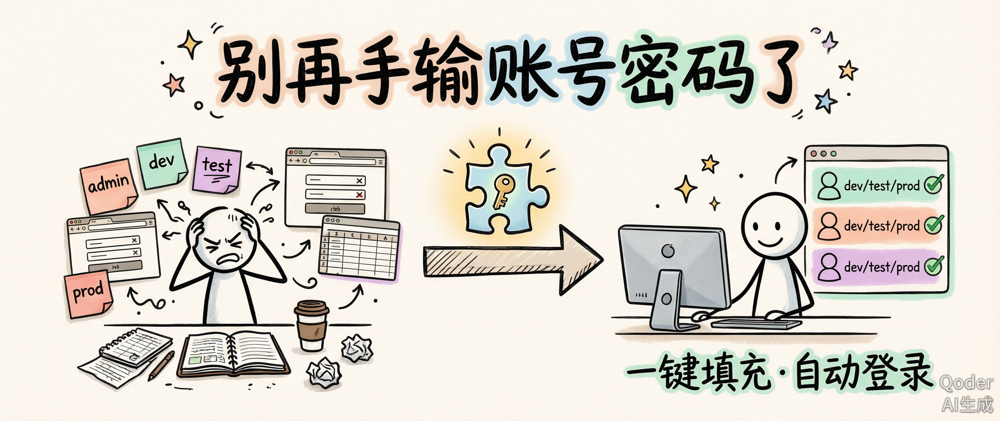
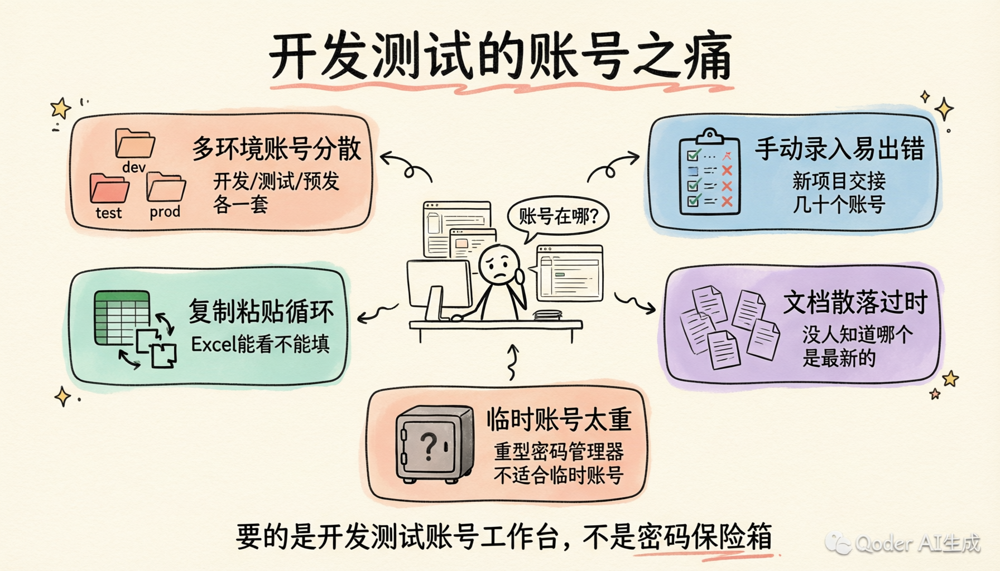
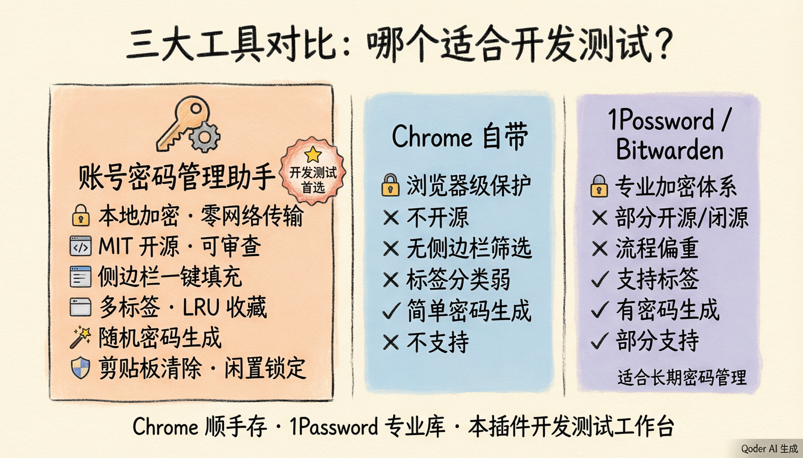
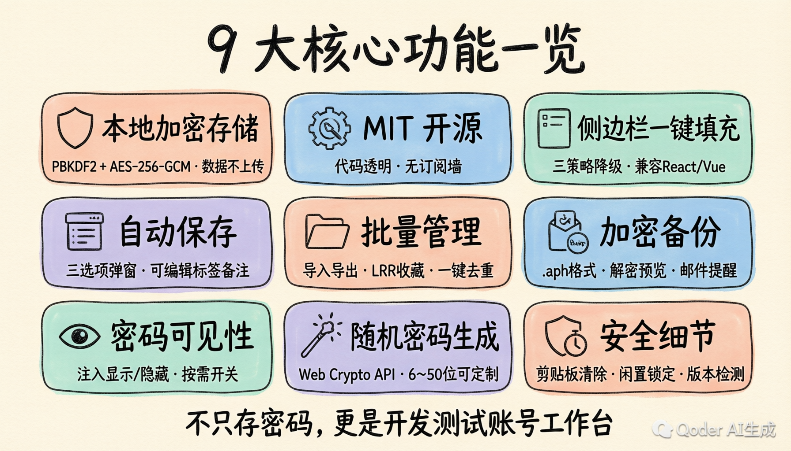
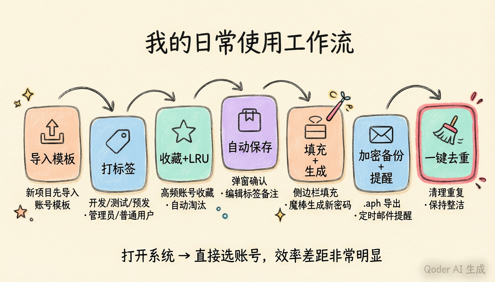

# 别再手输账号密码了：我开发了一款一键自动登录的插件

做开发久了，我发现一个特别真实的问题：很多时间不是浪费在写代码、测功能、看需求上，而是浪费在“找账号”上。

测试问我：“管理员账号是多少？”
产品问我：“有没有普通用户账号？”
联调、修复缺陷时我自己也在翻账号密码备忘录：开发环境一套，测试环境一套，预发布又一套；同一个系统还要区分管理员、运营、审核员、普通用户、异常用户；

账号越多，文档越乱；复制粘贴越频繁，输错一次还得重新来。它看起来只是小麻烦，但每天重复n次，真的很消耗耐心。

## 真正的痛点不是“存密码”，而是“快速找到并登录”

我以前也用过 Chrome 自带密码管理，也用过 Excel、飞书文档、备忘录。它们都能存账号，但解决不了开发测试场景里的几个问题：

- 同一个系统有多个账号，Chrome 很难按环境、角色快速筛选；
- 新项目交接时，几十个账号要手动录入，容易漏、容易错；
- Excel和备忘录 能看不能填，每次还是复制粘贴；
- 账号散落在不同文档里，过一段时间没人知道哪个是最新的；
- 临时测试账号生命周期短，放进重型密码管理器又显得太重。

所以我想要的不是一个“大而全”的密码保险箱，而是一个更贴近开发、测试、产品日常的小工具：**打开登录页，选账号，一键填充自动登录。**

这就是「账号密码管理助手」这个插件最想要解决的问题。



## 我为什么不用 Chrome 自带，或者 1Password？

不是它们不好，而是定位不同。

Chrome 自带密码管理适合个人常用网站，优点是浏览器原生、开箱即用。但它不太理解“测试账号”这个场景：没有项目/环境/角色标签，没有针对多账号的侧边栏筛选，也不适合批量维护一堆临时账号。

1Password、Bitwarden 这类主流密码管理工具更专业，适合个人长期密码、团队共享、跨设备同步、企业权限治理。但开发测试里很多账号只是临时的、内网的、角色验证用的，我并不想为了它们走一套复杂的云同步和团队管理流程，而且这些工具还需要付费。

我的插件更克制：**只解决本机安全、多账号、多系统、多环境的快速登录问题。**

| 能力             | 账号密码管理助手                                 | Chrome 自带          | 1Password / Bitwarden    |
| ---------------- | ------------------------------------------------ | -------------------- | ------------------------ |
| 账号数据传输     | 账号数据零网络传输，本地加密保存                 | 可跟随浏览器账号同步 | 通常依赖云同步或自建服务 |
| 加密方式         | PBKDF2 600000 次 + AES-256-GCM （企业级加密）    | 浏览器/系统级保护    | 专业加密体系             |
| 开源透明         | MIT 开源，可审查                                 | 不开源               | 部分开源/商业闭源        |
| 价格             | 免费                                             | 免费                 | 高级功能多为订阅制       |
| 多账号切换       | 侧边栏一键填充自动登录，域名优先匹配，可收藏置顶 | 多账号区分弱         | 可以管理，但流程偏重     |
| 标签分类         | 多标签、收藏（LRU 淘汰）、搜索、排序             | 较弱                 | 支持，但更偏通用保险库   |
| 批量导入导出     | CSV / JSON / .aph 加密备份（支持预览）           | 能力有限             | 支持，但迁移成本更高     |
| 自动保存账号密码 | 弹窗确认（保存/暂不/屏蔽）+ 可编辑标签备注       | 支持，但分类弱       | 支持                     |
| 随机密码生成     | Web Crypto API，可定制长度/字符集/易混淆排除     | 有，简单             | 有                       |
| 剪贴板自动清除   | 支持，延时可配置，清除前验证内容                 | 不支持               | 部分支持                 |
| 闲置自动锁定     | 支持，5/10/30/60 分钟可配                        | 不支持               | 部分支持                 |
| 适合场景         | 开发、测试、产品多账号/多系统登录                | 个人日常网站         | 长期密码、团队协作       |

简单说：Chrome 是"顺手存一下"，1Password 是"专业保险库"，而这个插件更像"开发测试账号工作台"。



## 这款插件9大核心功能



**第一，本地安全，账号数据不上传。**

- 账号密码保存在 Chrome 本地存储里，敏感字段（用户名、密码、URL、备注）全部加密存储，不做云同步。
- 插件会访问 GitHub Releases 检测新版本，但你的账号数据不会上传。
- 对办公内网系统、测试账号、演示账号来说，这个边界更清晰。
- 会话过期后，所有敏感字段自动加密回密文，只有重新验证主密码后才解密为明文缓存。

**第二，开源免费，代码透明。**

- 项目基于 MIT 协议开源，核心逻辑都能在 GitHub 上看到。
- 技术栈是现代前端开发者熟悉的组合：**WXT + Vue 3 + TypeScript + Element Plus**，完全拥抱 Chrome Manifest V3。
- 它不是黑盒工具，也没有订阅墙。
- 对开发者来说，能看代码本身就是一种安全感。

**第三，登录页侧边栏一键填充。**

- 打开登录页，点击账号或者密码输入框，会自动展示侧边栏，侧边栏会优先展示当前域名匹配的账号，可收藏置顶常用的账号。
- 点击目标账号即可填充账号密码，必要时还能自动触发登录（可配置）。
- 为了兼容 React、Vue 这类受控输入框，填充时做了三重策略自动降级：**Native Setter → execCommand → 模拟键盘事件**，确保主流框架都能正确响应。
- 悬浮按钮使用 **Closed Shadow DOM** 完全隔离页面样式，无论目标页面的 CSS 多复杂，按钮外观都不会受影响。
- 快捷键也安排上了：`Ctrl+Shift+P`（Mac 上 `Cmd+Shift+P`）打开密码管理页，`Ctrl+Shift+L`（Mac 上 `Cmd+Shift+L`）显示/隐藏侧边栏，还支持在 `chrome://extensions/shortcuts` 自定义。
- 本地开发时（localhost / 127.0.0.1），侧边栏会默认展示所有密码，方便多项目联调时快速切换账号，不用手动匹配域名。

**第四，支持自动保存账号密码。**

- 这个功能解决了"不想手动录入"的问题，点击登录后插件会弹出确认卡片，提供三个选项：「保存」直接写入密码列表，「暂不保存」跳过本次且 60 秒内相同凭证不再打扰，「不再提示」一键将该域名加入屏蔽黑名单。域名匹配规则支持精确域名和正则表达式两种模式，规则为空时匹配所有域名，灵活度很高。
- 保存前还可以编辑标签和备注，标签默认取页面标题，备注默认为"自动保存"。
- 同域名同账号登录时，插件会智能更新密码并保留原有的标签和备注（除非手动修改），对频繁新增和修改测试账号的人来说，非常省事。
- 凭证捕获覆盖了三种常见场景：表单提交（capture 阶段拦截）、登录按钮点击、密码框回车提交，基本涵盖了所有登录交互方式。
- 使用 `sessionStorage` 暂存凭证，即使登录提交导致跨页面导航，凭证也不会丢失，保存弹窗依然正常弹出。
- 智能防重复机制基于凭证指纹（用户名 + 密码长度）去重：已保存的凭证不会重复弹窗，点击「暂不保存」后 60 秒冷却期内相同凭证也不会重复打扰，避免重试登录时被反复骚扰。

**第五，批量管理能力完整。**

- CSV / JSON 导入导出、标签多选、收藏、只看收藏、搜索、排序、一键去重都有。
- CSV 导入时自动识别 Chrome、LastPass、Bitwarden、1Password 等主流密码管理器的导出格式，字段自动映射，迁移成本很低。只需从对应工具导出 CSV，直接导入即可。
- 收藏支持上限配置（默认 10 条，可调 1~50），超过上限时自动按最近最少使用（LRU）淘汰，确保常用账号始终置顶。被淘汰的条目只是取消收藏标记，密码数据不受影响。
- 一键去重特别实用：项目账号来回导入几次后，经常会出现重复记录（相同用户名 + 相同 URL），手动删除太繁琐，一键清理更省心，且已收藏的条目不会被误删。
- 支持多字段模糊搜索（用户名、标签、备注、URL）和点击表头切换升降序，账号多了也能快速定位。
- 批量选择与批量删除，大规模维护账号时效率拉满。

**第六，加密备份更安全更可靠。**

- 插件支持 `.aph` 加密备份文件（PBKDF2 600000 次迭代 + AES-256-GCM），导入时需要输入主密码进行解密，解密后可以预览前 5 条再确认，避免误操作。
- 也支持唤起邮箱客户端做备份归档，可以配置定时自动提醒（每天/每3天/每周/每两周/每月），到时间了桌面通知提醒手动备份。
- 我更建议把加密备份文件保存到安全位置，必要时再通过邮箱留档。

**第七，密码可见性也能按需开启。**

有些登录页面经常要确认密码是否填对，但是密码输入框没有自带的密码显示/隐藏切换功能，插件支持为页面密码框注入显示/隐藏切换按钮，默认关闭，需要时再打开，不会强行干扰页面。即使页面动态新增密码输入框（比如 SPA 路由切换后出现的新表单），`MutationObserver` 也会自动检测并注入切换按钮，无需手动刷新。

**第八，随机密码一键生成。**

- 添加或编辑密码时，输入框旁有个魔棒按钮，点击即可打开密码生成器。
- 可以自定义长度（6~50）、选择包含的字符集（大写/小写/数字/特殊字符），还能排除易混淆字符（1/l/I/0/O）。
- 生成后实时显示密码强度进度条，点击「使用此密码」即可填入。
- 底层基于 **Web Crypto API（crypto.getRandomValues）**，保证密码学级别随机性。

**第九，剪贴板安全、闲时自动锁定与更多贴心细节。**

- 复制密码后自动定时清除剪贴板，延时可选 10/15/30/60/120 秒，清除前会通过 `Async Clipboard API` 验证内容是否被用户替换，避免误清；侧边栏失焦无法读取时降级为「尽力清除」策略，宁可多清不漏清。复制用户名时自动取消密码清除定时器，避免误操作。
- 支持配置闲置自动锁定（5/10/30/60 分钟），系统检测到设定时间内无操作后自动清除主密码会话，防止离开电脑时密码列表被他人查看。Popup 弹窗也提供一键「锁定」按钮。
- 主密码会话有效期支持 1/2/4/8/12/24 小时和 3/5/7 天可选，`SessionManager` 每分钟检查会话有效性，页面可见性变化时也会触发检查，过期后敏感字段自动加密回密文。
- 版本更新检测基于 `GitHub Releases API`每 6 小时自动检查，发现新版本时在 Popup 弹窗中提示版本号和更新说明，点击即可跳转下载页。检测结果缓存 24 小时，避免频繁请求。
- 密码输入时还有实时强度可视化——进度条加规则校验清单（长度、字母、数字、特殊字符），通过气泡弹窗直观呈现，一眼看清安全性。
- 智能表单识别不只是找输入框：`MutationObserver` 动态检测登录表单，`LoginFormAnalyzer` 通过表单结构、容器属性、弹窗特征、按钮文案等多维启发式分析，支持用户名+密码、手机号+验证码等多种登录场景，还能自动勾选"记住密码"和"同意条款"等复选框。

and so on, 还有更多隐藏实用的细节需要你来探索发现。

## 技术架构：给同行开发者一个交代

做开源项目，光说功能不够，技术同行还想知道"这东西是怎么搭的"。

插件基于 **WXT + Vue 3 + TypeScript + Element Plus** 构建，完全拥抱 `Manifest V3`。选 WXT 是因为它让 Chrome 扩展开发体验接近标准前端项目——HMR 热更新、多入口点管理、自动 manifest 生成，不用再手动折腾配置文件。

架构上分为五个核心入口点：

- **Background Service Worker**：消息路由中心，负责密码缓存、会话管理、侧边栏状态同步、快捷键处理；
- **Content Script**：注入所有页面，初始化表单检测（LoginFormAnalyzer）与填充引擎（InputFiller），以及悬浮按钮系统；
- **Popup**：扩展图标弹窗，提供「密码管理」和「快速填充」快捷入口，同时展示版本更新提示；
- **Options**：密码管理主页面，完整 CRUD、导入导出、会话与有效期管理；
- **SidePanel**：侧边栏快速填充，通过 `chrome.runtime.connect()` 建立长连接 Port，支持搜索、排序、域名匹配、缓存加速。

加密方案是整个项目的安全基石：

```
主密码 + 盐值 → PBKDF2 (600000 次迭代) → 256-bit 密钥
明文 + 密钥 + 随机 IV → AES-256-GCM → Base64(IV + 密文)
```

所有加密操作基于浏览器原生的 `Web Crypto API` 实现，不依赖第三方加密库。敏感字段（username、password、url、remark）加密存储，空字段不参与加密，解密失败时安全降级返回原始数据。内存中的主密码副本还额外使用 `HKDF + SHA-256` 派生会话密钥，通过 `AES-256-GCM` 二次加密后再存入 `chrome.storage.local`。

通信层面，Background 作为消息路由中心处理跨组件通信：`SidePanel` 通过 Port 长连接实现可靠状态追踪，`Content Script` 和其他页面通过 `sendMessage` 短消息交互。`WeakMap / WeakSet` 缓存字段判断结果，避免内存泄漏。

## 我现在最常用的工作流

我的习惯是：

1. 新项目先导入账号模板；
2. 按「开发 / 测试 / 预发」和「管理员 / 普通用户 / 审核员」打标签；
3. 高频账号点收藏置顶，有 LRU（最近最少使用） 淘汰不怕收藏满；
4. 新增测试账号时自动保存弹窗确认，顺手编辑标签和备注；
5. 登录页面直接用侧边栏一键填充并自动登录，需要新密码就用魔棒生成器；
6. 定期导出加密备份，配上定时邮件提醒不遗漏；
7. 发现重复账号，一键去重。

以前是"先找账号，再登录系统"；现在是"打开系统，直接选账号"。这个变化听起来不大，但在多角色验收、多账号回归测试、多环境联调时，效率差距非常明显。



## 适合谁用？

如果你是开发，经常在本地、测试、预发之间切账号，它很适合你。

如果你是测试，经常验证不同角色权限、批量维护测试账号，它会非常省时间。

如果你是产品，经常拿演示账号、验收账号、客户模拟账号看功能，它也能减少很多重复操作。

**一句话：只要你有多账号、多系统、多环境登录场景，就能用得上。**

## 快速上手：三步开始用

**第一步，安装插件。**

从 [GitHub Releases](https://github.com/liaolongdong/account-password-helper/releases) 下载最新版本的 zip 包，解压到你想放的目录。打开 `chrome://extensions/`，开启「开发者模式」，点击「加载已解压的扩展程序」，选择解压后的 `account-password-helper` 文件夹即可。

> 更新版本时，只需将新文件覆盖到原安装目录，**切勿**重新选择其他目录加载——Chrome 会把新目录视为全新安装，导致原有密码数据无法访问。如何确认当前安装目录？在扩展详情页底部查看「来源：/path/to/directory」。

**第二步，设置主密码。**

首次使用会引导你设置主密码，至少 8 位，必须包含字母、数字和特殊字符。这个主密码是解锁所有密码数据的唯一钥匙——**忘了就找不回来**，只能通过「重置」清空数据重新设置。建议记在安全的地方。

**第三步，配置偏好。**

在密码管理页点击「偏好设置」，可以调整悬浮按钮显示/隐藏、自动展示侧边栏、自动触发登录、密码可见性切换、悬浮按钮透明度设置等。也可以直接导入一批账号数据开始用——CSV 导入支持下载标准模板，照着填就行。

也支持 Firefox，通过 `pnpm build:firefox` 构建即可。

## 最后，说句实在的

我做这个插件，不是因为市面上没有密码管理工具，而是因为很多工具并不理解开发测试的日常。

我们需要的不是每次都打开文档找账号，也不是把一堆临时账号塞进复杂系统，而是一个轻量、顺手、安全边界清晰的小工具。

如果你也经常被“账号在哪、密码多少、这个角色能不能登录”折腾，可以试试它。

项目地址：https://github.com/liaolongdong/account-password-helper  
在线演示：https://liaolongdong.github.io/account-password-helper/

> 安全提醒：
>
> - 本插件仅用于开发和测试环境，**严禁保存生产环境或个人敏感密码**（如银行、支付、社交核心密码）；
> - 主密码遗忘**无法恢复**，请务必牢记并妥善保管；
> - 所有数据本地 AES-256-GCM 加密存储，零网络传输；
> - 建议定期通过加密备份功能（.aph 文件）导出备份；
> - 建议开启剪贴板自动清除功能，复制密码更安心；
> - 建议配置闲置自动锁定，离开电脑时自动保护密码列表。
