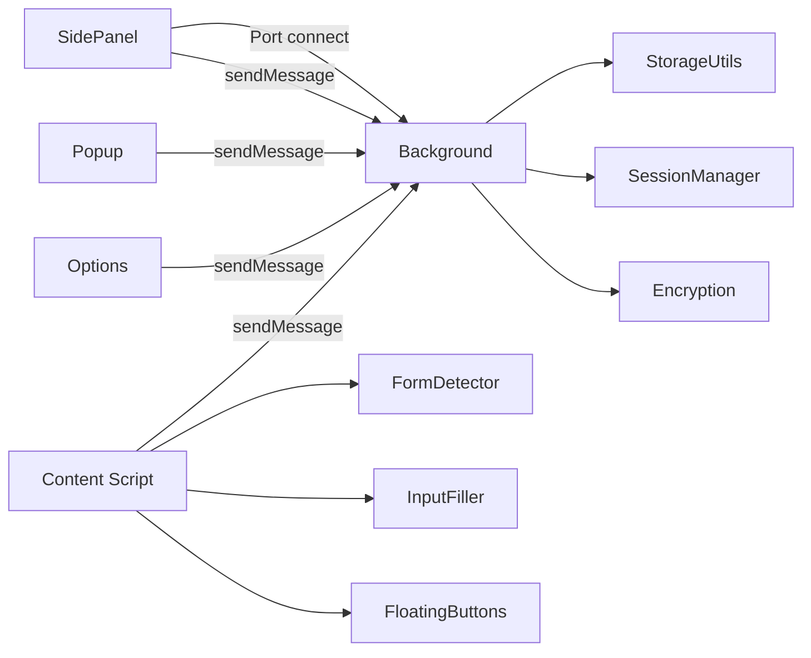
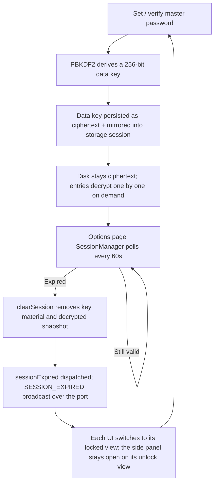

# Architecture & Implementation Details

[中文](./ARCHITECTURE.md) | **English** · [Back to README](../README.en.md)

This document targets developers and contributors, covering the architecture design, full project structure, and per-feature implementation details of Account Password Helper. For user-facing installation and usage, see the [README](../README.en.md).

## Table of Contents

- [Architecture](#architecture)
  - [Entrypoints](#entrypoints)
  - [Messaging & Data Flow](#messaging--data-flow)
  - [Content Script Runtime Constraints](#content-script-runtime-constraints)
  - [Session Lifecycle](#session-lifecycle)
  - [Encryption Scheme](#encryption-scheme)
- [Project Structure](#project-structure)
- [Feature Implementation Details](#feature-implementation-details)
- [Development Extras](#development-extras)

## Architecture

### Entrypoints

| Entrypoint         | Responsibility                                                                                                                                                                                                                                                                                                  |
| ------------------ | --------------------------------------------------------------------------------------------------------------------------------------------------------------------------------------------------------------------------------------------------------------------------------------------------------------- |
| **Background**     | Service worker: message routing (discriminated unions), password cache (domain-agnostic), side panel state (port tracking), shortcuts; background submodules: router / cache / side panel / options page / auto-save / quick fill / context menu / inline dropdown / quick add / services (keep-alive + alarms) |
| **Content Script** | Injected into all pages; initializes form detection and the floating button                                                                                                                                                                                                                                     |
| **Popup**          | Extension icon popup with "Manage Passwords" and "Quick Fill" entries                                                                                                                                                                                                                                           |
| **Options**        | Main manager page: full CRUD, import/export, session/validity management, spotlight guided tour                                                                                                                                                                                                                 |
| **SidePanel**      | Quick fill panel with pinyin smart search and match highlighting, sorting, domain matching (This-site / All-entries scope), cache acceleration, in-place quick add                                                                                                                                              |

### Messaging & Data Flow



- Background is the message routing hub for cross-component communication; message types are discriminated unions (`MessageType` in `utils/types.ts`)
- SidePanel opens a port via `chrome.runtime.connect({ name: 'sidepanel' })`, used for the open/ready handshake, the lock broadcast, and liveness tracking through a 25-second heartbeat
- SidePanel request/response operations (filling, cache updates, quick add, opening the options page) still go through `chrome.runtime.sendMessage()`
- Content scripts, Popup and Options communicate via `chrome.runtime.sendMessage()`

### Content Script Runtime Constraints

- **Injection scope**: [entrypoints/content.ts](../entrypoints/content.ts) declares `matches: ['<all_urls>']` with `allFrames: true`. Form detection and the auto-save listener initialize in **every frame** (login forms inside iframes must still be detected and captured), while the floating button, the save prompt, and delegated notifications render only in the **top frame** — otherwise every iframe would inject a duplicate, with broken positioning.
- **Style isolation**: two tiers, described as implemented. ① **Closed Shadow DOM** (reset with `all: initial`, themed by **inline** `--aph-*` tokens, stacked at `z-index 2147483647`, shadow root references never exposed): the floating button, the inline fill panel, the TOTP capsule, the fill-failure guidance bubble and the save-password prompt (its host hangs off `documentElement`, `data-aph="save-password-prompt"` being the only handle to locate the node from outside the shadow tree; its keyframes live inside the shadow scope, so no stylesheet reaches `document.head`). ② **light DOM** (nodes appended straight to the page, scoping relying on extension-owned class names, theme tokens written inline on the element itself): the password visibility toggle (a stylesheet injected once into `document.head` keyed by element id) and the native notification bar (no stylesheet at all, everything inlined via `cssText`, **fixed colors that do not follow the theme**). Neither tier may depend on page globals, and neither may render untrusted DOM/message text through `innerHTML`/`v-html`.
- **Plaintext boundary across frames**: credentials captured inside an iframe are delegated to the top frame for rendering through `window.top.postMessage`; the result is sent back with `targetOrigin` pinned to the sender's origin. Save-prompt delegation must first pass `isSameMainDomain(event.origin, location.origin)`, so a cross-origin iframe can never leak a plaintext password to a third-party page. Notification delegation **no longer uses postMessage**: an enum value like `APH_SHOW_NOTIFICATION` is a string anyone can read out of the published package, so a single page-script `postMessage` could impersonate the extension and render arbitrary text in the top-right corner of the whole page (a phishing shape). The content script now sends `MessageType.DELEGATE_PAGE_NOTICE` to the background, which checks `sender.id === chrome.runtime.id` plus the presence of `sender.tab.id` (the browser stamps the sender, and the page world cannot emit runtime messages at all) and forwards it with `tabs.sendMessage({ frameId: 0 })` to the top frame of the initiating tab; the tab id is derived from `sender` only and self-reported values are never accepted. When the background reports the notice was not delivered (e.g. no content script in the top frame yet), the caller renders it in its own frame, so a notice is never dropped silently. The same rule applies in reverse — plaintext credentials are only delivered to the top frame or same-main-domain frames (`isFrameFillable`).
- **Listener lifecycle**: every DOM listener is registered through WXT's `ctx.addEventListener` (removed automatically when the extension context invalidates), and `ctx.onInvalidated` plus `beforeunload` run a shared `cleanup()` that tears down the listeners, MutationObservers, and injected UI of FormDetector / LoginAutoSave / the floating button manager. This is the root-cause fix for stale scripts calling chrome APIs after a reload and throwing `Extension context invalidated`; new listeners must not bypass it.
- **Detection cadence**: the first scan runs 3 seconds after `DOMContentLoaded` (500ms when the document is already loaded), and the MutationObserver debounces re-scans at 500ms over `document.body` with `childList + subtree + attributes(class/style/placeholder)`. SPA route changes are folded into the same observer instead of a second one, and `popstate` only covers back/forward. Before filling, `waitForFieldsDetected()` retries up to 10 times with a 100ms start, 1.5× backoff, capped at 2000ms; moments that can trigger a re-render, such as `blur`, use the event-driven `waitForDomStable(quietMs=50, budgetMs=300)` to wait for DOM quiet instead of a fixed sleep.
- **Fill-readiness gate**: one place answers "is this page worth attempting to fill" — `hasFillableLoginForm` in [FormDetector.ts](../entrypoints/content/FormDetector.ts) — and both the fill entry point and `waitForFieldsDetected()` read it. It holds when a username or password field exists, plus **only** the combination "mobile field + verification-code field" (the shape of domestic SMS sign-in pages, the same combination the floating buttons already use in `shouldShowSidePanel`). A lone mobile field deliberately does **not** count: search boxes, registration forms and shipping-address pages all match `input[type="tel"]`, so admitting a single field would classify those pages as login pages. When that combination holds but the page has no username field, the entry's `username` falls back into the mobile field — the phone number is already stored in `username`, so neither the storage layout nor the encryption format changes. It does not fall back when the page has a password field, because that is an account-and-password form where the other `tel` input is normally "bind your phone / SMS recovery". The fallback carries `username` only; a password never looks for anything but a password field, and a password with nowhere to go is reported honestly as `unverified` ("please verify"). Be precise about coverage: `USERNAME_SELECTORS` and `MOBILE_SELECTORS` overlap heavily on the `text` type and on the placeholder / autocomplete groups, and detection runs username first (the mobile pass excludes fields already in the username set), so the most common markings — `type="text"[name*="mobile"]`, `type="tel"[placeholder*="手机号"]` — land in the **username** bucket and leave `mobileFields` empty. On those pages readiness and field placement are decided by the pre-existing username branch; the combination gate and the mobile fallback only participate for a field that matches the mobile selectors without being claimed by the username selectors (e.g. `type="tel"` with a `联系电话` placeholder, `autocomplete="mobile"`). Either shape ends up writing the entry's `username` into the phone box — the difference is which bucket does it.
- **Pre-warming**: `preWarmServiceWorker()` fires from three places — `focusin` on form inputs, `visibilitychange` in the top frame, and 100ms after initialization — waking the SW in parallel with the user's action so the subsequent `sidePanel.open()` pays no cold start (see "Side Panel Instant-Open: Cross-Platform Strategy").

### Session Lifecycle



- The session checker in `sessionManager.ts` starts only on the Options page via `initSessionManager()` (`window.setInterval`, 60 seconds, firing an expiry event only on a valid→invalid transition so opening the page with no session never raises a false alarm). SidePanel and Popup do not wait for that poll: they react immediately to the port's `SESSION_EXPIRED` broadcast, `chrome.storage.onChanged`, and `visibilitychange`.
- `isSessionValid()` results are cached with a 5-second TTL (`sessionManager-storage.ts`), and lock/rekey/clear-session points invalidate that cache proactively, so hot paths don't hit storage repeatedly.
- Session validity defaults to **24 hours**, selectable across 1/2/4/8/12/24 hours and 3/5/7 days (see [ValidityHoursSelect.vue](../components/options/ValidityHoursSelect.vue)).
- Expiry, idle lock, and manual lock all funnel through the same `clearSession()` (the manager header's "Lock Now" button is that manual path, sharing one `handleClearSession` with "Clear session" in the validity dialog rather than inventing a second locking routine): it removes key material, the decrypted snapshot, the CryptoKey handle cache, and the two derived memo caches **keyed by plaintext entry fields** (pinyin match ranges, tag presentation records) from memory and `storage.session`. Entries on disk are already ciphertext — **there is no "bulk decrypt to plaintext" step and no "bulk re-encrypt on expiry" step**.
- Those two caches are module-level `Map`s, so they only exist in the contexts that actually loaded the module, and each context wires its own cleanup trigger (a registry in `utils/plaintextCacheCleanup.ts` plus one call site per context): Background on `clearSession()` and `resetSessionMemoryState()` (the latter driven by the storage-change listener); SidePanel on both its lock and expiry paths in `useSidepanelData.ts`; Options on a `flush: 'sync'` watcher of `isAuthenticated` turning false — the options page can stay open for days, and on a cross-context lock it only flips that flag (`clearSession()` already ran elsewhere), so hooking only the `onSessionExpired` callback would miss the other four transition paths such as the `checkAuth` self-check. Popup and content script never write these caches (the inline dropdown uses pure helpers like `getTagColor`/`parseTags`, and the pinyin matcher is never warmed there), so they need no wiring. [plaintextCacheCleanupWiring.test.ts](../tests/architecture/plaintextCacheCleanupWiring.test.ts) guards this invariant via dependency closures.
- The idle lock (`chrome.idle`) and the browser-restart lock are **two opt-in switches that default to off** (`idleLockMinutes: 0`, `relockOnBrowserRestart: false`).
- **"Stay signed in" means "decryptable on this device right now"**: while a session is valid, `session_wrapped_data_key` and `session_wrap_key` both sit in `storage.local` — that pairing is exactly what lets the extension restore the session after a browser restart (see the session-key bullet under "Encryption Scheme"). Anything able to read that browser profile can decrypt the vault during that window, whether or not individual fields are ciphertext. Locking, expiry and `clearSession()` remove `WRAPPED_DATA_KEY` (`sessionManager-storage.ts:801-809`), leaving behind a random wrap key that unlocks nothing on its own. The recommendation for shared machines is therefore to turn on "Lock on browser restart": the startup barrier runs `clearSession()`, so the key material no longer lives on disk across browser shutdowns. The same disclosure appears in `privacy.html` ("Data Storage"), in the restart-lock hint inside the options page's "Auto lock settings" dialog, and in the sidepanel help entry, rather than in one place only.

### Encryption Scheme

```
Salt: 16 random bytes → 32 hex chars, stored in plaintext under master_password_config
Master password + salt → PBKDF2-SHA256, 600,000 iterations → 256-bit data key
Plaintext + data key + a fresh random 12-byte IV per call → AES-256-GCM → Base64(IV[12B] ‖ ciphertext ‖ auth tag[16B])
```

- Encrypted sensitive fields: `username`, `password`, `url`, `remark`, `totp`. Metadata such as `id`, `tag`, `createTime`, `updateTime`, `order`, `favorite`, and `lastUsedAt` stays in plaintext so sorting and filtering work without decryption.
- **One plaintext exception: the reminder table's username.** `password_reminders` redundantly stores each entry's `username` (code-point-truncated to `PASSWORD_FIELD_LIMITS.username`, see [reminderManager.ts](../utils/storage/reminderManager.ts)) because expiry notifications fire from `chrome.alarms` at any moment — including while locked — and dropping it would degrade the notice to a generic line that names no account. What it additionally leaks is _which_ account is about to expire and _when_; measured against the "stay signed in = decryptable on this device" surface above it opens no new door, but it is still plaintext that has to be disclosed. Removing that reminder, deleting the entry, or emptying the trash clears it along with the reminder record.
- Empty fields are not encrypted (written as empty strings). A Base64 parse failure degrades safely by returning the original data; a GCM decryption failure throws and lets the caller decide — the auth tag makes tampering detectable, with no silent fallback.
- **The master password is never persisted.** On disk there is only a verifier hash: `deriveVerifierHash` uses the same PBKDF2-SHA256 / 600,000 iterations but domain-separates the salt with the `aph-verify|` prefix, so the verifier and the decryption key are cryptographically independent and the stored verifier cannot be turned back into a key. Comparison runs in constant time. Legacy single-round SHA-256 verifiers are upgraded transparently on successful verification.
- **A second deliberate plaintext: `master_password_config.hint`.** When setting the master password you may leave a hint; it is trimmed and truncated to 120 code points and stored **in plain text** on the same config object. Plain text is a structural constraint, not an oversight: the hint exists precisely so it can still be read _after_ the master password is forgotten, so encrypting it with that password would create a "needed only when forgotten, useless once forgotten" deadlock. It takes no part in key derivation (`deriveVerifierHash` sees only the password and the salt); a legacy config without the field reads back as "no hint", so no migration is required. The unlock screen reveals it only after `MAX_FAIL_BEFORE_HINT` consecutive wrong attempts (defined in [useAuthFlow.ts](../composables/useAuthFlow.ts), the same threshold the sensitive-action verification dialog uses) and only on the Options page — the side panel opens over arbitrary sites, so putting a plaintext hint there would widen the shoulder-surfing and screen-recording surface. A hint is **not a security question or unlock credential**. The master password itself cannot be retrieved; optional offline recovery uses a separate high-entropy key path.
- **Session key**: the derived data key is wrapped with a freshly generated random wrap key (`session_wrap_key`) using AES-256-GCM and stored as `session_wrapped_data_key`. Both are committed together in one `chrome.storage.local.set()` to avoid pairing "A's wrap key with B's ciphertext", without treating that API as a general ACID transaction. The plaintext data key is mirrored in `storage.session` (memory only, cleared when the browser closes); a new key is published only after its matching local commit.
- **Distinguish the two HKDF paths**: `deriveSessionKey(salt)` (HKDF-SHA256, salt `aph-session-salt`, info `session-encryption-v2`) only unwraps the legacy `session_master_password` blob. That public salt offers no confidentiality against disk access and is not used in the current session flow. Optional offline recovery instead derives a non-exportable KEK from a separate 32-random-byte secret R through domain-separated HKDF-SHA256. R/KEK are not persisted; wrapped DK is bound to the current master-password configuration through AAD. See "Feature Implementation Details → Optional offline recovery of the local vault".
- `ensurePasswordsEncryptedAtRest` maintains the "ciphertext at rest" invariant idempotently within each SW lifetime, with a storage watcher as a backstop that flags plaintext anomalies.

## Project Structure

See the annotated tree in the Chinese version: [ARCHITECTURE.md — 项目结构](./ARCHITECTURE.md#项目结构) — paths and file names are identical. Top-level layout:

```
├── entrypoints/        # WXT entrypoints: background/, content/, popup/, options/, sidepanel/
├── components/         # Vue components (options/ and sidepanel/ subfolders)
├── composables/        # Vue composables (auth, session, side panel, TOTP, shortcuts...)
├── utils/              # Core library: storage/, i18n/, encryption, session, backup, health...
├── assets/             # Source SVG icons and CSS design tokens
├── public/icon/        # Build-time PNG icons (auto-injected into the manifest by WXT)
├── scripts/            # Icon generation and repo automation scripts
└── wxt.config.ts       # WXT configuration
```

## Feature Implementation Details

### 1. Security

- Master password requires at least 8 characters including letters, digits, and special characters.
- After unlocking, entries decrypt one by one into memory (the SW password cache / the encrypted `storage.session` snapshot) while `storage.local` stays ciphertext throughout; session expiry only clears the key material and the decrypted snapshot — no bulk re-encryption ever happens.
- Inconsistent encryption states are detected and repaired automatically after session recovery.
- The 60-second poll in `sessionManager.ts` starts **only on the Options page** (`initSessionManager()`) and fires an expiry event only on a valid→invalid transition; SidePanel and Popup don't wait for it — [useStorageWatcher.ts](../composables/useStorageWatcher.ts) re-runs the auth check on `visibilitychange`. See "Session Lifecycle".
- **Live Caps Lock warning**: every master-password field (first-time setup, the unlock verification view, the verification dialog, master password change, encrypted-backup import) reads the modifier state via `KeyboardEvent.getModifierState('CapsLock')` on keydown/keyup (see [useCapsLockDetection.ts](../composables/useCapsLockDetection.ts)) and shows an amber warning line below the input (see [CapsLockHint.vue](../components/CapsLockHint.vue)), so a stray Caps Lock is never mistaken for a "wrong password". The hint uses `role="status"` for non-interruptive screen-reader announcements and resets on blur, leaving no stale warning behind.
- **Password hint**: an optional sentence saved alongside the master password (`master_password_config.hint`, plain text, capped at 120 code points — see `MAX_MASTER_PASSWORD_HINT_LENGTH` in [masterPassword.ts](../utils/storage/masterPassword.ts)). After `MAX_FAIL_BEFORE_HINT` consecutive wrong attempts it appears under the error line on the unlock screen; the "reset all data" entry no longer wipes directly — it opens the recovery wizard first.
- **Forgot-password wizard** ([ForgotPasswordDialog.vue](../components/options/ForgotPasswordDialog.vue)): a hint is only a memory aid, not a security question. A matching recovery key enabled in advance can recover the current local vault (below). The backup route offers **read-only verification** of `.aph` / `.aphid`, without writing to or clearing the current vault, using that file's export-time master password. Verify first, then recommend importing on another device or in a separate browser profile to check the result; only afterward consider a reset with its second confirmation — never wipe first and test later. Plaintext CSV/JSON exports are another data source. Without a usable recovery key, decryptable backup or plaintext export, the data remains unrecoverable. Backups restore export-time snapshots only: password import appends without deduplication, personal info needs its separate `.aphid`, and trash/history are not included. If the export-time password is the same one now forgotten, the old backup cannot be opened either.

#### Optional offline recovery of the local vault

- **Activation contract**: off by default, no automatic migration. "Security Settings → Offline Recovery Key" requires the current master password to create, replace or disable recovery. Creation/replacement prepares pending material and activates it only after the user saves and re-enters the `.aphrecovery` kit for verification. Recovery cannot be added after a vault is already locked out.
- **Keys and persistence** ([utils/recoveryCrypto.ts](../utils/recoveryCrypto.ts), [utils/storage/recovery.ts](../utils/storage/recovery.ts)): recovery key R is 32 random bytes from `crypto.getRandomValues`. Domain-separated HKDF-SHA256 derives a non-exportable AES-GCM wrapping key KEK; the current master-password configuration is AAD binding the wrapped data key DK. Recovery persists only wrapped DK and non-sensitive metadata, never R or KEK, nor the master password as plaintext or reversible ciphertext. This differs from the session mechanism that keeps material for password-free restarts; locking/expiry does not remove an enabled recovery envelope.
- **Kit boundary**: `.aphrecovery` is unencrypted plaintext and contains only the recovery key and format metadata such as kit id/version/time, not the vault. The download button stays disabled until the user explicitly acknowledges this. R plus its matching envelope/ciphertext permits recovery, so treat it as a sensitive credential. Creating, replacing or disabling recovery is not a backup. If data/the browser profile is lost, R alone is useless; a matching data backup is still needed. `.aph` / `.aphid` formats are unchanged and do not accept R instead of the export-time master password.
- **Recovery order**: enter R or import the kit on the lock screen → set a new master password → save and verify a replacement kit → check decryption and re-encrypt the five current local domains (passwords, password trash, password history, personal info, personal info trash) → commit matching configuration, ciphertext and recovery envelope → remain locked until the user unlocks with the new master password. By default, any undecryptable data blocks in-place recovery and nothing is changed. Only after such an abort, and only with explicit informed consent, can the rest be recovered; those records stay in the vault as-is, remain unreadable under the new master password, and are omitted from lists and backups. Password changes use `UNDECRYPTABLE_RECORDS` for the same condition; malformed containers raise `VAULT_DATA_CORRUPTED` so the UI never offers a skip gate that cannot succeed.
- **Rekey and revocation limits**: ordinary password changes with recovery enabled also require saving and verifying a replacement kit first; disabled recovery keeps the original interaction. Once the new kit takes effect, old R no longer works at the current local entry point. Replacing/disabling cannot revoke an attacker's old R plus old envelope/ciphertext; suspected exposure requires a master-password change to rotate DK, without promising to recall historical copies. See section 20 for write isolation and session-publication order.
- **Privacy and acceptance boundary**: recovery adds no requests, permissions or telemetry; the extension's existing anonymous version check remains. This describes the implementation contract for this change. Crash/concurrency and end-to-end acceptance must run against the final implementation; historical reports and this text are not evidence that the new tests passed.

### 2. Form Detection & Filling

- Detects username, password, phone, and verification-code fields. After filling it checks **the single best-scoring checkbox**, where the score combines distance to the reference field, label keywords, position, form ownership, and DOM hierarchy: labels matching `CHECKBOX_POSITIVE_KEYWORDS` (记住 / remember / 同意 / agree / 自动登录 / auto / 服务条款 / terms / privacy…) score up, while `CHECKBOX_NEGATIVE_KEYWORDS` (发送 / subscribe / newsletter / notification / 广告 / marketing / ads…) score down, so marketing opt-ins are never ticked by accident (see [CheckboxHandler.ts](../entrypoints/content/CheckboxHandler.ts) / [formSelectors.ts](../entrypoints/content/formSelectors.ts)).
- Checkboxes come in two carrier shapes: the native `input[type=checkbox]` (including the custom-styled "hidden input + visible associated label" form), and the `<button role="checkbox">` simulated checkbox from modern component libraries (Radix/shadcn style — e.g. the agreement checkbox in Doubao's login dialog). The checked state is read from `aria-checked`; ticking issues **exactly one programmatic click** and lets the page write the state back itself — a controlled component has no `checked` to force, self-assigning the attribute would only fake the state, and a blind second click would toggle the just-checked box back off, so a failed write is warned about, never retried, and duplicate clicks inside the write-back window are deduplicated. Candidates exclude elements without `aria-checked`, disabled or invisible ones, and carriers that would submit a form or navigate — a `button` inside a `form` without an explicit `type="button"` (default submit type) or an `a[href]` (see `isDetectableAriaCheckbox`). The reference-field chain is password → username → mobile, so phone + verification-code login pages also have a fallback anchor.
- WeakMap / WeakSet caches field classification results to avoid memory leaks.
- When a bucket holds several candidates, **which box gets written is decided by pairing the value with the semantics the field itself declares**, not by document order (see `pickAccountField` / `pickPasswordField` in [FormDetector.ts](../entrypoints/content/FormDetector.ts)): `USERNAME_SELECTORS` pulls `[name*="email"]`, `[name*="mobile"]` and `[name*="user"]` into one account bucket, so on a "phone number or email" login page an email entry can land in the phone box; and entries like `name*="otp"` in `VERIFY_CODE_SELECTORS` carry no type constraint, so a masked one-time-code box also lands in the password bucket and the stored password can be written into it — exactly the shape of online banking and brokerage login pages. The ranking **only reorders candidates, it never drops one**: an email-shaped value promotes email boxes, a mainland-China mobile number or a `+`-prefixed international number promotes phone boxes, and with a single candidate, an ambiguous value, or no matching box the result is byte-for-byte the first visible field. A box that matches both keyword sets counts as generic and does not claim priority. The same rule covers codes: a TOTP is written to a visible box first, falling back to the first entry when none is visible, which keeps the "visible grid plus hidden real input" six-box components working.
- Fill strategy degrades automatically: **Native Setter → execCommand → simulated keyboard events**, and each level reads the field value back ~50ms later to confirm the fill actually landed before moving on. A match at that first read is not enough: the filler waits about 100ms more and reads again, and only a value that survived both reads is reported as filled. Controlled components, masked inputs and site validation scripts usually rewrite the field only after the first read, so a single read would return "filled" while the user is staring at an empty box. When the recheck fails the cascade still runs to the end, and `filled` — the gate for auto-triggering login — keeps using the final read, so no field gets filled that wasn't, or skipped that was. **The cost has to be stated per tier**: the common success path (the first strategy passes its recheck) adds one 100ms recheck window per field, while the worst path where all three strategies fail their recheck is 3×(50+100) = 450ms of fixed waiting per field — 900ms for an account + password pair, against 300ms for that same path before the change — plus the per-character typing time the third strategy spends by itself. That extra waiting is only reached on sites that actually rewrite the value, and is the deliberate trade of paying it rather than handing out a false receipt.
- After a successful fill, a small acknowledgement chip floats up just below the field that was actually written into ("Filled" / "Filled, please verify"), collapses after 1.6 seconds, repositions with scroll and resize, and hides itself the moment the field leaves the document (see [FillAckChip.ts](../entrypoints/content/FillAckChip.ts)). It closes the feedback gap left by "the side panel / popup closes right after filling, and the shortcut and context-menu fills had no in-page signal at all": confirmation happens where your eyes already are instead of hunting back through the form. The three live fill paths (username + password / one-time code / context menu) anchor to **the field that really took the value**, password first, and all three pass the post-write recheck tier through to `showFillAck`; phone + SMS login pages ride the username + password path (the phone number is what the entry stores as `username`), while `FILL_MOBILE_CODE` is a declared-but-unwired message type with no sender, whose handler therefore still calls `showFillAck(ackField)` with no tier — wiring it up should copy the context-menu path's `outcome` (full evidence in `docs/reports/OPPORTUNITY_EVALUATION.md` §F-1); when nothing was written there is no chip, because the failure message belongs to whoever started the fill and its panel deliberately stays open. `unverified` (the value was written but the site may never have registered an `input` event) uses the "please verify" wording, since that is the case genuinely worth a look. The chip lives in a Closed Shadow DOM and renders fixed copy only — **never the account, password or code**. Under reduced motion the 3px rise is dropped while the fade stays.
- The end of the chain — clicking login — is decided by the **"Auto-submit login" switch in the preferences panel (off by default)**; when on, it submits via a two-step "click the login button → `form.requestSubmit()`" strategy (see [SettingsPanel.ts](../entrypoints/content/floatingButtons/SettingsPanel.ts) / [FormDetector.ts](../entrypoints/content/FormDetector.ts)). If you don't want it always on, every side panel row has an explicit "Fill and login" action that applies to that one fill only.

### 3. Data Management

- CSV import/export (.csv) with a standard template download; exported files carry a UTF-8 BOM and `\r\n` line endings, so Excel opens them with correct Chinese and no repair prompt.
- **Known limitation: exported CSV is not formula-escaped.** Every field is quoted per CSV grammar only (`"` → `""`); values starting with `=`, `+`, `-` or `@` get no leading `'` or TAB (see `serializeCsvRows` in [excelExport.ts](../utils/excelExport.ts)). Deliberately so: ① a prefix rewrites the field, and a password is consumed character by character — the generator's symbol set already includes `+ - = @`, so a password that happens to start with one would be wrong both when copied out of the sheet and when re-imported; ② once prefixed, the file is no longer reversible against this extension's own parser ([excelCsv.ts](../utils/excelCsv.ts)), breaking the export → import round trip. The cost: opening the export in Excel / Numbers evaluates such a cell as a formula. Mitigation: only open export files you produced yourself on your own machine, and prefer the encrypted backup (.aph) for cross-machine migration.
- JSON import/export: export password data as JSON (master password required), filename `passwords_YYYYMMDD_HHmmss.json`; JSON import is also supported.
- Import accepts **only `.csv` and `.json`** — there is no xlsx parser, so save a spreadsheet as CSV first (see [ImportDialog.vue](../components/options/ImportDialog.vue)).
- **Import byte gate (before any read).** Entry-count and per-field length maxima only take effect after a file has been fully decoded, decrypted and parsed row by row, so they cannot stop "one `arrayBuffer()` pulls an arbitrarily large input into memory". `MAX_PASSWORD_IMPORT_INPUT_BYTES` (32 MiB) in [backup/constants.ts](../utils/backup/constants.ts) and `MAX_IDENTITY_IMPORT_INPUT_BYTES` (4 MiB, sized from the personal info vault's real 100-record PII ceiling) in [identity/constants.ts](../utils/identity/constants.ts) therefore reject oversized files at the moment of selection ([ImportDialog.vue](../components/options/ImportDialog.vue) / [BackupImportDialog.vue](../components/options/BackupImportDialog.vue) / [IdentityVaultDialog.vue](../components/options/IdentityVaultDialog.vue)), and the `.aph` decryption entry point [backupExport.ts](../utils/backupExport.ts) carries the same gate for callers that bypass the UI. The limit shown in the rejection message is rendered from the constant via [formatFileSize.ts](../utils/formatFileSize.ts) rather than hard-coded; the derivation lives in each constant's JSDoc, and a legitimate self-export never hits it. `tests/architecture/importByteGateWiring.test.ts` mechanically guards that the gate precedes the read and that `formatFileSize` does not fall back to a component-private copy.
- Tag multi-select with custom tags (up to 5 per entry, max 30 chars each); identical tags keep stable, consistent colors (see [utils/tagUtils.ts](../utils/tagUtils.ts)).
- **Site filter**: a second organising dimension next to the tag dropdown, its options **summarised automatically** from each entry's `url` through `normalizeToHostname` (exact-hostname bucketing, so `https://x.com/login` and `x.com` land together; the three loopback spellings `localhost` / `127.0.0.1` / `[::1]` fold into one bucket through `canonicalSiteHost`, sharing the same notion of "one site" as matching and sorting, while `myapp.localhost` and private IPs keep their own buckets; ports never split a bucket but survive as the bucket's `ports` metadata in the row's `title`, and folded-in spellings are written into the option label so typing `127` still finds the bucket; it deliberately ignores the cross-subdomain match tier, otherwise the result set would drift with a setting owned by another dialog — see [utils/siteUtils.ts](../utils/siteUtils.ts)), so the user maintains no second structure. Several selected sites combine as "keep on any match", and stack as AND with the tag filter; the per-row counts are always **whole-vault** counts, independent of the current result. Entries whose URL normalises to nothing (left blank, whitespace only, or slashes only) form one **fixed trailing** "(No URL)" option and **only take part in the result when that option is checked** — the same rule as the tag filter further up the same chain: keeping URL-less entries while the user selected a site reads as "the filter did nothing". Those entries lose no landing point, because checking "(No URL)" alone yields exactly the "still needs a URL" list; "which entries appear on this site" is a filling question, answered by `matchesSiteScope` in the side panel (where empty-URL entries come up on every site), and the management page does not pretend to answer it — the sentinel key is `/no-url`, its display text is materialised on the option data (only `el-select-v2`'s `:props` field names are honoured, and the closed-state chip, the type-to-filter input and the panel width measurement all read `label`), while the value written back to `filterSites` stays a site key, so switching language never drops a selected condition; selecting that option alone yields exactly the "still needs a URL" list. A malformed URL does not necessarily land in that bucket: `normalizeToHostname` only normalises, it never validates, so `http://` or a string with spaces survives as a non-empty residue and forms its own bucket. Both filter dropdowns render through `el-select-v2`'s virtual list (a plain `el-select` defaults to `persistent`, which would keep thousands of option components alive and re-run an O(T²) path). Wiring is pinned by [siteFilterWiring.test.ts](../tests/architecture/siteFilterWiring.test.ts); behaviour by the 11 real-browser cases in `e2e/site-filter.spec.ts`.
- Password list sorts by update time (desc) by default; the side panel sorts by recent usage. Sortable by username, URL, tag, remark, and create/update time.
- Multi-field smart search across username, tag, remark, and URL: case-insensitive substring first, falling back to pinyin matching (full pinyin / initial abbreviations / mixed CN-EN; pinyin-match is split into a separate chunk via dynamic import so it never hits the first-paint path, pre-warmed when idle after first frame); matched ranges are highlighted via the SearchHighlight component (see [utils/searchMatch.ts](../utils/searchMatch.ts)).
- **One source of truth for search semantics**: the side panel, the manager page and the inline dropdown share a single matching rule set. "Which fields, and how the keyword is normalised" lives in [utils/keywordMatch.ts](../utils/keywordMatch.ts) (`keywordFieldsOf` fixes the username / tag / remark / url order; `normalizeSearchKeyword` trims page-supplied keywords and caps them at 64 characters). "How a hit is decided" lives in [utils/searchMatch/core.ts](../utils/searchMatch/core.ts) — zero Vue, which is exactly what lets the service worker and content scripts reuse it, and `tests/architecture/vueFreeMatchKernel.test.ts` mechanically forbids `vue` / `vue-i18n` anywhere in its transitive import closure. `passwordFilter.ts`, `usePasswordManagement` and the background's `passwordCache.ts` all go through the same order-preserving `filterByKeyword(entries, keyword, matcher)`, so one keyword cannot produce three different result sets.
- Batch selection supports batch tag editing (append / remove), exporting only the selected rows, and batch deletion; deleted entries go to the trash for 30 days and can be restored anytime.
- Favorites: star frequent entries and filter with "favorites only"; the limit defaults to **10** (configurable 1–50) with LRU eviction of the least recently used favorite when exceeded; filling from the side panel refreshes the usage timestamp for accurate LRU.
- **Vault capacity: 2,000 entries.** The single source of truth is `MAX_PASSWORD_ENTRIES` in [vaultCapacity.ts](../utils/storage/vaultCapacity.ts); it counts the password list itself, so entries sitting in the Trash do not take a slot. The three write paths that can lengthen the list are gated after they read the current data and before anything is encrypted or written — `savePassword` (+1), `batchSavePasswords` (decided for the whole batch, never silently truncated) and `restoreFromTrash` (gated by how many entries come back). The guard only refuses new writes; it never deletes or rewrites stored data, and counting reads the raw ciphertext array for its `length` instead of decrypting.
- What an exceeded limit looks like depends on the entry point: the import dialogs (CSV/JSON and encrypted backup) show "current entries / how many still fit / how many will be ignored" in the preview ([useImportCapacity.ts](../composables/useImportCapacity.ts) + [CapacityAlert.vue](../components/options/CapacityAlert.vue)) and ask for confirmation to import only the first N before writing; page auto-save and the sidebar's quick add keep their existing prompt slot and message contract, only the copy changes to "not saved because the limit was reached". Refusals travel as `VaultCapacityError` with the discriminator `vault-capacity-exceeded`, so entry points map copy from the code rather than parsing `error.message` (`tests/utils/vaultCapacity.test.ts` pins that a forged code is not mistaken for one and that a refused path calls neither `storage.set` nor the encryption helpers).
- One-click dedup: detects duplicates (same username + same URL) and cleans them up after confirmation.
- Read-only detail view: each row's "View details" opens a drawer with every field of the entry (full notes and password history included) — no need to enter edit mode (see section 23).
- Multi-format CSV import: auto-detects Chrome, LastPass, Bitwarden, and 1Password export formats (see [utils/excel.ts](../utils/excel.ts)).

### 4. Auto-Save Login Credentials

- When enabled, credentials are captured on site login with a confirmation prompt (see [LoginAutoSave.ts](../entrypoints/content/LoginAutoSave.ts)).
- Three capture scenarios: form submit (capture phase), login button click, and Enter key in the password field.
- Domain rules support exact domains and regular expressions; empty rules match all domains. Rules with a port (e.g. `localhost:3000`) only match that exact host + port combination (see [AutoSaveSettingDialog.vue](../components/options/AutoSaveSettingDialog.vue)).
- sessionStorage staging preserves credentials across page navigation caused by traditional form submits. The page only ever holds an **undecryptable container**: the key is issued by the background per `tab + origin` and kept solely in `chrome.storage.session` (default `TRUSTED_CONTEXTS`, unreadable by both the host page and content scripts; see [pendingCipherKeyStore.ts](../entrypoints/background/pendingCipherKeyStore.ts)). When no key can be obtained, staging is skipped entirely (the only cost is the prompt not reappearing after navigation) and never falls back to plaintext.
- After saving, a desktop notification is sent and the password cache is invalidated so the next load gets fresh data.
- **Three-option interaction**: the prompt offers "Save", "Not now", and "Never".
- **Editable fields**: besides showing the account and password, the prompt provides editable **tag** (defaults to the site name taken from the page title, see the next bullet) and **remark** (defaults to "Auto-saved") inputs.
- **Tag prefill cleaning**: instead of copying `document.title` verbatim, `deriveCapturedTag` in [capturedTag.ts](../utils/capturedTag.ts) distills it into one short tag — the title is split on separators (commas and the Chinese ideographic comma always split; hyphen, colon and slash split only when adjacent to whitespace, so `E-commerce` and `12:30` stay intact), then candidates are ranked as "the end segment matching the registrable domain label → last segment → first segment → remaining segments by ascending length" and the first one fitting `CAPTURED_TAG_MAX_LENGTH` wins; if none fits, the field is left empty. Rationale: a full page title usually exceeds the single-tag limit, and since the save path deliberately leaves `tag` uncapped (see [autoSaveHandler.ts](../entrypoints/background/autoSaveHandler.ts)) such a tag is persisted as-is until the user next touches the tag selector, where `normalizeTagInput` drops it with a warning; a comma makes `parseTags` split it into several tags; and once saved it joins the tag candidate pool, which is aggregated from the entries themselves (`countTags`), adding noise to the tag filter. `tests/utils/capturedTag.test.ts` pins its equality with the editor's `MAX_TAG_LENGTH`, which the content side deliberately does not import.
- **Smart update strategy**: same account + same domain with a changed password triggers an "Update" confirmation that keeps existing tags and remarks (unless edited in the prompt); identical credentials are skipped; new accounts create new entries.
- **Blocklist**: clicking "Never" adds the current domain to the block list (see [SavePasswordPrompt.ts](../entrypoints/content/SavePasswordPrompt.ts)); entries without a port block all ports for that hostname and its subdomains, while entries with a port (e.g. `localhost:3000`) only block that specific port. Remove entries under "Blocked domains" in settings to restore prompts.
- **Anti-duplicate**: before prompting, the background is queried for the domain + account status in the vault (see `checkCredentialStatus` in [autoSaveManager.ts](../utils/storage/autoSaveManager.ts)): identical credentials stay fully silent (persistently across logins); changed passwords open an "Update" prompt; new accounts open a "Save" prompt. A same-page fingerprint debounce (username + password length, see [LoginAutoSave.ts](../entrypoints/content/LoginAutoSave.ts)) absorbs the triple trigger of submit/click/Enter.
- **Pre-save inline risk warning (non-blocking)**: `checkCredentialStatus` computes the risk hint in place over the **already-decrypted full entry list** and returns it alongside the credential status (the `risk` field), so it adds no extra storage read or decryption cost. It is attached only on the two branches that actually prompt (`new` / `password_changed`); `locked`, `identical` and the error fallback carry none. The prompt then renders an amber warning bar below the password row for two risks: a weak password (same yardstick as the form validation and the security audit, reusing `isWeakPassword` from [passwordStrengthCore.ts](../utils/passwordStrengthCore.ts)) and password reuse (the same password shared by N other accounts). The bar **only informs — it never blocks**: no extra confirmation, and no change to the save button flow or any callback signature, matching the restraint of Chrome's native save prompt.
- **Where the save lands (duplicate detection unchanged)**: `checkCredentialStatus` additionally returns `targetNote`, only on the two branches that actually prompt (`new` / `password_changed`). It carries "the stored URL of the related entry, verbatim" plus one of two shapes: `updateOtherHost` means the entry duplicate detection matched lives under a different host (this update touches that one), `willCreate` means an entry with the same username exists across subdomains but detection does not accept it (this save adds a new row). The prompt renders it as a grey line under the remark, and like `risk` it passes `sanitizeTargetNote` (`kind` only as one of the two enum values, `url` only as a non-empty string truncated to `PASSWORD_FIELD_LIMITS.url`, otherwise the whole note is dropped) and never enters pending or sessionStorage. **The duplicate-detection source of truth — `findMatchingEntry` and `hostMatchScore` — is completely unaware of the matching tier**: same username + equal host (2 points) or parent/child-domain containment (1 point), wildcard entries always score 0, so a widened tier can only add an explanation, never merge two environments' accounts into one row.
- **Trust boundary of the risk data**: `risk` is a derived verdict and is **written neither into pending nor into sessionStorage**, so it cannot go stale after the user edits the password; the cross-page recovery path re-enters the pre-check and gets a fresh value. In the iframe delegation case the data arrives via cross-frame `postMessage` and is therefore untrusted input — the receiver (`sanitizeRiskHint` in [SavePasswordPrompt.ts](../entrypoints/content/SavePasswordPrompt.ts)) narrows it field by field: `weak` is accepted only as the strict boolean `true`, and `reusedCount` must be an integer in `1..9999`; anything illegal is discarded. Once the password field drifts from the value the background evaluated, the locally recomputable weak flag is recomputed on the spot while the vault-dependent reuse count is withdrawn.

### 5. Email Backup

- Exports the password list as a data file and launches the mail client (see [utils/emailBackup.ts](../utils/emailBackup.ts)).
- Backup modes: "Encrypted backup" exports an .aph file (viewable only via this extension's "Encrypted Backup Import" with the original master password); "Plain backup" exports a standard CSV data file.
- **The initial selection is "Encrypted backup"** (listed first, and the component's default value is `encrypted`). Picking "Plain backup" pins an `el-alert` under the options stating the file holds plaintext passwords and leaves this device into your mailbox, and clicking "Back up now" first raises an `ElMessageBox.confirm` risk acknowledgement (danger-styled button) before the existing master-password re-verification — two gates in series: the acknowledgement covers "you know it's plaintext", the re-verification covers "you are the one doing it". The choice applies to that single action only and is never written into `EmailBackupConfig`, so the new default migrates no stored data. `tests/architecture/securityDefaults.test.ts` pins the default against a silent regression to the weak mode.
- Scheduled backup reminders: each `chrome.alarms` tick first checks whether anything changed since the last successful backup (an `.aph` export that passed the integrity round-trip) or whether the configured interval has elapsed, and only then raises a desktop notification (no decryption, no automatic downloads). Usage traces (`lastUsedAt` / `favoriteUsedAt`) do not count as a change; the predicates live in `utils/backup/changeDetection.ts`. **Changing the master password is not a change either**: that write re-encrypts all five crypto domains and lands in the same batch as the new wrapped data key, so a field-by-field diff reads it as "everything changed" — yet an `.aph` file is decrypted with the password current at export time and its own salt, so the backup content is byte-for-byte identical. `recordBackupRelevantChanges` returns early when the same batch carries a new `session_wrapped_data_key` (`isKeyRotationBatch`; the key being _removed_ is lock semantics and does not qualify). Without this, every password change would leave the user artificially in debt for a backup, and the header chip and the desktop notification would both report a false "backup pending".
- Intervals: daily / every 3 days / weekly / biweekly / monthly.

### 6. Encrypted Backup Import/Export

- Export: all password data is AES-GCM encrypted with the master password and downloaded as an `.aph` file (see [utils/backupExport.ts](../utils/backupExport.ts)), filename `backup_YYYYMMDD_HHmmss.aph`.
- Import: upload an `.aph` file, enter the master password used at export time, preview the first 5 entries, then confirm (see [BackupImportDialog.vue](../components/options/BackupImportDialog.vue)).
- Scheme: PBKDF2 (600,000 iterations) + AES-256-GCM + random salt + random IV — stronger than regular storage.
- **Backup chip in the header**: a chip sits in the right side of the manager page's first header row ([HeaderBar.vue](../components/options/HeaderBar.vue) + [useBackupChip.ts](../composables/useBackupChip.ts)) and condenses both vaults into one verdict — `critical` never backed up (red), `urgent` changes not backed up (orange), `warning` overdue (orange, status dot only), `ok` within the window (green). The verdict comes from the pure function `decideBackupChipState` ([utils/backup/changeDetection.ts](../utils/backup/changeDetection.ts)): the more severe vault wins, and on a tie the one that has gone longer without a backup wins, so the chip never reports the friendlier number. The UI only consumes the result. The floor reuses `autoBackupIntervalDays` — the same user setting the desktop notification path already uses — rather than inventing a second threshold.
- **Cost boundaries**: the chip reads four timestamps plus the length of the `IDENTITY` array. It **decrypts nothing and never reads the whole `PASSWORDS` array** (the entry count is handed back from the list the manager page already holds decrypted), and it does not poll — `storage.onChanged` updates it in place, and the listener is removed with the component scope. Hovering spells out both vaults separately (`.aph` and `.aphid` do not clear each other, so a green vault next to a red one must not read as all-clear), and when both vaults are empty the chip hides.
- **Where it leads**: activating the chip routes by **which backup is actually outstanding** — the password vault takes the same `backupExport` command the menu uses (`.aph`), while the personal info vault opens the vault dialog (`.aphid` can only be exported there). The two backups never clear each other, so sending someone to the wrong one would leave the chip red after they did what it asked. When nothing has ever been backed up, or when this page session really did change data that is still unbacked, a dismissible nudge appears ([BackupNudgeBanner.vue](../components/options/BackupNudgeBanner.vue)) — its copy names the matching file form per vault (`.aph` / `.aphid`), it is scoped to that page visit, and it adds no persisted key, alarm or notification — and it never stacks with the activation checklist. **The banner pushes one backup at a time, but when the other vault is also sitting in "never backed up" or "changed since the last backup", a second line names the next one** (via `isVerdictOwedNow`, the same two tiers the banner itself answers to — `stale`, `ok` and an empty vault stay silent, so a vault with nothing new to lose is never described as outstanding). Once the first file is exported the chip recomputes, `worstVault` flips, and the banner takes over pointing at the second. The copy **never quotes an export duration**: an `.aph` pays three PBKDF2 runs at 600k iterations (verify, encrypt, self-check) and an `.aphid` pays two, so the same action differs several-fold between machines and any fixed number eventually becomes a lie. Status is carried by text, the status dot and `aria-label`; colour is never the only channel.
- The previous home for this fact — a disabled read-only row at the top of the "Data" menu — is gone: the header chip is the single source, and the `options.header.backupStatus*` message keys were removed with it.

### 7. Password Visibility Toggle

- Injects a show/hide toggle into page password fields (see [PasswordVisibilityToggle.ts](../entrypoints/content/PasswordVisibilityToggle.ts)); off by default, enabled in the preferences panel.
- The toggle is injected uniformly into every password field, coloured with the `--aph-primary` token family so it follows all six themes, and becomes visible once the field holds a value. The preferences panel warns that the button may overlap a site's own eye icon.
- MutationObserver watches for dynamically added password fields and injects automatically.

### 8. Auto Idle Lock & Lock on Browser Restart

- Configure the idle period under "Auto lock settings" — options are **don't lock / 5 / 10 / 30 / 60 minutes**; continuous inactivity beyond it clears the master password session and locks the manager, and the system locking or screensaver activating also locks it immediately (see [IdleLockSetting.vue](../components/options/IdleLockSetting.vue)). Idle detection is based on the chrome.idle API, counting from the last system-level user input. **The default is "don't lock" (`idleLockMinutes: 0`)** — the user has to opt in.
- Unlocking requires the master password again — consistent with manual lock and session expiry.
- **Lock on browser restart**: available as a "Lock on browser restart" switch in the same "Auto lock settings" dialog. **This switch defaults to off**: while off, fully closing and reopening the browser keeps you signed in within the validity period; when on, a restart requires the master password again (more secure), and the barrier is fail-closed — if the restore state cannot be determined it locks (see [utils/browserStartupRelock.ts](../utils/browserStartupRelock.ts)).
- The two switches protect different things, so don't read them as one: the idle lock covers "you walked away with a live session", the restart lock covers "key material sitting on disk for a long time". With the restart lock off, `session_wrap_key` + `session_wrapped_data_key` persist in `storage.local` across browser restarts — i.e. "stay signed in = decryptable on this device" (see "Session Lifecycle"). Turn it on for shared machines.
- The popup also provides a one-click "Lock" button to clear the current session.
- **The toolbar icon doubles as a status light**: the unlocked state keeps the manifest key, the locked state switches to a closed padlock (`public/icon/locked/`, implemented in [actionIcon.ts](../entrypoints/background/actionIcon.ts)). The single source of truth stays `isSessionValid`, and there are only two switch points — `void refreshActionIcon()` on every SW start, and the session-key branch of `storage.onChanged` calling `setActionIconState()` when key material appears or is cleared. The refresh matters because Chrome's default state is always the unlocked key while session material is stored on disk: after a restart with "material present but expired" the toolbar would otherwise claim the vault is open. The `onChanged` branch is the single funnel — manual lock, countdown expiry, startup relock, idle lock, setting and verifying the master password, and rekeying all end up writing or clearing those two keys, so no entry point needs its own wiring. Icon and badge stay deliberately separate channels: the badge (✓ / ! / new) is a one-off receipt of "what just happened", the icon is the standing answer to "can I use it now", and neither overwrites the other. No new permissions and no new data — and a failed `setIcon` is logged, never thrown, so toolbar cosmetics cannot bubble into the lock path (regressions: [actionIconSessionState.test.ts](../tests/background/actionIconSessionState.test.ts), [toolbarIconSessionState.test.ts](../tests/architecture/toolbarIconSessionState.test.ts)).

### 9. Password Strength Visualization

- While setting the master password or editing entries, a popover shows the strength level in real time across **four levels (none / weak / medium / strong)** plus a progress bar (see [PasswordStrengthPopover.vue](../components/options/PasswordStrengthPopover.vue)).
- The popover lists **five rows**: the four character rules (≥8 characters, has letters, has digits, has special characters) plus an asynchronous "not in the common leaked-password dictionary" check. Pass/fail is visible at a glance. The level mapping uses only the four character rules — all four pass = strong, ≥2 pass = medium, anything else = weak, empty input = none — and a dictionary hit then rewrites the level to weak on top.
- A hit in the near-1,000-entry offline dictionary (see [utils/weakPasswordDict.ts](../utils/weakPasswordDict.ts)) forces the level down to "weak" and caps the progress bar at 25%, so a password that satisfies all four rules but is trivially guessable is never shown as strong.
- Built on the reusable [usePasswordStrength](../composables/usePasswordStrength.ts) composable.
- **Layering of the decision core**: the rule regexes, the length threshold, the level mapping and the colour contract live in [passwordStrengthCore.ts](../utils/passwordStrengthCore.ts), which has no i18n and no Vue dependency; the composable is reduced to a thin layer that attaches Vue i18n labels on top. This layering lets the background service worker and the content script reuse **exactly the same character-rule yardstick** (the pre-save risk warning, the health dashboard's "weak" indicator, and live form validation all agree) without dragging Vue i18n into the SW or content-script bundles (verified by build: `background.js` contains no `strength.*` locale entries). The dictionary check stays out of that core — lazy loading would add latency to hot paths — and is layered on as a separate async dimension: the form folds it into the displayed level, while the health dashboard scores it as its own indicator alongside "weak".

### 10. Security Health Dashboard

- Click "Health Check" in the top toolbar (with a health signal dot) to open the dashboard dialog (see [PasswordHealthDialog.vue](../components/options/PasswordHealthDialog.vue)).
- Overall score (0–100) + grade (≥90 excellent / 70–89 good / 40–69 fair / <40 poor) with an animated ring (see [utils/passwordHealth.ts](../utils/passwordHealth.ts)).
- **Local trend**: each visit records one snapshot containing only the score and the four counts ([healthHistory.ts](../utils/healthHistory.ts), up to 24, with identical counts deduplicated for one hour); the dialog shows a recent-score line and the change since last time. Snapshots contain no entry ID, account, password or reconstructable content, and are not part of `.aph` backups.
- There are five indicators and **four of them are scored**: password reuse (weight 35%), weak passwords (25%), hits in the near-1,000-entry offline leaked-password dictionary (20%, see [utils/weakPasswordDict.ts](../utils/weakPasswordDict.ts)), and long-unchanged passwords (20%). Each deducts linearly by the share of affected entries — `100 − 35×reuse ratio − 25×weak ratio − 20×breached ratio − 20×stale ratio`. "2FA not enabled" is informational only and **never scored**.
- "Long-unchanged" is graded across 90/180/365-day tiers to show how stale an entry is; it does not imply the password itself has expired.
- Set expiry reminders for stale entries (a reminder N days later, e.g. 7/30/90); a background alarm checks due reminders and sends a desktop notification that links straight back to the manager (see [utils/storage/reminderManager.ts](../utils/storage/reminderManager.ts)).
- Detail sections expand/collapse; each issue has a "Fix" button jumping straight into editing that entry.
- The number of rows rendered at once is capped per panel (100 rows on first paint, +100 per "Show more" click — `DETAIL_ROW_BUDGET` / `DETAIL_ROW_STEP`): the four panels overlap the same entries (one weak, stale _and_ reused password shows up in three of them), so full rendering under the 2,000-entry cap means up to 4 × 2000 DOM rows, and every "long-unchanged" row additionally carries its own `el-dropdown` (each with its own popup instance). **The cap constrains rendering only — no reading gets smaller**: panel badges still show the full count, and the truncation point says how many rows remain via `health.showMore` / `health.hiddenInGroup`. Reuse groups consume the budget through a row-based window (`revealReuseGroups`), since a single group can already exceed it.
- Fully local computation (the offline dictionary ships with the extension and loads lazily); online breach checks (e.g. HIBP) are deliberately excluded; no plaintext passwords are returned; the audit itself issues no network requests.
- The signal dot next to the entry button changes color with the health grade (green/blue/orange/red).

### 11. Quick Fill

- The side panel puts passwords matching the current domain first.
- **Exact domain matching (the default tier)**: only entries whose host exactly matches the current page are shown (no subdomain/parent-domain fuzzy matching), keeping multi-environment accounts apart (e.g. `fat.example.com` vs `uat.example.com`); entries without a URL always show. This is the `off` tier of "Cross-subdomain matching" — once the user widens it, the layered predicate `resolveMatchTier` in [domain.ts](../utils/domain.ts) decides instead (see the "Cross-subdomain matching tiers" section).
- **Local dev friendly**: `localhost`, `127.0.0.1` and `[::1]` fold into one host via `canonicalSiteHost` (one port on your own machine is one listening endpoint; `myapp.localhost` and private IPs are **not** folded in), so a single account fills across all three spellings. On such hosts an entry still has to pass the **host gate** (`resolveMatchTier`) before the port filter applies — previously this branch compared ports and ignored hosts entirely, so a page on `127.0.0.1:3000` treated `example.com` (no port) and `example.com:3000` (port coincidence) as this site _and_ as fillable, which is another site's credential offered to a local login form. A page without a port shows every entry of that host; a page on a port shows only the same-port entries and entries that declare no port, so two local projects on `:3000` and `:5173` don't blend. To let one entry cover every port on the machine, write its URL as `localhost:*` (see `matchesSiteEndpoint` in [domain.ts](../utils/domain.ts)).
- **Local environment binding (a third axis)**: dev / fat / uat / prod usually share one front-end address, so `http://localhost:3000` carries **no** information about which backend the page talks to and this axis can only be populated by one user click. Options are derived by `collectEnvFamilies` in [utils/envFamily.ts](../utils/envFamily.ts) straight from the URLs already stored (a non-registration label matching the environment word list becomes an environment; the bare registration domain only counts as production once that scope already has an environment family, otherwise `github.com` would pose as prod in the chip; loopback hosts never become candidates). The effect is a **union**, not a substitution: `matchesSiteWithEnv` = real-endpoint decision OR bound-endpoint decision, so binding fat keeps every local account, and ranking takes the more relevant of the two axes (an exact bound host ties the current endpoint at rank 0; favourite-first and the sort field still decide the order, so no implicit weight is invented). The bound axis deliberately ignores ports: `:3000` is the local dev server's listener, not the remote environment's. **Only loopback pages can bind** - the gate lives in the pure function `effectiveEnvHost`, not in the chip, so a public page passing a binding is a no-op, and the writer plus the message layer re-check it (messages require `isExtensionPageSender`, which accepts the extension id plus an extension page URL and excludes content scripts by their page URL - deliberately not `isTrustedInternalSender`, whose `sender.tab === undefined` requirement rejects the side panel itself because a side panel is associated with a tab; verified against a real browser). Production or unrecognisable hosts (`prod.` / `online.` / an unlabelled `example.com`) require a **background-issued confirmation**: the writer refuses and answers `needsAck`, the UI then confirms and resends with `ack` - keeping the gate outside the interface means a missed UI check can never let it through. Bindings are keyed by `host:port` in `chrome.storage.session` (loopback aliases fold first, so `127.0.0.1:3000` and `localhost:3000` share a key; see [environmentBinding.ts](../entrypoints/background/environmentBinding.ts)), rebuilt from storage after an SW restart, cleared when the browser closes and never written to `storage.local` - a one-off debugging grant must not outlive the session. All six consumers (side panel list and ranking, row badge, inline dropdown, quick fill, context menu, Popup count) read the same binding; the panel stamps every read/write with the current endpoint and drops late responses (switching tabs races two syncs and the cold one can land last, which would otherwise hang page A's binding on page B), and a storage failure rolls the memory mirror back and surfaces an error rather than looking bound until the service worker recycles. and rows admitted only by it carry an environment badge / source chip decided by the same predicate as the gate (`isAdmittedByEnvOnly`). **Auto-save ignores bindings**: signing in on a local page still files the account under that page's own address and never rewrites the remote environment's entry.
- **Site favicons**: list and side panel entries show the matching website icon, read from Chrome's local favicon cache via the `_favicon/` endpoint — zero external network requests (see [SiteFavicon.vue](../components/SiteFavicon.vue)); falls back to the default icon with zero layout shift when unavailable.
- **Side panel quick add**: the "+" in the header opens the quick-add dialog in place (see [QuickAddDialog.vue](../components/sidepanel/QuickAddDialog.vue)) with the URL prefilled from the current domain; when the site has no account or the search returns nothing, the empty state offers the same "Add this site's account" entry. The dialog keeps only the five frequent fields (account / password / URL / tag / remark) — full fields such as TOTP go through "Open Password Manager for all fields".
- **Search scope toggle (This site / All entries)**: the icon right of the search box switches between `site` (default: current-domain matches plus URL-less generic entries) and `all` (the whole vault). Both the predicate and the filtering live in the Vue-free pure functions of [passwordFilter.ts](../utils/passwordFilter.ts) (`matchesSiteScope` / `filterEntriesByScope`), shared with "can this entry fill the current page" so the two semantics cannot drift apart; the scope resets to `site` whenever the current domain or port changes (switching to another tab on the same site keeps all-entries). In all-entry mode an off-site hit has a falsy `canFill`, so the row degrades to "open the site in a new tab" (via `toNavigableUrl` in [domain.ts](../utils/domain.ts), which adds the default protocol and rejects non-navigational schemes such as `javascript:`) while copying username / password / 2FA code, favoriting and editing stay available. When this site has no match but the vault does, the empty state renders a one-click "Search all entries (N found)".
- **Share card**: a new share icon sits in the row's right-hand action area, rendered unconditionally and always immediately left of "Edit" (in All-entries mode an off-site row shows an extra "Open this site" icon before it). One click composes that entry's username / password / URL into one plain-text block on the clipboard (the URL line is omitted when empty), so a teammate or family member gets everything in one paste — no confirmation dialog, no new component (see [shareCard.ts](../utils/shareCard.ts)); when the entry has no password the card carries no usable credential, so the toast switches from success to a warning (`fill.shareCardNoPassword`) rather than implying a complete handoff; the row icon's tooltip picks its label from the same `hasShareCardPassword` check ("includes password" only when it really does), so the pre-click promise and the post-click notice never contradict each other.
- **Search placeholder and empty state**: the placeholder reads "username / tag / remark / URL", with `aria-label` and `title` on the search area documenting pinyin support; the empty state switches wording depending on whether a keyword is typed — an add-guidance hint before typing, and pinyin-initial tips after a keyword returns nothing (e.g. `zf` matching 「支付」).
- **In-panel keyboard navigation**: `↑` / `↓` move through the result list, `Enter` fills the highlighted entry (in all-entries mode an off-site entry opens its site instead), `Esc` closes the side panel, and `Ctrl+C` copies the highlighted entry's username. When focus sits in an editable element such as the search box, the handler defers to the browser's native copy so it never swallows selected text. `Ctrl+Shift+C` is deliberately left unbound (the source comment records "copy password — not needed for now") so it doesn't fight the DevTools shortcut (see [sidepanel/App.vue](../entrypoints/sidepanel/App.vue)).
- **Bounded chunked rendering**: the first frame renders only the first 30 rows, then later animation frames release more — how many per frame is derived from a single-frame budget: the browser's 50 ms long-task line divided by the measured upper bound of 4.3 ms per settled row, i.e. `RENDER_BATCH_SIZE` ≈ 11 rows, which keeps a rendering frame at that line rather than comfortably under it (the measured edge is about 52 ms; see `docs/reports/PERF_LARGE_VAULT_EVALUATION.md` §9.15). The idle ramp **stops at 100 rows** (`IDLE_RENDER_LIMIT`, the same budget as the inline dropdown's `INLINE_MAX_RESULT_ROWS`), so the settled state is no longer the whole vault. Scrolling near the bottom releases another batch on demand, sized by `SCROLL_EXTEND_ROWS` (60 rows) and deliberately decoupled from the per-frame batch — the former bounds reachability ("how many bottom-triggerings it takes to reach the last row"), the latter bounds per-frame fluency (how long one frame stalls). Keyboard navigation past the window expands synchronously, so every row stays reachable without an extra "Show more" interaction, while filtering and sorting still operate on the full set; when the filtered length changes the window shrinks back within the cap in the same tick, so rows left in the DOM by an earlier deep scroll never join the current re-render (policy in [useListRenderWindow.ts](../composables/useListRenderWindow.ts), wiring in [SidepanelAuthView.vue](../components/sidepanel/SidepanelAuthView.vue)). When the filtered list already fits the window, the original array reference is reused, so nothing is copied.
- The search scope (this site / all entries) lives only in the current side panel session and is **never written to storage**: reopening the panel returns to the default "this site".
- Click an entry to fill and auto-close the side panel; if no login form is present, a "no login form detected" notice appears.
- Side panel entries can jump to the manager to edit that entry or add a new one.
- Shortcuts:
  - `Ctrl+Shift+P` / `Cmd+Shift+P`: open the password manager
  - `Ctrl+Shift+L` / `Cmd+Shift+L`: toggle the side panel
  - `Ctrl+Shift+F` / `Cmd+Shift+F`: quick-fill credentials on the current page (fills the same entry as the top of the side panel list, no panel needed; when several entries match, the notification states which one was filled and how many matched; feedback via desktop notification + toolbar badge, see [quickFillHandler.ts](../entrypoints/background/quickFillHandler.ts))
  - `Ctrl+Shift+K` / `Cmd+Shift+K`: open the inline fill dropdown in the current page's password field (equivalent to clicking the key icon inside it — see section 17)
  - Keys **cannot be rebound inside the extension** (Chrome has no `commands.update()`) — change them at `chrome://extensions/shortcuts`, see [README — FAQ](../README.en.md#-faq)
  - **Unified overview with an inactive-key warning**: Chrome's `commands` API only exposes `getAll()` / `onCommand`, so an extension cannot rebind its own keys (`commands.update()` is Firefox-only). The popup, the manager page's "Help → Keyboard Shortcuts" dialog ([ShortcutSettingDialog.vue](../components/options/ShortcutSettingDialog.vue)) and the side panel Help dialog ([HelpDialog.vue](../components/sidepanel/HelpDialog.vue)) therefore all render a read-only overview and explicitly flag any command whose `getAll()` result has an empty `shortcut` as "Not active" (usually taken by the OS or another extension, or a command added by an update that Chrome never auto-bound) — this addresses the "I pressed it and nothing happened" dead end. The single source of truth for the command list is [shortcutCommands.ts](../utils/shortcutCommands.ts), kept aligned with the manifest by the static check in [shortcutCommands.test.ts](../tests/utils/shortcutCommands.test.ts)
- Background maintains a password cache; the side panel reads the cache first and validates asynchronously.
- **Favorite / last-used metadata writes are delegated and merged**: clicking a star or filling an entry only updates that entry in memory (`favorite` / `favoriteUsedAt` / `lastUsedAt`) and repaints the UI immediately, then asks Background to persist it through `UPDATE_PASSWORD_METADATA`. Background coalesces those writes with a 1500ms debounce so rapid clicks never saturate disk IO. The `storage.onChanged` echo produced by that write is recognized through a `metadata_flush_at` marker in `storage.session` (TTL 3000ms) and skips cache invalidation, preventing "my own write knocking out my own cache" churn (see [utils/storage/passwordCrud.ts](../utils/storage/passwordCrud.ts) and [passwordCache.ts](../entrypoints/background/passwordCache.ts)).

### 12. Update Detection

- Detection is driven by a background alarm that runs every 6 hours (360 minutes) (see [utils/updateChecker.ts](../utils/updateChecker.ts)).
- **Step 1 — store reachability probe.** A lightweight `mode: 'no-cors'` HEAD request to chromewebstore.google.com (the result is cached for 24 hours). When it succeeds, the user can already update from the store with one click, so any stale update notice is cleared and the GitHub request is **skipped** outright.
- **Step 2 — GitHub Releases, only when the store is unreachable.** The latest release tag is fetched and compared with `chrome.runtime.getManifest().version`; if it is newer, the result is cached and the popup shows the version and release notes, and clicking it opens the Releases page to download.
- Results are cached for 24 hours to avoid excessive requests; the cache refreshes automatically after expiry.
- Neither request carries account data or anything identifiable, and this is the extension's **only** outbound traffic: apart from these two requests nothing reaches the network at runtime, and password data never leaves the device.

### 13. Password Generator (Random / Passphrase)

- In the add/edit form, a magic-wand button (`MagicStick` icon) next to the password field opens the generator, with a toggle between **Random** and **Passphrase** modes.
- **Random mode**: length defaults to **16** (adjustable 6–50) with character-class switches for uppercase / lowercase / digits / symbols (all four on by default), plus an optional ambiguous-character exclusion (`1 l I 0 O`, off by default); the symbol set is `!@#$%^&*()_+-=[]{}|;:,.<>?`. It first guarantees one character from each enabled class, then Fisher-Yates shuffles the result, and throws if all four classes are disabled. Randomness comes from `crypto.getRandomValues`.
- **Passphrase mode**: follows the Diceware idea, drawing 3–8 equally likely words from a built-in list of **3080 common English words** (see [utils/data/passphrase-words.json](../utils/data/passphrase-words.json)), default 4 words (e.g. `Apple-River-Cloud-Tiger42`), with 5 separator options (`-` / `_` / `.` / space / none, default `-`), a capitalize-each-word switch (on by default), and 1–4 trailing random digits (on by default, 2 digits). Because the list holds 3080 words, a 4-word phrase carries roughly 4 × log2(3080) ≈ 46 bits of entropy — secure yet memorable (see [utils/passphraseGenerator.ts](../utils/passphraseGenerator.ts)).
- Live strength bar after generation; click "Use this password" to fill the form.
- Backed by the Web Crypto API (`crypto.getRandomValues`) for cryptographic randomness (see [utils/passwordGenerator.ts](../utils/passwordGenerator.ts)).

### 14. Clipboard Auto-Clear

- The mechanism is split per context into **two timers unaware of each other**: the manager page's detail drawer uses the UI-free [utils/clipboard.ts](../utils/clipboard.ts) (`copySecretToClipboard()` writes a sensitive value and schedules the clear afterwards), while the side panel uses the module-level `clipboardClearTimer` + `copiedPasswordSnapshot` inside [useSidepanelFill.ts](../composables/useSidepanelFill.ts). Only the plain-text construction is shared; timers are never mixed across contexts, because two timers in one context means the older one wipes whatever was just copied.
- **Enabled by default** (`autoClear: true`, `clearAfterSeconds: 30`), with delays of 10 / 15 / 30 / 60 / 120 seconds (see [ClipboardSettingDialog.vue](../components/options/ClipboardSettingDialog.vue)); the entry point is the manager page's "Security Settings" menu → "Clipboard Settings".
- Before clearing, it verifies the clipboard still holds the value that was copied (reading and comparing through the Async Clipboard API) and skips the clear if the user has copied something else. When the document is unfocused the content can't be read, so it degrades to best-effort clearing — `navigator.clipboard.writeText('')` also fails there, so it writes a zero-width space through a hidden `textarea` + `document.execCommand('copy')` instead (an empty selection makes `execCommand` a no-op, so non-empty content is required to actually overwrite).
- **The timer covers any copy that leaves a plaintext password behind**: passwords, historical passwords and share cards are auto-cleared. Copying a username or URL goes through `copyTextToClipboard()`, which also cancels any pending clear so it never wipes the plain text just copied. 2FA codes bypass the timer entirely — `copyTotp` writes them straight to the clipboard (with the same `execCommand` fallback), and the rolling code expires on its own after 30 seconds.
- **Share cards are built synchronously and emitted verbatim**: the card text comes from the pure function in [utils/shareCard.ts](../utils/shareCard.ts), with labels injected by the caller (`common.username` / `common.password` / `common.url`), a full-width `：` or half-width `: ` separator depending on locale, the URL line omitted when empty, and newlines inside values flattened to spaces so the structure can't be broken. Construction must complete before `writeText` — a single `await` (a dynamic import, say) consumes the side panel's transient user activation and the Async Clipboard API may then reject. The URL is written exactly as stored rather than through `toNavigableUrl`: a card is plain text and never a navigation sink, while that helper adds a scheme, rewrites localhost, and returns `null` for `javascript:` — which would silently drop the whole line. Card text never appears in a log; the failure branch logs the error object only. An entry with no password still copies the card and still schedules the clear — that edge case gets no second code path, only a different toast (clearing once too often beats leaving a path with no protection).

### 15. Two-Factor Authentication (TOTP)

- Paste an `otpauth://` link or Base32 secret into the "2FA" field of the add/edit form (see [PasswordFormDialog.vue](../components/options/PasswordFormDialog.vue)).
- **QR scanning**: two entries below the secret input — "Scan QR on webpage" and "Upload QR image" (see [utils/qrScanner.ts](../utils/qrScanner.ts)). The former locates the most recently viewed web tab, briefly switches to it for a `captureVisibleTab` screenshot and switches right back; the latter reads an uploaded screenshot. Both decode locally with jsQR (dynamically imported, kept out of the first-screen chunk) with no network requests; results are validated by `isValidTotpInput` before filling the secret field.
- Codes are computed locally per RFC 6238 using [Web Crypto API](https://developer.mozilla.org/en-US/docs/Web/API/Web_Crypto_API) HMAC — **no network request is needed** — which matches the extension's stance that password data never leaves the machine (see [utils/totp.ts](../utils/totp.ts)).
- The list and side panel show live codes with a ring countdown (color shift in the last 5 seconds, see [TotpCode.vue](../components/TotpCode.vue)).
- Side panel entries offer "Fill code" and "Copy code": filling writes into detected verification-code inputs (reusing selectors like `autocomplete="one-time-code"`), triggered only on explicit click.
- TOTP secrets are sensitive fields encrypted under the master password scheme (AES-256-GCM) and travel with CSV / JSON / encrypted (.aph) import/export; `totp` columns from LastPass exports migrate directly.
- Supports custom algorithms (SHA1/256/512), digits (6–8), and period (default 30s), parsed from the `otpauth://` URI; bare secrets fall back to defaults.

#### Troubleshooting verification failures

- **One secret per service**: e.g. GitHub binds exactly one TOTP secret per account. Whichever authenticator completes "verify" owns the binding; older secrets elsewhere become invalid.
- **Multiple authenticators**: within a single setup session, enter the same displayed secret into all authenticators (this extension, Google Authenticator, etc.) before clicking verify; do not refresh the setup page — refreshing regenerates the secret and desynchronizes them.
- **Accurate clock required**: codes are computed from absolute UTC time; a clock drift beyond ~30 seconds fails verification. Enable automatic time sync.
- **Matching parameters**: defaults are SHA-1 / 6 digits / 30 seconds (mainstream); if your `otpauth://` link carries non-default parameters (e.g. SHA-256, 8 digits), they are honored and must match the server (check the parsed parameters in the form preview).

### 16. Themes

- 6 color themes, listed in UI order: Sky Blue (default), Bamboo Green, Peach Pink, Blossom Mauve, Sunset Orange, Misty Slate (see [utils/theme.ts](../utils/theme.ts)).
- Theme preference is stored with the floating button preferences; three entries into settings: ① "Preferences" button on the management page; ② floating button gear icon; ③ side panel gear icon.
- Extension pages (manager, side panel, popup) theme consistently via the `data-theme` attribute + CSS design tokens ([tokens.css](../assets/theme/tokens.css)). That file doubles as **the shared Element Plus override layer for extension pages**. Bundled EP styles load _after_ it, so an override of equal specificity loses to EP regardless of what reads better locally — every rule here wins on specificity instead (adding one real DOM level, e.g. `.el-alert.is-light .el-alert__content .el-alert__title`). That is how light alerts got their title/description back to the neutral text ramp (11.7–12.1:1 and 5.5–5.7:1) from EP's semantic hue (measured 2.04–2.80:1, below WCAG AA), with the hue kept on the icon and the tint. The same file defines `--aph-danger-strong` and `--aph-warning-strong`: a semantic hue used as _text_ on a light surface misses AA (`--el-color-danger` 2.90:1 on white, `--el-color-warning` 2.19:1), and error and safety copy is exactly what must stay readable — so text uses these two tiers (worst case 4.53 / 4.61:1 across the eight light surfaces) while icons, dots, fills and borders keep the raw `--el-color-*`. EP's own `.el-form-item__error` and `.el-message-box__errormsg` are overridden here too. [themeContrast.test.ts](../tests/architecture/themeContrast.test.ts) guards all of it, including a whitelist asserting that the only remaining semantic `color:` declarations in the repo are graphical. Content scripts don't use Element Plus, so `utils/theme.ts` needs no SHADOW_* mirror.
- How far content-script injected UI follows the theme depends on its implementation: the Closed Shadow DOM tier (floating button, inline fill panel, TOTP capsule, fill-failure bubble, save-password prompt) writes `--aph-*` tokens onto the shadow host and stays synchronized with extension pages; within the light-DOM tier the password visibility toggle writes theme tokens on its own element (so it does follow the theme), while the native notification bar keeps fixed colors and does not change with the theme.
- Theme changes apply instantly, no refresh needed.

### 17. Inline Fill

- An alternative to the side panel (see [InlineFillDropdown.ts](../entrypoints/content/inlineDropdown/InlineFillDropdown.ts)) — fill directly in the page without opening the side panel.
- In "Inline" mode, a key icon appears at the inner-right edge of a focused login field (auto-avoiding any existing visibility eye icon).
- Clicking the key icon blurs the field (closing Chrome's native password dropdown) and opens a mini panel: search bar on top + scrollable account list + "Password Manager" entry at the bottom.
- Keyboard navigation: `↑` / `↓` browse, `Enter` fills the highlighted item, `Esc` closes the panel. Opening the panel and every filtering pass **highlight the first row by default** (the same contract as "Enter fills the top row" in the side panel; with no results nothing is selected and Enter is a no-op), so "open → Enter" fills the best-matching account for the site in two keystrokes. The one exception is the moment the background's pinyin superset replaces the list: the highlight follows the entry the user had selected (scrolling it back into view when it lands on row N) instead of snapping to row 0 — otherwise "which row will Enter fill?" would change under them.
- **Key events are only accepted from inside the panel**: the navigation/fill `keydown` listener is bound to the **closed** shadow root, which the host page can neither reach nor dispatch into, so a page-authored `new KeyboardEvent('keydown', { key: 'Enter' })` can no longer fill anything (on the previous `document` capture binding any page script could trigger "fill the highlighted row", and combined with first-row arming that wrote the top entry's password straight into the page field). `Esc` is the one handler left on `document`: the locked card has no focusable search field, so real key presses there never traverse the shadow root. That layer only closes the panel — a forged Esc can at worst collapse it, which is the fail-safe direction. The honest cost: once focus leaves the panel (a page script refocusing its own field, or Shift+Tab), ↑/↓/Enter no longer drive it — and they are also no longer `preventDefault`ed, so the page's own key behaviour comes back.
- **IME composition is passed through**: without an early exit on `e.isComposing` an Enter that only commits an IME candidate would fill the highlighted row, ↑/↓ would page through candidates and Esc would close the panel — together, "the password landed in the page before the sentence was typed". Guard placement for all three handlers of this kind (this panel's shadow-root navigator, its `document`-level Esc fallback, and the side panel's container `@keydown`) is pinned by `tests/architecture/imeKeyGuard.test.ts`, which accepts only a bare `return` **before any key branch**, never `isComposing` folded into a branch condition.
- **In-page search follows the same semantics**: keyword filtering reuses `filterByKeyword` + `substringMatcher` (see "one source of truth for search semantics" above), so the page script never carries the ~27KB pinyin-match dictionary. Full-pinyin and initialism hits are computed by `getMatchingAccounts` in the background ([passwordCache.ts](../entrypoints/background/passwordCache.ts), `keyword` parameter normalised through `normalizeSearchKeyword`) and returned on the `GET_MATCHING_ACCOUNTS` response. The front end is **optimistic and local-first**: after a 120ms debounce it renders substring hits immediately, replacing them with the full result set when the response lands. Responses are discarded under three guards (stale sequence / panel already closed / keyword already changed); a background failure silently keeps the local result instead of emptying the list. Local filtering and the outgoing `keyword` use one and the same normalised string (`normalizeSearchKeyword`: trim plus a 64-character cap) — if the two sides diverged, the invariant "the pinyin result is a superset of the substring result" would stop holding. When a response reports the session locked or no master password, the panel swaps to the corresponding guidance card in place (writing the same state set as the open path, discarding keyword, cached results and any running live code): all four background paths answer `locked + empty array`, which looks exactly like "no match for this keyword" at the render layer, and mis-rendering it leaves the user staring at an empty state with no way to unlock.
- **A cap on rows per response**: `getMatchingAccounts` truncates to `INLINE_MAX_RESULT_ROWS` (100) only after sorting and filtering, and the response also carries `totalMatched` (the hit count **before** truncation). The cap exists because of payload size, not rendering: each row's `favicon` is a dataURL, so even identical icons are carried once per row and 2,000 rows would mean megabytes of cross-process copying, while the panel shows a dozen rows per screen. The tail readout "N more matches on this site are hidden — view all in the manager" therefore appears only when **the current list is the authoritative result** (no keyword → `totalMatched`; keyword plus a landed pinyin response → `serverTotalMatched`) — the optimistic local subset is a subset of a truncated set, and subtracting one bound from the other would print a fabricated number, so that frame shows nothing. Clicking the readout opens the manager page (`OPEN_OPTIONS_AND_SEARCH` with a keyword, otherwise `OPEN_OPTIONS_PAGE`), sending "see everything" to the only entry that has pagination instead of building a second virtual scroller inside the page. Both sides are guarded: `tests/background/passwordCache.test.ts` (the truncation must keep the head of the shared `sortMatchesForDomain` order, and favicons are fetched only for rows actually shipped) and `tests/content/inlineFillDropdown.serverFilter.test.ts` (when the readout appears, its optimistic-frame suppression, and where the click goes).
- **Screen readers and close-out**: the search field is a `role="combobox"` with `aria-controls` / `aria-expanded` / `aria-autocomplete="list"`; the list is `role="listbox"` with one `role="option"` per row, and the active row syncs `aria-activedescendant` plus `aria-selected` (focus never leaves the input, and the visual layout is unchanged). Empty-state copy lives outside the listbox so assistive tech does not announce it as another candidate. Closing the panel clears rendered account text, empty-state copy and the input value (`clearRenderedAccounts`) rather than leaving credential metadata visible in the page DOM.
- **Empty-state exit**: when the site has no matching accounts, next to "add an account for this site" and the cross-subdomain prompt, the panel offers "search all accounts for «keyword»" — through `OPEN_OPTIONS_AND_SEARCH` → `openOptionsAndSendMessage`, which opens the manager page with the keyword applied (and clears "favorites only" plus tag filters, so the results are not swallowed by a leftover filter). The keyword is user input observable on the page and is treated as untrusted: truncated to 64 characters at the background boundary, downgraded to a plain "open manager" when blank, and logged as the instruction only — never the value.
- The panel shows only account metadata (username, tag, remark, URL); the password is delivered transiently by the background only upon explicit selection — same security model as the side panel.
- The key icon in front of each entry prefers the matching website favicon: the background reads it from the local `_favicon/` endpoint and ships it as a dataURL with the metadata (in-memory cache + fallback to the key icon, see `fetchFaviconDataUrl` in [utils/favicon.ts](../utils/favicon.ts)); `_favicon/*` is never exposed as a web-accessible resource, avoiding history-probing privacy risks — zero external network requests.
- When the session is locked, the panel shows an "unlock to fill" guide linking to the manager for master password verification.
- **Failures after the panel closes still speak up**: choosing a row hides the panel, and on the three paths where the background denies the request on the spot — `isFrameFillable` rejecting a cross-origin frame, a locked session or a deleted entry, the target frame having no content script — the content script never receives a fill instruction, so the in-page "fill failed" prompt never fires and all the user sees is "nothing happened". Each of the three now emits a page notice through `showPageNotice` (the same fallback channel the context menu uses, see section 22), carrying only fixed `tl()` text: raw error messages can embed URLs and other page-controlled content, so they stay out of the notice. The "Receiving end does not exist" navigation/refresh race is deliberately silent — by then the user is already on a new page, and a banner would land on a page they never clicked. Regression: [fillByIdFailureFeedback.test.ts](../tests/background/fillByIdFailureFeedback.test.ts).
- Closed Shadow DOM (`all: initial`) fully isolates page styles; theme tokens are written inline on the host element and follow the global theme.
- **Event propagation needs isolating too**: Shadow DOM isolates styles, not events. The injected UI's host hangs under `document.body`, outside the page dialog's DOM subtree, so escaped pointerdown/mousedown events reach `document` and get misread as outside interactions by the dialog's "click outside to close" listener (the scenario: clicking the key icon on Doubao's login dialog closed the dialog along with it). The host terminates propagation of 8 event types — click/dblclick/pointer/mouse/touch — at the bubble stage ([eventIsolation.ts](../entrypoints/content/inlineDropdown/eventIsolation.ts); the TOTP handoff capsule host shares the same defense). This extension's own "outside press closes the panel" check is bound at the `document` capture stage, which runs before the host's bubble-stage stop, so its behavior is unaffected. Regression: [inlineFillDropdown.eventIsolation.test.ts](../tests/content/inlineFillDropdown.eventIsolation.test.ts).
- **Viewport-aware positioning**: the panel is made visible before it is positioned (an invisible panel reports `offsetHeight` 0, which breaks the above/below space decision on first open), then anchored below the input by default, flipping above only when the space below can't fit the panel and the space above is larger. When the chosen side is short, the panel height is compressed (the list scrolls internally, floored at 120px so the search row plus at least one entry stay usable); if the viewport is even smaller it snaps inside the viewport, and 8px horizontal margins are kept — so narrow viewports such as nested-iframe login boxes no longer clip the panel (see `InlineFillDropdown.positionPanel()`). Visibility and positioning happen in one synchronous task, so no wrong-position flash; if the panel ends up closed during positioning, the remaining interaction binding and focus are aborted.

### 18. Trash Bin

- Deleting passwords (single or batch) no longer erases them — entries move to the trash as a soft delete and stay for **30 days** (see [utils/storage/trashManager.ts](../utils/storage/trashManager.ts)).
- Entry point: "Data Management" menu → "Trash" on the manager page, opening the trash dialog (see [TrashDialog.vue](../components/options/TrashDialog.vue)). A successful single or batch delete leaves a receipt with a **5-second Undo** window; Undo reuses `restoreFromTrash`, adds no storage format and does not change the 30-day trash semantics, and capacity failures share the trash-restore message.
- Each row supports "Restore" (back to the list) and "Delete permanently"; the footer offers "Empty trash". Permanent deletion also cleans the entry's password history and expiry reminders.
- The dialog lists the **most recent deletion first**: entries are appended to storage (`moveToTrash` writes `[...trash, ...movedEntries]`), so the oldest deletion used to sit on top — and once pagination landed, the entry you just removed sat on the last page. Ordering therefore closes at the single read-side choke point, `getTrashEntries` (one batch shares a single `deletedAt`, and `Array.sort` stability keeps the intra-batch append order; the sort runs on a copy, so the read-modify-write paths behind restore / permanent deletion still see the stored content as-is).
- The dialog also carries a keyword filter: filtering goes through `filterByKeyword` in [keywordMatch.ts](../utils/keywordMatch.ts) with the same `matchesKeyword` the password table injects (pinyin included), so the manager page and the trash agree on what a keyword means. The searchable scope is exactly the three fields the dialog already decrypts (username / URL / tag) — the placeholder states that scope instead of the dialog decrypting another field just for search. Input is debounced by 200 ms (same as the table: swapping `data` by reference re-lays-out the current page), a keyword counts as a change of view and returns you to page 1 (the reset signal is "dialog opened + active keyword"), and every open clears both keyword copies before loading so the previous filter cannot flash through.
- Whole-vault decryption in the trash runs on `mapWithConcurrency` from [concurrency.ts](../utils/concurrency.ts) (a serial `for … await` grows linearly with the entry count — same-protocol measurement: 5N serial is 705.0 ms at 2,000 entries versus 396.3 ms with entry-level parallelism; this path is 3N, so scale it down proportionally, see `docs/reports/PERF_ISSUE89_DATA_LAYER_EVALUATION.md` 3.3); a single failing entry still degrades to the placeholder text inside the mapper, and the helper guarantees output order identical to the input. Search has to cover the whole collection — an undecrypted field cannot be found — so this path cannot shrink to "decrypt the current page only". Ordering is guarded by `tests/utils/trashDisplayOrder.test.ts`, the search and concurrency wiring by `tests/architecture/trashSearchWiring.test.ts`.
- Entries older than 30 days are removed automatically by a background alarm; trash entries stay encrypted — username/URL decrypt for display only within a valid session, placeholders show when locked.

### 19. Password Change History

- When a password field changes on edit, the old ciphertext is snapshotted into history (see [utils/storage/passwordHistory.ts](../utils/storage/passwordHistory.ts)); each entry keeps the latest **3** records by default (configurable to 1–10 in "Password History Settings"), oldest evicted automatically.
- The edit dialog shows a "Password history" section (edit mode with history only): each record shows the change time and a mask, with "Copy" and "Restore" buttons — restore fills the old password back into the form; the read-only detail drawer offers the same history as a read + copy view (see section 23).
- History is stored encrypted, never in plaintext; viewing/restoring requires a valid session; history is purged with permanent deletion and re-encrypted on master password change.

### 20. Master Password Change

- Entry point: "Security Settings" menu → "Change master password" on the manager page (see [ChangeMasterPasswordDialog.vue](../components/options/ChangeMasterPasswordDialog.vue)).
- Flow: verify the current master password → check and decrypt all five local domains (passwords, password trash, password history, personal info, personal info trash) → re-encrypt with the new data key → commit matching ciphertext, master-password configuration and session material (see [utils/storage/changeMasterPassword.ts](../utils/storage/changeMasterPassword.ts)). A malformed domain container aborts either flow. Undecryptable passwords or password trash abort a password change, while unreadable history and personal-info records are carried over unchanged (a key change never drops records). Offline recovery is the strict path: any unreadable data among the five domains aborts with `RECOVERY_INCOMPLETE` instead of trading records for a claim of success.
- **When offline recovery is enabled**: save and re-enter the replacement `.aphrecovery` kit for verification before committing the rekey and new recovery envelope. Once successful, the old recovery key no longer works at the current local entry point. Users who have not enabled recovery keep the original password-change interaction, with no automatic migration to enabled recovery. **The disclosure that "the kit you hold is about to die" now sits on the dialog's first screen**, inside its standing alert (same predicate that decides whether the kit step appears: `getRecoveryStatus().enabled`; the dialog is `v-if`-mounted, so it reads once per open) — nobody has to type all three passwords and reach a second screen to find out. For users who never enabled recovery, the first screen is unchanged word for word.
- **Isolation and publication order**: same-origin Web Locks shared mutation leases exclude an exclusive key-transition lease. An unavailable lock fails busy without waiting; shared leases do not serialize all ordinary CRUD. Publish a new session key only after the matching `storage.local` commit; other extension pages only adopt material matching the local configuration. Commit failure is fail-closed, never an early publication of the new key (see [utils/storage/vaultWriteLock.ts](../utils/storage/vaultWriteLock.ts) and [utils/sessionManager-storage.ts](../utils/sessionManager-storage.ts)).
- Grouping matching values in one write prevents key/ciphertext mismatches by design; **it does not make `storage.local.set()` a general ACID transaction or a complete power-loss guarantee**. Crash, concurrency and session-publication paths still need release acceptance tests; a design description is not a test result.
- Independent `.aph` / `.aphid` backup formats are unchanged and still require their export-time master passwords. Neither a new master password nor a new recovery key automatically opens old backups. If the export-time password is the same one now forgotten, the old backup remains unreadable.

### 21. Quick-Fill Shortcut

- Press `Ctrl+Shift+F` / `Cmd+Shift+F` to fill credentials on the current page without opening the side panel (see [quickFillHandler.ts](../entrypoints/background/quickFillHandler.ts)).
- The filled entry matches the top of the side panel list (domain match first + favorites pinned + sort config); with multiple matches, the notification states which entry was filled and how many matched — open the side panel to switch.
- Unverified session → the inline dropdown's locked card opens in place first (it carries its own "Unlock to fill" prompt, and only navigates to the master-password page when the user clicks it); when the page is unreachable or has no login field, it falls back to a clickable "unlock required" notification; no match for the domain → "no matching account"; page not ready (stale tab after an extension update) → refresh guidance.
- Dual-channel feedback: desktop notification + toolbar icon badge (green check on success / red exclamation on failure, auto-cleared after 3 seconds) — covering cases where system notifications are disabled. "Unlock required" notifications use a dedicated ID (`unlock-required`) so clicking one opens the master-password verification page (see `notifications.onClicked` in [backgroundServices.ts](../entrypoints/background/backgroundServices.ts)).
- Successful fills silently refresh the entry's last-used time, keeping the side panel's recency sort accurate.

### 22. Right-Click Context Menu Fill

- The menu uses an **explicit single-parent** structure (see [contextMenuManager.ts](../entrypoints/background/contextMenuManager.ts)): right-clicking an input shows the parent "Fill Credentials" → Fill Username / Fill Password / Fill 2FA Code / Generate & Fill Strong Password; right-clicking empty page space shows the parent "Account Password Helper" → Open Side Panel / Open Password Manager.
  Why a custom parent: when only one top-level item is visible in a given context, Chrome no longer collapses items under the extension's full name — otherwise the parent label would carry the store subtitle ("… - Local Encrypted Password Manager"), growing too wide and pushing the submenu off screen. Nesting depth stays identical to the collapsed layout (still two levels).
- Menu items are registered by Background via `chrome.contextMenus` (requires the `contextMenus` permission); titles render in the user's language and the whole menu is rebuilt on language switch (parents are created before children, since Chrome requires the `parentId` target to exist). Menu item registrations persist in the browser (the code still defensively rebuilds them on each SW startup to sync the language), while the `onClicked` listener does not persist and is re-registered synchronously on every SW startup, as MV3 event registration requires. Environments without the `sidePanel` API (e.g. Firefox) omit the "Open Side Panel" child item.
- Target-element memory: `contextMenus.onClicked` only provides the `frameId`, not the clicked element — so the content script records the input where the right-click happened during the `contextmenu` capture phase (see [contextMenuTarget.ts](../entrypoints/content/contextMenuTarget.ts)), and Background delivers a frame-targeted `CONTEXT_MENU_FILL` message back to that frame; the same memory is reused by `resolveContextMenuInputTarget()` to anchor the unlock panel when the session is invalid.
- Entry selection semantics match the side panel: entries for the current tab's domain are sorted via `sortMatchesForDomain` and the first one is used; the TOTP action picks the first match with 2FA configured and computes the dynamic code inside the SW (the secret is never sent out).
- Security gates share the same line of defense as quick fill: the startup-relock barrier, session validation, and `isFrameFillable` cross-origin frame rejection (plaintext is only sent to the top frame or same-main-domain frames). **Exception**: "Generate & Fill Strong Password" is exempt from the session gates — it only generates a random password with Web Crypto and reads no encrypted or decrypted entry, while signing up for a new account (its most frequent scenario) is exactly when the session is usually locked; the `isFrameFillable` gate and frame-targeted delivery remain in place.
- When the session is invalid it follows the same policy as quick fill: the inline dropdown's locked card opens in place, anchored preferentially to the right-clicked input (the `useContextMenuTarget` round of `OPEN_INLINE_DROPDOWN`, limited to frames in `getFillableFrameIds`); the feedback channels are only used when the panel cannot open.
- Feedback policy: a successful fill shows only the toolbar badge (the fill result is visible in the input, avoiding notification noise); failures use **three layers** — an in-page notice (`SHOW_PAGE_NOTICE` sent to the top frame, independent of OS notification permissions) + desktop notification + failure badge, with session-related notifications using the clickable `unlock-required` ID. "Open Side Panel" failures are never swallowed silently either.

### 23. Read-only Entry Detail Drawer

- Each row's "View details" on the manager page opens a read-only drawer with the full record of one entry (see [PasswordDetailDrawer.vue](../components/options/PasswordDetailDrawer.vue)): site icon, username, URL, password, live 2FA code, tags, the complete remark, password change history, and create / update / last-used timestamps — the notes truncated in the list and the history that has no list slot are both fully readable here, without entering edit mode. The row's icon is a **hand-drawn detail card** ([ViewDetailIcon.vue](../components/ViewDetailIcon.vue): a panel with a title bar plus one content row, mirroring the read-only drawer the click opens), and three candidates were each ruled out: an eye (`View`) always means "show / hide a secret" in this product (the password column on the same row, the detail drawer, personal-info-vault cards, and the toggle injected into page password fields all use it that way), and two eyes on one row leave the user unsure whether the click reveals more fields or exposes plaintext; `Document` already means "file" in the header's Data menu (download template, password history), and at this button size (`size="small"`, circular) it is nearly indistinguishable from the `CopyDocument` right beside it, which means "duplicate"; the previous circled i (`InfoFilled`) reads as "hint" rather than "view details", and as a solid disc it sat a full weight step above the four linear icons next to it.
- **Presentation only**: it never writes storage and never touches encryption or the session; "Edit" just emits the entry upward so the parent closes the drawer and reuses the existing edit dialog, keeping a single write path.
- The password stays masked until the eye button is clicked; visibility is local state that resets — together with the loaded history list — when the closing animation ends, so no plaintext reference lingers. The URL is normalized through `toNavigableUrl` before being used as a link.
- Copying username / URL uses `copyTextToClipboard` from [clipboard.ts](../utils/clipboard.ts); copying the password and any historical password uses `copySecretToClipboard`, which auto-clears after the configured clipboard delay and reports success/failure through a callback. The side panel's equivalent is a separate in-context timer (see "14. Clipboard Auto-Clear") — the two share only the card's plain-text construction, never the timer.
- The footer offers a "Share card" button between "Close" and the primary "Edit": it composes this entry's username / password / URL into one plain-text block in a single copy (the URL line is omitted when empty), so the recipient no longer pastes the fields one by one. Because the card carries the plaintext password it falls under the same timed clearing (with that setting off, the card stays on the clipboard until the next copy). An entry with no password still copies through, with the warning toast instead of the success one; both share entry points (drawer and side panel row) use the same `hasShareCardPassword` check.
- Password history is loaded lazily — and only when "Password History Settings" is enabled — via a dynamic import of the config, so opening the drawer never triggers pointless decryption.
- **"Search the personal info vault" on the username row**: it answers "which phone or email is bound to this account" **without introducing a cross-vault link**. The drawer emits `searchIdentity` with the entry's `username` treated as a **search term**; the parent opens the vault through the very same `openIdentityVaultWithVerify` gate the menu uses (whether it asks for the master password is decided by the "Three re-verification policies" bullet in section 27) and prefills that one search box (`useIdentityVault.keyword`), letting the vault's own matching (name / ID number / phone / card number, pinyin and substrings included) find the hit. So no join field is added to `PasswordEntry`, no PII value renders on the password side, and this jump decrypts nothing. An empty username emits nothing (otherwise the button would open an unfiltered vault), cancelling the re-verification leaves the drawer untouched, and the prefilled term goes away with `@closed → teardown() → resetViewState()` so it never leaks into the next normal open. "Jump-and-search" was chosen over a record-level link because there is no dependable key between the two vaults (a username may be an email, a phone or any free-form value, and the same value in the vault may belong to someone else) — a structured link would widen both the PII storage surface and the export surface. Guarded by [identityLookupFromDetailWiring.test.ts](../tests/architecture/identityLookupFromDetailWiring.test.ts), which pins "exactly one place in the file opens the dialog", "prefill happens only after a failed check has returned early", "the drawer holds no vault state", and the four invariants the conditional gate adds: whether it asks is decided solely by `shouldVerifyIdentityVault`'s return value, the session marker is set only after a successful check, it is reset alongside `teardown()` when the session goes invalid, and changing the policy itself requires the master password first. A real-browser case, [identity-lookup-from-detail.spec.ts](../e2e/identity-lookup-from-detail.spec.ts), additionally covers the four things that only hold in an actual browser: the gate really pops, cancelling the re-verification really leaves the drawer in place instead of opening the vault, the term really lands in the vault's existing search box and narrows the list to the hit, and the prefill really does not survive a close (the next open from the menu shows the full list).

### 24. Two-Step Verification Code Handoff

- Scenario: GitHub-style logins put the credentials form and the verification-code form on different pages. Once a credential fill succeeds, the plugin attaches a "live code capsule" to the right inner edge of the verification-code input on the same host, so the user never has to go back to the side panel for the code (see [TotpHandoffCapsule.ts](../entrypoints/content/inlineDropdown/TotpHandoffCapsule.ts)).
- **The relay marker records intent only**: the three fill paths — side panel, inline panel pick, and quick fill — report `SET_PENDING_TOTP` after a successful fill, and Background writes `pending_totp_tabs` in `chrome.storage.session` keyed by `tabId`, with a value of just `{ entryId, hostname, ts }` — no secret, no dynamic code, no entry content. It lives in `storage.session` rather than module memory so it survives an SW restart; one slot per tab, so a newer fill in the same tab overwrites the older marker.
- **Validation & expiry**: `consumePendingTotp` requires the marker to be within a **3-minute** TTL, the hostname to match **exactly** (`pending.hostname !== hostname` discards it — no eTLD+1 relaxation), and the session to still be valid; any failure returns null and clears the marker on the spot. Every read-modify-write goes through the `withPendingLock` serial queue, so concurrent fills in multiple tabs cannot clobber each other. Session clearing, idle lock, and browser-startup relock all call `clearAllPendingTotp()` to close the door in one shot (a cache invalidation caused by an ordinary data change does **not** clear relay markers).
- **When it renders**: the content script only queries the marker when the viewport contains a visible verification-code input and the viewport contains **no** visible username / password / phone field — avoiding duplicate nagging next to the existing inline panel, while the "visible in viewport" filter also skips hidden autofill honeypot inputs.
- **How codes are obtained**: the capsule holds no secret. Each tick it asks Background for a fresh one-time code over `GET_INLINE_TOTP` (the key always stays in the SW), displays it, and refreshes on a 1-second beat; clicking the capsule copies the code, clicking "Fill" delegates to `FILL_TOTP_BY_ID` so Background computes a fresh code and writes it back into the frame that started the fill, and closing it suppresses the hint for that entry for the rest of the session (`dismissedIds` remembers entry IDs). If the code request fails (e.g. the session got locked) the capsule collapses immediately rather than showing a stale code.
- Its styling speaks the same language as the inline panel's capsule: Closed Shadow DOM + `:host { all: initial }` + inline `--aph-*` tokens, `z-index 2147483647`.

### 25. Quick-Fill Modes & the Preferences Panel

- The preferences panel is the single configuration entry point for injected UI, reachable from three places: ① the floating button's gear icon; ② "Personalization" on the manager page; ③ the side panel's top-right gear (see [settingsPanelView.ts](../entrypoints/content/floatingButtons/settingsPanelView.ts)). It holds themes (6), UI language, button visibility, quick-fill mode, personal-field hints, auto-submit login, the password visibility toggle, Shadow DOM penetration and opacity. Rows are ordered by how often they get used — environment and appearance controls on top, the behaviour switches you touch on every fill in the middle, low-frequency technical/visual ones at the bottom (`tests/content/settingsPanelView.rowOrder.test.ts` pins that order, and it also constrains the sequence used in the help copy).
- **Quick-fill mode is a three-way segmented control**: side panel (focus a login field and it opens automatically) / inline on page (a key icon inside the input) / manual only (nothing opens automatically — click the floating button or the toolbar icon first). Storage actually keeps two fields, `fillMode` + `autoShowSidepanel`, and every UI choice writes both, so stored state is always canonical and never left in a self-contradictory combination like "inline on + side panel auto"; the derivation rule is that `fillMode === 'inline'` wins as inline (and `autoShowSidepanel` has no effect then).
- **The panel has three segments: fixed header / the single scroll area / a footer summary.** The nine rows have different heights, so the fold line almost always lands mid-text — and under macOS defaults the scrollbar takes no space and only surfaces while scrolling, so "there is more below" has no standing signal. Two measures together: the footer reframes "the card got cut" as "the scroll area ends here" and states how many rows remain (`N` counts rows whose bottom edge is still below the fold, not a scroll percentage), while a 28px `mask-image` linear fade at the bottom of the scroll area says "keep scrolling" — it fades the glyphs themselves, it is not a white veil laid over a white card. Reaching the bottom toggles `.is-at-bottom`, which drops the fade and settles the footer on "All settings shown"; when the content already fits, the footer is emptied instead (`:empty` hides the whole bar) so it never reports a boundary that means nothing. The floating-button copy is `visibility: hidden` while it is constructed (zero box), so its first read can only be "nothing to scroll" — the real number comes from the `refresh()` call in `show()` (`tests/content/settingsPanelView.scrollSummary.test.ts` pins these states).
- **New and existing users get different defaults**: a fresh install defaults to inline with no auto-open (`fillMode: 'inline'` + `autoShowSidepanel: false`). Older versions had neither field, and applying the new default to them would silently change their behavior — so `freezeLegacyFillDefaults()` in [configManager.ts](../utils/storage/configManager.ts) pins existing users to `sidepanel` + `true` (i.e. exactly what they already had) whenever it detects the fields are missing.
- The selected option carries a `✓` prefix as a second signal, so it is distinguishable by more than color (which is hard to read in the light themes).

### 26. Bilingual UI & the Two i18n Systems

- Only Simplified Chinese and English are supported (`Locale = 'zh-CN' | 'en'`). The switch lives in the preferences panel, takes effect instantly with no reload, and stays synchronized between extension pages and injected UI.
- **Vue side** ([utils/i18n/](../utils/i18n)): reactive `t()`, with language packs split into 18 namespaces under `locales/{locale}/{namespace}.json`; each entry statically registers only the subset it needs through `bundles/` (options takes everything, sidepanel/popup/help each take a trimmed set), avoiding the first-screen dead weight of "the whole language pack in every entry". `t()` returns the key itself for unregistered keys, so coverage can grow incrementally.
- **Content / Background side** ([utils/i18n-lite.ts](../utils/i18n-lite.ts)): an inline bilingual message table with no Vue dependency (`cs.*` for content scripts, `bg.*` / `cm.*` for background), exposing `tl()`, so the Vue runtime and the full language pack never get pulled into the content script or SW bundles.
- **Language resolution priority**: the Vue side is `localStorage` synchronous mirror > `storage.local` persisted value > `chrome.i18n.getUILanguage()`; the lite side is storage > `getUILanguage()`, and any read failure falls back to `zh-CN`. The `localStorage` mirror exists so `initI18n` can return synchronously on a hit, eliminating the one serial storage IPC before Vue mounts (~40-80ms on cold Windows environments).
- **Live switching path**: both systems listen for `app_locale` changes on `storage.onChanged` and notify subscribers; context menu titles render in the user's language and the whole menu is rebuilt on a switch.
- **Consistency guards**: `tests/utils/i18nBundles.test.ts` checks that the zh/en key sets match and that bundles are registered, and `tests/utils/i18nLiteParity.test.ts` checks the lite i18n parity — adding, removing, or renaming a key in one language without the other fails the tests. Manifest copy goes through a third path entirely: `public/_locales/{zh_CN,en}/messages.json`.

### 27. Personal Info Vault

- **Positioning & independence**: a standalone "personal details locker" fully decoupled from the password vault — it stores name, ID number, phone, email, address, bank card info (card number / issuing bank / holder / expiry / CVV) and custom fields, for credentials-like facts that have nowhere else to live. It is opened from its own "Personal Info Vault" button in the manager page header (as of 2026-10-22; it used to sit last inside the "Data Management" dropdown) and, according to the re-verification policy, is gated by a master-password re-verification (a pure gate that deliberately discards the returned password, preventing someone from seeing every ID and card at once when the session is unlocked but the user has stepped away); the second entry point is the "Search the personal info vault" jump from a password entry's detail drawer (see "23. Read-only Entry Detail Drawer"), which shares that same `openIdentityVaultWithVerify` gate and hands over only a search term. It touches none of `utils/types.ts` / `passwordCrud.ts` / sidepanel / popup / content; the only cross-domain touchpoint is the master-password change.
- **Three re-verification policies**: `always` (re-verify on every open) / `perSession` (default — once per document lifetime) / `followValidity` (no separate check; only the global session validity applies). The decision is a pure function, `shouldVerifyIdentityVault` in [identityVaultAccess.ts](../utils/identityVaultAccess.ts), kept separate from "where it is stored"; **none of the three changes the decryption path** — the vault always decrypts with the global session data key, so the policy only decides whether to ask once more before opening, and `followValidity` does not keep plaintext alive for a single second longer; it removes a human confirmation, not a crypto boundary. The setting lives in `createConfigStore` under the single plaintext key `identity_vault_access_config` (enum only, non-PII, outside the encrypted domain and outside `.aphid` backups). Two fail-closed points: the read path `getIdentityVaultAccessConfig` collapses any **explicitly stored unrecognized value** to the strictest `always` (it must not be written as `?? default` — "asking one less time" is exactly what this switch must never buy), and `saveIdentityVaultAccessConfig` throws rather than persist an illegal value; a key that was never written takes the default `perSession`. The `perSession` marker is a module-level variable in `App.vue`, not `chrome.storage.session`: its granularity is the **manager-page document lifetime** (reset on reload or reopen, which is stricter than a browser session), and it must be zeroed alongside `identityVault.teardown()` in the invalidation branch of `watch(isAuthenticated)` — otherwise the gate degrades into "verified once, exempt forever". The setting sits under "Security settings → Personal Info Vault Verification" ([IdentityVaultAccessSetting.vue](../components/options/IdentityVaultAccessSetting.vue)), and **saving it requires the master password for all three policies** (not just when loosening): if changing it did not prove you know the master password, the gate itself would become the bypass. Guards: [identityVaultAccess.test.ts](../tests/utils/identityVaultAccess.test.ts) (truth table of three policies × marker states, "illegal values must be stricter than the default", and the invariant "exactly one policy skips verification"), [configManager.identityVaultAccess.test.ts](../tests/utils/configManager.identityVaultAccess.test.ts) (storage-side fallback and refusal to persist), [identityLookupFromDetailWiring.test.ts](../tests/architecture/identityLookupFromDetailWiring.test.ts) (policy read at open time, argument order of the decision call, marker set only after a successful check, reset on invalidation, re-verification before saving the setting, single writer of the storage key) and [securityDefaults.test.ts](../tests/architecture/securityDefaults.test.ts) (the default is `perSession`, not "no check").
- **The 4th encrypted domain**: [identityCrud.ts](../utils/storage/identityCrud.ts) runs parallel to the password vault with whole-payload encryption (one `encryptedPayload` blob, PBKDF2-SHA256/600k + AES-256-GCM), so the on-disk shape has only four non-identifying plaintext keys — `id / encryptedPayload / createTime / updateTime` — with every other field (including the category) inside the ciphertext, avoiding leaks of the fact that "the user stored a bank card". Storage key `personal_identity_infos`, no new permissions; `updateTime` doubles as the concurrency token.
- **Two-level validation**: [validators.ts](../utils/identity/validators.ts) is i18n-free and pure, emitting "level + message key". Format errors (length/character set) → `error`, which blocks saving; the 18-digit mainland China ID GB11643 mod 11 checksum (together with its region-code and birth-date validity checks) and the mainland mobile-number form check → `error`, which blocks saving (that all-digit 18-char form maps almost exclusively to a mainland resident ID, so a checksum mismatch is treated as a data-entry typo); card Luhn and already-expired dates → `warning`, which only advises while allowing the save — so passport / travel-permit numbers (not an 18-digit form, so they never enter the checksum branch) and social-security / access cards (no Luhn) are never wrongly rejected. [formRules.ts](../utils/identity/formRules.ts) attaches i18n to produce Element Plus rules, and warnings surface through a persistent `el-alert`.
- **Concurrency & limits**: a 100-record cap (checked before writing); `updateIdentity` rejects stale writes using the `updateTime` read earlier (multiple manager tabs genuinely coexist, so the user is told to refresh and retry); updates merge forward via `{ ...existing, ...patch, pv: 1 }` so fields added by a future version survive an edit made by an older one. Before saving, [dedup.ts](../utils/identity/dedup.ts)'s `findDuplicateIdentity` runs a **non-blocking** duplicate check: only the ID number / card number participate (trimmed + upper-cased, excluding the record being edited), and a hit raises a confirmation the user can still choose to save through.
- **Trash (soft delete, 30 days)**: deleting an personal info record is no longer a hard delete — `deleteIdentities` routes through `moveIdentitiesToTrash` in [identityTrashManager.ts](../utils/storage/identityTrashManager.ts) into its own key `personal_identity_infos_trash` (on disk: the four main-list keys plus a plaintext `deletedAt`). It **deliberately does not share code** with the password vault's `trashManager.ts` — the two on-disk shapes differ (per-field ciphertext + `encrypted` flag vs one whole `encryptedPayload` blob) and the capacity rules differ (100 vs 2,000); mixing them would make the at-rest safety net misjudge personal info records against the password shape. What is shared is the **caliber**: the retention period and remaining-days readout live in the standalone zero-dependency module [trashRetention.ts](../utils/storage/trashRetention.ts) (`TRASH_RETENTION_DAYS` / `TRASH_RETENTION_MS` / `getTrashRemainingDays`) — the password side `trashManager.ts` deliberately uses a local literal threshold instead of importing it, because it sits inside the popup first-screen closure (statically reached via passwordCrud) and any module edge would hoist that chunk into the eager list (the sidepanelClosure guard), with the two values locked equal by a source scan in [trashRetentionDays.test.ts](../tests/utils/trashRetentionDays.test.ts); the expiry sweep hangs on the same background alarm as the password trash (`performTrashCleanup`). Ciphertext is **moved as-is** — no path ever writes plaintext; moving in is a single atomic `set` over both keys, so there is no "removed from the list, not yet in the trash" window; read-modify-write paths rethrow any read failure (fail-closed), only pure display reads degrade to empty. The entry point is the **Trash** button in the personal info dialog footer (with a live record count); the [IdentityTrashDialog.vue](../components/options/IdentityTrashDialog.vue) dialog supports restore / delete-forever / empty-all. The display surface is narrowed to "title + category + deleted date" — `decryptIdentityTrashTitles` decrypts each blob only to extract the `identityDisplayTitle` fallback chain and `category`; no other PII is assembled into the return value. Restores are guarded by the `MAX_IDENTITIES` total (all-or-nothing per batch; the error is the locally defined `IdentityTrashCapacityError` rather than a reuse of `VaultCapacityError` — `vaultCapacity.ts` sits inside the popup first-screen closure, and any identity-side edge to it would hoist that chunk into the popup eager list; the two classes share only the `current / incoming / max` semantics (a whole-batch refusal), each dialog routes the failure to its own i18n text, and the password-side message is **deliberately left unchanged**), and a record whose id already exists in the main list merely consumes its trash copy; trashed records take no slot in the main-list quota (same caliber as "Trash entries take no slot" for passwords). The backup-reminder predicate compares **only the main list `IDENTITY` and deliberately never reads `IDENTITY_TRASH`** (same caliber as `recordBackupRelevantChanges` on the password side, which reads only `PASSWORDS` and never `TRASH`): soft deletes and restores both change the active records in the main list, so that branch already covers them; whereas permanent deletion / empty-all / the TTL sweep only touch the trash while the active records stay identical, and `.aphid` backups do not include the trash at all — refreshing the timestamp for a trash-only change would light up a reminder that _"re-exporting cannot clear"_ (the backup contents would be identical to the previous one yet flagged as unbacked-up), breaking this module's contract of speaking only when there is something to back up. `.aphid` backups **do not include** the trash (a backup means "current vault contents", matching how `.aph` omits the password trash). Guards: [identityTrashManager.test.ts](../tests/utils/identityTrashManager.test.ts) (atomic double write, fail-closed reads, all-or-nothing capacity refusal, the TTL boundary using the same comparator as passwords, the narrowed decrypt surface) and [identityRekey.test.ts](../tests/utils/identityRekey.test.ts) (the trash is re-keyed in the same batch and keeps its `deletedAt`).
- **Session security**: [useIdentityVault.ts](../composables/useIdentityVault.ts) is instantiated once by `App.vue` and injected into the list dialog; a `watch(isAuthenticated)` clears the in-memory plaintext and closes both dialogs on session expiry to prevent PII from lingering. Secret fields (ID number / card number / CVV) are masked by default and revealed at the **card** granularity (one eye toggles all secret fields on that card, never persisted); the "contains a secret field" decision is shared through `hasSecretFields` in [fields.ts](../utils/identity/fields.ts), and the toolbar adds a batch **Show / Hide all secrets** toggle (`toggleRevealAll`) that adds or removes only the cards that are both **visible and secret-bearing**, leaving reveals on filtered-out cards untouched. The toolbar also offers a batch **Collapse / Expand all** toggle (`toggleCollapseAll`) that collapses each visible card down to just its title row for a compact overview and less scrolling; like reveal-all it touches only the visible cards and preserves the collapsed state of filtered-out ones, and `resetViewState` returns everything to expanded; the card's action row also leads with a per-card chevron (`toggleCollapse(id)`) that shares the very same `collapsedIds` set and is likewise never persisted; the title row itself (excluding the checkbox, the manual-sort grip and the action row) toggles the same card — a drag-selection inside the title suppresses that click, while the second click of a double-click toggles back, so selecting text is not mistaken for collapsing the card. Since the batch buttons' labels are derived from "are all visible cards collapsed / revealed", collapsing one card flips that label on its own, so no second state machine is needed. Copying has two granularities — **per field** and **whole card** (`copyCard`, which joins the card's non-empty fields into `label: value` lines via `buildIdentityFieldRows` + `formatIdentityCardText` and copies them at once); both copy the plaintext value itself (the mask is display-only). Per-field copy branches on sensitivity (secret → `copySecretToClipboard`, non-secret → `copyTextToClipboard`), whereas a whole card always carries PII (name / phone / address), so `copyCard` unconditionally uses `copySecretToClipboard` with timed clearing rather than branching on whether a secret field is present. List search reuses the pinyin matcher from `searchMatch`, and secret fields match but are never highlighted. A status row carries a persistent "n of 30 used" capacity indicator (turning to a warning at the cap), shows the match count when a filter is active, and offers a **Clear filters** action in the no-match empty state.
- **The action row always has five slots**: the right-hand action area of a card is fixed to collapse / reveal / copy-card / edit / delete, and the eye button is **always rendered**, carrying `.is-void` (`visibility: hidden`) when "the card has no secret field" or "the card is collapsed". It used to be `v-if`-ed away, which made the right-aligned row slide horizontally as the slot count changed — the same card jumped position between collapsing and expanding, and secret-bearing cards never lined up with the ones without. `visibility: hidden` rather than `opacity: 0` because it also removes the element from the tab order and the accessibility tree, so no extra `aria-hidden` or disable logic is needed (a placeholder you can still tab into would be worse). Guarded by [identityCardActions.dom.test.ts](../tests/components/identityCardActions.dom.test.ts).
- **View preferences & sorting**: the toolbar's category buttons only filter; the order itself is chosen by a sort selector — `updated` (the default, which reproduces the hard-coded "most recently modified first" order from before this change, so nothing drifts) / `created` / `category` / `title` / `manual`. The five-value list and its whitelist guard live in [constants.ts](../utils/identity/constants.ts) and the comparators in [sort.ts](../utils/identity/sort.ts): pure functions that copy before sorting, because `rows` is one array held in a `shallowRef` and an in-place `sort` would silently reorder the export as well. Ties always fall back to `updateTime` descending → `id`, otherwise the result would depend on the key order of `storage.local`. `COMPARATORS` is a `satisfies Record<IdentitySortMode, …>` map, so **a new mode that is not registered fails compilation** — that guard replaces "remember to extend the switch". `category` follows `CATEGORY_ORDER` (the same order as the toolbar buttons) rather than the translated labels, so switching language does not reshuffle it; `title` uses `Intl.Collator(locale, { numeric: true, sensitivity: 'base' })`, giving pinyin order in Chinese and alphabetical order in English, tracking the UI language. `category` follows `CATEGORY_ORDER` (the same order as the toolbar buttons) rather than the translated labels, so switching language does not reshuffle it; `title` uses `Intl.Collator(locale, { numeric: true, sensitivity: 'base' })`, giving pinyin order in Chinese and alphabetical order in English, tracking the UI language. The mode is a **persisted view preference**: a plaintext single key `identity_sort_mode` (not PII, so it stays out of the encrypted domain and out of `.aphid` backups), read and written in [identityCrud.ts](../utils/storage/identityCrud.ts) rather than `configManager` — the latter sits inside the sidepanel's first-paint `modulepreload` closure, so pulling an Options-only personal info module into it would add weight to the sidepanel's first screen (same reasoning as the file split recorded for the page-size tier under "Management Page Rendering Performance on Large Vaults"). Illegal writes are dropped by `isIdentitySortMode` and illegal stored values fall back to the default mode. On open, `restoreSortMode()` runs in parallel with `load()` behind a generation counter: a mode that comes back from storage after the user already switched manually is discarded. **Sorting only changes display order** — `rows` keeps the `updateTime`-descending baseline order established by `load()`, so the export scope, the selection summary and backup contents never depend on the mode. Width budget: inside the 760px dialog (728px of content) the trigger is fixed at 104px, measured to show the widest label ("Category" / 「最近修改」) without an ellipsis while the search box keeps 210px in Chinese / 174px in English; the fifth mode does not overturn that budget (Chinese 「手动排序」 is four CJK glyphs exactly like 「最近修改」, English "Manual" is shorter than "Category"), and the selector's purpose is carried by a tooltip plus `aria-label`. Guards: [identitySort.test.ts](../tests/utils/identitySort.test.ts) (including "never mutates in place", the identical-timestamp fallback, unknown categories sorting last, the title mode reversing with the locale, and the dynamic `identity.sort.<mode>` keys being cross-checked against both language bundles — static scanning cannot see dynamic keys), [identityCrud.sortMode.test.ts](../tests/utils/identityCrud.sortMode.test.ts) (storage side: missing or illegal stored values fall back to the default mode, illegal writes never reach storage, write failures are rethrown), [useIdentityVault.test.ts](../tests/composables/useIdentityVault.test.ts) (the restore race and "the mode never touches `rows`") and [identitySortSelect.dom.test.ts](../tests/components/identitySortSelect.dom.test.ts) (the tooltip must not insert a wrapper node into the flex container).
- **Manual order & dragging**: the `manual` mode compares nothing — it reads the injected `orderIndexOf` on `IdentitySortContext` (the same shape as the existing `titleOf` / `locale` injections, which keeps `sort.ts` free of storage dependencies). An id that is not registered gets `MANUAL_ORDER_UNRANKED`, so after `tieBreak` it settles at the end — a record just created can never disappear from the list because it is missing from the array. The order lives in a new key `identity_manual_order` (plaintext `string[]`, capped at 100, the same limit as the record cap), read and written in [identityCrud.ts](../utils/storage/identityCrud.ts) as well: on the read side `sanitizeManualOrder` collapses **the whole array** to `[]` for "not an array / empty / over the cap / any non-string or empty entry / any duplicate id" (falling back to the default order is better than letting half a corrupt array decide what the user sees), and the write side validates first, warns and drops on an illegal payload, rethrows a storage failure. `normalizeManualOrder` reconciles the stored order with the ids that actually exist before every use (dropping deleted records, appending new ones), so deletions need no immediate prune. **The grip renders at the far left** (before the `el-checkbox`) and only while `sortMode === 'manual'`, deliberately **outside** `.identity-card__actions`: the mode is global state, so every card grows a grip at the same time — no inter-card misalignment, and the five-slot invariant above stays intact. `draggable` is set on the grip rather than the whole card so it cannot fight text selection and button clicks; `dragover` paints `.is-drop-before` / `.is-drop-after` guide lines via `box-shadow`, `drop` calls `moveIdentity(draggedId, targetId, side)`, and `dragend` plus the dialog's `handleClosed` both reset the drag state. Keyboard: the grip is `tabindex="0"` + `role="button"` with an `aria-label`, `Alt+↑ / Alt+↓` move it one position, and the result is announced through a clipped `aria-live="polite"` region ("moved to position n"). Interaction with filtering is deliberate: with a search term or a category filter active, only the **visible subset** is reordered — `applyManualMove` removes the dragged item before locating the anchor (so `before/after` needs no special case for "the target's index already shifted left when moving down") and writes the new visible sequence back into the original global slots of those visible items, leaving hidden records exactly where they were. Switching away and back keeps the array (a view preference, like the other four modes), and the rollback path is simply deleting the key. Guards: [identityCrud.manualOrder.test.ts](../tests/utils/identityCrud.manualOrder.test.ts) and [useIdentityVault.test.ts](../tests/composables/useIdentityVault.test.ts).
- **Backup**: [backup.ts](../utils/identity/backup.ts) writes an `.aphid` container (`salt‖iv‖ciphertext`) mutually exclusive with the `.aph` password backup via a `kind` marker (importing the wrong file gives an explicit message); imports merge by `id` (newer `updateTime` wins for the same id) and report "added / updated / skipped" counts explicitly. Export supports a **selected subset** (`resolveExportEntries`: none selected = all, otherwise only the checked records; the selection clears after a successful export). It also offers an **optional plaintext `.json` export/import** (`buildIdentityPlaintextJson` / `exportIdentityPlaintext` / `parseIdentityPlaintextJson`): unencrypted and reusing the `.aphid` data structure (so an import runs the same `parseIdentityBackupData` validation and merges by `id`), gated on both read and write by a master-password re-check plus a risk confirmation — an intentional exception to the privacy boundary, with encrypted `.aphid` still the recommended format for long-term retention. The vault is **not** covered by the existing automatic and email backups (an independence boundary); the `el-alert` in the dialog is driven by whether anything actually changed since the last **complete** encrypted export (the `hasPendingIdentityBackup` predicate in [changeDetection.ts](../utils/backup/changeDetection.ts): a record whose `createTime` / `updateTime` post-dates the last backup, or `last_identity_change_at` post-dating it — the latter covering deletions, which otherwise make the remaining records look already backed up; an in-session flag additionally covers the async window before the service worker writes that timestamp). A full-library export records `last_identity_backup_at` and dismisses the reminder; a selected-subset export or a plaintext `.json` export does not (an incomplete backup must not be booked as done).
- **Personal-field hints on pages (summon, never fill)**: when focus lands on a field that semantically asks for personal information, [IdentityHint.ts](../entrypoints/content/IdentityHint.ts) paints a closed-Shadow-DOM bubble beside it that answers only "what does this field want". The two actions are "Pick from Personal Info Vault" (opens the vault in the manager page through the same `openIdentityVaultWithVerify` gate, always at the **All** category and carrying at most one optional search word — the person's own name, or for the serial-number family the label of that very box) and "Dismiss" (`Esc` does the same). That the whole hint can be switched off is signalled in two places: the Dismiss button carries a `title` plus `aria-keyshortcuts="Escape"`, and the **very first** bubble ever drawn gets one extra 12px line — "Done with these hints? Turn off \"Personal-field hints\" in Preferences", led by an `aria-hidden` info icon and set in deep blue `#2563eb` (measured 5.17:1) rather than the theme primary, because `--aph-primary` across the six palettes only reaches 2.4~3.2:1 on white and 12px text would fail WCAG 1.4.3, while a line written in the same grey 12px as the body notes simply scans as part of that block (it landing more prominent than the amber check-before-use line is a deliberate trade — this one only ever appears once). The flag lives in `STORAGE_KEYS.IDENTITY_HINT_TIP_SHOWN` (a single boolean, so no privacy surface) and is prefetched by `FormDetector.loadConfig` — and again when the master gate flips off→on — through `prefetchIdentityHintSettingsTip()`, so the line either ships **synchronously** with a bubble or the bubble simply has no line, never "draw one version then re-render taller". Persisting and rendering settle in the one place, `renderBubble`: a locale re-render counts as having said it, while a bubble that was pulled off screen because its field sat outside the viewport does not, leaving the single chance for the next focus. If the prefetch loses the race (focus immediately after load), the line rides the next bubble; each tab prefetches independently, so in principle every frame can say it once — accepted rather than pushing an asynchronous claim into the render path. Keyboard users reach those two buttons with `Alt+↓` — the host is a `position: fixed` layer appended at the end of `documentElement`, so a plain `Tab` fires the field's focusout and dismisses the bubble before the buttons are ever reachable, which makes an explicit entry point necessary (otherwise the hint is readable but unactionable). Once focus has entered the bubble, moving focus **out of** the bubble dismisses it as well, and dismissal hands focus back to the bound field — not doing so would eject the user from the form (document focus falls back to `<body>`, taking the screen-reader anchor with it). The decision lives in [piiClassifier.ts](../entrypoints/content/piiClassifier.ts) as a short-circuiting ladder: structural exclusion (`hidden`, button / checkbox / radio / range style `type`s, the masked `password` box, `role=searchbox`, or sitting inside a search container — `password` belongs to this tier instead of waiting for the shape fallback, because the last tier reads `input.value` once and the digits inside a masked box look most like a phone number or an SMS code, so a bubble parked under it would only mislead the user) → the `autocomplete` token (the highest-confidence evidence a page volunteers; among card values `cc-number` yields the card-number role right here, while `cc-exp` / `cc-csc` are recognised and suppressed on the spot) → negative phrases in Chinese and English ("create a password", "payment", and friends — this box is not asking for details you already own) → **an organisation's own credentials** (`orgCredentialHit`: nobody sitting at this screen has a "unified social credit code" to fill in. On 2026-10-17 this gate was lifted from the two weak-clue layers to a layer of its own, because the single most common miss in the field survey was a real `<label for>` reading "institution certificate number" — the label layer never passed the old gates, so the dictionary took "certificate number" and hinted the _person's_ ID instead. The gate runs in three stages — exempt first, then direct strings, then co-occurrence — so wordings that name a natural person (legal representative, handling agent, contact person) still get a hint, and the `org` role is exempt throughout. Since 2026-10-18 the gate's exit is dispatched by where the evidence came from — when the organisation wording sits on that box's name carrier - its own label, its `name` / `id`, or the sibling label block that owns the field - it is classified as `serialNumber` (it never claims to be an ID number, and its landing spot is a custom field), while a hit that only comes from a `placeholder` stays silent, because that box may well say "certificate number" itself) → `name` / `id` tokens → the adjacent `<label>` text (including the native `label[for]` reverse lookup) → the sibling label block that owns the field (the two shapes where a component library emits one item as two controls without a `for`, and an AntD-style row grid; four budgets — walk up 4 levels / the first 3 siblings per level / at most 2 label carriers inside the block / and that text has to actually look like a label — with a `<td>` label cell passing the last gate, because social-security and government pages make the entire form one `table`) → the `placeholder` self-declaration (reversed on 2026-10-17: under component-library shapes it is the only remaining clue, whereas before it only fed the negative scan) → the shape of the value already typed (only the mainland ID-number, mainland mobile and email forms, used as a last resort when structural evidence is thin, and only to name the role). It produces `{ role, tier, ownership, needsVerify, suppress, evidence }` (`tier` names the layer that matched — not a confidence score — and `suppress` carries a reason code whenever the field is vetoed), and the ownership ladder is the main lesson from the simulation run: `other` (emergency contact, guarantor) **suppresses the hint outright** — filling someone else's ID number with your own identity is the one unacceptable error here — while `confirm` (recipient, passenger, guest: maybe you, maybe a family member) together with the ID-number role, the serial-number role and the three card roles sets `needsVerify`, which adds a "check before use" line to the bubble. The 17 hintable roles are single-sourced in [hintRoles.ts](../utils/identity/hintRoles.ts); `serialNumber` (the certificate-and-registration-number family: diploma number, teaching-certificate number, driving-licence file number, social-security computer number, policy number …) was added on 2026-10-18 as the 17th role, and it deliberately **never claims to be an ID number** — its landing point comes from a separate table, `CUSTOM_FIELD_LANDING_ROLES`, because the vault has no built-in field for it: the bubble therefore appends a "save it as a custom field" line and the deep link sends the field's own label (the second source of the channel below); the card family was opened up for **card number / cardholder name / issuing bank** only (ratified 2026-10-17, one-to-one with the three `bank_card` fields the vault already stores), and **the card secrets (`cardExp` / `cardCvv`) are absent at type level** — expiry dates and CVVs never take the hint path, encoded in the vocabulary rather than left to "remember not to send it at runtime". Roles never cross the entry boundary (there is no `role` key in the payload): the category tier is never reverse-derived from a role, while the bubble copy and the choice of which local text to send are both decided inside this one document, so the vocabulary serves only this page-side catalog. Yielding to login forms happens at two levels: `FormDetector` first drops the fields that quick-fill actually claims, judged by `shouldShowSidePanel` rather than by `getFieldType` bucket membership — the latter only records which bucket a field landed in, so a registration page's phone box sits in the `mobile` bucket yet never gets a key because it is not inside a login form, and keying off the bucket would suppress the key and the hint together; the classifier then checks whether the **smallest field group** (a wrapping `label`, else the parent element — more than four fields in it means it is not a group) contains a password input. Deliberately not `<form>`: registration pages routinely put one password box and nine personal info boxes inside a single form, so blocking the whole form would zero out the feature (the control run measured 47 → 27 hits), and a CVV written as `type="password"` has to be exempted or the billing address and email get blocked with it (worth five fields in that same run).
- **No hint while locked**: the bubble only appears when the session is valid (`StorageUtils.isSessionValid()`, cached for 5 seconds); after the async check returns it revalidates the master switch, the focused field and the element's connection state, so a late bubble cannot land on a field that has already lost focus. On the receiving side, `useRuntimeMessageHandler` does not open the vault if it is still locked after the 3-second wait — vault decryption needs the session data key, and opening while locked only yields an empty list (`getAllIdentity` throws without a key and `load()` clears the rows). Regression: `formDetector.identityHint.test.ts` covers locked sessions and focus moving during the check; `useRuntimeMessageHandler.identityVault.test.ts` covers the timeout; `identity-hint.spec.ts` covers the locked → unlocked round trip in real Chrome.
- **One label on the wire**: page DOM is a self-declared environment, so the `OPEN_OPTIONS_AND_IDENTITY` payload is allowed exactly two shapes — `{ keyword }`, or the whole `data` key absent (reversed on 2026-10-17: the role stopped crossing entries because its only cross-entry use was the category preselect, while one vault record carries an ID number, a phone number and an address at the same time — preselecting a category from a page role filters out exactly the record that should have matched). A `role` key that a stale content script or a crafted message still sends is dropped at the background boundary instead of being passed through, because nothing on this side consumes it. `keyword` is **the one and only plaintext channel leaving the page**, and it has exactly two sources picked by role. The dispatcher has one definition and one call site — `pickSearchKeyword()` in [IdentityHint.ts](../entrypoints/content/IdentityHint.ts), inside the click callback of "Pick from Personal Info Vault", so nothing is read into a closure during focus. The name branch lives in `selfNameValueNear` in [piiClassifier.ts](../entrypoints/content/piiClassifier.ts): it scans the first 80 controls inside `el.closest('form') ?? body` and accepts exactly one box — the one already classified as `name` with ownership `self`. Recipient-style `confirm` fields, emergency-contact `other` fields, and every other role such as card number or email yield nothing. The serial-number branch lives in `hintFieldKeyword` in the same file and reads **the label text of this very box** (falling back to the sibling label block of the same item, with decoration characters such as `*`, `：` and `、` trimmed from both ends) — **never the value already typed in it**, because that family has no built-in vault field and sending the person's name would not find the custom field the user wrote themselves. Both boundaries normalise the word through the very same `normalizeSearchKeyword` (once in the background, once in Options: trim plus the 64-character cap shared with "search the whole vault", so there is no second source of truth and no bespoke sanitizer), and a blank word never writes the key — otherwise Options would read "filtered to nothing" and "not filtered" as the same thing. Its only use is the vault's existing search box: the name branch filters the list down to that one person so the user does not have to type the name, while the serial-number branch filters it to the records that store that field label — the search surface has two layers: the strict one is "whatever the list actually shows" — custom field labels and values plus built-in field names and values — and only when that matches nothing does the vault ask whether the typed text names a field, using a word list kept in step with the page-side dictionary (stems never render on screen; see `docs/reports/PII_FIELD_HINT_MATCHING.md` §5.8). Both layers are pinned by `tests/composables/useIdentityVault.test.ts`, so the user does not have to type the field name either. Neither branch participates in decryption, neither reaches the logs, neither lands on disk, and `@closed → teardown()` clears it along with the rest of the view state. The reason this single exception is acceptable while autofill still is not: that value is plaintext the user just typed into the same page — page scripts can already read it — and carrying it into another document of this extension only to filter a list widens nothing about where it can be reached. In the opposite direction nothing changed at all: **not one value from the vault has ever left the manager page.** Personal info plaintext still exists only inside the Options document, the page side never touches ciphertext or plaintext, and none of the three boundaries — the encrypted domain, the re-verification policy, the clipboard whitelist — was loosened, so this is still a hint with a deep link rather than autofill, and nothing is ever written back into the page. Beyond the two sources of that channel the bubble module still reads only geometry: the number of `.value` occurrences inside `IdentityHint.ts` is pinned to zero by the architecture guard, and the classifier's `evidence` only ever holds name / label fragments from the page plus fixed shape tags such as `id-shape`, neither logged nor sent. The route reuses the existing conventions: the sender is checked against `EXTENSION_CONTEXT_COMMANDS` before any `switch` branch, forwarding goes through `openOptionsAndSendMessage`, and the Options side shares the same re-verification entry point as the detail-drawer jump, **applying the preset search word only after verification passes** — if the user cancels the prompt the dialog never opened, and a leftover filter would silently shrink the next legitimate visit.
- **Where it appears and what it costs**: hints show only in the top frame (`window === window.top`) and only for _typeable_ form controls (`input` / `textarea` / `select` — addresses are usually textareas, region and gender usually selects; a `readOnly` box never gets a bubble, because component libraries proxy date pickers and dropdowns as read-only inputs and a page-written greyed box behaves the same way — focus gets in, the keyboard does not, while the bubble's one and only action is "fill this in"; `disabled` is deliberately **not** a criterion, since that class of control, including one inside `<fieldset disabled>`, never receives focus), independently of the fill mode: `sidepanel` and `manual` show them too, because the bubble answers "what does this field want", not "how do I fill it". The master switch is `floatingButtonConfig.identityHintEnabled`, on by default and, like `penetrateShadow`, "unset means on" (stored configs predate the key, so the test has to be `!== false` or it contradicts the default); when it is off, `handleIdentityHintOnFocus` returns on its first line and neither the classifier nor the bubble runs. Detection hangs on the **already existing** document-level `focusin` delegation (shared with login detection and the inline icon — `FormDetector` registers no listener of its own), so the standing cost is zero; the bubble adds four transient listeners while shown (`scroll` capture / `resize` / `focusout` / `keydown` capture) and all four dismissal paths go through the same `hideIdentityHint()`, which releases them together with the locale subscription. It repositions with the field, flips above when there is no room below, hides when the field leaves the viewport, and calls `preventDefault()` on `mousedown` / `pointerdown` over its action row — otherwise the click blurs the field first, the bubble disappears, and the click never lands.
- **Master password change**: personal info data — including the personal info trash (`personal_identity_infos_trash`) — joins [changeMasterPassword.ts](../utils/storage/changeMasterPassword.ts) in the same atomic `set` (reads happen before any write), and `reencryptAll` carries undecryptable records through untouched, matching the other domains; after re-keying the trash, the plaintext `deletedAt` must be re-attached in input order (`reencryptAll`'s success path normalizes records to the four standard keys) — dropping it would make the expiry sweep treat pre-rekey trash entries as data that never ages out.
- **Regression coverage for the hints**: [piiClassifier.test.ts](../tests/content/piiClassifier.test.ts) pins the ladder and the bilingual negative phrases; [piiClassifier.coverage.test.ts](../tests/content/piiClassifier.coverage.test.ts) pins the breadth of coverage (six tables: Chinese labels, English labels, `name`/`id` tokens, organisation credentials plus the person-subject exemptions, concepts the vault has no field for, and the five domestic form families — social insurance, public rental housing, housing fund, courier and residential address; one table row = one test case); [piiClassifier.selfNameValue.test.ts](../tests/content/piiClassifier.selfNameValue.test.ts) pins the shape of the name branch (only `name` + `self`, empty values are not taken, masked and hidden boxes yield nothing, `confirm` / `other` boxes are out of reach, a neighbouring `<form>` is not crossed, the 80-control budget is enforced with a positive control alongside); [identityHint.test.ts](../tests/content/identityHint.test.ts) pins that the bubble's DOM never contains a field value and that the outbound payload holds nothing beyond the one search-word label (the fixture uses a recognisable CANARY string), plus the whole serial-number branch as its own block — the payload keyword is the box's **label**, its decorations are trimmed, it obeys the same 64-character ruler, an empty label means the whole `data` key is absent rather than an empty string, a box with no visible text falls back to the sibling label, and the value typed inside the box is never taken — and that all dismissal paths leave no subscription behind, and that re-focusing the same field does not rebuild; [formDetector.identityHint.test.ts](../tests/content/formDetector.identityHint.test.ts) pins the wiring (master switch, frame gate, independence from the fill mode, "no role means hide", teardown, and the _typeability_ gate as a matched pair: read-only `input`s and read-only textareas get no bubble, while the very same control hints once `readonly` is removed and a `select` — which has no `readOnly` concept — hints as usual); [identityHintRoles.test.ts](../tests/utils/identityHintRoles.test.ts) pins the closed-set narrowing (card number / cardholder / issuing bank are in the table, `cardExp` / `cardCvv` never are) and that the vocabulary and both locale bundles stay in sync; [useRuntimeMessageHandler.identityVault.test.ts](../tests/composables/useRuntimeMessageHandler.identityVault.test.ts) pins the dispatch contract, the illegal-role and illegal-word degradations and the not-yet-ready session deferral; [identityHintWiring.test.ts](../tests/architecture/identityHintWiring.test.ts) pins the cross-context seams and the privacy surface (Options really registers the callback, re-verification precedes the preset word and the deep link never touches the category tier, the payload shape is only ever `{ keyword }` or the whole `data` key absent, no assignment to `categoryFilter.value` remains anywhere on the Options side, `IdentityHint.ts` contains zero `.value` reads and calls the keyword dispatcher exactly once, inside the click handler, with one definition of `pickSearchKeyword()`, one reference to each of the two channels and the dispatch predicate required to be `CUSTOM_FIELD_LANDING_ROLES.includes(...)` rather than a hard-coded role name, the command stays inside `EXTENSION_CONTEXT_COMMANDS`, both boundaries call `normalizeSearchKeyword`, and no log line in either carries the word); [senderValidation.test.ts](../tests/background/senderValidation.test.ts) pins the sender whitelist for the new message type plus the normalisation of both halves; [piiClassifier.demoPage.test.ts](../tests/content/piiClassifier.demoPage.test.ts) reads the whole [docs/fixtures/identity-hint-demo.html](fixtures/identity-hint-demo.html) page and reconciles every declared row against the classifier (that page doubles as the manual regression bench, with its serving instructions in the header comment); and [settingsPanelView.updateConfigSwitch.test.ts](../tests/content/settingsPanelView.updateConfigSwitch.test.ts) with [configManager.fillmode.test.ts](../tests/utils/configManager.fillmode.test.ts) pin the "unset means on" reading of the new switch. All of that lives in jsdom; [identity-hint.spec.ts](../e2e/identity-hint.spec.ts) pins in real Chrome the six things jsdom cannot measure: the bubble's contents are only readable through CDP `DOM.getDocument({ pierce: true })` (in the light DOM the host reports `shadowRoot: null` with zero children), the hint sits **above** a page-drawn mask at the highest stacking level and a real mouse click lands on it, its events do not leak to `document`, the anchor-below / scroll-following geometry including the flip above near the viewport bottom, the master gate hot-switching off and back on inside an already-injected document, and the deep link passing the re-verification gate with the category staying at **All** and the self-name preset in the search box — the same run for a serial-number box presets its **field label** instead, and that box's own value again appears neither on the options page nor on disk — plus the CANARY value appearing neither in the bubble, nor in the options page text, nor in what lands in `chrome.storage.local`. That last case types the value into the **ID-number** box and leaves the name box empty, so it exercises the payload-absent branch; the only condition under which a page value reaches the vault's search box is that it was typed into the self-name box, per the section above. [identity-hint-demo-page.spec.ts](../e2e/identity-hint-demo-page.spec.ts) is the other half of that reconciliation: it reads the fixture's own `data-expect` / `data-owns` / `data-nohint` ledger off the live DOM — restating it in the test would split one page's claim into two books that can drift apart — and focuses every row, so what it measures is behaviour **after** the five gates, not the classifier's verdict. That is exactly the split that makes it worth running: a green jsdom ladder plus a red row here means one of the gates leaked, not that the dictionary is wrong.

### 28. Per-Site Fill Rules

- **Purpose**: a manual fallback for sites where auto-detection fails (Web Components, login forms with unusual `name`/`placeholder`) — pin the account and password field CSS selectors per domain, and toggle Shadow DOM penetration per site. Data lives under the `site_rules` key of [siteRules.ts](../utils/storage/siteRules.ts) as `Record<domain, SiteRule>`, and is **plaintext, non-sensitive metadata** (domain + selectors + a boolean), so it never enters the encrypted domain, the `.aph` backup or the email backup, and content scripts can read it directly; cross-machine migration uses the plaintext JSON channel described below.
- **Three entry points**: Options → Security settings → Site-Fill Rules, the command palette (`siteRules`), and the content-script guidance bubble shown when a fill fails with `reason='no_form'` ([FillFailurePrompt.ts](../entrypoints/content/FillFailurePrompt.ts)). The last one travels `OPEN_OPTIONS_AND_SITE_RULES` → [messageRouter.ts](../entrypoints/background/messageRouter.ts) → `openOptionsAndSendMessage` back into the options page; the bubble carries its own closed Shadow DOM host appended to `documentElement`, with theme tokens written inline through `applyThemeTokensToHost` (`SavePasswordPrompt` follows the same closed-shadow contract; the native notification bar and the password visibility toggle belong to the light-DOM tier, so they are **not** the same isolation contract — see "Style isolation" under Content Script Runtime Constraints).
- **Visual selector picker**: "Pick" in the form sends `START_SELECTOR_PICK`; [selectorPickerHandler.ts](../entrypoints/background/selectorPickerHandler.ts) finds an open tab whose host matches the rule domain, activates it, and [selectorPicker.ts](../entrypoints/content/selectorPicker.ts) renders a closed-Shadow-DOM highlight layer in the top frame. Clicking a field generates a selector by "unique id → unique name → tag/nth-of-type path" and returns only `{ selector, unique, codeLike }` (`codeLike` says whether the picked field itself declares one-time-code semantics; it only drives the immediate hint in the Options form, is never stored, and reads no input value) — **never an input value**. Fields inside a shadow tree get a host-scoped selector (`host >>> inner`, chained for nested roots); the consumer resolves it from `document` into each open `shadowRoot`, and fails closed when a scoped selector matches multiple visible fields instead of preferring a same-tag control in the main document. The result is broadcast back to Options, stale replies are dropped by `requestId`, and the manager page is brought back to the front. The sender gate accepts extension pages only (allowing `sender.tab`, rejecting the page URL of content scripts); replies must come from the top-frame content script (`frameId === 0`).
- **No lost click while locked**: the message is deferred by `waitForPasswords()` because the options session may still be settling; if the page is still locked, the dialog is not stacked over the master-password screen — the domain is remembered and an `ElMessage.info` explains why, and `watch(isAuthenticated)` resumes that exact guidance the moment the user unlocks.
- **Consumer ordering**: `init()` in [FormDetector.ts](../entrypoints/content/FormDetector.ts) loads the rule for the current domain and **the first detection pass is queued behind `siteRuleReady`** (the storage listener only fires on value changes, so a race would leave the rule inert for the rest of the page's lifetime); `setupSiteRuleListener` re-detects after an edit without a page reload, and `destroy()` removes the listener precisely.
- **Penetration precedence**: `penetrateShadowEnabled` evaluates to `global !== false && siteRule !== false` — the global switch is the master gate, and a site rule may only narrow it further for that one site, never re-open it (otherwise adding a rule would silently override the user's global preference). The decision now gates two capabilities with identical semantics: `collectShadowQueryRoots` returns only `document` when it is off (so the custom selectors keep working, but strictly in the light DOM), and the fill-failure guidance bubble stays hidden (the cross-boundary remedy it points to is unavailable anyway, so showing it would mislead). The two used to diverge — selectors crossed the boundary unconditionally while the bubble honoured the switch — which surfaced to users as "penetration is off, yet my rule still works and the guidance is gone", the opposite of the switch label. That is now closed; the hint text and type comments were updated in the same pass.
- **Where the master gate is reachable, and how live it is**: the global switch used to exist only as a storage field with no UI at all — the sole way to turn penetration off was to write a per-site rule. It is now the fourth switch in the shared preferences panel (`settingsPanelView.ts`, which serves the floating button's shadow tree, the Options page and the sidebar), written through the existing partial-merge `saveFloatingButtonConfig(patch)`. "Absent means on" is computed in one place, `isSwitchOn`, shared by all three readers — the initial render, the click handler and the storage re-sync (`updateConfig`). The re-sync used to carry its own `!!config[key]` copy, so a legacy config (no such key) that triggered the storage listener once made the panel paint the gate off while the detection side kept running as if it were on, with screen readers saying `aria-checked="false"`; the three now agree, guarded by `tests/content/settingsPanelView.updateConfigSwitch.test.ts`. `FormDetector`'s storage listener re-runs `detectForms()` when — and only when — the penetration state flips (same contract as the site-rule listener), so switching off needs no page reload; position drags and opacity changes write the same config and must not trigger a full re-detection.
- **Detection scope**: the heuristics run through `document.querySelectorAll` over the light DOM only, so login fields inside open or closed shadow trees are never auto-detected; the single cross-boundary channel is the custom selector described above, and that channel is itself bound by the penetration switch (a closed tree stays unreachable even with a selector, since `el.shadowRoot` is `null`). A former "recursive open-shadow field collection" heuristic has been removed: its BFS was seeded only with `document.body` and never enqueued light-DOM children, so it collected almost nothing — zero hits whenever the host sits inside the main tree (the shape of every real page), and it was only reachable when a shadow tree was attached straight to `document.body` with the input as a direct child (both placements measured). Cross-boundary capability now rests solely on the custom selectors, which reach that exotic shape just as well.
- **Authoritative override**: `applySiteRuleSelectors` replaces `usernameFields` / `passwordFields` on a hit and simultaneously demotes the replaced fields in `fieldTypeCache` to `null` (`getFieldType` reads the cache first, so replacing only the arrays would keep opening the side panel / inline trigger on discarded elements); the side that was not configured keeps its heuristic result and is never cleared as a side effect. Both selectors are **independently optional** (`CustomSelectors` fields are optional) — pinning one side is the only correct expression for pages like SMS-code logins that simply have no password field. The form used to demand both sides together, so a user pinning the account field had to point the "password field" at whatever box was left clickable, and that box was the code field; credentials then landed in the wrong input.
- **The user's rule always wins; the receipt makes it traceable**: rules come from storage and bypass every heuristic check, so whether a target is right is the user's call — the content script never voids a selector that resolves to one field on semantic grounds. `type="text"` password inputs are a real pattern (`name="passCode"`), and bank password cards and broker dynamic-password boxes are exactly the case where the user means to type the stored secret into a masked code-looking field; voiding either silently would leave the user with "my configured rule does nothing", which is harder to debug than a wrong box they can actually see. Dropping an override stays reserved for rules that cannot identify a single field at all: invalid syntax or over budget, a scoped (`>>>`) selector matching several visible fields, one bare selector matching more than one shadow root, or the penetration master gate being off. Within one selector's matches a candidate declaring one-time-code semantics still sorts last (ties take the first in document order, byte-identical to the old result). Those ambiguity paths log at debug only — stripped in production builds — but then no field is labelled "from your rule" either, so what the user sees is plain auto-detection, not a silently rewritten target. Provenance is what makes honouring the rule safe: `applySiteRuleSelectors` records the pinned targets in `ruleUsernameField` / `rulePasswordField` (cleared at the start of every `detectForms()` round, so a site without a rule cannot inherit the marker), and the fill path checks **only the anchored field** against those two references before setting the optional `FillResult.viaSiteRule` / `ruleTargetCodeLike` flags — a rule that pins only the account side never claims the auto-detected password box as its own. The in-page chip and the side-panel toast follow the ladder `ruleCodeLike > rule > check > filled`, provenance ahead of verification, because a target is something the user can fix permanently while an unregistered input event concerns only this one write; either box being unmasked with code semantics raises `ruleCodeLike`. Dwell and reachability: the two ordinary tiers stay at 1.6s and remain transparent to the pointer — the pill sits right under the field, and every extra box that can swallow a click is one more mis-click; the `rule` and `ruleCodeLike` tiers extend to 3.6s / 4.8s and accept pointer events (hovering pauses the auto-hide, leaving restarts it, clicking dismisses it immediately), still without `tabindex` so no site's tab order is invaded. Enabling "auto-trigger login" can still navigate away first, so the label is a hint, not a guarantee. The page's real code field still sits in the verify-code bucket, so TOTP and the inline panel keep treating it as a code.
- **Bucket order (a `tel` code field belongs to the verify-code bucket)**: `MOBILE_SELECTORS` includes a bare `input[type="tel"]`, the mobile bucket runs before the verify-code bucket, and the latter only excludes the username/mobile buckets. On pages that mask the SMS code with `type="tel"` (anti-shoulder-surfing plus the numeric keypad — common on Chinese sites) the code field was read as a phone field and `verifyCodeFields` came out empty: TOTP reported "no verification-code input", the handoff capsule never appeared, and the account fallback could write the phone number into the code box. The mobile bucket now excludes such fields through `matchesVerifyCodeSelectors`, the very same selector set the verify-code bucket uses, so a field can never fall between the two buckets.
- **Single source of validation**: `normalizeSiteRuleDomain` and `isValidCssSelector` are shared by the writer (the form) and the consumer (the content script). The domain is the match key and the reader derives it from `document.domain || location.hostname` (lower-case, no trailing dot), so the writer normalizes and validates it label by label — otherwise a rule silently never matches. Editing writes back to the **original storage key**, so legacy mixed-case entries are not split into two records. Selectors are treated as untrusted input: an invalid or over-budget selector is skipped safely and never aborts the detection pass.
- **Plaintext JSON migration channel**: the bottom of the rules list offers Export / Import, implemented in [siteRulesTransfer.ts](../utils/siteRulesTransfer.ts). The export envelope is `{ kind: 'aphsr', version, exportedAt, count, rules }` (rules sorted by domain so two exports diff cleanly); import accepts both that envelope and a bare `Record<domain, SiteRule>` — the storage shape itself, so a file can be hand-edited and re-imported. The channel is **deliberately unencrypted**: the file holds only domains, selectors and fill-mode slots, no credential fields, but the list of sites does leave the extension with the file, which is the known trade-off of this channel. On import the file is untrusted input — size, rule count, structure / version / `count` consistency are checked one by one, each entry then re-validated through `normalizeSiteRuleDomain` + `isValidCssSelector` and dropped individually, and a file with nothing valid errors out without touching storage. The merge semantic is **overwrite per domain, keep everything else**, reported explicitly as "N added / M updated / K ignored" (K counts entries dropped from the file, so "3 of 10 rules landed" can never read as a full success); legacy mixed-case keys always collapse into their normalized single record (when this machine already holds both variants, the one the content script can actually match survives).
- **Cost bound**: the cross-boundary query roots are collected by `collectShadowQueryRoots` **once per detection pass** (`SHADOW_ROOT_SCAN_BUDGET` node budget, with a distinguishable log when it is hit) and reused by both the account and password selector; when penetration is off the function short-circuits to `[document]`, so the BFS never runs at all.
- **Regression coverage**: [siteRulesValidation.test.ts](../tests/utils/siteRulesValidation.test.ts) pins normalization and selector bounds, [formDetector.siteRule.test.ts](../tests/content/formDetector.siteRule.test.ts) pins the authoritative override / cache demotion / the three penetration states and their scope / the first-pass race / listener setup and cleanup, together with the "the rule always wins, the receipt shows the source" contract (a broad selector yields to the non-code box, ties still take document order, an unmasked code-looking password target is still filled but flagged as `ruleCodeLike`, and two selectors on one element are both honoured with the source marked), [formDetector.mobileGate.test.ts](../tests/content/formDetector.mobileGate.test.ts) pins the four readings for a `tel` code field now sitting in the verify-code bucket (buckets and the ready gate, only the phone number written, TOTP landing in that box, no account fallback when only a code box exists), [formDetector.shadow.test.ts](../tests/content/formDetector.shadow.test.ts) pins the scope itself (heuristics never cross a boundary, selectors do reach open roots, closed roots stay invisible, and with the penetration switch off selectors resolve in the light DOM only), [senderValidation.test.ts](../tests/background/senderValidation.test.ts) plus [useRuntimeMessageHandler.siteRules.test.ts](../tests/composables/useRuntimeMessageHandler.siteRules.test.ts) pin the domain hardening and dispatch contract of the message chain, and [siteRulesTransfer.test.ts](../tests/utils/siteRulesTransfer.test.ts) pins the envelope and bare-store entry points, per-entry rejection, the size and count caps, error-code routing, merge counting and the no-write-on-failure guarantee. The visual picker is covered by [selectorPicker.test.ts](../tests/content/selectorPicker.test.ts) (selector generation / shadow-root scoping / overlay lifecycle), [selectorPickerHandler.test.ts](../tests/background/selectorPickerHandler.test.ts) (tab selection / delivery / error codes) and the real-Chrome picker case in [site-rules.spec.ts](../e2e/site-rules.spec.ts).

### 29. Cross-Subdomain Matching Tiers & Port Isolation

- **Two orthogonal axes**: the host axis answers "which **domains** count as this site" (`off` ⊂ `wildcard` ⊂ `sameMainDomain`), and the port axis answers "should the different **ports** of one domain be kept apart" (`loose` / `strict`). They travel together as one **required** `SitePolicy` ([domain.ts](../utils/domain.ts)): a defaulted parameter makes a missed argument completely silent under both type-checking and ESLint, and defects on either axis only surface on a non-default tier — so the compiler is made to catch it instead of relying on discipline.

- **Purpose and default**: makes an account saved for a root domain usable on its subdomains (an entry for `qq.com` fills on `mail.qq.com` / `music.qq.com`) without overturning the exact-host rule introduced in 2026-07 to isolate multi-test environments. The three tiers form an **inclusion chain** and start at the strictest: `off` (exact match only, the pre-migration behaviour) ⊂ `wildcard` (additionally accepts entries the user explicitly saved as `*.qq.com`) ⊂ `sameMainDomain` (additionally the apex and other subdomains of the same root domain). Widening only ever happens by explicit choice in Options; the default reproduces the previous behaviour entry for entry.
- **One source of truth for matching**: `resolveMatchTier(currentHost, storedUrl, mode)` in [domain.ts](../utils/domain.ts) returns a `MatchTier` (0 exact / 1 wildcard / 2 apex / 3 sibling subdomain / 4 empty URL) or `-1`, and the number doubles as the sort weight. The port gate `matchesPortScope(storedUrl, page, portScope)` stacks on top of it, and `matchesSiteEndpoint` composes both into the single "this site, and fillable here" predicate. The sidebar's this-site scope ([passwordFilter.ts](../utils/passwordFilter.ts)'s `matchesSiteScope` / `filterEntriesByScope`), the inline dropdown and quick fill ([passwordSort.ts](../utils/passwordSort.ts)'s `filterAndSortEntriesForDomain`), the sort priority (`domainPriorityOf` in [App.vue](../entrypoints/sidepanel/App.vue)) and the Popup's this-site count ([usePopupInit.ts](../composables/usePopupInit.ts)) all go through it, so a row can never appear in one surface and not the other, the count can't contradict the list, and the two orderings cannot diverge — these four used to copy the branch by hand and copied it incompletely (the local branch skipped the host, the Popup skipped the port). Ordering adds a third layer: `siteRankOf` always scores relevance at the widest host scope (0 current endpoint / 1 same host other port / 2 wildcard / 3 apex / 4 sibling / 5 generic / 6 unrelated) — **the tier decides visibility, relevance decides position** — so an "all entries" list puts same-main-domain rows above unrelated sites, while the this-site list only ever holds classes 0 and 4 and its first row stays identical to the inline dropdown and quick fill. Under both defaults the resulting set and order are identical to the pre-feature behaviour. **The lookup table — per-tier truth tables, switch defaults, how each surface presents the same entry and the known traps — lives in [SITE_MATCH_RULES_REFERENCE.md](reports/SITE_MATCH_RULES_REFERENCE.md).**
- **How a wildcard entry matches**: the wildcard lives in `PasswordEntry.url` (literally `*.qq.com`). Validation strips the leftmost `*.` in [formValidators.ts](../utils/formValidators.ts) and reuses the existing hostname regex on the remainder, so malformed shapes (`*.`, `*.*.x`, `a.*.x`) are rejected by that regex instead of a second bespoke rule set. Matching deliberately avoids `endsWith('.qq.com')` (prefix collisions such as `evil-qq.com` would slip through) and reuses the same trusted boundary as cross-origin iframe delegation — equal **registrable scope** (`registrableScope`): it first consults a curated shared-hosting suffix table (`github.io`, `vercel.app`, `azurewebsites.net`, …) and takes "tenant + suffix" as the boundary on a hit, otherwise it falls back to every two-part-ccTLD rule of `getMainDomain`. So `evil.github.io` no longer matches `victim.github.io` — the price being that a wildcard written on a public suffix (`*.github.io`) stops matching arbitrary tenants and must be written as `*.me.github.io`. The table is an intentionally curated denylist rather than a public suffix list, and an unlisted suffix behaves exactly as it did before the change, so no new misjudgement is introduced. Both derivation paths (navigation and favicon) first pass through `stripWildcardPrefix`, because `*.qq.com` states an applicability range, not an openable address.
- **The trust boundary uses the registrable scope**: `isSameMainDomain` is the single predicate behind the cross-origin iframe fill gate (`isFrameFillable` in [frameFill.ts](../utils/frameFill.ts)), the cross-frame delegation of the save prompt and of notices (`entrypoints/content.ts` / `LoginAutoSave.ts`), the self-reported-domain check in `resolveTrustedContentUrl`, and tier 1-3 matching — so it compares `registrableScope`, not `getMainDomain`. Otherwise `attacker.github.io` and `victim.github.io` would count as "the same site" and both the cross-domain gate and the auto-save attribution would fall open. `getMainDomain`'s own rule set is deliberately left untouched: it survives as the fallback branch inside `registrableScope` and as the description of a hostname's root domain for non-trust purposes. [domain.test.ts](../tests/utils/domain.test.ts) pins the direction of the change with a sample loop — the scope is always the same string or a strictly more specific one, never a broader match.
- **The wildcard marker must survive URL parsing**: `*` is not a legal host code point, and parsers disagree on it — Chrome's `new URL('https://*.qq.com').hostname` yields `%2A.qq.com` and never decodes it back, while Node keeps `*` as-is. `normalizeToHostname` / `normalizeToHostAndPort` therefore restore a leading `%2A.` to `*.` after parsing, so tier resolution is parser-independent. Unit tests running in Node can never observe this divergence (the first real-browser run showed the `wildcard` tier releasing no wildcard entry at all, and `sameMainDomain` ranking it alongside sibling subdomains); `e2e/cross-subdomain.spec.ts` is the guard.
- **Reading and distributing the policy**: persisted as `{ mode, portScope }` under `STORAGE_KEYS.DOMAIN_MATCH_CONFIG`; on read `isDomainMatchMode` and `isPortScope` narrow the two values and any illegal one falls back to `off` / `loose` (showing fewer entries beats silently widening matching). `portScope` is a later addition, so vaults written before it simply lack the key and fall back to the default — no migration. The entry points are the manager page header's "Cross-Subdomain Matching" item (the same dialog now carries a port group as well) and the command palette, opening [DomainMatchSettingDialog.vue](../components/options/DomainMatchSettingDialog.vue) — both axes are **non-sensitive metadata** that expose no credential, so like theme and language they need no master-password re-verification. The Vue surfaces (Options / SidePanel / Popup) read storage directly and listen to `onChanged`; **content scripts never see the policy**: `getCachedSitePolicy()` in the background ([passwordCache.ts](../entrypoints/background/passwordCache.ts)) attaches a per-entry `tier` inside `getMatchingAccounts`, and the inline dropdown only renders the origin marker from it. The page endpoint is derived authoritatively by the background from `sender.tab.url` (`parsePagePortContext`); a content script's self-reported `domain` is only a fallback when that URL is unavailable.
- **Switching tiers never costs the open-in-one-tick budget**: the tier only affects filtering, not the cached plaintext or the `storage.session` snapshot, so `backgroundServices`' `onChanged` calls `resetDomainMatchModeMirror()` to drop that single in-memory mirror and deliberately avoids `invalidatePasswordCache` (which would delete the snapshot and force a full re-decryption warm-up, breaking "the sidebar still opens instantly after a tier change").
- **Origin marker and empty-state guidance**: widened rows that are not exact matches get a "Cross-subdomain" badge in the sidebar row (`sidepanel.scope.crossSubdomain`, sharing the flex line with tags so it never fights a long URL for shrink space), and the inline panel keys the same marker off `tier` — answering "why is this one here" rather than relying on colour or order alone. When the current site has no accounts but the root domain does, the sidebar and inline empty states offer "N more accounts on the same root domain" (counted once by `countSameMainDomainCandidates`, always 0 on the loosest tier, on local-dev hosts and when there is no domain), clicking through `OPEN_OPTIONS_AND_DOMAIN_MATCH` straight into that dialog. The "cross-subdomain hit" tier range (1-3) is defined once, in `isCrossSubdomainTier` ([domain.ts](../utils/domain.ts)), and shared by the four surfaces that report origin — sidebar badge, inline chip, empty-state counter and the auto-save destination hint; `tests/architecture/crossSubdomainTierWiring.test.ts` mechanically forbids hand-writing that range in runtime code, so one surface cannot drift into "badged here, unbadged there".
- **The port gate's rules** (only under `strict`, and monotonic — the visible set under `strict` is always a subset of `loose`, so it can only narrow): an entry with an empty URL is always visible; **an entry written as `host:*` is always visible** (the user declared "every port on this host" for that one entry, which is more specific than any tier and therefore more precise than leaving the URL empty, since an empty URL is visible on every site); an entry that declares a port must match the page's port exactly; **an entry that declares no port is visible only when the page sits on the scheme's default port** (reading `example.com` as "this domain's front door" rather than "every port on this domain" — the latter would surface a `:8443` admin account on `https://example.com`, which is the confusion this feature removes). `localhost` loses its special case under `strict` and follows the same rule as public hosts and private IPs; under `loose` it keeps the pre-existing port filter — but never the old port-only shortcut that skipped the host gate.
- **Two deliberate asymmetries in how a port is read**: (1) for the page, `parsePagePortContext(url)` yields the **effective** port — `URL.port` is an empty string on a default port while an entry may literally say `443`, so both sides must be converted to one scale before comparing, and `atDefaultPort` is kept separately because `port` alone cannot tell `https://a.com` (443, default) from `http://a.com:443` (443, not default); (2) for the entry, `declaredPortOf(url)` reads the port **textually** rather than through `new URL().port`, because WHATWG strips a scheme's default port to an empty string, which would downgrade `example.com:443` to "no port declared" and let it through on `http://example.com`. The auto-save path only ever has `location.host` (default ports omitted) plus the protocol, so `pagePortFromHostLike(host, protocol)` rebuilds the context from a minimal URL — the alternative would be carrying a full `location.href` (path and query included) into a pending-credential payload that survives navigation.
- **Port chip and the per-site temporary relaxation** (shown when `strict` is on and the page really is on a non-default port, and also on loopback hosts under `loose` whenever same-host entries are actually being kept out by the port): the chip shows the current port (e.g. `:8443`) and one click lowers the port axis to **`relaxed`, a scope that exists only in the display layer** (deliberately not `loose`: loopback hosts still filter by endpoint under `loose`, so reusing `loose` would make the switch do nothing on a local page). It relaxes **display only**: `displayPolicy` drives list visibility, while every "can this fill the current page" decision (`notFillableIds`, the row click and Enter dispatch) keeps using the persisted `sitePolicy` — so a revealed other-port row is badged "Other port", sorts to the end of the list, and keeps only copy plus "open site". The relaxation is never persisted and resets on tab change or on a port-policy change; the empty state has its own one-liner from `countPortHiddenCandidates`, and the chip renders only when that count is really non-zero.
- **Duplicate detection: the host axis is untouched, the port axis is not**: `hostMatchScore` and the cross-subdomain tier never enter duplicate detection (same username plus a host that is equal _or_ in a parent/child relation counts as one entry; a wildcard entry always scores 0), so widening the host axis adds visibility without merging two environments' accounts. The port axis **must** take part in ownership: under `strict`, `findMatchingEntry` applies `matchesPortScope` first and only an entry compatible with the current endpoint may be rewritten — overwriting the `:8443` account for the same username with a `:443` password is data loss, far worse than one extra row. The pre-check (`checkCredentialStatus`) and the write (`autoSavePassword`) receive the same inputs so the dialog can never say "new entry" while the save touches a different row. When the endpoint context is missing, or the axis is `loose`, nothing is blocked: a login is a user-initiated action and no judgement failure may silently drop it. The content script therefore reports `location.host` (the pre-check used `hostname` while the write used `host`, which was already two different scales) plus `location.protocol`, which is used only to complete the default port and never stored.
- **Regression coverage**: [domain.test.ts](../tests/utils/domain.test.ts) pins the tier decisions under all three modes, wildcard prefix collisions, ccTLDs and the shared-hosting suffix table (cross-tenant pairs never match; an unlisted suffix behaves exactly as before the change), plus the port axis's truth table, the `declaredPortOf` default-port trap and the "`strict` ⊆ `loose`" monotonicity; [passwordFilter.test.ts](../tests/utils/passwordFilter.test.ts) and [passwordSort.test.ts](../tests/utils/passwordSort.test.ts) pin "both axes at their defaults equal the pre-migration behaviour" and the policy-driven ordering; [configManager.domainMatch.test.ts](../tests/utils/configManager.domainMatch.test.ts) pins the illegal-value fallback on both axes; [useRuntimeMessageHandler.domainMatch.test.ts](../tests/composables/useRuntimeMessageHandler.domainMatch.test.ts) pins the direct-link message contract; [inlineFillDropdown.crossDomain.test.ts](../tests/content/inlineFillDropdown.crossDomain.test.ts) pins the inline panel's `tier` rendering and empty-state guidance; [autoSaveManager.test.ts](../tests/utils/autoSaveManager.test.ts) pins "duplicate detection ignores the host tier but obeys the port tier" and the branch boundaries of `targetNote`; [crossSubdomainTierWiring.test.ts](../tests/architecture/crossSubdomainTierWiring.test.ts) is a source guard pinning "every site-scope decision passes the policy explicitly", "both gates are applied at the source", "the temporary relaxation never leaks into the fill predicate" and "a policy change never enters the cache-invalidation key list", and [envFamily.test.ts](../tests/utils/envFamily.test.ts) pins that options come only from URLs already stored, that equally named environments across registration domains never merge, and that loopback hosts never become candidates; [envBindingMatch.test.ts](../tests/utils/envBindingMatch.test.ts) pins the union layer's four invariants (a binding is a no-op on public pages, the union never replaces local entries, the bound axis ignores ports, and the badge predicate is the same as the gate); [environmentBinding.test.ts](../tests/background/environmentBinding.test.ts) pins the session store's write gates, per-endpoint keys, the `needsAck` flow, rebuilding the mirror from storage, the entry cap, and that nothing ever reaches `storage.local`; [envBindingWiring.test.ts](../tests/architecture/envBindingWiring.test.ts) is a source guard pinning that the loopback gate lives in the pure layer, that all six consumers read the same binding, that confirmation is decided by the background rather than the UI, and the chip/badge rendering contract; [localDevSiteScope.test.ts](../tests/utils/localDevSiteScope.test.ts) pins the four local-endpoint invariants (foreign entries never join a local page, loopback spellings match each other, `host:*` spans ports per entry, and same-host entries kept out by the port are countable and only ever revealed for display).

### 30. The Spotlight Guided Tour

- **Entry point and auto-play**: it plays once on the first visit to the manager page, after authentication and once the table has finished loading (in [App.vue](../entrypoints/options/App.vue) a `watch([isAuthenticated, tableLoading, guideActive])` sits behind a one-shot gate; the snapshot is deliberately taken after `tableLoading` settles, because otherwise the empty-vault branch has not rendered yet and the `empty` anchor does not exist. `guideActive` is a third watch source because the in-page guide view sets the main content to `display: none` — no anchor is findable while it is open, and entering that view calls `tour.skip()` on a running tour). HeaderBar's "Help" dropdown replays it at any time via "Tour" ([HeaderBar.vue](../components/options/HeaderBar.vue)) and replaying **never rewrites** the seen state — whether it still auto-plays depends only on `seen` inside `STORAGE_KEYS.ONBOARDING_TOUR`.
- **Opening the manager page on install**: `onInstalled` calls `void openOptionsPage()` **only** for `details.reason === 'install'` (updates and every other reason never open a tab), placed after all the existing initialisation work and never awaited. Master-password setup, the spotlight tour and the in-page guide all exist only on that page, so a user who installs from the Web Store and closes the dialog otherwise has no entry point. `openOptionsPage` already swallows and logs its own errors, so a failed tab open cannot cascade into `markInstalledBrowserSessionReady` / `freezeLegacyFillDefaults` / `initBackgroundConfig` / the cross-platform warm-up. No new permission is involved (`tabs.create` does not need `tabs`). Guarded by [installOpensOptionsPage.test.ts](../tests/background/installOpensOptionsPage.test.ts).
- **The anchor contract**: `TOUR_STEPS` in [utils/onboardingTour.ts](../utils/onboardingTour.ts) has nine steps, and each step's `anchor` points at a `data-tour="…"` element (`add` / `health` / `data` / `settings` / `personalize` in HeaderBar, `search` in [SearchFilterBar.vue](../components/options/SearchFilterBar.vue), `empty` in [EmptyGuide.vue](../components/options/EmptyGuide.vue)). This is the only implicit contract between the tour and the UI: renaming or deleting an attribute makes its step vanish **silently**, so [onboardingTour.test.ts](../tests/utils/onboardingTour.test.ts) scans the sources in both directions — every scripted anchor exists, and every anchor in the UI is claimed by a step. Anchorless steps are an **explicit whitelist of two** (`welcome` and `sidepanel`): the guard asserts that the set of anchorless step ids is exactly those two, that both use `prefer: 'center'`, and that welcome still leads — a wording like "welcome is the only anchorless step" would have to be deleted rather than updated whenever a legitimate second one appears, while this form still turns red if a third shows up.
- **The sidepanel step**: `sidepanel` is inserted directly after `add` (`pickSteps` preserves array order, so position is presentation order), closing the "store it → get it out" loop and paying off the promise in `welcome.desc` that "the sidepanel is all you need day to day" on the third screen rather than the last. The sidepanel is not inside the Options DOM, so a spotlight cannot circle it: the step uses a full-screen scrim plus an in-card action button. "Open the sidepanel now" goes through the existing `MessageType.SHOW_SIDEPANEL` → [messageRouter.ts](../entrypoints/background/messageRouter.ts) and its **synchronous** `sidePanel.open()` (the call must stay synchronous to keep the user-gesture chain), and `trigger` gains a `'tour'` value so this path's perf reading is not mixed in with the floating button or the shortcut (the field is only a string label written into the ring buffer; there is no exhaustive branch anywhere, so adding a value is zero-risk). Nothing is awaited before `sendMessage` and `getTabIdSync` reads `sender.tab.id`, so the panel attaches to the tab the manager page is on — deliberately not "guess the last site tab", which would require `await tabs.query` before `open()` and break that same constraint. What the panel shows at that moment is the **whole vault, not this site**: the extension does not request the `tabs` permission, so `tabs.query` from an extension page returns no `url`, `useSidepanelData` leaves `currentDomain` unset, and `passwordFilter`'s `if (!ctx.domain) return true` degrades "this site" to "no filter" (exactly what a new-vault user wants — every record on one screen with search and favourites at hand). But content scripts cannot be injected into a `chrome-extension:` page, so the card talks only about browsing / searching / favouriting, never about trying a fill here, and adds that on any website the panel shows just that site's accounts. Degradation: if `sidePanel.open()` rejects or `chrome.sidePanel` is absent, the card swaps in the `Ctrl+Shift+L` shortcut caption read from `useShortcuts().shortcuts.value.toggle_sidepanel` instead of failing silently.
- **The script is trimmed to the screen**: `pickSteps` takes a snapshot the moment the tour opens and the indices stay fixed after that — recomputing every frame would drop the `empty` step (and shift the current index) if the user added their first account mid-tour. The empty-vault card and the search bar are mutually exclusive, so anchor existence alone picks the right one; no extra state check is needed.
- **All geometry lives in pure functions**: `expandToSpot` grows the anchor rect into the spotlight box (corner radius capped at half the short side, so a short button does not become a capsule), and `resolvePlacement` walks `SIDE_FALLBACK_ORDER` (opposite side first, then the cross axis, then back to the request), returning the first placement fully inside the safe area; when nothing fits it keeps the requested side and clamps with `clampToViewport` (a card taller than the viewport pins to the top so the title stays readable). This sits in `utils/` because the repo's vitest is fixed to `environment: 'node'` — only the DOM-free part can be asserted, and otherwise every flip branch would have to be eyeballed in a browser.
- **One element for both scrim and cutout**: the hole is a single element's `box-shadow: 0 0 0 9999px var(--tour-veil)`, which produces the scrim, the ring and the breathing glow at once with no third-party tour library. Card width is the constant `CARD_WIDTH = 340`; its height comes back through a `ResizeObserver` (line counts differ between languages and narrow viewports wrap, and the flip decision depends on it).
- **Theming rule**: every hard-coded colour in the tour that expresses _emphasis_ now goes through the theme tokens — `--tour-accent` is derived with `color-mix(in srgb, var(--aph-primary) 62%, #fff)`, and the border `--tour-line`, the progress bar, the halo and the card outline all use `rgb(var(--aph-primary-rgb) / …)`, so all six palettes (default / green / pink / mauve / orange / slate) recolour the tour with them. The scrim, the dark card body (`#182034` / `#0b101f` / `#0d1424`) and the light text **stay fixed on purpose**: they exist to hold the contrast between the focused area and everything else, and letting them follow the theme would flatten that contrast on light palettes. The existing [reducedMotionCoverage.test.ts](../tests/architecture/reducedMotionCoverage.test.ts) and [shadowTokenCoverage.test.ts](../tests/architecture/shadowTokenCoverage.test.ts) guards keep the token usage honest.
- **State ownership and first-paint budget**: [useOnboardingTour.ts](../composables/useOnboardingTour.ts) is held by the Options root component and passed as props to the purely presentational [OnboardingTour.vue](../components/options/OnboardingTour.vue) — it queries no DOM and writes no storage, so unmounting is clean; the card node is handed back through an explicit `tour.setCard()` rather than by writing into someone else's ref across a boundary. The component loads through `defineAsyncComponent`, so the manager page's first-paint chunk never pays for a tour that plays once — the `preRowMs` / `wallMs` measurements are unaffected by design.
- **Accessibility**: `role="dialog"` + `aria-modal="true"` reuse the existing [useFocusTrap](../composables/useFocusTrap.ts) (`Tab` stays inside the card, focus returns to whatever opened it), step changes are announced through an `aria-live="polite"` "Step N of M: title", `←` / `→` change steps and `Esc` exits, with [isEditableEventTarget](../utils/a11y.ts) yielding to native behaviour inside inputs; when `prefersReducedMotion()` is true scrolling becomes instant and the CSS drops the slides and pulses. `z-index: 3200` sits above the command palette's 3000, and while the tour runs the `canOpen` passed to `useCommandPalette` in [App.vue](../entrypoints/options/App.vue) additionally requires "tour not active": the palette is opened from a `window` keydown that never passes through this chain, so without the gate it would raise a second, invisible layer under the scrim that still fights the card for focus. A source guard in [onboardingTour.test.ts](../tests/utils/onboardingTour.test.ts) pins that wiring.
- **Privacy**: only `{ seen, outcome, finishedAt }` is persisted (whether you saw it, whether you finished or skipped, and when) — no step content, sites, accounts or credentials, no new permissions, no network request. A failed write only logs a warning; worst case the tour plays again next time rather than interrupting what the user is doing (see [configManager.ts](../utils/storage/configManager.ts)).
- **Regression coverage**: [onboardingTour.test.ts](../tests/utils/onboardingTour.test.ts) pins the geometry branches, the script's own invariants (including the anchorless-step whitelist and that `sidepanel` follows `add`), the anchor contract, the `SHOW_SIDEPANEL` step's wiring and the palette `canOpen` gate (with negative controls), plus the `TOUR_STEPS ↔ onboarding.json` copy completeness (`title` / `desc` required, `tip` present exactly where `hasTip` is set, identical placeholder sets across locales); [useOnboardingTour.dom.test.ts](../tests/composables/useOnboardingTour.dom.test.ts) covers under jsdom the half that only exists with a DOM — anchor lookup and rect read-out, the three measurement sources (viewport width/height and card height), the take-over boundary of ← / → / Esc, listeners that attach and detach with the tour plus the `onScopeDispose` backstop, the three-flag-only write on close, and the shortcut fallback surviving only within the current tour session (reset on both `success=false` and a rejected channel); [installOpensOptionsPage.test.ts](../tests/background/installOpensOptionsPage.test.ts) pins install-opens-page, update-does-not, and that a throwing open cannot break the existing initialisation order; [i18nBundles.test.ts](../tests/utils/i18nBundles.test.ts) registers the tour's dependency graph in the scan lists and pins that every key it uses lands in the options bundle.

### 31. The In-Page Guide and Safe Rich Text

- **Shape**: [GuideView.vue](../components/options/GuideView.vue) is a first-level Options view — section navigation on the left, content on the right, a back action on top — answering "the sidepanel help dialog gives me eight summaries; where is the full documentation". Three entry points: the **Guide** item inside HeaderBar's "Help" dropdown, the `guide` command-palette action, and the `#guide` deep link. Two in-page links target that same `#guide` anchor, so they fall inside the three categories above: the **Guide** link at the bottom of the master-password setup view (reachable before authentication) and the "Built-in guide" link in the tour's last-step docs line.
- **Visible before authentication**: the `#guide` branch is evaluated **before** `isAuthenticated`, so it works during setup and verification. The first thing a fresh install does is set a master password, and that is exactly when someone reads "how does this work"; hiding the documentation behind authentication would leave a hole in the onboarding chain. In [App.vue](../entrypoints/options/App.vue) the main content is `v-show`-ed off while `guideActive` is set, and the table's scroll offset is saved and restored across the round trip (`listScrollTop`), so coming back does not jump to the top.
- **No collision with the existing deep links**: the `OPEN_OPTIONS_AND_*` commands ("open the manager page and edit / add / inspect expiry") go through `openOptionsAndSendMessage`'s **message pre-fill** channel, not URL fragments, and `App.vue` never read `location.hash` before this view existed. `#guide/<sectionId>` is its only consumer; the `hashchange` listener is registered in `onMounted` and removed in `onUnmounted`, and leaving the view clears the hash.
- **Navigation order = scroll order**: `product` / `gs` / `gb` / `gd` / `gc` / `shortcut` / `faq`. The menu has to match the page top-to-bottom; putting FAQ last because "it feels like a closing action" is a menu order, not a content order, and reads like a broken index. Labels resolve through `labelKey` indirection (`help.group*`, `options.guide.sectionProduct`) and are validated by the `labelKey:` harvester in `i18nBundles.test.ts`.
- **The TOC list and the scroll picker live in [guideNav.ts](../utils/guideNav.ts)**: `GUIDE_SECTIONS` (seven first-level chapters, FAQ carrying the `faq-s` / `faq-b` / `faq-d` / `faq-c` sub-groups) and the flattened `GUIDE_ANCHORS` (11) are the only data source for the navigation, with `pickActiveId` / `guideFoldY` as pure functions. The highlight follows scrolling: a `rAF`-throttled scroll handler takes "the last anchor that crossed the fold line", where the fold = the sticky bar's **measured** height + a 12px slack + a 1px tolerance. That 1px is load-bearing: the click landing point comes from CSS `scroll-padding-top` and sits mathematically on the fold line, real browsers add ±0.3px of jitter, and a strict `<=` judges "the section you just clicked" as not crossed — the highlight stays on the previous one. Type is 14px in a 696px content column (derived from `--guide-measure: 940px`), which shares one baseline with the bar.
- **One source of truth for content**: the body reuses all 43 guide lines from [help.json](../utils/i18n/locales/en/help.json) (gs 11 + gb 15 + gd 11 + gc 6), all 38 FAQ lines (fs 9 + fb 9 + fd 7 + fc 13) and the 4 shortcut entries. The only new copy is the short product summary, which lands under `options.guide.*` in `options.json`. No new namespace: adding one means editing the static `BUNDLE_NAMESPACES` list in `tests/utils/i18nBundles.test.ts`, and the options bundle would pull the new entries into the Options first screen wholesale.
- **A duplication kept on purpose**: `helpItems(prefix, count)` and the eight literal calls (`helpItems('help.gs', 11)` …) are written in both HelpDialog and GuideView, with the per-group counts matching exactly (gs 11 / gb 15 / gd 11 / gc 6 / fs 9 / fb 9 / fd 7 / fc 13). The reason is not laziness: the hand-rolled flat i18n exports only `t` / `useI18n` / `registerMessages` (`messagesCache` is module-private), so enumerating keys by prefix at runtime means adding an export to an i18n core shared by every entry — and HelpDialog sits on the sidepanel's lazy path, where one more module for a one-line local helper just means one more chunk. The duplication is covered mechanically instead: `HELP_ITEM_SOURCES` scans both files and compares the group counts, so changing an `N` on either side without writing the copy turns the test red. Matching literals is therefore an enforced property rather than a convention.
- **Safe rich text**: bundle copy marks emphasis and code spans with `<b>` / `<code>`, which used to reach the browser through `v-html`. [richText.ts](../utils/richText.ts) replaces that with an explicit whitelist: only `<b>` / `<code>` become elements and **neither accepts attributes**; unknown tags, scripts, comments, unclosed tags and stray closing tags are emitted as literal text and escaped naturally by Vue's text nodes, so no executable content can appear in the DOM. `OPEN_TAG_RE` uses `(?:\s[^<>]*)?` so the character after `<code` must be whitespace or `>`, which is what keeps `<codex>` and `<bcc>` out; the entity table covers the five XML predefined entities so the rendered result stays equivalent to the old `v-html` output (the bundles currently use only `&lt;`), and numeric entities are deliberately unsupported to keep the parsing surface small. `toRichTextVNodes` is the only Vue-dependent layer, called by [RichText.vue](../components/RichText.vue); host components never touch the parse tree. Replacing HelpDialog's eight `v-html` groups **shrank** the inventory recorded by `tests/architecture/lintBypassInventory.test.ts` (eight fewer exceptions against the "no broad eslint-disable" rule), with the emitted DOM structure and text unchanged.
- **Link placement**: `PRODUCT_DOCS_URL` in [urls.ts](../utils/urls.ts) is the single source for the product site (byte-identical to the string previously hard-coded in HelpDialog, so a pure substitution). Four consumers: the HelpDialog footer, the top and bottom "see the full online documentation" links in GuideView, one line with a link in the tour's final step, and a line at the bottom of `MasterPasswordSetupView.vue` — the last one is what makes the full documentation reachable while the user is still setting a master password, compensating for the tour not covering the setup stage.
- **First-paint budget**: GuideView loads through `defineAsyncComponent`, and `RichText.vue` / `HelpGroupIcon.vue` / `ShortcutKeyCap.vue` all hang off lazy chunks, so the eager preloaded set of the sidepanel and popup **did not grow by a single byte** — the allow-list self-check in `tests/architecture/sidepanelClosure.test.ts` asserts that no base name among `GuideView` / `OnboardingTour` / `RichText` / `identity` appears in it, so anyone wiring these into the sidepanel's first screen will get a red test.
- **Regression coverage**: [richText.test.ts](../tests/utils/richText.test.ts) and [richText.dom.test.ts](../tests/components/richText.dom.test.ts) pin the whitelist, attribute discarding and the degradation of unclosed and nested tags, asserting that `` and `<script>` render as text nodes rather than real elements; [guideNav.test.ts](../tests/utils/guideNav.test.ts) pins that the navigation and the `id="guide-sec-*"` anchors in the body hold the same set **in the same order** (the order is scraped out of the source with a regex, so editing only one side turns it red), the five `pickActiveId` boundaries, and the three fold-line pairings (`guideFoldY` must sit strictly above the click landing point; the CSS `--guide-fold-slack` / `--guide-bar-h` values must equal their JS constants); [i18nBundles.test.ts](../tests/utils/i18nBundles.test.ts) pins the cross-surface group-count equality in `HELP_ITEM_SOURCES` and that every file in `GUIDE_GRAPH_FILES` exists with all of its keys inside the options bundle; [sidepanelClosure.test.ts](../tests/architecture/sidepanelClosure.test.ts) pins the ownership and budget judgments for the first screen.

### 32. Getting-Started Checklist and Teammate Sharing

- **Checklist**: once at least one password exists, the manager page shows a three-step checklist between the header and the search bar (add/import → encrypted backup → health check). Completion is derived entirely from existing facts: `passwords.length`, `LAST_VERIFIED_BACKUP_AT`, `HEALTH_HISTORY`; no completion state is persisted. `activation_checklist` stores only `{ dismissedAt }`, the snooze lasts 7 days, and a failed read degrades to showing the checklist.
- **Reused actions**: backup reuses the data-management `backupExport` path (master-password verification and export self-check included), the health step reuses `openHealthDialog` (waiting for a ready report), and add/import reuse the existing dialogs; the checklist itself never reads or writes credentials.
- **Teammate sharing**: AboutDrawer's "Share" uses `copyTextToClipboard` to copy an i18n message organised around free/open-source, secure encryption and core features, together with two links sharing the same UTM set: `TEAMMATE_PRODUCT_URL` (product page) and `TEAMMATE_SHARE_URL` (store page) — no account, password or vault data. The store-share button is hidden in the Firefox build.
- **Regression**: `activationChecklist.test.ts` pins state normalization, read/write and the 7-day window; the real-Chrome case in `password-management.spec.ts` covers "appears → snooze → stays hidden after reload"; the i18n bundle guard covers the new strings.

### 33. Update Prompt and One-Time Review Prompt

The update notice is a one-time dialog (`WhatsNewDialog.vue`), while the review prompt stays a card in the main content area (`ReviewPrompt.vue`). Both are controlled entirely by the Options page; neither component reads storage or opens external links. The update dialog takes priority and makes the getting-started checklist and review card yield while it is open.

- **What's new**: `WHATS_NEW_SEEN_VERSION` stores only the seen version string. On a first install (no master-password config yet) the current version is recorded silently during initialization, so no dialog appears; an existing vault shows it once when the version is unrecorded or changed. Closing via the X, Esc, backdrop, footer button or CTA writes the current version back.
- **One-time review prompt**: `REVIEW_PROMPT_STATE` stores three timestamps only — the first successful fill, the permanent dismissal, and the snooze deadline. All three conditions must hold: more than one saved password (`REVIEW_PROMPT_MIN_PASSWORDS = 2`), at least one _successful_ fill, and the first fill being at least 7 days old. The first-fill timestamp is written once by the background inside `passwordCrud.flushMetadataUpdates`: every quick-fill path (side panel, keyboard shortcut, inline dropdown, context menu, Popup one-click fill) persists its usage mark through that function, so a batch carrying `lastUsedAt` is exactly one real fill, and `markFirstQuickFill` keeps an in-process gate so it writes once (a failed write leaves the gate open and the next fill retries). Favouriting does not count as usage, and `lastUsedAt` cannot serve as the age anchor — it is refreshed on every fill, so a user with a single entry would never reach the threshold. If the update dialog was shown in this session the card waits until the next visit, avoiding back-to-back prompts. The card offers Review / Later / Don't ask again: Later stays silent for 30 days (the write reads first, so a permanent dismissal or an anchor written by another tab survives), while a permanent dismissal or the CTA suppresses it for good. The store link carries `utm_source=options&utm_medium=review&utm_campaign=review_prompt` so review traffic is attributed separately from teammate sharing. The About drawer footer also carries a permanent review entry to the left of "Share" (hidden in the Firefox build); clicking it writes the same permanent dismissal timestamp. All three writers are "read the whole object → merge → write the whole object", so a failed read aborts the write (the degraded value from `getReviewPromptState()` is for display only) — otherwise a write would erase the "Don't ask again" the user just clicked. The anchor did not exist before this change, so an existing user is asked only after one more successful fill plus 7 days: past timestamps are never backfilled, and asking late beats guessing.
- **Store-policy boundary**: the Chrome Web Store prohibits inflating ratings or reviews through incentives or fraud. Neither entry offers a reward, filters users by sentiment or blocks features; both only open the store page for the user to review voluntarily, and the automatic prompt only appears once more than one password is saved, a fill has succeeded and that first fill is 7 days old, and it can be snoozed or permanently dismissed at any time. The About entry is a neutral permanent link, not a prompt dialog.
- **Regression**: `whatsNew.test.ts` / `reviewPrompt.test.ts` pin state normalization, persistence and the three trigger boundaries (more than one password, 7 days, 30-day snooze); `passwordCrudFirstFillAnchor.test.ts` pins, on the real debounced flush, that only a batch carrying `lastUsedAt` records the anchor, that a favourites-only batch does not, and that an existing anchor is never overwritten; `growthPromptWiring.test.ts` pins the Options wiring, that the components touch no storage, and that the anchor is recorded only after the password array write succeeds; `growth-prompt.spec.ts` flips one gate at a time in real Chrome and checks dismissal persistence — there the anchor is seeded directly, because the tab-shaped side panel is rejected by `isTrustedInternalSender` and cannot delegate its usage mark, while the real fill chain is covered by the unit tests above.

## Development Extras

### Icon Workflow

1. Edit or replace [assets/icons/icon.svg](../assets/icons/icon.svg) (pick one from [variants](../assets/icons/variants) if desired); the locked state has its own source at [assets/icons/icon-locked.svg](../assets/icons/icon-locked.svg)
2. Run `pnpm icons:build` to generate `public/icon/{16,32,48,96,128}.png` and `public/icon/locked/{16,32,48,96,128}.png` — both sets come from `ICON_SETS` in the script, and a missing entry there fails silently: you only find out the first time a user locks the vault
3. WXT picks up the five root files as `manifest.icons` and `action.default_icon` — no explicit declaration in [wxt.config.ts](../wxt.config.ts) needed; the locked set **must** stay under `locked/`, because anything else in the root means "which icon shows on the first frame after install" is no longer ours to decide (that listing is pinned by an architecture guard)
4. Runtime switching uses `chrome.action.setIcon` with only 16 / 32 / 48 / 128: the toolbar never asks for more than 2× 16, so 96 has no consumer (see the icon-state entry under "Auto Idle Lock & Lock on Browser Restart")

### Test Page

The repo includes [test-page.html](./fixtures/test-page.html) for regression testing of form detection and auto-fill.

### Performance Design

- Service worker keep-alive uses a two-tier "heartbeat + revival alarm" architecture: a 20s heartbeat calls a lightweight extension API to reset the 30s idle timer for continuous keep-alive, and a 0.5-minute revival alarm wakes the SW to rebuild after it is force-killed (see [backgroundServices.ts](../entrypoints/background/backgroundServices.ts)).
- Business value of keep-alive: during a valid session the password cache stays in memory, so the side panel's first screen takes the cache-race fast path (~20–50ms to data) with no cold-start delay; after session expiry the hot SW and warming tick remain, preventing the "SW dies → warming stops → files evicted from OS disk cache → cold-read white screen on next open" degradation chain.
- The worker pre-warms the password cache 500ms after startup, further improving the first side panel open.
- Keep-alive is unified as resident on all platforms (including after session expiry, regardless of platform or session state): stopping keep-alive after session expiry was the direct root cause of the Mac "open the side panel after an idle period → 4s white screen" (historical conditional/grace-period keep-alive policies all regressed this scenario and were consolidated into unified resident keep-alive). See "Side Panel Instant-Open: Cross-Platform Strategy" below.
- Cost of unified resident keep-alive: the SW wakes roughly every 30 seconds (20s heartbeat + 0.5min revival alarm), a light but persistent background wakeup overhead — a deliberate trade-off to eliminate cold-start white screens, disclosed to users in the README, CWS listing and privacy policy.

### Management Page Rendering Performance on Large Vaults

Context: the root-cause evaluation and phased plan for issue #89 ("clicking Add is extremely laggy with ~600 passwords") live in
[PERF_LARGE_VAULT_EVALUATION.md](reports/PERF_LARGE_VAULT_EVALUATION.md); only the long-lived architectural constraints are recorded here.

- Cost model: Vue's per-flush callback scan grows roughly quadratically in "the number of components updated within one flush". With 600 rows × ~17 **direct** child components per row (tooltip wrappers, icons, tags, checkbox — 45–55 instances per row once Element Plus internals are counted, static estimate in [PERF_LARGE_VAULT_EVALUATION.md](./reports/PERF_LARGE_VAULT_EVALUATION.md) §3.3), any pattern that makes a row's children update one extra time is amplified into seconds of main-thread blocking, while filtering/sorting those 600 entries costs only 1–5 ms — the lever is render identity, not algorithms.
- The side panel's chunked rendering **must not be copied into the options table**: every new reference passed to `el-table`'s `data` re-patches all rows currently rendered (the side panel's `v-for` + `v-memo` skips the untouched items, a table component cannot), so "first frame renders one screen, later frames fill in" turns one whole-table patch into fifteen — measured on 600 rows: total time 19.9 s → 39.4 s and main-thread blocking 8.1 s → 37.8 s (data and reasoning in [PERF_LARGE_VAULT_EVALUATION.md](./reports/PERF_LARGE_VAULT_EVALUATION.md) §9.8). Reducing the first-paint row count therefore requires pagination or virtual scrolling; that trade-off has since been decided in favour of **pagination**, which is now implemented (see the pagination bullet at the end of this section).
- Render-identity discipline ([PasswordTable.vue](../components/options/PasswordTable.vue)): per-row presentation objects must keep stable references — tag records come from `buildTagPresentationRecords` in [tagUtils.ts](../utils/tagUtils.ts) (a bounded, frozen, FIFO-capped-at-500 cache keyed on the raw tag string), tooltip popper styles are a component-level frozen constant (created once per instance rather than once per render), and the template must not call `parseTags()` or carry inline `:style="{…}"` / inline `:class` computations — all three produce a fresh object or string every render, which reads as a prop change and drags the child into the current flush. [optionsRenderIdentity.test.ts](../tests/architecture/optionsRenderIdentity.test.ts) enforces this via source regex guards.
- First-screen cost is priced per **component instance**, not per DOM node (measured): replacing the operation column's 5 `el-tooltip` wrappers with native `:title` on the buttons moved the median whole-table mount for 600 rows from 24.3/28.4 s (two control batches) to 14.8 s, and main-thread blocking from 10.2 s to 8.2 s, while the DOM probe came back byte-identical (38,655 nodes / 3,609 buttons / 3 poppers). The per-row popper component chain is the cost, independent of how many nodes get painted (data in [PERF_LARGE_VAULT_EVALUATION.md](./reports/PERF_LARGE_VAULT_EVALUATION.md) §9.9). The counter-example was rejected in the same batch: short-circuiting `SearchHighlight` on an empty keyword (4–6 pure-text instances fewer per row, identical DOM) measured inside the noise and was reverted — don't add template forks for a vague "fewer instances" argument; check whether the instance carries real rendering logic.
- The 2,000-entry cap closes the **write** side; it is not a fix for the render side. Under the same measurement setup (`--only mount`, control batches bracketing the experiment) the final build mounts 600 rows in 16.5 s, 1,200 in 52.5 s and 2,000 in 180.2 s, with first paint (row 15) at 5.8 s / 13.8 s / 33.6 s and a single 29.3 s long task at 2,000 rows — time grows roughly quadratically in row count (fitted exponent 1.67–2.0; data in [PERF_LARGE_VAULT_EVALUATION.md](./reports/PERF_LARGE_VAULT_EVALUATION.md) §9.10). So capping the vault at 2,000 only guarantees the list stops growing without bound; it does **not** mean the maximum is smooth. Decoupling first-screen cost from total row count takes pagination or virtual scrolling — pagination has since landed (next bullet).
- Management-page pagination (turning rendered rows from "how many matched" into "page size" — the closing knob for every curve in this section): `el-table`'s `data` is always exactly one page, sliced by [useVaultListPagination.ts](../composables/useVaultListPagination.ts) and operated through [VaultPagination.vue](../components/options/VaultPagination.vue); the pager-folding algorithm is a Vue-free pure function living in [vaultPagination.ts](../utils/vaultPagination.ts) (unit-tested in `tests/utils/vaultPagination.test.ts` without mounting a component), while the page-size choices and their whitelist guard live separately in [vaultPageSize.ts](../utils/vaultPageSize.ts). The split is driven by the artifact closure, not style: the storage layer reads the tier (see below) and `configManager` sits inside the sidepanel's first-screen `modulepreload` closure, so keeping the tier next to an options-only pager algorithm would have the sidepanel preload that algorithm too (measured: the same chunk grows from 7,847 to 8,183 bytes when merged, hence the split). The password table and the trash dialog share that one pager component, because their pagination semantics are identical and only "cross-page selection" differs. Default page size 100 (choices 50/100/200; **"show all" is deliberately absent** — that option would hand the user back exactly the problem pagination solves), so at the 2,000-entry cap there are at most 20 pages. The page size is a persisted view preference (key `VAULT_PAGE_SIZE`, read and written through `StorageUtils.getVaultPageSize` / `saveVaultPageSize`; a stored value outside the `PAGE_SIZE_OPTIONS` whitelist falls back to the default, and an illegal write is ignored rather than persisted), and the read/write rule itself lives in [useVaultPageSize.ts](../composables/useVaultPageSize.ts) — **one preference, two views**: the password table and the trash dialog each own a pagination instance yet read the same key, so the dialog aligns to the stored tier every time it opens (inside its existing open watcher, next to `loadTrash()`, without adding a second listener) and `App.vue` makes the table catch up once when the dialog closes; otherwise the user picks 200 in the trash dialog, goes back to a list still showing 100, and only a reload reconciles them. The restore records "the tier already on disk" before assigning `pageSize`, so the equality check in the watcher recognizes that change as a restore and does not write back (without that layer, every page open would pay for one extra `storage.local` write). **The page number is deliberately not persisted** — it is derived from the current hit set, so restoring it alone would park the user on a page they never saw. The restore must be `await`ed before the first render (in `App.vue`'s `onMounted`, ahead of `checkAuth()`), otherwise changing the size pays for the full table re-layout twice. Four invariants: (1) the composable owns no filtering or sorting and stays fully decoupled from `filteredPasswords`; (2) "back to page 1" is triggered only by a change of **view** (`listFilterSignature` is a single joined string compared by value, so a checkbox click that yields a fresh `filterTags` array cannot reset the page), in-place edits and deletions deliberately keep the page, an out-of-range page is clamped by `pageCount` rather than left on a blank page, and changing page size lands via `pageForSizeChange` — "where does the first row of the current page sit under the new size" — never by clamping against the stale `pageCount`; (3) the table sets `row-key="id"` + `reserve-selection`, so the selection survives across pages — the hit counter (`totalCount`), bulk delete, bulk tagging and export all operate on the **full selection**, and `offPageSelectedCount` states explicitly how many selected rows are off-page; the header checkbox follows `el-table` convention and toggles the current page's rows only, so a cross-page batch relies on selections surviving page changes rather than on one click covering the whole vault; whenever the hit set changes, `App.vue` explicitly calls the `clearSelection()` that `PasswordTable` exposes to restore the reset that reserve-mode skips (the component exposes intent methods like this one, no longer the Element Plus table instance itself); (4) revealing a saved row must change the page first and scroll on the next frame (`revealIndex`), because the target row's DOM exists only on its own page. Pagination fixes rendering only; it removes **no** data-layer read/write — see "Data-Layer Cost on Large Vaults".
- The first-paint skeleton has one shape per auth state and predicts it before the first frame: the classic script `public/options-first-view.js`, loaded synchronously in `<head>`, reads the URL's `first-view` parameter or the view resolved by the previous load in this tab's `sessionStorage`, and writes `html[data-options-first-view]`; without a hint it falls back to a neutral `boot` shape instead of guessing the auth state. `useAuthFlow` refines the shape through `onFirstViewResolved` after the checkAuth branch is known and **before** `loadPasswords()` (once per page), and the app writes the result back to sessionStorage so a refresh lands directly on the right shape; in-page lock/unlock transitions update that hint as well. When the validity chip or the sidebar / floating-button "Manage" entry creates a new tab, the background first confirms the session: a valid session appends `?first-view=vault` so the tab starts on the table shape, while a locked session keeps the neutral boot shape and lets the auth check land on the verify page. The table header keeps exactly one session pill matching HeaderBar (status dot + timer icon + time) instead of the earlier two generic chips. Guards: `optionsSkeletonView.test.ts` pins the shared keys, wiring and structure, while `options-first-paint.spec.ts` verifies first install, an unhinted new tab, a same-tab refresh and the validity entry in real Chrome.
- Row-local state must not be shared table-wide: the tag-overflow hint now reads `data-tag` from the event target inside `@mouseenter` ([useTagOverflow.ts](../composables/useTagOverflow.ts)) instead of holding a shared ref collected by `ElTableBody`'s render effect.
- The operation column's hints are carried by a **single** `el-tooltip` instance for the whole table ([PasswordTable.vue](../components/options/PasswordTable.vue)): 5 per-row instances meant 3,000 component instances at 600 rows, measured at 40% of the mount cost (§9.9), so the buttons now self-describe via `data-tip`, `@mouseenter` just registers one of them, and one `virtual-triggering` instance shows it — Element Plus moves the text and the `aria-describedby` attribute between triggers on its own. Four wirings are hard constraints: (1) there are two open paths and they must use the same delay — on the first hover of an element EP has no `mouseenter` listener on it yet (the virtual trigger is rewritten _after_ `mouseenter`, so the listener bound in that same frame never fires), so [useSharedHoverTooltip.ts](../composables/useSharedHoverTooltip.ts) owns the 400 ms; on a re-hover of the same element EP's own listener is already there and reads the instance's `show-after`, so the template keeps `:show-after="400"` and `present` opens with an explicit `onOpen(event, 0)`. Setting the instance to 0 instead makes a re-hover pop up instantly with the previously cached text; (2) open and close share one **timer slot** inside the EP instance (`useTimeout.registerTimeout` cancels the pending task before registering a new one), which has two consequences: the `onOpen` inside `present` must run after `nextTick` — writing `triggerEl`/`content` necessarily schedules a re-render of this component, that re-render runs the `onBeforeUpdate` fallback close, and closing in the same frame cancels the open that was just registered, so the tooltip never appears; and that `onBeforeUpdate` fallback may **only call `onClose()`, never `cancel()` a pending hover** — `arm` registers synchronously, so a same-frame cancel erases the 400 ms that was just scheduled and the symptom becomes "no tooltip at all after sweeping across a row of buttons"; (3) when the trigger element leaves the document with its row (filtered out, deleted), no `mouseleave` will ever come again, so `onUpdated` checks `isConnected`, calls EP's own `hide()` and releases the reference to the detached node — but `hide()` only skips `hide-after`, the bubble still runs EP's default fade (measured 200 ms, from `--el-transition-duration-fast: .2s`) while this path has already cleared the text in the same frame, leaving an **empty bubble** hanging where the row used to be; that path therefore also switches `:transition` to a name with no CSS rule in the repo (`aph-tooltip-no-fade`), so Vue's `<Transition>` finds no transition type at leave start and removes the bubble after a double `requestAnimationFrame` (frame-by-frame measurement on a real browser: the row disappears and the switch happens at ≈214 ms after the keystroke, the bubble is removed at ≈244 ms, so it stays "visible but empty" for ≈30 ms) — which looks like what per-row instances used to do, but is **not literally the same frame**; (4) per-row entry points must be stable references such as `@mouseenter="armOperationTip"` — per-row arrow-function closures would buy back the saved instance cost as an equal number of functions and listeners; that wrapper also **restores** the transition name to EP's default in the `mouseenter` frame itself (restoring inside `present` would hit the same timer slot as (2)), and because Vue does not notify dependents when a ref is written with an unchanged value, the normal path stays render-free. Hide timing (200 ms) stays with EP and must not be re-implemented in the composable; the bubble itself, however, carries `pointer-events: none` (`OPERATION_TIP_POPPER_STYLE`) — `placement="top"` puts it on top of the row above's action buttons (measured on a real browser: at a 61 px row pitch it covers 11 px of the 28 px button and the button center is still the button's own, while at 45 px it covers 27 px and `elementFromPoint(button center)` lands inside the bubble — the runner's ≈42 px pitch is that second bracket), and a hit-testable `enterable` bubble would swallow that button's clicks, which on a real mouse reads as "the pointer is on the button but nothing happens". Since an operation-column hint is only a restatement of the button's own label, with nothing clickable or selectable inside, "hovering into the bubble keeps it open" was traded for "the bubble never blocks a click". (1)–(4) are pinned by source-regex guards in [optionsRenderIdentity.test.ts](../tests/architecture/optionsRenderIdentity.test.ts) (the two delays must be equal, `present` must contain no reactive write, `onBeforeUpdate` must contain no cancel, the no-fade name may appear exactly once, and the shared instance must carry that popper style); behavioral parity by `e2e/operation-tooltip.spec.ts` (10 cases on real Chrome for Testing, including the re-hover timing, the three exit-state predicates for a filtered-out row — text already cleared, a `*-leave-active` class present, no transition duration left — and the bubble never being a hit-test target).
- The table's truncation bubble is pointer-transparent for the same reason (`TABLE_OVERFLOW_TOOLTIP_OPTIONS` in [tableOverflowTooltip.ts](../utils/tableOverflowTooltip.ts)): what `show-overflow-tooltip` shows is **not an `el-tooltip` written in the template** but an internal instance Element Plus builds inside `handleCellMouseEnter` via `createTablePopper()`, with properties hardcoded in `util.js` — `virtual-triggering` + `appendTo: tableWrapper` + `placement="top"` + `strategy="fixed"` + `hideAfter: 0` — and the default `enterable` therefore takes part in hit-testing. Measured on a real browser (Chrome for Testing, 1280×720, two entries, hovering the remark cell of the row below): rows are 63–64 px tall, the bubble is 1280×52, and **eight** controls of the row above sit with their geometric centres inside it — the row checkbox, show-password, the site link, view details, duplicate, edit, favorite, delete — with `elementFromPoint(center)` returning the bubble itself, so none of those eight can receive a click; in the same build hovering the URL cell produces a 520×32 bubble that stops 1 px short of the control centres and covers nothing, and the username column at that length does not truncate at all. Reachability thus moves with column width and text length, so **"the other columns are safe" cannot be inferred from this** — and the user-visible symptom is identical to the operation column's ("the pointer is on Delete but nothing happens"). There is exactly one way to fix it: `appendTo` puts the bubble outside the cell subtree so scoped styles cannot reach it, and it has no distinguishing class (`.el-popper.is-dark.el-tooltip`, the same shape as dropdown menus, so global CSS cannot hit only it without touching dropdowns and selects that _must_ stay clickable). Hence `el-table`'s `tooltip-options`, whose keys Element Plus spreads verbatim as props of that internal instance — `popperStyle` is the only door onto this bubble. All five tables that use `show-overflow-tooltip` (`PasswordTable` / `TrashDialog` / `SiteRulesDialog` / `ImportDialog` / `BackupImportDialog`) bind one line each and share a single frozen object to keep the reference identity stable. The price is that the bubble's text is no longer selectable (measured `user-select: auto` before the change), the same trade as the operation column, while the path to the full text stays open (detail drawer, edit dialog, duplicate and copy on the row). The bindings are pinned by [tableOverflowTooltipPointerTransparent.test.ts](../tests/architecture/tableOverflowTooltipPointerTransparent.test.ts) (including an "exactly 5 tables found" extraction self-check, so a broken regex cannot make the guard run empty), and "clicks are not swallowed" by `e2e/table-overflow-tooltip.spec.ts` on real Chrome — dropping the `PasswordTable` binding turns its first and third cases red (verified by mutation).
- Candidate panels keep their scrolling to themselves (the non-scoped style block of [App.vue](../entrypoints/options/App.vue)). Real-browser measurements (Chrome for Testing 153, 1280×420, 30 entries) turned up one genuine defect and one **measurement artifact**. First, scrolling past the last candidate of a filter panel **chains into the document** (before the fix, one further `deltaY=800` wheel after reaching the bottom — the value this spec drives — moved the document `scrollTop` from 150 to 950 and pushed the panel itself out of the viewport) — those panels are not modal, so Element Plus puts no body lock on them. The fix is `overscroll-behavior: contain` on the virtual-list scroller `.el-vl__window` inside `.tag-filter-popper` / `.site-filter-popper`, and the rule has to stay in the **non-scoped** block: measured, the panel is mounted by Element Plus into a bare `div` under `body`, outside the `.options-page` subtree, and the scroller node carries no `data-v-*` at all, while a scoped rule always compiles with `[data-v-*]` (the `entrypoints/options/styles.css` pulled in by that block's `@import` compiles with them too) — moving it into the scoped block would silently undo the fix. Second, **"opening an `el-dialog` zeroes the document `scrollTop` and closing it does not bring it back" was an artifact, and the restore logic written for it (`useModalScrollRestoration` + `noteRevealIntent`) was reverted once the measurements contradicted it**. Three measurements in a row — start at 40 with the 添加密码 button inside the viewport and an automated click, same conditions with a real mouse, and start at 150 so the button is above the viewport (`rectTop = −82`) — the first two still read 40 at every sample point after the dialog opens and after it closes, and only the third zeroes it, with per-frame readings from a throwaway probe (`150 unlocked → 0 unlocked → 0 locked`): the zeroing lands **before** the lock class, because it is Playwright scrolling the trigger into view for itself. A real user cannot click a button that is off-screen, so that path is unreachable. Element Plus 2.14.4's `useLockscreen` confirms it from source — it only adds/removes that class on `body` and sometimes rewrites `body.style.width`, never writing a scroll offset at all. Every case in this family therefore proves the trigger is fully inside the viewport before opening anything (`expectInView` in `e2e/dialog-scroll-isolation.spec.ts`) — except triggers inside a `position: fixed` overlay, which scrolling the document cannot move, so the drawer's 编辑 click legitimately skips that precondition; otherwise the reading belongs to the harness, not to the product. The wiring is pinned by [facetPopperContainmentWiring.test.ts](../tests/architecture/facetPopperContainmentWiring.test.ts) (the popper class names are looked up from `SearchFilterBar.vue` as the source of truth, both panels must share one declaration, the target must be `.el-vl__window`, and `overscroll-behavior` must not appear in the scoped block — each judgement was checked by injecting its mutation; the global block additionally registers "which rule cuts the chain" as a verbatim `selector → value` table, and swapping the target to a non-scrolling node, duplicating the rule, or reverting it to `auto` each turn that comparison red), and the behaviour by the 5 real-browser cases in `e2e/dialog-scroll-isolation.spec.ts` (case 2 covers the candidate panels, case 5 the overlay; most of them assert with `expect.poll`, which returns the moment a sample passes, so what they pin is "the offset is unchanged at the sample points", not a per-frame trace; the per-frame and `lock`-class numbers below come from throwaway probes that were deleted afterwards and have no reproducible copy in the repo). The same `useLockscreen` accounting gap **does** have a user-visible consequence on the master-password-gate dialogs, and that is what the second chain-cutting rule in the global block is for: 回收站 and 个人信息库 first raise an `ElMessageBox` to re-verify the master password, so the real dialog lands inside that 200 ms deferred-cleanup window and likewise never gets the lock class; the overlay `.el-overlay-dialog` is a real scroller (`position: fixed; inset: 0; overflow: auto`) and when its content is shorter than the viewport it cannot scroll itself, so the chain passes to the document. Measured before the fix, one `deltaY=800` notch on the overlay moved the list (回收站 `0 → 800`, 个人信息库 `87 → 887`), while 导入数据 (no gate) and the detail drawer stayed put at the same coordinates. The fix cuts the chain instead of restoring the lock (`.el-overlay-dialog { overscroll-behavior: contain }`, valid only in the non-scoped block for the same reason: EP mounts the overlay under `body` and those nodes carry no `data-v-*`); re-acquiring the lock would mean changing when MessageBox closes, which is EP internals. The drawer path is a second instance of the same skipped accounting: the drawer's 编辑 button closes the drawer and opens the dialog in the same frame, so the later dialog sees the lock class already present and skips accounting for itself, after which the drawer's deferred 200 ms cleanup removes the class — measured as `doc=150 lock=1 → doc=150 lock=0`, same shape in all 3 cycles. The offset itself survives (the case samples it three times — drawer visible, dialog visible, after close — and all three read 150; a probe on the same path never saw it leave 150 either), and the wheel does not reach the list through the mask either — though the reason is narrower than it was first written: that dialog is a long form, so its overlay _is_ a scroller and swallows the chain there. Hit-testing shows `.el-overlay-dialog` takes the wheel itself (at the same coordinates a `deltaY=400` wheel moves the document 150 → 550 once the overlay is gone, while it stays at 150 while the dialog is open). **The earlier text here claimed the dropped lock had "no measured user-visible consequence", which over-stated the evidence — only that one long-form sample was taken — and is corrected above.** Redefining "locked" as "a visible `.el-overlay` exists" remains a behaviour change and is still not done. Case 5 judges displacement rather than absolute position: the menu item it has to click sits below the 420 px fold in document coordinates, so Playwright scrolls the document to reach it (the start is pinned at 40 while the baseline read 87 and 36 in two local runs — how far it moves is not this case's decision, which is why only displacement can be the predicate) — the harness scrolling described in the second caveat, and this entry point has no alternative that skips it. Both directions of this case are verified: changing that global declaration to `auto` and re-running turns only case 5 red (`36 → 836`, exactly one notch), and `contain` turns it green again.
- The row of action icons at the end of a detail field is governed by two numbers that constrain each other: an 8 px clear gap and a 24 px hit-area floor. The detail drawer's `.detail-value` and the identity card's `.identity-card__actions` each carry their own copy of this styling and neither derives from the other. `link` buttons used to sit 16 px apart (22 px measured between the visible glyphs) because the container's `gap: 4px` _adds to_ Element Plus's `.el-button + .el-button { margin-left: 12px }`; that 12 px is now explicitly taken over as 4 px, so both rows read 8 px / 14 px. The compensation for tightening is the `::after { inset: -4px }` in the same block: a `link` button's box is only 20×20 (14 px icon + 2×2 px padding + 2×1 px border), which does not reach the WCAG 2.5.8 floor. The non-obvious part is the measurement — `inset` resolves against the padding box, so the 1 px border eats one unit and −4 px expands by only 3 px, giving a 26×26 target (real mouse: +2 px past the right edge still toggles the password, +3 px lands in nothing). Adjacent hot zones therefore keep a ~2 px neutral band and never overlap, so a mis-click does not land on the neighbour. The table's action column (`.operation-buttons`: 28 px box + 10 px gap + `inset: -5px`) has used this same recipe all along; this round only brought the drawer and the card in line. Because the two copies must stay identical and neither `tsc` nor Stylelint can see a "two values that add up" regression, [actionIconDensityWiring.test.ts](../tests/architecture/actionIconDensityWiring.test.ts) compares a verbatim registry and checks both bounds of the expansion (too small to reach 24 px is red, larger than half the clear gap is red as overlap).
- The clear gap in a row of text buttons is owned by the container's `gap`, not by Element Plus's `.el-button + .el-button { margin-left: 12px }` — the two **add up** rather than override, so any container that declares a `gap` must neutralize that margin to 0 in the same block. Dialog footers take 12px (the identity vault's `.identity-footer__left` and the review prompt's `.review-prompt__actions` came down from the 20px the stacking produced); the 400px About drawer keeps its tightened 6px, because [command-palette.spec.ts](../e2e/command-palette.spec.ts) pins "gap ≤ 8px / three buttons on one row" geometrically, so it is deliberately not folded into the dialog tier. The neutralization **has to live per component inside `<style scoped>`**: `entrypoints/options/styles.css` is pulled in through an `@import` in App.vue's scoped block, so every class selector in the built CSS is stamped with App's scope id (`.dialog-footer[data-v-fd3d1564]`) and none of the 15 consumers match it — which is also why 14 dialogs carry their own copy of `.dialog-footer`. Button tier and label width constrain each other: once the drawer's three buttons move from `small` to the default tier (14px / 32px), the English "Share with a teammate" needs 383.36px against 368px of usable width, so the EN label was shortened to "Share" (270.31px; zh keeps 「分享给同事」). The vault row needs 751.68px against 728px in English, and `.el-dialog` has no `overflow: hidden`, so the surplus used to bleed past the dialog's rounded corner — that row now sets `flex-wrap`. Widths come from a real-browser rig (headless Chrome 155 replicating EP 2.14.4's `padding: 8px 15px` plus the 14px icon and its 6px offset); the declared values are guarded by [dialogFooterDensityWiring.test.ts](../tests/architecture/dialogFooterDensityWiring.test.ts). Four rows still read 20px because they declare a `gap` without the takeover and remain open: `IdentityFormDialog`'s `.identity-form-footer`, `PasswordDetailDrawer`'s `.detail-footer`, and `QuickAddDialog`'s `.quick-add-footer` / `.quick-add-actions`.
- Highlight and filter share one source: the table's `search-keyword` receives the debounced `debouncedSearchKeyword` rather than the raw input value, so a keystroke no longer re-lays-out every `SearchHighlight` (the pinyin branch is separately memoized per `(text, keyword)` inside [searchMatch/core.ts](../utils/searchMatch/core.ts)); the trade-off is that highlighting now lands together with filtering, so the two can never briefly disagree.
- The local-operation guard releases on the event, not on a timer: after `runLocalOperation` raises the flag, `consumeSkip` in [useStorageWatcher.ts](../composables/useStorageWatcher.ts) clears it when the matching `chrome.storage.onChanged` is actually consumed, with a 2 s ceiling as fallback. The event is dispatched IPC-to-renderer and usually arrives later than one macrotask, so the previous `setTimeout(0)` release let the guard lapse and turned a single save into "full re-decrypt + new array reference + whole-table re-render". The side panel's flag uses the same `consumeLocalOperation` ([useLocalOperationGuard.ts](../composables/useLocalOperationGuard.ts)).

### Data-Layer Cost on Large Vaults

Background: after the render-layer fixes, the remaining "still laggy when saving / filtering / exporting a
large vault" cost lives in the data layer. Measurements and the option comparison are in
[PERF_ISSUE89_DATA_LAYER_EVALUATION.md](reports/PERF_ISSUE89_DATA_LAYER_EVALUATION.md); the E1 key-sharding
**migration design (design only, not implemented)** is in
[PERF_E1_KEY_SHARDING_DESIGN.md](reports/PERF_E1_KEY_SHARDING_DESIGN.md). Only the long-lived constraints are recorded here.

- Three cost lines (2,000 entries, measured on macOS + SSD): (1) **full-vault decryption = 5N `crypto.subtle` calls** (five sensitive fields per entry, each an importKey + decrypt, ~25–30 µs of fixed overhead per call) → 410.6 ms; (2) **whole-array rewrite** (the entire array lives under one storage key, so saving one entry rewrites all N) → 263.1 ms for the read + modify + write cycle; (3) **`chrome.storage.onChanged` delivering the full payload** (the event payload _is_ the whole `newValue`) → 211–245 ms. Pagination removes **none** of the three — they are a separate ledger from rendering, and the zero-format P0 work only touches (1).
- Five landed items (no data-format, interaction or default changes): chunked base64 decoding plus `slice` → `subarray` ([encryption.ts](../utils/encryption.ts)); batched reminder cleanup `removeReminders` ([reminderManager.ts](../utils/storage/reminderManager.ts)) — the per-id loop used to read the whole reminder map per id, so deleting 100 entries cost 100 serial round-trips and now costs 1 read + at most 1 write; entry-level parallelism for bulk-import encryption and rekey re-encryption ([concurrency.ts](../utils/concurrency.ts)'s `mapWithConcurrency`, 64 per batch, measured −43–46% in same-iteration pairs, ≈1.8×); the trash dialog's whole-vault decryption on that same helper ([TrashDialog.vue](../components/options/TrashDialog.vue), 3N calls — search must cover the whole collection, so it cannot shrink to the current page); and the options-page watcher's "metadata-only change patches in place" path ([usePasswordManagement.ts](../composables/usePasswordManagement.ts)'s `patchMetadataOnlyFromStorage` + [useStorageWatcher.ts](../composables/useStorageWatcher.ts)'s `patchMetadataOnly`), which drops the wasted 5N decryption an external write used to trigger in the management page. That fast path has one hard precondition: **no full-list load is in flight** — the patch mutates entries about to be replaced by the whole-table assignment, and returning true makes the watcher skip the reload that should still happen, leaving the list silently stale. `loadPasswords` therefore carries a generation counter (only the latest load may commit the list or clear the loading state), and while a load is in flight the fast path returns false and defers to the full reload; `tests/composables/usePasswordManagement.loadRace.test.ts` pins these three behaviours.
- Concurrency discipline: any "loop over ids `await`-ing a whole-map read/write" is treated as a defect and must collapse to "one read → mutate in memory → at most one write" (see `cleanOrphanReminders`, `batchUpdatePasswordMetadata`, `deleteHistoryByEntryIds`). Entry-level parallelism always goes through `mapWithConcurrency` rather than hand-rolled `Promise.all` chunking, because it alone carries the four guaranteed properties: result order, lowest-index error propagation, no later batches started, no unhandled rejections (`tests/utils/concurrency.test.ts`).
- Single source of truth: `isMetadataOnlyChange` + `METADATA_FIELDS` ([passwordCrud.ts](../utils/storage/passwordCrud.ts)) is the only "metadata-only change" judgement; the SW cache/snapshot, the side panel and the options page must reuse that pair and that whitelist instead of hard-coding field lists.
- Not landed: **E1 sharding** of the main vault onto many keys (a single-entry save would drop into the 0.8 ms band, ~150×; the whole-vault rewrite stays on par with today). It changes the at-rest **storage key structure**, so it must go through dual-write → shadow-read reconciliation → read cutover → cleanup, and it must not share a commit batch with the P0 changes above. The prerequisite measurements in §5 of the design doc were completed on 2026-09-25 (M-1…M-6, macOS Intel + SSD): one `set` writing 100/1000/2000/5000 keys **lands in full** in both contexts (no cap, no truncation, no silent partial success), so the §5.2 veto line was not hit and the S1 choice stands; a single-key `onChanged` delivery costs 1.0 ms against 129.7 ms for a same-window whole-payload delivery (M-3, two orders of magnitude apart). **Two caveats travel with the number**: "~150×" holds only if the index key is rewritten solely when the id set changes — an 88 KB index key measured 9.8 ms per write (M-5), which would consume the <50 ms budget by itself; and M-4 (the amplification factor under Windows + antivirus) is not obtainable on this machine and is **still unmeasured** — it changes the multiple, not the direction. C1/C2 (at-rest ciphertext format) are orthogonal to E1 and are also never batched together.
- Quota: `chrome.storage.local` has a **total** quota (observed 10,485,760 bytes with `unlimitedStorage` not requested), i.e. roughly 20,000 entries at 479 B each; sharding **does not raise that ceiling**, it only removes write amplification. Only `unlimitedStorage` lifts it, and that requires a separate explicit decision.

### Side Panel Instant-Open: Cross-Platform Strategy

Performance goal: the side panel must open instantly (<1s, no white screen) on **both Windows and Mac in all scenarios** — valid session, expired session, browser cold start, and quick restart. The open path itself is identical cross-platform; platform differences exist only in the SW background resilience layer and are deliberate design.

**Open paths (identical cross-platform)**

| Entry                                   | Path                                                                                                                                                                          |
| --------------------------------------- | ----------------------------------------------------------------------------------------------------------------------------------------------------------------------------- |
| Floating button click                   | `TOGGLE_SIDEPANEL` message → `openSidePanelAndRespond`                                                                                                                        |
| Content message                         | `SHOW_SIDEPANEL` message → same (click timestamp `clickTs` passed through)                                                                                                    |
| Popup button                            | Direct `chrome.sidePanel.open` within the user gesture, falling back to a `SHOW_SIDEPANEL` message on failure (carrying `clickTs` so the metric start point stays consistent) |
| Shortcut `Ctrl+Shift+L` / `Cmd+Shift+L` | `toggle_sidepanel` command → close if open, otherwise open directly                                                                                                           |

Shared constraints:

- No `await` before `sidePanel.open()` (preserves the user-gesture chain); the tabId is obtained synchronously via `getTabIdSync` (see [messageRouter.ts](../entrypoints/background/messageRouter.ts)).
- The `markSidepanelOpenRequested` metric fires synchronously before opening (see [perfMetrics.ts](../utils/perfMetrics.ts)), measuring the "click → render process creation" segment.
- `preWarmServiceWorker` (8s throttle) wakes the SW ahead of time on form focus / page visibility restore / page load / popup open / floating button click, removing cold-start latency from subsequent opens (see [preWarmSw.ts](../utils/preWarmSw.ts)).
- A side panel registers through a validated `SIDEPANEL_READY(windowId, tabId)` handshake. Background keeps per-window port sets, tolerates old/new port overlap during refresh, and never lets an old disconnect erase the new instance. Closing uses a three-layer fallback: `chrome.sidePanel.close` → `setOptions` disable/restore → a `window.close()` message sent only to the target window's ports (see [sidePanelManager.ts](../entrypoints/background/sidePanelManager.ts)).
- Initial data starts three paths together: the encrypted `storage.session` snapshot, Background `GET_INITIAL_DATA`, and direct local storage. One path failing does not cancel the others, and every asynchronous commit is guarded by a session generation plus latest-request sequence so lock/rekey cannot be overwritten by stale results (see [useSidepanelData.ts](../composables/useSidepanelData.ts)).
- Browser-start relocking uses `pending/complete/failed` state plus a separate authentication-recovery marker. `pending` cannot be overwritten by install, config-change, or authentication events; Side Panel, quick fill, inline account/password/TOTP, and auto-save credential entry points share the same fail-closed gate. Fresh authentication can recover only the matching `failed` attempt and cannot release an in-progress startup clear (see [browserStartupRelock.ts](../utils/browserStartupRelock.ts)).
- First fill no longer waits a fixed 800ms: it PINGs first, injects only the safe top-level/same-site frames when missing, then uses bounded short backoff. A disappearing iframe does not prevent remaining valid frames from becoming ready (see [contentScriptReadiness.ts](../utils/contentScriptReadiness.ts)).

**Platform behavior matrix (SW background resilience layer)**

| Mechanism                                               | Windows                                                                                                                                                                                                                                                                                               | Mac/Linux                                                                                                                                                                                                                 | Cross-platform exceptions                                                                           |
| ------------------------------------------------------- | ----------------------------------------------------------------------------------------------------------------------------------------------------------------------------------------------------------------------------------------------------------------------------------------------------- | ------------------------------------------------------------------------------------------------------------------------------------------------------------------------------------------------------------------------- | --------------------------------------------------------------------------------------------------- |
| SW keep-alive (`syncSwKeepaliveAlarm`)                  | Unified resident: 20s heartbeat + 0.5min revival alarm, **kept running even after session expiry**                                                                                                                                                                                                    | Same: unified resident keep-alive, no longer session-state-dependent (historical conditional/grace-period keep-alive policies were consolidated into resident after the Mac 4s-white-screen regression after idle)        | —                                                                                                   |
| Render resource warming (`maybeWarmSidePanelResources`) | Full four-layer warm (HTML → static assets → dynamic chunks → secondary deps, ~25 files) / 5min throttle                                                                                                                                                                                              | Lightweight warm (HTML + module/modulepreload/CSS + whitelisted auth-view and local-data-read critical chunks and their secondary deps, ~15 files) / 5min throttle                                                        | Browser launch and extension install/update run a full cross-platform warm via `ignorePlatformGate` |
| Warm trigger points                                     | Window focus / tab activation / keep-alive alarm tick / 2s after side panel open — sharing a 5min persisted throttle + in-flight mutex                                                                                                                                                                | Same                                                                                                                                                                                                                      | —                                                                                                   |
| Proactive lock on session expiry                        | The keep-alive alarm tick detects an elapsed `PASSWORD_EXPIRY` and completes "`markSessionInvalid()` + `clearSession()` + drop the password cache and the pending-TOTP relay markers" in one shot inside the SW, so the next side panel open takes the "no session key → immediately false" fast path | Same behavior (entries on disk were always ciphertext — locking only removes key material and the decrypted snapshot, so **there is no bulk re-encryption** on any platform; the performance payoff is mostly on Windows) | —                                                                                                   |

**Rationale**

- Keep-alive is unified as resident across all platforms (no session-state distinction): Windows' pain point is antivirus scanning + cold disk making SW cold starts and chunk cold reads take seconds (the main cause of white screens in expired-session state); Mac's SSD is fast with no antivirus amplification, but under the historical conditional/grace-period policies, stopping keep-alive after session expiry → SW dies → warming tick stops → files evicted from the macOS UBC (especially after long idle/system sleep) → the next open hits the "SW cold start + render process cold creation + file cold read + snapshot miss" quadruple-cold white screen, and neither conditional nor grace-period keep-alive can cover "any interval after the grace period ends" — hence unified on resident keep-alive;
- Warming scope is differentiated by platform: Windows uses full four-layer warming (~25 files); Mac uses lightweight warming that whitelists the auth-view chunk (including the Element Plus CSS runtime, the largest cold-read unit in authenticated state) and the local-data-read chunks (sessionManager-storage / passwordCrud / encryption — the cold-read units when the data race falls back to the local path after a browser-restart snapshot miss), eliminating the multi-second white screen after macOS disk-cache eviction;
- Platform detection uses the tri-state API in [platform.ts](../utils/platform.ts) (true/false/null) with a storage.local persistence fallback and no caching of failures: low-impact scenarios like warming use the two-state wrapper (`isWindowsPlatform`) for simpler calls.
- The same file also exposes a **synchronous** sniffing API, `isMacPlatform()` (reads `navigator.userAgentData.platform` first, falling back to the deprecated `navigator.platform`), for paths that cannot await — module-level constants and synchronous composable initialization. Its only caller today is the fallback key shown when a shortcut command is unbound, which picks the platform branch (`default` vs `mac`) of the manifest's `suggested_key` (see [shortcutCommands.ts](../utils/shortcutCommands.ts)). It deliberately takes **no** part in keep-alive/warming decisions: a misjudgment there would only affect modifier-key styling (⌘ vs Ctrl), whereas a wrong keep-alive/warming call is costly, so those paths keep using the tri-state async detection.

Related code: [backgroundServices.ts](../entrypoints/background/backgroundServices.ts) (keep-alive & expiry locking), [warmSidePanelResources.ts](../utils/warmSidePanelResources.ts) (resource warming), [platform.ts](../utils/platform.ts) (platform detection), [sidePanelManager.ts](../entrypoints/background/sidePanelManager.ts) (open/close & port tracking).
