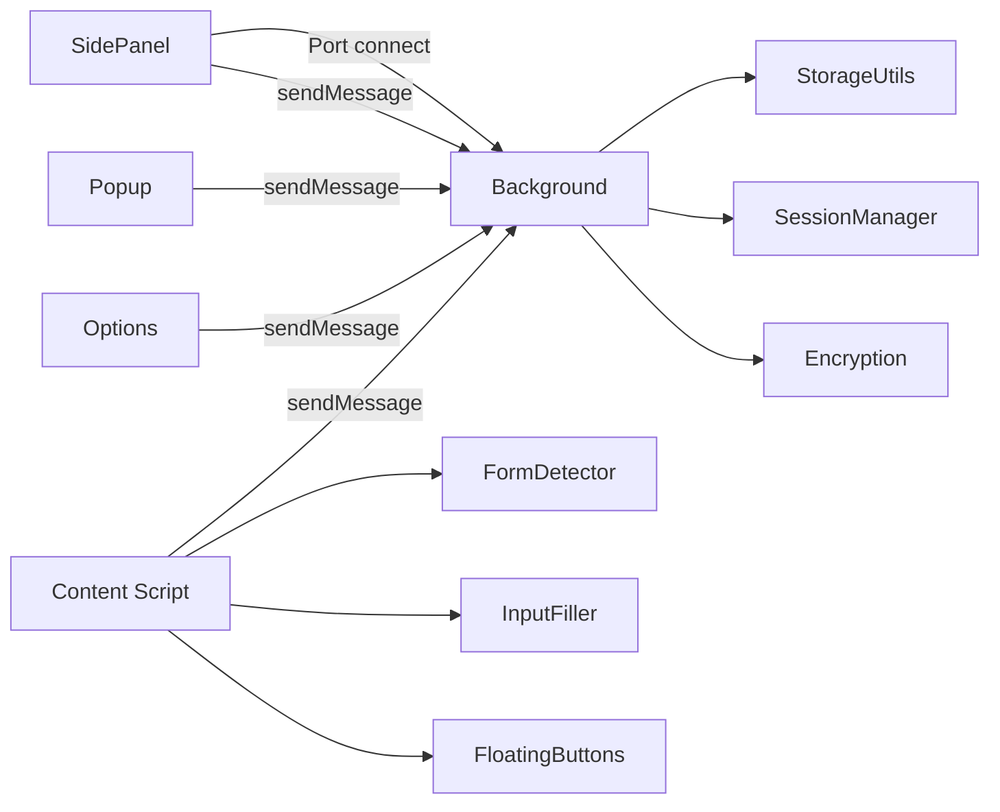
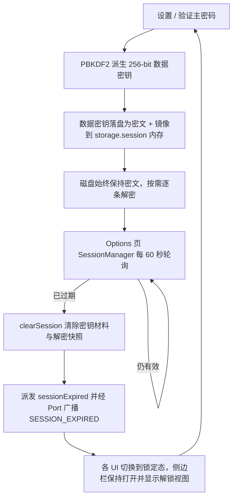

# 架构设计与实现详解

**中文** | [English](./ARCHITECTURE.en.md) · [返回 README](../README.md)

本文档面向开发者与贡献者，收录「账号密码管理助手」的架构设计、完整项目结构与各功能的实现细节。用户向的安装与使用说明请见 [README](../README.md)。

## 目录

- [架构设计](#架构设计)
  - [扩展入口点](#扩展入口点)
  - [消息与数据流](#消息与数据流)
  - [Content Script 运行时约束](#content-script-运行时约束)
  - [会话生命周期](#会话生命周期)
  - [加密机制](#加密机制)
- [项目结构](#项目结构)
- [功能实现详解](#功能实现详解)
- [开发补充](#开发补充)

## 架构设计

### 扩展入口点

| 入口点             | 职责                                                                                                                                                                                                                                     |
| ------------------ | ---------------------------------------------------------------------------------------------------------------------------------------------------------------------------------------------------------------------------------------- |
| **Background**     | Service Worker，消息路由（判别联合类型）、密码缓存（域名无关）、侧边栏状态（Port 连接追踪）、快捷键处理；后台子模块：消息路由/缓存管理/侧边栏管理/选项页管理/自动保存/一键填充/右键菜单/内联下拉/侧边栏快速添加/后台服务（SW 保活+闹钟） |
| **Content Script** | 注入所有页面，初始化表单检测与悬浮按钮                                                                                                                                                                                                   |
| **Popup**          | 扩展图标弹窗，提供「管理密码」和「快速填充」快捷入口                                                                                                                                                                                     |
| **Options**        | 密码管理主页面，完整 CRUD、导入导出、会话/有效期管理、聚光式新手引导                                                                                                                                                                     |
| **SidePanel**      | 侧边栏快速填充，支持拼音智能搜索与命中高亮、排序、域名匹配（本站 / 全站范围切换）、缓存加速、就地快速添加                                                                                                                                |

### 消息与数据流



- Background 作为消息路由中心，处理跨组件通信；消息类型为判别联合（`utils/types.ts` 的 `MessageType`）
- SidePanel 通过 `chrome.runtime.connect({ name: 'sidepanel' })` 建立 Port，用于打开/就绪握手、锁定广播与 25 秒心跳的存活追踪
- SidePanel 的请求/响应类操作（填充、缓存更新、快速添加、打开选项页）仍走 `chrome.runtime.sendMessage()`
- Content Script 与 Popup / Options 通过 `chrome.runtime.sendMessage()` 发送消息

### Content Script 运行时约束

- **注入范围**：[entrypoints/content.ts](../entrypoints/content.ts) 以 `matches: ['<all_urls>']` + `allFrames: true` 注入所有 frame。表单检测与自动保存监听在**所有 frame** 初始化（iframe 内的登录表单同样需要被检测和捕获），而悬浮按钮、保存弹窗、委托通知只在**顶层 frame** 渲染，避免每个 iframe 重复注入造成重叠与定位错乱。
- **样式隔离**：分两档，按实现如实区分。①**Closed Shadow DOM**（`all: initial` 重置 + 内联写入 `--aph-*` 主题令牌，`z-index 2147483647`，宿主引用不外泄）：悬浮按钮、内联填充面板、活码胶囊、填充失败引导气泡、保存密码提示（宿主挂在 `documentElement`，`data-aph="save-password-prompt"` 是影子树外定位它的唯一凭据，keyframes 随影子树作用域生效，不向 `document.head` 注入任何样式）。②**light DOM**（节点直接挂在页面 `body` 上，作用域靠扩展自有类名收敛，主题令牌内联写到自身元素）：密码可见性切换按钮（按 id 向 `document.head` 一次性注入样式表）、原生通知条（不注入任何样式表，全部 `cssText` 内联，**配色固定、不随主题变化**）。两类都不得依赖页面全局函数/变量，也不得以 `innerHTML`/`v-html` 渲染来自 DOM 或消息的不可信文本。
- **跨 frame 明文边界**：iframe 内的凭证通过 `window.top.postMessage` 委托顶层 frame 渲染保存弹窗，回传结果时 `targetOrigin` 固定为来源 origin；保存类委托必须先经 `isSameMainDomain(event.origin, location.origin)` 校验，防止跨域 iframe 把明文密码泄露给第三方页面。提示委托**不再走 postMessage**：`APH_SHOW_NOTIFICATION` 这类枚举值是公开可得的字符串，宿主页面脚本一行 `postMessage` 就能冒充扩展在整页右上角渲染任意文案（钓鱼形状），改由内容脚本发 `MessageType.DELEGATE_PAGE_NOTICE` 给 background，路由校验 `sender.id === chrome.runtime.id` 且 `sender.tab.id` 存在（归属由浏览器盖章，页面世界发不出这条消息），再以 `tabs.sendMessage({ frameId: 0 })` 回投发起标签页的顶层 frame；tabId 只从 sender 推导，不接受自报值。后台回报未送达（如顶层 frame 尚未注入内容脚本）时委托方在当前 frame 降级渲染，提示不静默丢失。反向同理，明文凭证只下发到顶层或同主域名 frame（`isFrameFillable`）。
- **监听器生命周期**：所有 DOM 监听统一经 WXT 的 `ctx.addEventListener` 注册（扩展上下文失效时自动移除），`ctx.onInvalidated` 与 `beforeunload` 触发集中 `cleanup()`，销毁 FormDetector / LoginAutoSave / 悬浮按钮管理器注册的监听器、MutationObserver 与注入 UI。这是消除重载后旧脚本残留调用 chrome API 抛 `Extension context invalidated` 的根因修复，新增监听时不得绕过。
- **检测节奏**：首次扫描在 `DOMContentLoaded` 后延时 3 秒（文档已就绪时 500 毫秒），MutationObserver 以 500 毫秒去抖触发重扫，观察范围为 `document.body` 的 `childList + subtree + attributes(class/style/placeholder)`；SPA 路由变化合并进同一观察器（不额外建 Observer），`popstate` 仅覆盖前进/后退。填充前若字段尚未命中，`waitForFieldsDetected()` 以 100ms 起始、1.5 倍退避、上限 2000ms 重试至多 10 次；`blur` 等易触发重渲染的时机改用事件驱动的 `waitForDomStable(quietMs=50, budgetMs=300)` 等待 DOM 静默，而非固定 sleep。
- **填充就绪门**：「这一页值不值得试着填充」只由 [FormDetector.ts](../entrypoints/content/FormDetector.ts) 的 `hasFillableLoginForm` 一处回答，填充入口与 `waitForFieldsDetected()` 共用它。成立条件是账号框或密码框存在，此外**只**再认「手机号框 + 验证码框」这一组合（国内短信登录页的形状，与悬浮按钮的 `shouldShowSidePanel` 同源）；手机号框单独存在**不**算就绪，因为搜索框、注册表单、收货地址页都命中 `input[type="tel"]`，放宽到单字段等于把这些页面判成登录页。组合成立而页面没有账号框时，条目里的 `username` 回退写进手机号框——手机号本就存在 `username` 字段，不涉及存储结构或加密格式；页面存在密码框时不回退，因为那是账号密码表单，页面上另一个 tel 框通常是「绑定手机号 / 短信找回」。回退只接 `username`，密码永远只找密码框，页面上无处可去的密码会以 `unverified` 档如实提示「请核对」。覆盖面要说清：`USERNAME_SELECTORS` 与 `MOBILE_SELECTORS` 在 `text` 型和 placeholder / autocomplete 两组上大量重叠，而检测顺序是先 username 后 mobile（手机号那轮带 `!usernameFieldsSet` 排除），所以 `type="text"[name*="mobile"]`、`type="tel"[placeholder*="手机号"]` 这类最常见的标记先落进账号桶、`mobileFields` 为空——这些页面的就绪判定与账号落位走的是既有的 username 分支，组合门与手机号回退只在「命中 mobile 选择器且没被 username 选择器抢走」的框上参与（如 `type="tel"` 配 `联系电话` 占位符、`autocomplete="mobile"`）。两种形状最终都把条目的 `username` 写进手机号框，区别只在哪个桶负责。
- **预唤醒**：表单输入框 `focusin`、顶层 frame `visibilitychange`、初始化后 100ms 三处调用 `preWarmServiceWorker()`，与用户操作并行拉起 SW，为后续 `sidePanel.open()` 消除冷启动等待（见「侧边栏秒开跨平台策略」）。

### 会话生命周期



- 会话检查器 `sessionManager.ts` 只在 Options 页通过 `initSessionManager()` 启动（`window.setInterval` 60 秒，仅在「有效 → 无效」的跳变时触发过期事件，避免无会话时打开页面就误报）；SidePanel 与 Popup 不等这个轮询，它们经 Port 的 `SESSION_EXPIRED` 广播、`chrome.storage.onChanged` 与 `visibilitychange` 即时感知锁定。
- `isSessionValid()` 的结果带 5 秒 TTL 缓存（`sessionManager-storage.ts`），锁定、改密、清除会话等状态变更点会主动失效该缓存，避免热路径上反复读盘。
- 会话有效期默认 24 小时，可选 1/2/4/8/12/24 小时与 3/5/7 天（见 [ValidityHoursSelect.vue](../components/options/ValidityHoursSelect.vue)）。
- 过期 / 锁定 / 手动锁定三条路径都只走 `clearSession()`（管理页头部「立即锁定」按钮即第三条的手动档，与有效期设置里的「清除会话」共用同一个 `handleClearSession`，不新造锁定编排）：清除内存与 `storage.session` 中的密钥材料、解密快照、CryptoKey 句柄缓存，以及两把**以条目明文为键**的派生记忆缓存（拼音命中区间、标签呈现记录）。磁盘中的条目本来就是密文，**不存在「批量解密为明文存储」或「过期时批量加密回密文」的落盘动作**。
- 上面两把缓存是模块级 `Map`，**只在加载了该模块的上下文里存在**，因此清理按上下文各自接线（`utils/plaintextCacheCleanup.ts` 登记处 + 各上下文一个触发点）：Background 走 `clearSession()` 与 `resetSessionMemoryState()`（后者由 storage 变更监听触发）；SidePanel 走 `useSidepanelData.ts` 的锁定与过期两条路径；Options 走 `isAuthenticated` 落 false 的 `flush: 'sync'` watcher——管理页可整日常驻，而跨上下文锁定时它只会翻这个状态（`clearSession()` 早在别的上下文跑完），只补 `onSessionExpired` 回调会漏掉 `checkAuth` 自检等其余四条翻转路径。Popup 与 content script 不写这两把缓存（内联下拉只用 `getTagColor`/`parseTags` 等纯函数，拼音模块在其上下文永不预热），故无需接线。该口径由 [plaintextCacheCleanupWiring.test.ts](../tests/architecture/plaintextCacheCleanupWiring.test.ts) 以依赖闭包守卫。
- 闲置锁定（`chrome.idle`）与浏览器重启锁定是**两个默认关闭**的可选开关（`idleLockMinutes: 0`、`relockOnBrowserRestart: false`）。
- **"保持登录"等价于"这台设备当前可解密"**：会话有效期内，`session_wrapped_data_key` 与 `session_wrap_key` 同时落在 `storage.local`，这是重启后免密恢复登录的实现依赖（见「加密机制」的会话密钥一条）——能读到该 Profile 的进程在此期间足以把密文解开，条目字段是不是明文反而不改变这个结论。锁定 / 过期 / `clearSession()` 会删除 `WRAPPED_DATA_KEY`（`sessionManager-storage.ts:801-809`），只留一枚对什么都无意义的随机包裹密钥。因此面向共用设备的建议是开启「浏览器重启锁定」：启动屏障会 `clearSession()`，密钥材料不再跨浏览器关闭长期驻留磁盘。该口径同时写进 `privacy.html`「数据存储」、管理页「自动锁定设置」的重启开关提示与侧边栏帮助条目，避免只在一处披露。

### 加密机制

```
盐值：16 字节随机 → 32 位 hex，明文存于 master_password_config
主密码 + 盐值 → PBKDF2-SHA256 600,000 次 → 256-bit 数据密钥
明文 + 数据密钥 + 每次随机的 12 字节 IV → AES-256-GCM → Base64(IV[12B] ‖ 密文 ‖ 认证标签[16B])
```

- 敏感字段加密：`username`、`password`、`url`、`remark`、`totp`；`id`、`tag`、`createTime`、`updateTime`、`order`、`favorite`、`lastUsedAt` 等元数据保持明文，供排序与过滤使用。
- **一处例外的明文：到期提醒表的账号名**。`password_reminders` 表按 `entryId` 冗余保存该条的 `username`（按码点截断到 `PASSWORD_FIELD_LIMITS.username`，见 [reminderManager.ts](../utils/storage/reminderManager.ts)），因为提醒由 `chrome.alarms` 在任意时刻发出桌面通知（含锁定态），去掉它就等于让通知退化成不含账号的通用文案。它额外泄露的信息是「哪个账号将在何时到期」——按上一条「保持登录 = 磁盘可解」的同一攻击面衡量并不新增防线，但确实是一处需要单独披露的明文；移除该条提醒、删除条目或清空回收站都会连带清除。
- 空字段不参与加密（写空字符串）；Base64 解码失败安全降级返回原始数据，GCM 解密失败抛出错误由调用方按需处理——认证标签使篡改可检测，无静默回退。
- **主密码从不落盘**。磁盘上只有校验哈希：`deriveVerifierHash` 同样是 PBKDF2-SHA256 / 600,000 次，但对盐值做了域分离（前缀 `aph-verify|`），使校验值与解密密钥在密码学上互相独立，存储中的校验值无法反推为密钥；比对使用常量时间。旧版单轮 SHA-256 校验值在验证成功时透明升级。
- **会话密钥**：派生出的数据密钥由一枚新生成的随机包裹密钥（`session_wrap_key`）经同一套 AES-256-GCM 加密，写入 `session_wrapped_data_key`；两者必须在同一次 `chrome.storage.local.set()` 中原子落盘，避免多上下文并发写入时「A 的包裹密钥 + B 的密文」错配。明文数据密钥另存 `storage.session`（仅内存，浏览器关闭即清）。
- **HKDF 只存在于旧版迁移路径**：`deriveSessionKey(salt)`（HKDF-SHA256，salt `aph-session-salt`、info `session-encryption-v2`）仅用于解包历史遗留的 `session_master_password` blob。它的输入是明文可读的盐值，因此不提供任何抗磁盘访问的机密性，新版会话流程不使用它。
- `ensurePasswordsEncryptedAtRest` 在每个 SW 生命周期内幂等地维护「磁盘即密文」不变量，并由 storage 监听器兜底发现明文异常。

## 项目结构

```
├── entrypoints/                    # WXT 扩展入口点
│   ├── background.ts               # Background Service Worker 入口
│   ├── background/                 # Background 子模块
│   │   ├── backgroundServices.ts   # 核心后台服务（保活/闲置/更新/备份闹钟）
│   │   ├── messageRouter.ts        # 运行时消息路由（判别联合类型）
│   │   ├── sidePanelManager.ts     # 侧边栏生命周期管理（Port 连接追踪）
│   │   ├── passwordCache.ts        # 密码缓存（域名无关/SW 内存）
│   │   ├── optionsPageManager.ts   # 选项页管理（复用/创建/激活）
│   │   ├── quickFillHandler.ts     # 一键填充快捷键处理（域名匹配 + 多层反馈）
│   │   ├── contextMenuManager.ts   # 右键上下文菜单（注册/语言重建/填充动作分发）
│   │   ├── quickAddHandler.ts      # 侧边栏快速添加落库处理
│   │   ├── inlineDropdownHandler.ts # 内联填充下拉面板的展开与数据下发处理
│   │   ├── autoSaveHandler.ts      # 自动保存凭证处理
│   │   └── pendingCipherKeyStore.ts # 待保存凭据密钥仓（密钥只存 storage.session）
│   ├── content.ts                  # Content Script 入口
│   ├── content/                    # Content Script 模块
│   │   ├── FormDetector.ts         # 表单检测编排器
│   │   ├── InputFiller.ts          # 多策略输入填充
│   │   ├── LoginFormAnalyzer.ts    # 登录表单启发式分析
│   │   ├── LoginAutoSave.ts        # 登录凭证自动保存管理器
│   │   ├── SavePasswordPrompt.ts   # Chrome 风格保存确认弹窗
│   │   ├── PasswordVisibilityToggle.ts # 密码显示/隐藏切换
│   │   ├── CheckboxHandler.ts      # 复选框自动勾选
│   │   ├── NativeNotification.ts   # 原生浏览器通知
│   │   ├── FillAckChip.ts          # 填充成功页面内回执胶囊（Closed Shadow DOM）
│   │   ├── IdentityHint.ts         # 个人信息字段提示气泡（Closed Shadow DOM，出站载荷只有一个可选的检索词：本人姓名或字段名）
│   │   ├── piiClassifier.ts        # 单字段 PII 语义判定（分层短路；末层只判值的形状，不填充）
│   │   ├── contextMenuTarget.ts    # 右键目标输入框记忆（供 Background 定向下发）
│   │   ├── formSelectors.ts        # 选择器与关键词常量
│   │   ├── domUtils.ts             # DOM 元素可见性检测工具
│   │   ├── types.ts                # Content Script 类型定义
│   │   ├── floatingButtons/        # 悬浮按钮系统（Closed Shadow DOM）
│   │   └── inlineDropdown/         # 内联填充系统（字段内钥匙图标 + 迷你面板）
│   │       └── InlineFillDropdown.ts # 内联填充管理器（Closed Shadow DOM）
│   ├── popup/                      # 扩展图标弹窗
│   ├── options/                    # 密码管理主页面
│   └── sidepanel/                  # 侧边栏快速填充
├── components/                     # Vue 组件
│   ├── BrandLogo.vue               # 钥匙主题品牌 Logo
│   ├── QuickFillIcon.vue           # 快速填充图标
│   ├── TotpCode.vue                # TOTP 动态码展示（环形倒计时）
│   ├── SiteFavicon.vue             # 网站图标组件（本地 _favicon 缓存，失败降级默认图标）
│   ├── ShortcutKeyCap.vue          # 快捷键键帽展示（主题令牌 + 未生效弱化态，不含 i18n）
│   ├── CapsLockHint.vue            # 大写锁定警示行（role=status，配合 useCapsLockDetection）
│   ├── options/                    # Options 页面组件
│   │   ├── AutoSaveSettingDialog.vue   # 自动保存设置对话框
│   │   ├── BackupImportDialog.vue      # 加密备份导入对话框
│   │   ├── ChangeMasterPasswordDialog.vue # 修改主密码对话框（原子换钥）
│   │   ├── ClipboardSettingDialog.vue  # 剪贴板设置对话框
│   │   ├── DisclaimerInfo.vue          # 免责声明
│   │   ├── DomainMatchSettingDialog.vue # 站点匹配策略对话框（跨子域三档 + 端口两档单选）
│   │   ├── EmailBackupDialog.vue       # 邮箱备份对话框
│   │   ├── EmptyGuide.vue              # 空数据引导卡片
│   │   ├── FavoriteLimitSetting.vue     # 收藏上限设置对话框
│   │   ├── HeaderBar.vue               # 顶部操作栏（会话徽标与一键锁定 / 添加 / 体检 / 个人信息库 / 数据管理 / 安全设置 / 偏好设置 / 命令面板 / 帮助）
│   │   ├── IdleLockSetting.vue         # 自动闲置锁定设置
│   │   ├── ImportDialog.vue            # CSV/JSON 导入对话框
│   │   ├── MasterPasswordSetupView.vue # 主密码设置视图
│   │   ├── MasterPasswordVerifyDialog.vue # 主密码验证弹窗（会话解锁/导出前验证）
│   │   ├── OnboardingTour.vue          # 聚光式新手引导（遮罩挖空 + 步骤卡片，动态导入不进首屏）
│   │   ├── PasswordDetailDrawer.vue    # 条目只读详情抽屉（备注全文/密码历史/限时复制清除）
│   │   ├── PasswordFormDialog.vue      # 密码表单对话框（含 TOTP 字段与密码修改历史）
│   │   ├── PasswordGeneratorPopover.vue # 密码生成器弹窗（随机密码/助记词组）
│   │   ├── PasswordHealthDialog.vue    # 安全体检仪表盘弹窗
│   │   ├── PasswordStrengthPopover.vue # 密码强度可视化弹窗
│   │   ├── PasswordTable.vue           # 密码列表表格
│   │   ├── PasswordVerifyView.vue      # 主密码验证视图
│   │   ├── SearchFilterBar.vue         # 搜索过滤栏
│   │   ├── ShortcutSettingDialog.vue   # 快捷键一览对话框（只读 + 未生效预警 + 跳转管理页）
│   │   ├── TrashDialog.vue             # 回收站对话框（检索/恢复/彻底删除/清空）
│   │   ├── ValidityHoursSelect.vue     # 有效期选择器
│   │   └── ValiditySettingDialog.vue   # 有效期设置对话框
│   └── sidepanel/                  # SidePanel 侧边栏组件
│       ├── HelpDialog.vue          # 操作指引与常见问题
│       ├── PasswordListItem.vue    # 密码列表条目（含 TOTP 动态码与全站模式降级操作）
│       ├── QuickAddDialog.vue      # 侧边栏快速添加弹窗（预填当前域名）
│       ├── SidepanelAuthView.vue   # 侧边栏列表主体（搜索/范围切换/空态引导）
│       └── SidepanelHeader.vue     # 侧边栏头部
├── composables/                    # Vue 组合函数
│   ├── useAuthFlow.ts              # 认证流程
│   ├── useCapsLockDetection.ts     # 主密码输入框大写锁定检测（getModifierState）
│   ├── useChromeListeners.ts       # Chrome API 监听器自动清理
│   ├── useOnboardingTour.ts        # 聚光式新手引导状态机（步骤裁剪 + 锚点测量 + 卡片定位）
│   ├── usePasswordManagement.ts    # 密码 CRUD + 搜索排序 + 收藏
│   ├── usePasswordHistory.ts       # 密码修改历史加载与解密
│   ├── usePasswordStrength.ts      # 密码强度校验
│   ├── usePopupInit.ts             # Popup 初始化逻辑
│   ├── useRuntimeMessageHandler.ts # 运行时消息处理
│   ├── useSessionLock.ts           # 会话锁定
│   ├── useSessionTimer.ts          # 会话定时器
│   ├── useShortcuts.ts             # 快捷键管理（真实绑定状态 + 未生效判定）
│   ├── useSidepanelData.ts         # 侧边栏数据管理
│   ├── useSidepanelFill.ts         # 侧边栏填充逻辑（含 TOTP 填充）
│   ├── useSidepanelSettings.ts     # 侧边栏设置
│   ├── useStorageWatcher.ts        # Storage 监听
│   ├── useTagOverflow.ts           # 标签溢出检测
│   ├── useTotp.ts                  # TOTP 动态码生成与倒计时
│   └── useVersionUpdate.ts         # 版本更新检测
├── utils/                          # 核心工具库
│   ├── storage.ts                  # 存储门面（StorageFacade）
│   ├── storage/                    # 存储领域模块
│   │   ├── autoSaveManager.ts      # 自动保存配置管理
│   │   ├── changeMasterPassword.ts # 修改主密码（原子换钥编排）
│   │   ├── configManager.ts        # 用户配置管理
│   │   ├── facades.ts              # 存储门面聚合
│   │   ├── masterPassword.ts       # 主密码存储与验证
│   │   ├── passwordCrud.ts         # 密码 CRUD 操作
│   │   ├── passwordHistory.ts      # 密码修改历史（旧密文快照，默认每条 3 份，可配 1~10）
│   │   ├── reminderManager.ts      # 密码到期提醒存储与 CRUD
│   │   ├── trashManager.ts         # 回收站（软删除/恢复/30 天自动清理）
│   │   ├── trashRetention.ts       # 回收站保留期口径（两库共用常量与剩余天数读数，零依赖）
│   ├── i18n/                       # Vue 侧国际化（响应式语言包）
│   │   ├── index.ts                # t() 翻译函数与语言切换
│   │   ├── bundles/                # 按上下文聚合的语言包（options / sidepanel / popup / help）
│   │   └── locales/                # 全量语言包（zh-CN / en，17 个 namespace）
│   ├── i18n-lite.ts                # content/background 轻量国际化（tl()）
│   ├── data/top1000.json           # 离线弱口令字典（近千条，懒加载）
│   ├── data/passphrase-words.json  # 助记词组词库（3080 个常见英文单词）
│   ├── weakPasswordDict.ts         # 弱口令字典懒加载与 O(1) 命中检测
│   ├── passwordStrengthCore.ts     # 密码强度规则核心（纯函数、零 i18n/零 Vue 依赖，三方共用判定源）
│   ├── encryption.ts               # PBKDF2 + AES-256-GCM
│   ├── concurrency.ts              # 条目级并行（mapWithConcurrency：分批并行、结果保序、抛首批最小下标错误）
│   ├── crypto-light.ts             # 轻量加密工具
│   ├── pendingCredentialCodec.ts   # 待确认凭据编解码器（密钥由调用方传入）
│   ├── sessionManager.ts           # 会话轮询单例（仅 Options 页启动，60 秒一次）
│   ├── sessionManager-storage.ts   # 会话密钥材料持久化（包裹数据密钥）与有效性判定
│   ├── backupExport.ts             # 加密备份导出/导入（AES-GCM）
│   ├── excel.ts                    # CSV/JSON 门面（保留 ExcelUtils 静态入口，转发到下列四个子模块）
│   ├── excelCsv.ts                 # CSV 上传解析（多格式列映射）
│   ├── excelJson.ts              # JSON 上传解析（数组或 { entries } 包裹）
│   ├── excelExport.ts              # CSV/JSON 导出与模板下载
│   ├── excelFormatMap.ts           # 导入格式与 CSV 列映射表（Chrome/LastPass/Bitwarden/1Password）
│   ├── emailBackup.ts              # 邮箱备份工具
│   ├── passwordHealth.ts           # 密码健康体检（评分/弱密码/复用/泄露/陈旧检测）
│   ├── tagUtils.ts                 # 标签颜色生成
│   ├── totp.ts                     # TOTP 动态码生成（RFC 6238，Web Crypto HMAC）
│   ├── favicon.ts                  # 网站图标 URL 构造（Chrome 本地 _favicon/ 端点，零网络）
│   ├── qrScanner.ts                # 二维码识别（截取标签页/图片 + jsQR 本地解码）
│   ├── updateChecker.ts            # 版本更新检测（GitHub Releases API + CWS 可达性探测）
│   ├── passwordGenerator.ts        # 随机密码生成器
│   ├── passphraseGenerator.ts      # 助记词组生成器（Diceware 思路，内置 3080 词库）
│   ├── passwordSort.ts             # 密码排序工具
│   ├── passwordFilter.ts           # 侧边栏列表过滤纯函数（本站/全站范围判定、能否填充单一事实来源）
│   ├── keywordMatch.ts             # 关键词过滤内核（字段口径 + 长度收口 + 保序过滤，matcher 由调用方注入）
│   ├── searchMatch.ts              # 智能搜索匹配的 Vue 响应式外壳（pinyinMatcherReady ref，供过滤/渲染 computed 依赖）
│   ├── searchMatch/                # 搜索匹配领域模块（子目录不进 WXT 顶层自动导入扫描，避免与外壳同名冲突）
│   │   └── core.ts                 # 匹配内核（子串 + 拼音/首字母缩写 + 命中区间，零 Vue，SW 与 content 可复用）
│   ├── clipboard.ts                # 剪贴板复制与限时自动清除（UI 无关，options 详情抽屉使用）
│   ├── shareCard.ts                # 分享卡片纯文本构造（用户名/密码/网址一段，标签由调用方注入，内容零日志）
│   ├── onboardingTour.ts           # 新手引导纯函数层（步骤清单 + 锚点裁剪 + 高亮框几何与卡片定位）
│   ├── logger.ts                   # 环境感知日志
│   ├── env.ts                      # isDev / isFirefox 常量
│   ├── platform.ts                 # 操作系统平台检测（Windows 判定，跨上下文复用）
│   ├── perfMetrics.ts              # 侧边栏打开性能埋点（生产可用，落 storage.session）
│   ├── a11y.ts                     # 无障碍键盘工具（role=button 的 Enter/Space 激活）
│   ├── formValidators.ts           # 表单校验器工厂（长度/复杂度/URL/标签规则复用）
│   ├── masterPasswordVerify.ts     # 主密码验证工具
│   ├── masterPasswordVerifyController.ts # 主密码验证弹窗单例控制器（命令式调用）
│   ├── createVueApp.ts             # Vue 应用工厂
│   ├── dateFormat.ts               # 日期格式化工具
│   ├── domain.ts                   # 域名工具（getMainDomain / registrableScope 可注册域（认共享托管后缀）/ isExactHostMatch 精确主机匹配 / resolveMatchTier 跨子域分层匹配真源 / matchesPortScope 端口隔离门 / parsePagePortContext 页面端口上下文 / toNavigableUrl 安全导航）
│   ├── formatShortcut.ts           # 快捷键格式化工具
│   ├── formatFileSize.ts           # 文件字节数可读化（文件信息展示与导入闸门文案共用）
│   ├── shortcutCommands.ts         # 快捷键命令清单（与 manifest.commands 对齐）与打开管理页动作
│   ├── generateId.ts               # ID 生成工具（crypto 随机，独立模块避免页面 chunk 拉入 PBKDF2）
│   ├── lazyImport.ts               # 泛型懒加载工具（并发去重的动态 import 封装）
│   ├── contentScriptReadiness.ts   # Content Script 就绪探测（ping + 必要时重注入）
│   ├── frameFill.ts                # 跨 frame 填充共享工具（sidepanel 与 quickFill 复用）
│   ├── browserStartupRelock.ts     # 浏览器启动重锁屏障与等待状态机
│   ├── preWarmSw.ts                # Service Worker 预热工具
│   ├── warmSidePanelResources.ts   # 侧边栏渲染资源预热（SW 侧，抗 Windows 白屏）
│   ├── theme.ts                    # 主题工具（主题名类型、令牌映射、应用/同步）
│   ├── storageKeys.ts              # Storage Key 常量
│   ├── constants.ts                # 跨领域共享常量（密码条目字段长度容量 `PASSWORD_FIELD_LIMITS`；URL 常量在 urls.ts）
│   ├── urls.ts                     # URL 常量
│   └── types.ts                    # 公共类型定义
├── assets/icons/                   # 源 SVG 图标
│   ├── icon.svg                    # 当前生效图标
│   └── variants/                   # 4 款钥匙主题候选图标
├── assets/theme/                   # 主题 CSS Design Tokens
│   └── tokens.css                  # 主题令牌定义（`--aph-*` 变量，6 套色彩方案）
├── public/icon/                    # 构建期 PNG 产物（WXT 自动注入 manifest）
├── scripts/generate-icons.mjs      # SVG → 多尺寸 PNG 生成脚本
├── types/global.d.ts               # 全局类型补充
├── .github/workflows/              # ci.yml（校验）与 release-please.yml（发版）
├── wxt.config.ts                   # WXT 配置
└── package.json
```

## 功能实现详解

### 1. 安全保护

- 主密码至少 8 位，必须包含字母、数字和特殊字符。
- 会话解锁后条目按需解密到内存（SW 密码缓存 / `storage.session` 加密快照），`storage.local` 全程保持密文；会话失效只清除密钥材料与解密快照，不做批量重加密。
- 会话恢复后自动检测并修复加密状态不一致的数据。
- 会话检查器 `sessionManager.ts` 的 60 秒轮询**只在 Options 页**启动（`initSessionManager()`），且只在会话从「有效 → 无效」跳变时触发过期事件；SidePanel 与 Popup 不等这个轮询，由 [useStorageWatcher.ts](../composables/useStorageWatcher.ts) 的 `visibilitychange` 监听在页面重新可见时重跑认证检查。详见「会话生命周期」。
- **大写锁定实时提示**：主密码相关输入框（首次设置、解锁验证视图、验证弹窗、修改主密码、加密备份导入）通过 `KeyboardEvent.getModifierState('CapsLock')` 在 keydown/keyup 实时判定大写锁定状态（见 [useCapsLockDetection.ts](../composables/useCapsLockDetection.ts)），开启时在输入框下方展示琥珀色警示行（见 [CapsLockHint.vue](../components/CapsLockHint.vue)），避免大小写误输入被当成「密码错误」；提示行用 `role="status"` 让屏幕阅读器非打断播报，失焦即复位，不留残留提示。

### 2. 表单识别与填充

- 识别用户名、密码、手机号、验证码字段；填充后自动勾选**得分最高的那一个**复选框——`calculateCheckboxScore` 按与密码输入框的距离、关键词命中、DOM 位置、是否同表单、层级深度为每个候选打分后取最优，而非单纯取最近的复选框；按 `CHECKBOX_POSITIVE_KEYWORDS`（记住我 / 自动登录 / 同意 / 服务条款 / remember / agree / terms…）判定可勾，命中 `CHECKBOX_NEGATIVE_KEYWORDS`（订阅 / 通知 / 营销 / subscribe / newsletter / ads…）则跳过，避免误勾营销类选项（见 [CheckboxHandler.ts](../entrypoints/content/CheckboxHandler.ts) / [formSelectors.ts](../entrypoints/content/formSelectors.ts)）。
- 复选框载体支持两种：原生 `input[type=checkbox]`（含隐藏 input + 可见关联 label 的自定义样式形态），以及现代组件库（Radix/shadcn 形态，如豆包登录弹窗的协议勾选）的 `<button role="checkbox">` 模拟复选框——勾选态读 `aria-checked`，勾选只发一次程序化点击交由页面自身回写（受控组件没有可强设的 `checked`，自改属性只会伪造状态；盲发第二次点击会把刚勾上的翻回去，故失败只告警不重试，且回写窗口内去重）；候选排除无 `aria-checked`、禁用、不可见，以及 form 内缺省 submit 型 button / `a[href]` 这类会提交表单或触发导航的载体（见 `isDetectableAriaCheckbox`）。参照字段链为密码 → 账号 → 手机号，手机号+验证码登录页也有兜底参照。
- WeakMap / WeakSet 缓存字段判断结果，避免内存泄漏。
- 桶里多个候选时，**写哪个框由「值 ↔ 字段自己声明的语义」配对决定**，不再取文档顺序首个（见 [FormDetector.ts](../entrypoints/content/FormDetector.ts) 的 `pickAccountField` / `pickPasswordField`）：`USERNAME_SELECTORS` 把 `[name*="email"]`、`[name*="mobile"]`、`[name*="user"]` 一起收进账号桶，「手机号 / 邮箱二选一」页面上条目存的是邮箱却可能写进手机号框；`VERIFY_CODE_SELECTORS` 里 `name*="otp"` 这类条目不带 type 限定，掩码动态口令框于是同时进密码桶，静态密码可能写进口令框（银行 / 券商网页登录就是这个形状）。排序只在**多个候选之间调次序、不淘汰候选**：值是邮箱形态才让邮箱语义框优先，值是国内手机号或带 `+` 的国际格式才让手机号语义框优先，单候选、值形状不明确或没有吻合框时结果与「取首个可见」逐字节相同；同时命中两组关键词的自相矛盾框按通用处理，不抢优先位。同一条原则管到验证码：动态码优先写可见的框，一个都不可见时退回首个，保住「可见格子 + 隐藏真实输入」那类六格组件。
- 填充策略自动降级：**Native Setter → execCommand → 模拟键盘事件**，每级约 50ms 后回读校验实际值；回读相等还要再等约 100ms 复检一次，两次都一致才算「已填充」。这一层是因为站点的受控组件、掩码框和校验脚本常在首读之后才把值改回去或清空，只读一次就会给出「已填充」而用户面对空框；复检不通过时级联照旧走完，`filled`（决定「自动触发登录」是否点火）仍按最终当场读数判定，不因此多填或少填一个字段。**代价要按档位算**：常见成功路径（第一级写入即复检通过）每字段只多一个 100ms 复检窗；三级全不通过的最坏路径每字段是 3×(50+100)=450ms 固定等待，账号 + 密码两字段串联即 900ms（改造前同一路径为 300ms），此外还有第三级逐字符输入自身的耗时。这段额外等待只在站点确实改写值时才走到，是「宁可慢这一截，也不给假回执」的取舍。
- 填充成功后，真正写进去的那个输入框下缘浮出一枚回执胶囊（「已填充」/「已填充，请核对」），1.6 秒自动收起，滚动与缩放时跟随字段重定位、字段脱离文档即收起（见 [FillAckChip.ts](../entrypoints/content/FillAckChip.ts)）。它补的是「侧边栏 / popup 填充后立即关闭、快捷键与右键菜单本来没有页面内提示」这段反馈真空：确认动作发生在视线当前位置，不必把眼睛挪回表单核对。三条在线的填充路径（账号密码 / 动态码 / 右键菜单）各自锚到**真正落地的那个框**，密码框优先，且三处都把写后复检的档位透传给 `showFillAck`；手机号 + 短信验证码登录页走的就是账号密码那条（条目里存的手机号即 `username`），而 `FILL_MOBILE_CODE` 是「已声明、无发送方」的死通道，它的 handler 因此仍是那句不带档位的 `showFillAck(ackField)`——接活时按右键菜单那条补 `outcome` 即可（存/填口径的完整取证见 `docs/reports/OPPORTUNITY_EVALUATION.md` §F-1）；一个字段都没写进去时不回执（失败提示归发起方，且面板刻意保持打开）。`unverified`（写入成功但站点未必登记了 `input` 事件）用「请核对」文案，因为这一档真正需要用户看一眼。胶囊走 Closed Shadow DOM、只渲染固定文案，**绝不承载账号 / 密码 / 验证码**；减弱动效档只关那 3px 上浮，淡入淡出保留。
- 链条末端的「点击登录」由偏好设置中的**「自动触发登录」开关**决定（默认关闭），开启后按「点击登录按钮 → `form.requestSubmit()`」两级策略提交（见 [SettingsPanel.ts](../entrypoints/content/floatingButtons/SettingsPanel.ts) / [FormDetector.ts](../entrypoints/content/FormDetector.ts)）。不想常开时，侧边栏每条账号另有显式的「填充并登录」按钮，只对本次生效。

### 3. 数据管理

- CSV 导入导出（.csv），提供标准模板下载；导出带 BOM + CRLF，Excel 可直接打开。
- **已知限制：导出的 CSV 不做公式转义**。每个字段只按 CSV 语法加引号（`"` → `""`），以 `=`、`+`、`-`、`@` 开头的值不会额外加 `'` 或 TAB 前缀（见 [excelExport.ts](../utils/excelExport.ts) 的 `serializeCsvRows`）。刻意如此：① 前缀会改写字段内容，而密码是逐字符取用的凭证，随机密码生成器的符号集本就含 `+ - = @`，一条以这些符号开头的密码被前缀化后，无论是从表格复制使用还是再导回来都是错的；② 转义后的表格与本扩展的 CSV 解析器（[excelCsv.ts](../utils/excelCsv.ts)）不再互为可逆，破坏「导出 → 导入」往返一致性。代价是：用 Excel / Numbers 打开导出文件时，恰好以这些符号开头的单元格会被当作公式求值。缓解：只在自己本机、来源可信的表格里打开导出文件，跨机迁移优先用加密备份（.aph）。
- JSON 导入导出：支持密码数据的 JSON 格式导出（需验证主密码），导出文件名格式为 `passwords_YYYYMMDD_HHmmss.json`；也支持从 JSON 文件导入。
- 导入仅接受 `.csv` 与 `.json` 两类文件（无 xlsx 解析器）：Excel 表格请先「另存为 CSV」再导入（见 [ImportDialog.vue](../components/options/ImportDialog.vue)）。
- **导入字节闸门（先于读盘）**：条数上限与逐字段长度上限都要等整份文件解码、解密、逐条 parse 之后才生效，防不住「一次 `arrayBuffer()` 把任意大的输入拉进内存」。因此 [backup/constants.ts](../utils/backup/constants.ts) 的 `MAX_PASSWORD_IMPORT_INPUT_BYTES`（32 MiB）与 [identity/constants.ts](../utils/identity/constants.ts) 的 `MAX_IDENTITY_IMPORT_INPUT_BYTES`（4 MiB，按个人信息库 100 条 PII 的实际容量取值）在**选文件这一步**就拒（[ImportDialog.vue](../components/options/ImportDialog.vue) / [BackupImportDialog.vue](../components/options/BackupImportDialog.vue) / [IdentityVaultDialog.vue](../components/options/IdentityVaultDialog.vue)），`.aph` 解密入口 [backupExport.ts](../utils/backupExport.ts) 内另有同口径兜底以覆盖绕过 UI 的调用路径。拒绝文案里的上限值由 [formatFileSize.ts](../utils/formatFileSize.ts) 从常量渲染，不写死数字；取值口径见各常量文件的 JSDoc，合法自导出永不命中（`tests/architecture/importByteGateWiring.test.ts` 机械守卫「闸门必须早于取字节」这条接线，以及 `formatFileSize` 不得回到组件内的私有实现）。
- 标签下拉多选 + 自定义新增（每条最多 5 个，单个最长 30 字符）；相同标签颜色稳定一致（见 [utils/tagUtils.ts](../utils/tagUtils.ts)）。
- **站点筛选**：与标签下拉并列的第二条组织维度，候选由条目 `url` 经 `normalizeToHostname` **自动汇总**（精确 hostname 分桶，`https://x.com/login` 与 `x.com` 同桶；刻意不读跨子域匹配档位，否则筛选结果会随另一个弹窗里的设置漂移，见 [utils/siteUtils.ts](../utils/siteUtils.ts)），用户无需维护第二套结构。多选站点之间是「命中任一即保留」，与标签筛选叠加为 AND；行内计数一律按**全库条目数**，与当前筛选结果无关。网址归一后为空（留空、只有空白符、或只有斜杠）的条目汇成候选集**末位固定**的「（无网址）」一档，并**只在被勾选时参与结果**——与同一条过滤链上的标签筛选同口径：勾了站点却带出一批没填网址的条目，读起来就是「筛选没生效」。这批条目并没有失去落点，勾「（无网址）」这一档即只得到它们，「把网址没填的条目挑出来补全」照旧可达；至于「这个站点上会出现哪些条目」是填充场景的问题，由侧边栏的 `matchesSiteScope` 回答（那里空网址条目任何站点都带出），管理页不替它作答——哨兵键 `/no-url`，展示文案落在候选数据上（`el-select-v2` 的 `:props` 只认字段名，闭合态选中标签、键入过滤与面板宽度三处都读 `label`），回填 `filterSites` 的仍是站点键，切语言不会让已选条件失效；单独勾选这一档就得到「待补网址」的清单。畸形网址不一定落进这一档：`normalizeToHostname` 只做收敛、不判合法性，`http://` 或含空格的串归一后是非空残值，各自成桶。两个候选下拉都用 `el-select-v2` 虚拟列表（普通 `el-select` 的 `persistent` 默认 true，千级候选会常驻 DOM 并重演 O(T²)）。接线守卫见 [siteFilterWiring.test.ts](../tests/architecture/siteFilterWiring.test.ts)，真机回归见 `e2e/site-filter.spec.ts`（8 例）。
- 密码列表默认按更新时间倒序；侧边栏默认按最近使用倒序。支持按用户名、URL、标签、备注、创建/更新时间切换排序。
- 支持用户名、标签、备注、URL 的多字段智能搜索：大小写不敏感子串优先，未命中降级拼音匹配（全拼 / 首字母缩写 / 中英混合，pinyin-match 经动态 import 拆分为独立 chunk 不占首屏，首帧后空闲预热），命中区间经 SearchHighlight 组件高亮（见 [utils/searchMatch.ts](../utils/searchMatch.ts)）。
- **检索口径单一真源**：侧边栏、管理页与内联下拉三处共用同一套匹配规则——「比哪些字段 + 怎么收口关键词」在 [utils/keywordMatch.ts](../utils/keywordMatch.ts)（`keywordFieldsOf` 固定 username / tag / remark / url 顺序，`normalizeSearchKeyword` 对来自页面的关键词先 trim 再截到 64 字符），「怎么判定命中」在 [utils/searchMatch/core.ts](../utils/searchMatch/core.ts)（零 Vue，故 SW 与 content script 都能复用；`tests/architecture/vueFreeMatchKernel.test.ts` 机械守卫内核传递依赖不得出现 `vue` / `vue-i18n`），`passwordFilter.ts`、`usePasswordManagement` 与后台 `passwordCache.ts` 都经 `filterByKeyword(entries, keyword, matcher)` 走同一条保序过滤路径，杜绝「同一关键词三处结果不同」的口径分叉。
- 批量选择后可批量编辑标签（追加 / 剔除）、批量导出选中项、批量删除；删除的条目进入回收站保留 30 天，可随时恢复。
- 收藏标记：点击星标收藏常用条目，支持「只看收藏」过滤；收藏上限默认 **10** 条（可配 1~50），超限时 LRU 自动淘汰最早使用的收藏条目；侧边栏填充时自动更新收藏使用时间戳确保 LRU 准确。
- **条目总量上限 2000 条**：唯一口径是 [vaultCapacity.ts](../utils/storage/vaultCapacity.ts) 的 `MAX_PASSWORD_ENTRIES`，按密码列表的条目数计数，回收站中的条目不占额度。三条会让列表变长的写路径在「读到现有数据之后、加密与写入之前」收口——`savePassword`（+1）、`batchSavePasswords`（整批判定，不做静默截断）、`restoreFromTrash`（按恢复条数判定）。守卫只拒绝新写入，绝不删改已有数据；计数读取原始密文数组取 `length`，不为计数触发全量解密。
- 超限语义按入口分层：导入类弹窗（CSV/JSON 与加密备份）在预览页给出「当前条数 / 还能导入多少条 / 将被忽略多少条」（[useImportCapacity.ts](../composables/useImportCapacity.ts) + [CapacityAlert.vue](../components/options/CapacityAlert.vue)），点导入时再要求确认「只导入前 N 条」或取消；网页自动保存与侧边栏快速添加沿用原有的提示位与消息契约，只把文案换成「因达到上限而未保存」。超限错误以 `VaultCapacityError` 携带判别码 `vault-capacity-exceeded` 抛出，各入口按码映射文案、不解析 `error.message`（`tests/utils/vaultCapacity.test.ts` 守卫伪造错误码不误判、且拒绝路径上 `storage.set` 与加密函数均未被调用）。
- 一键去重：智能检测重复条目（相同用户名 + 相同 URL）并提供一键清理。
- 只读查看详情：列表每行的「查看详情」以抽屉形式展示该条目的全部字段（含备注全文与密码历史），无需进入编辑态（见第 23 节）。
- 多格式 CSV 导入：自动识别 Chrome、LastPass、Bitwarden、1Password 的导出格式（见 [utils/excel.ts](../utils/excel.ts)）。

### 4. 自动保存登录凭证

- 启用后，网站登录时自动捕获账号密码并弹窗确认是否保存（见 [LoginAutoSave.ts](../entrypoints/content/LoginAutoSave.ts)）。
- 三种凭证捕获场景：表单提交（capture 阶段）、登录按钮点击、密码框回车提交。
- 域名匹配规则支持精确域名和正则表达式两种模式，规则为空时匹配所有域名；含端口的规则（如 `localhost:3000`）仅精确匹配对应 host + port 组合（见 [AutoSaveSettingDialog.vue](../components/options/AutoSaveSettingDialog.vue)）。
- sessionStorage 暂存凭证，支持传统表单提交导致的跨页面导航场景。页面侧只保留**不可解的密文容器**，解密密钥由后台按 `tab + origin` 签发并只存 `chrome.storage.session`（默认 `TRUSTED_CONTEXTS`，宿主页面与内容脚本均不可读，见 [pendingCipherKeyStore.ts](../entrypoints/background/pendingCipherKeyStore.ts)）；申请不到密钥时直接放弃暂存（代价仅为跳转后不复现弹窗），绝不退回明文存储。
- 保存成功后发送桌面通知，并使密码缓存失效以确保下次加载获取最新数据。
- **三选项交互**：保存确认弹窗提供「保存」、「暂不保存」和「不再提示」三个操作选项。
- **可编辑字段**：弹窗中除显示账号和密码外，还提供可编辑的**标签**（默认从页面标题里取站点名，见下条）和**备注**（默认为"自动保存"）输入框，用户可在保存前自定义。
- **标签预填清洗**：捕获时不再整串照搬 `document.title`，而由 [capturedTag.ts](../utils/capturedTag.ts) 的 `deriveCapturedTag` 收敛成一个短标签——先按分隔符切段（逗号/顿号恒为分段，连字符/冒号/斜杠仅在邻接空白处分段，避免切碎 `E-commerce`、`12:30`），再按「命中主域名首段的端段 → 末段 → 首段 → 其余中段按长度升序」取第一个不超 `CAPTURED_TAG_MAX_LENGTH` 的分段；全都装不下时预填空串。动机：整串页面名普遍超过单标签上限，而落盘通道刻意不限 `tag` 长度（原因见 [autoSaveHandler.ts](../entrypoints/background/autoSaveHandler.ts)），于是这条超长标签会一路落库，直到用户下次在编辑弹窗里改动标签时被 `normalizeTagInput` 丢掉并弹警告；含逗号会被 `parseTags` 拆成多标签；保存后它还会进入由条目聚合而来的标签候选池（`countTags`），让筛选变噪音。上限与编辑器 `MAX_TAG_LENGTH`（`utils/constants.ts`）的同口径关系由 `tests/utils/capturedTag.test.ts` 与 `tests/architecture/tagCapacityConstantSource.test.ts` 钉住（content 侧刻意不 import 那份常量）。
- **智能更新策略**：同账号 + 同域名且密码有变化时，以「更新」弹窗确认后更新已有条目的密码，保留存量标签和备注（除非用户在弹窗中主动修改）；账号密码完全相同则不打扰；不同账号则新增条目。
- **黑名单屏蔽**：保存弹窗中点击「不再提示」可将当前域名加入屏蔽列表（见 [SavePasswordPrompt.ts](../entrypoints/content/SavePasswordPrompt.ts)）；无端口条目屏蔽该 hostname 及子域名所有端口的登录弹窗，含端口条目（如 `localhost:3000`）仅屏蔽对应端口的弹窗。可在设置对话框的「已屏蔽的域名」中删除以恢复提示。
- **智能防重复**：弹窗前先向后台查询该域名 + 账号在密码库中的状态（见 [autoSaveManager.ts](../utils/storage/autoSaveManager.ts) 的 `checkCredentialStatus`），据此分流：账号密码完全相同则完全静默不弹窗（跨登录持久生效，从根本上避免同账号反复登录反复弹窗）；密码发生变化则弹出「更新」确认弹窗；新账号弹出「保存」弹窗。同时保留基于凭证指纹（用户名 + 密码长度）的同页防抖（见 [LoginAutoSave.ts](../entrypoints/content/LoginAutoSave.ts)），吸收表单提交 / 按钮点击 / 回车三连触发。
- **保存前风险内联预警（非阻断）**：`checkCredentialStatus` 在**已解密的全量条目**上就地计算风险提示并随凭证状态一并返回（`risk` 字段），因此不产生额外的存储读取或解密开销；仅在实际会弹窗的 `new` / `password_changed` 两个分支携带，`locked`、`identical` 与异常兜底分支不携带。弹窗在密码行下方以琥珀色警示条展示两类风险：弱密码（与表单校验、安全体检同口径，复用 [passwordStrengthCore.ts](../utils/passwordStrengthCore.ts) 的 `isWeakPassword`）与密码复用（该密码被其它 N 个账号共用）。警示条**只提醒不拦截**：不加二次确认、不改变保存按钮流程与任何回调签名，与 Chrome 原生保存弹窗的克制风格一致。
- **风险数据的信任边界**：`risk` 属派生结论，**不写入 pending 也不进 sessionStorage**，避免用户改密码后留下陈旧计数；跳页恢复路径会重新进入预检查拿新鲜值。iframe 委托场景下该数据经 `postMessage` 跨帧传入，属不可信输入，接收方（[SavePasswordPrompt.ts](../entrypoints/content/SavePasswordPrompt.ts) 的 `sanitizeRiskHint`）逐字段收窄：`weak` 仅接受严格布尔 `true`，`reusedCount` 须为 `1..9999` 的整数，非法值一律丢弃。密码字段一旦偏离后台评估时的值，本地可重算的弱密码标志就地重算，依赖全量库的复用计数则直接撤下。
- **保存去向提示（判重口径不变）**：`checkCredentialStatus` 另返回 `targetNote`，只在实际弹窗的 `new` / `password_changed` 两个分支携带，内容为「相关条目的网址原样串 + 二选一的形态」：`updateOtherHost` 表示判重命中的条目属于别的 host（本次更新的是那一条），`willCreate` 表示库里已有同用户名的跨子域条目但判重不认（本次新增一条）。弹窗在备注下方以一行灰字展示，与 `risk` 同样经 `sanitizeTargetNote` 收窄（`kind` 仅两个枚举值、`url` 仅非空字符串并按 `PASSWORD_FIELD_LIMITS.url` 截断，非法整条丢弃），不进 pending 也不进 sessionStorage。**判重真源 `findMatchingEntry` 与 `hostMatchScore` 完全不受跨子域档位影响**——仍是「同用户名 + host 相等（2 分）/ 父子域包含（1 分）」，通配条目恒 0 分，因此放宽档位只会多提示，绝不会把两个环境的账号合并成同一条。

### 5. 邮箱备份

- 导出密码列表为数据文件并唤起邮件客户端（见 [utils/emailBackup.ts](../utils/emailBackup.ts)）。
- 支持选择备份方式：「加密备份」导出 .aph 加密文件（只能通过本插件的「加密备份导入」功能 + 原主密码解密查看）；「不加密备份」导出标准 CSV 数据文件。
- **默认档是「加密备份」**（单选项把加密档列在首位，初始选中值同为 `encrypted`）。选择「不加密备份」时，选项下方常驻一条 `el-alert` 说明文件含明文密码、会离开本机并留存于邮箱；点「立即备份」还会先走一次 `ElMessageBox.confirm` 风险二次确认（危险色按钮），确认后才进入原有的复验主密码环节——两闸串联：知情确认解决"知道是明文"，复验主密码解决"是本人操作"。该选择只作用于本次动作、不写入 `EmailBackupConfig`，因此改默认值不迁移任何存量配置；`tests/architecture/securityDefaults.test.ts` 钉住这条默认值，避免日后被无声改回弱档。
- 支持配置自动备份提醒：`chrome.alarms` 到点先判定「自上次成功备份（`.aph` 导出且通过完整性自检）后是否有内容变更」或「是否已超过设定间隔」，只在需要时才发桌面通知（不解密、不自动下载文件）。使用痕迹（`lastUsedAt` / `favoriteUsedAt`）落盘不算变更，判据见 `utils/backup/changeDetection.ts`。
- 备份间隔可选：每天 / 每3天 / 每周 / 每两周 / 每月。

### 6. 加密备份导入导出

- 导出：使用主密码通过 AES-GCM 加密全部密码数据，下载为 `.aph` 文件（见 [utils/backupExport.ts](../utils/backupExport.ts)），文件名格式为 `backup_YYYYMMDD_HHmmss.aph`。
- 导入：上传 `.aph` 文件后输入导出时使用的主密码进行解密，解密后可预览数据（前 5 条）再确认导入（见 [BackupImportDialog.vue](../components/options/BackupImportDialog.vue)）。
- 加密方案：PBKDF2（600,000 次迭代）+ AES-256-GCM + 随机 Salt + 随机 IV，安全性高于常规存储。

### 7. 密码可见性切换

- 自动为页面中的密码输入框注入显示/隐藏切换按钮（见 [PasswordVisibilityToggle.ts](../entrypoints/content/PasswordVisibilityToggle.ts)），默认关闭，需在偏好设置面板中手动开启。
- 对所有密码输入框统一注入切换按钮，颜色取 `--aph-primary` 系列主题令牌（跟随 6 款主题换肤），输入有值时按钮自动可见；开启时面板会提示该按钮可能与站点自带的显隐眼睛重叠。
- MutationObserver 监听动态新增的密码输入框，自动注入。

### 8. 自动闲置锁定与浏览器重启锁定

- 在密码管理页「自动锁定设置」中配置闲置时间（不锁定 / 5 / 10 / 30 / 60 分钟），连续闲置超过设定时间后自动清除主密码会话并锁定密码管理；系统锁屏或屏保激活时也会立即锁定（见 [IdleLockSetting.vue](../components/options/IdleLockSetting.vue)）。闲置判定基于 chrome.idle API，计时从最后一次系统级用户输入起算。**默认为「不锁定」（`idleLockMinutes: 0`）**，需用户主动开启。
- 锁定后需重新验证主密码才能恢复访问，与手动锁定和会话过期行为一致。
- **浏览器重启锁定**：在「自动锁定设置」中可开启「浏览器重启锁定」开关。**该开关默认关闭**：关闭状态下，完全关闭并重新打开浏览器后在有效期内自动保持登录，无需重复输入；开启后重启浏览器需重新输入主密码（更安全），且该屏障为 fail-closed——恢复状态无法判定时按锁定处理（见 [utils/browserStartupRelock.ts](../utils/browserStartupRelock.ts)）。
- 两个开关的安全价值口径不同，别把它们当同一件事：闲置锁定防的是「人离开机器后留下的可操作会话」，重启锁定防的是「密钥材料长期驻留磁盘」。关闭重启锁定期间，`session_wrap_key` + `session_wrapped_data_key` 会跨重启长期留在 `storage.local`，即「保持登录 = 这台设备当前可解密」（详见「会话生命周期」）。共用设备应开启重启锁定。
- Popup 弹窗也提供一键「锁定」按钮，可快速清除当前会话。
- **工具栏图标即时钟**：解锁态沿用 manifest 里的钥匙，锁定态换成闭合挂锁（`public/icon/locked/`，实现在 [actionIcon.ts](../entrypoints/background/actionIcon.ts)）。状态唯一来源仍是 `isSessionValid`，切换只有两个入口——SW 每次启动 `void refreshActionIcon()` 对齐一次（Chrome 的默认档位恒为解锁态钥匙，而会话材料是落盘的，「重启后材料仍在但已过期」必须被纠正，否则留下「库锁着、图标却是钥匙」的错相），以及 `storage.onChanged` 的会话键分支按「材料出现 / 被清除」调 `setActionIconState()`。后者是唯一的收口点：手动锁定、倒计时到期、重启重锁、闲置锁定、设置与验证主密码、换钥最终都汇到这两个键上，因此不必在每个入口逐个接线。图标与角标刻意分道——角标（✓ / ! / new）是「刚刚发生了什么」的一次性回执，图标是「现在能不能用」的持续状态，两通道互不覆写；零新权限、零新数据，`setIcon` 失败只记日志不抛出，不让工具栏外观冒泡进锁定链路（回归见 [actionIconSessionState.test.ts](../tests/background/actionIconSessionState.test.ts) 与 [toolbarIconSessionState.test.ts](../tests/architecture/toolbarIconSessionState.test.ts)）。

### 9. 密码强度可视化

- 在主密码设置和密码表单中，密码输入时通过气泡弹窗实时展示强度等级（空 / 弱 / 中 / 强四级）和进度条（见 [PasswordStrengthPopover.vue](../components/options/PasswordStrengthPopover.vue)）。
- 逐条校验密码规则：清单实际渲染 5 行——至少 8 字符、包含字母、包含数字、包含特殊字符四条字符规则，外加一条异步的「不在常见泄露密码字典中」校验，通过/未通过状态一目了然；等级映射只由前四条决定（四条全过为「强」，通过 ≥2 条为「中」，其余为「弱」，空输入为「无」），字典命中再单独把等级改写为「弱」。
- 命中近千条离线弱口令字典（见 [utils/weakPasswordDict.ts](../utils/weakPasswordDict.ts)）时强制降级为「弱」并把进度压到 25% 以下，避免「满足四条规则却极易被撞库」的常见密码被显示成强。
- 基于 [usePasswordStrength](../composables/usePasswordStrength.ts) Composable 实现，可在多处复用。
- **判定核心的分层下沉**：规则正则、长度阈值、等级映射与色值契约住在无 i18n、无 Vue 依赖的 [passwordStrengthCore.ts](../utils/passwordStrengthCore.ts)；composable 退化为在其上贴附 Vue i18n 文案的薄层。这一分层使 background Service Worker 与 content script 能复用**完全同一套字符规则口径**（保存前风险预警、安全体检的「弱密码」项、表单实时校验三方一致），而不会把 Vue i18n 拖进 SW 与内容脚本包（已构建验证：`background.js` 不包含任何 `strength.*` 语言包条目）。字典命中不进该核心（懒加载会给热路径引入延迟），而是作为独立的异步维度叠加：表单侧把它并进等级展示，安全体检把它单列为与「弱密码」并列的计分项。

### 10. 安全体检仪表盘

- 在密码管理页顶部操作栏点击「安全体检」按钮（带健康信号灯圆点），打开安全体检仪表盘弹窗（见 [PasswordHealthDialog.vue](../components/options/PasswordHealthDialog.vue)）。
- 综合安全评分（0~100 分）+ 等级（≥90 优秀 / 70 至 89 良好 / 40 至 69 一般 / 低于 40 较差），环形进度动画直观展示（见 [utils/passwordHealth.ts](../utils/passwordHealth.ts)）。
- **本机趋势**：每次打开体检记录一条只含分数与四类计数的快照（[healthHistory.ts](../utils/healthHistory.ts)，最多 24 条，同一组计数一小时内不重复），弹窗展示最近分数折线与相对上次的变化；快照不含条目 ID、账号、密码或任何可还原内容，也不参与 `.aph` 备份。
- 健康指标共五项，其中**四项计分**：密码复用（权重 35%）、弱密码（25%）、命中近千条离线弱口令字典（20%，见 [utils/weakPasswordDict.ts](../utils/weakPasswordDict.ts)）、长时间未更新（20%），按受影响条目占比线性扣分，即 `100 - 35×复用占比 - 25×弱口令占比 - 20×泄露占比 - 20×陈旧占比`；「未开启两步验证」只做信息展示，**不进评分**。
- 「长时间未更新」按 90/180/365 天三级预警表示陈旧程度，不代表密码过期。
- 支持为「长时间未更新」条目设置密码到期提醒（7/30/90 天等 N 天后提醒），到期由后台闹钟检查并发送桌面通知，点击通知直达管理页（见 [utils/storage/reminderManager.ts](../utils/storage/reminderManager.ts)）。
- 明细区支持展开/折叠，每条问题提供「去处理」按钮，点击直接跳转到对应条目的编辑流程。
- 明细一次渲染的行数有上界（每个面板首屏 100 行，点「显示更多」按 100 递增，`DETAIL_ROW_BUDGET` / `DETAIL_ROW_STEP`）：四个面板会覆盖同一批条目（一条弱、陈旧又被复用的密码同时出现在三处），全量渲染在 2000 条上限下是最多 4 × 2000 行 DOM，而「长时间未更新」每行还各带一个 `el-dropdown`（各自一份弹层实例）。**上界只约束渲染，不减任何读数**：面板徽标仍是完整计数，截断处由 `health.showMore` / `health.hiddenInGroup` 说明还剩多少条；复用组走按行消耗的窗口（`revealReuseGroups`），因为单组就可能远超预算。
- 全程本地计算（弱口令字典内置离线加载），不做在线泄露检测（HIBP 等需联网的能力被刻意排除），不返回任何明文密码，体检过程不发起任何网络请求。
- 入口按钮旁的信号灯圆点颜色随健康等级变化（绿/蓝/橙/红），一眼可见密码库健康状态。

### 11. 快速填充

- 侧边栏自动将与当前域名匹配的密码排在前面。
- **精确域名匹配（缺省口径）**：仅展示与当前页面 host 完全一致的条目（不做子域名/主域名模糊匹配），方便区分多测试环境账号（如 `fat.example.com` 与 `uat.example.com` 互不干扰）；未填写域名的条目始终展示。该口径是「跨子域名匹配」三档中的 `off` 档，用户显式放宽后改由 [domain.ts](../utils/domain.ts) 的 `resolveMatchTier` 分层判定（见「跨子域名匹配档位」）。
- **本地开发友好**：`localhost` / `127.0.0.1` / `[::1]` 经 `canonicalSiteHost` 折叠为同一主机（同一端口就是同一监听端点；`myapp.localhost` 这类不同虚拟主机与内网 IP **不**并入），同一条账号因此在这三种写法之间互通。在这类主机上条目仍然**先过主机门**（`resolveMatchTier`），再叠端口过滤——改前这一支只比端口、不比主机，`127.0.0.1:3000` 的页面会把 `example.com`（未写端口）与 `example.com:3000`（端口恰好相同）判成本站且判成可填充，等于把别的站点的凭证摆进本地登录框。当前页面不带端口（纯 `localhost`）时展示该主机的全部条目，带端口时只展示端口一致或本身未写端口的条目，避免 `:3000` 与 `:5173` 两个本地项目的账号混在一起；想让一条账号覆盖本机所有端口，把网址写成 `localhost:*`（见 [domain.ts](../utils/domain.ts) 的 `matchesSiteEndpoint`）。
- **网站图标展示**：密码列表与侧边栏条目展示对应网站的图标，经 Chrome 本地 `_favicon/` 端点读取浏览器图标缓存，零外部网络请求（见 [SiteFavicon.vue](../components/SiteFavicon.vue)）；无缓存图标或不支持的环境自动降级为默认图标，布局零偏移。
- **侧边栏快速添加**：顶栏「+」就地打开快速添加弹窗（见 [QuickAddDialog.vue](../components/sidepanel/QuickAddDialog.vue)），网址自动预填当前域名；本站无账号或搜索无结果时，空态同样提供「添加本站账号」入口。弹窗只收账号 / 密码 / 网址 / 标签 / 备注五个高频字段，TOTP 等完整字段经「到密码管理中完整添加」跳到选项页录入。
- **搜索范围切换（本站 / 全站）**：搜索框右侧图标在 `site`（默认，仅当前域名匹配 + 空 URL 通用条目）与 `all`（全库条目）之间切换，判定与过滤集中在无 Vue 依赖的纯函数 [passwordFilter.ts](../utils/passwordFilter.ts)（`matchesSiteScope` / `filterEntriesByScope`），与「能否填充当前页」共用同一判据，避免两处语义分叉；域名或端口变化时自动回到 `site`（切到同域名的其它标签页仍保留全站态）。全站模式下命中的外站条目 `canFill` 为假，整行降级为「在新标签页打开该站点」（经 [domain.ts](../utils/domain.ts) 的 `toNavigableUrl` 补默认协议并拒绝 `javascript:` 等非导航协议），但复制账号 / 密码 / 验证码、收藏、编辑仍然可用；本站无命中而全库有命中时，空态给出「在全部条目中查找（N 条）」一键切换。
- **分享卡片**：条目右侧动作区新增一枚分享图标，无条件渲染且始终紧邻「编辑」左侧（全站模式下的外站条目会在它前面另出现一枚「打开站点」图标）；单击即把该条目的用户名 / 密码 / 网址合成一段纯文本写入剪贴板（网址为空时省略该行），一次粘贴即可发给同事或家人，不弹确认、不引入新对话框（见 [shareCard.ts](../utils/shareCard.ts)）；条目未填密码时卡片不含可用凭据，提示由成功改为告警（`fill.shareCardNoPassword`），避免分享者误以为凭据已完整交付；行图标 tooltip 按同一判定取词（`hasShareCardPassword`，有密码才写「含密码」），点击前后不会自相矛盾。
- **搜索占位与空态文案**：占位符为「账号/标签/备注/网址」，搜索区 `aria-label` 与 `title` 标注支持拼音搜索；空态按是否已输入关键词给不同文案，未输入时提示添加引导，已输入无结果时附拼音首字母搜索技巧说明（如 `zf` 匹配「支付」）。
- **面板内键盘操作**：`↑` / `↓` 在结果列表间移动，`Enter` 填充高亮条目（全站模式下的外站条目改为打开其站点），`Esc` 关闭侧边栏，`Ctrl+C` 复制高亮条目的用户名；焦点在搜索框等可编辑元素内时让路给浏览器原生复制，避免吃掉用户选中的文本。`Ctrl+Shift+C` 刻意留空（源码注释标注「复制密码 暂不需要」），不与开发者工具抢键（见 [sidepanel/App.vue](../entrypoints/sidepanel/App.vue)）。
- **有界分片渲染**：首帧只渲染前 30 行，其后在后续动画帧里逐帧放开，每帧的行数由单帧预算反推——浏览器「长任务」的定义线 50 ms 除以每行落定的实测成本上界 4.3 ms，即 `RENDER_BATCH_SIZE` ≈ 11 行，目的是让渲染帧不跨过这条线（实测压在 50 ms 附近，边缘读到过 52 ms，见 `docs/reports/PERF_LARGE_VAULT_EVALUATION.md` §9.15）；**空闲态最多铺到 100 行即停**（`IDLE_RENDER_LIMIT`，与内联下拉的 `INLINE_MAX_RESULT_ROWS` 同口径），落定态因此不再等于整库；继续下滚接近底部时按需再放开一批，单次触底放开的行数由 `SCROLL_EXTEND_ROWS`（60 行）决定，与每帧批次刻意解耦——前者约束「多少次触底够到最后一行」的可达性，后者约束单帧流畅度（一帧卡多久）；键盘导航越过窗口时同步放开，所以任意一行仍然可达、无需「显示更多」这类额外交互，过滤与排序语义始终是全集；过滤后列表长度一变，窗口在同一 tick 内收回上限内，避免上一次深滚留下的上千行参与本次重渲染（策略见 [useListRenderWindow.ts](../composables/useListRenderWindow.ts)，接线见 [SidepanelAuthView.vue](../components/sidepanel/SidepanelAuthView.vue)）；列表被过滤到窗口以内时直接复用原数组引用，零拷贝。
- 搜索范围（本站 / 全站）只活在当前侧边栏会话内，**不写入存储**：重新打开面板回到默认的「本站」。
- 点击条目一键填充并自动关闭侧边栏；若无登录表单，给出「当前页面未检测到登录表单」提示。
- 侧边栏条目支持右键或操作按钮跳转到密码管理页，直接编辑该条目或添加新条目。
- 快捷键：
  - `Ctrl+Shift+P` / `Cmd+Shift+P`：打开密码管理页面
  - `Ctrl+Shift+L` / `Cmd+Shift+L`：显示/隐藏侧边栏
  - `Ctrl+Shift+F` / `Cmd+Shift+F`：一键填充当前页面账号密码（无需打开侧边栏，直接填充与侧边栏列表首条一致的条目；多条匹配时通知告知填充了哪条，填充结果通过桌面通知 + 工具栏角标双通道反馈，见 [quickFillHandler.ts](../entrypoints/background/quickFillHandler.ts)）
  - `Ctrl+Shift+K` / `Cmd+Shift+K`：在当前页面的密码输入框内展开内联填充下拉面板（等价于点击输入框内的钥匙图标，见第 17 节）
  - 快捷键**不可在扩展内改键**（Chrome 无 `commands.update()`），需到 `chrome://extensions/shortcuts` 修改，详见 [README - 常见问题](../README.md#-常见问题)
  - **统一一览与未生效预警**：Chrome `commands` API 仅提供 `getAll()` / `onCommand`，扩展无法自行改键（`commands.update()` 属 Firefox）。因此 Popup、密码管理页「帮助 → 快捷键」（见 [ShortcutSettingDialog.vue](../components/options/ShortcutSettingDialog.vue)）与侧边栏帮助弹窗（见 [HelpDialog.vue](../components/sidepanel/HelpDialog.vue)）三处均展示只读一览，并对 `getAll()` 返回空 `shortcut` 的命令明确标注「未生效」（多因被系统或其他扩展占用，或更新后新增命令未自动绑定），解决「按了没反应」无从排查的痛点；命令清单单一事实来源为 [shortcutCommands.ts](../utils/shortcutCommands.ts)，与 manifest 的一致性由 [shortcutCommands.test.ts](../tests/utils/shortcutCommands.test.ts) 静态校验
- Background 维护密码缓存，侧边栏优先读取缓存，后台异步验证。
- **收藏/最近使用的元数据回写走委托 + 合并**：侧边栏点击收藏或填充后只在内存标记该条目（`favorite` / `favoriteUsedAt` / `lastUsedAt`）并立即更新 UI，再委托 Background 经 `UPDATE_PASSWORD_METADATA` 落盘；后台按 1500ms 去抖合并批量写入，避免连续操作打满磁盘 IO。落盘产生的 `storage.onChanged` 回声由 `storage.session` 中的 `metadata_flush_at` 标记（TTL 3000ms）识别并跳过缓存失效，防止「自己的写入把自己的缓存打掉」的抖动（见 [utils/storage/passwordCrud.ts](../utils/storage/passwordCrud.ts) 与 [passwordCache.ts](../entrypoints/background/passwordCache.ts)）。

### 12. 版本更新检测

- 检测由后台闹钟驱动，每 6 小时（360 分钟）执行一次（见 [utils/updateChecker.ts](../utils/updateChecker.ts)）。
- **第一步：商店可达性探测**。向 chromewebstore.google.com 发起 `mode: 'no-cors'` 的轻量 HEAD 请求（结果缓存 24 小时）。可达时用户本就能在商店里一键更新，因此清掉旧的更新提示并**直接跳过** GitHub 请求。
- **第二步（仅商店不可达时）：GitHub Releases**。拉取最新 Release 版本号，与 `chrome.runtime.getManifest().version` 比较；有新版本则写入缓存并在 Popup 展示版本号和更新说明，点击直达 Releases 页面下载。
- 检测结果缓存 24 小时，避免频繁请求；缓存过期后自动重新检测。
- 这两次请求均不携带账号数据或可识别信息，是本扩展**唯一**的出站行为；除此之外运行期不发生任何网络请求，密码数据全程不出本机。

### 13. 密码生成器（随机密码 / 助记词组）

- 在添加/编辑密码表单中，密码输入框旁有一个魔棒按钮（`MagicStick` 图标），点击弹出密码生成器，顶部可在「随机密码」与「助记词组」两种模式间切换。
- **随机密码模式**：默认长度 16（可调 6~50）、字符集开关（大写字母 / 小写字母 / 数字 / 特殊字符，默认四类全开），可排除易混淆字符（`1 l I 0 O`，默认关闭），符号集为 `!@#$%^&*()_+-=[]{}|;:,.<>?`。先保证每个启用的字符类各出一个，再做 Fisher-Yates 洗牌；四类全关时直接抛错，随机源为 `crypto.getRandomValues`。
- **助记词组模式**：沿用 Diceware 思路，从内置 3080 个常见英文单词的词库（见 [utils/data/passphrase-words.json](../utils/data/passphrase-words.json)）中等概率抽取 3 至 8 个单词组合（UI 默认 4 词，如 `Apple-River-Cloud-Tiger42`），支持 5 种分隔符（`-` / `_` / `.` / 空格 / 无，默认 `-`）、首字母大写开关（默认开）、末尾追加 1 至 4 位随机数字（默认开、2 位）。词库为 3080 词，故 4 词组合约 4 × log2(3080) ≈ 46 bits 熵，兼顾安全与易记（见 [utils/passphraseGenerator.ts](../utils/passphraseGenerator.ts)）。
- 生成后实时显示密码强度进度条，点击「使用此密码」即可填入表单。
- 基于 Web Crypto API（`crypto.getRandomValues`）保证密码学安全随机性（见 [utils/passwordGenerator.ts](../utils/passwordGenerator.ts)）。

### 14. 剪贴板自动清除

- 机制层按上下文分治，是**两套互不知情的定时器**：密码管理页详情抽屉走与 UI 无关的 [utils/clipboard.ts](../utils/clipboard.ts)（`copySecretToClipboard()` 写入明文敏感值后按配置排程清除）；侧边栏走 [useSidepanelFill.ts](../composables/useSidepanelFill.ts) 自带的模块级 `clipboardClearTimer` + `copiedPasswordSnapshot`。共享的只有纯文本构造，定时器绝不跨上下文混用——同一上下文并存两个定时器时，旧定时器会误清刚复制的内容。
- **默认开启**（`autoClear: true`、`clearAfterSeconds: 30`），延时可选 10 / 15 / 30 / 60 / 120 秒（见 [ClipboardSettingDialog.vue](../components/options/ClipboardSettingDialog.vue)），入口位于密码管理页「安全设置」下拉菜单 →「剪贴板设置」。
- 清除前验证剪贴板内容仍为当初复制的值（优先用 Async Clipboard API 读取比对）；内容已被用户替换则跳过清除。文档失焦无法读取时降级为「尽力清除」，此时 `navigator.clipboard.writeText('')` 仍会失败，改用隐藏 `textarea` + `document.execCommand('copy')` 写入零宽空格覆写（空选择集是 no-op，必须写入非空内容才真正生效）。
- **作用范围是「剪贴板里留下了明文密码」的复制**：复制密码、复制历史密码、复制分享卡片走限时清除；复制用户名 / 网址调用 `copyTextToClipboard()`，会顺带取消待执行的清除定时器，避免误清刚复制的普通文本。两步验证码不经该定时器——它由 `copyTotp` 直接写入剪贴板（Async Clipboard 失败时同样降级 `execCommand`），动态码本身 30 秒滚动失效。
- **分享卡片同步构造、逐字输出**：卡片文本由 [utils/shareCard.ts](../utils/shareCard.ts) 纯函数生成，标签由调用方注入（`common.username` / `common.password` / `common.url`），冒号随语言取全角 `：` 或半角 `: `，网址为空时整行省略，值内换行折成空格以防破坏行结构。构造必须在 `writeText` 之前同步完成，一旦 `await`（例如动态导入）就会消耗掉侧边栏的瞬时用户激活，Async Clipboard API 随后可能抛错。网址按存储原值逐字写入而不走 `toNavigableUrl`：卡片是纯文本、不构成导航 sink，而该函数会补协议、改写 localhost，并对 `javascript:` 返回 `null` 导致整行静默丢失。含明文卡片的文本在任何日志中都不出现，失败分支只记录错误对象本身。条目密码为空时卡片照旧复制并照旧排程清除——不为这一边界分叉第二条路径，只在提示上分流（宁可多清一次，也不留一条未受保护的路径）。

### 15. 两步验证（TOTP）

- 在添加/编辑密码表单的「两步验证」字段中，粘贴 `otpauth://` 链接或 Base32 密钥即可为账号启用 TOTP 两步验证（见 [PasswordFormDialog.vue](../components/options/PasswordFormDialog.vue)）。
- **扫码添加**：密钥输入框下提供「扫描网页二维码」与「上传二维码图片」两个入口（见 [utils/qrScanner.ts](../utils/qrScanner.ts)）：前者自动定位用户最近浏览的网页标签页，短暂切换过去 `captureVisibleTab` 截屏后立即切回；后者读取用户上传的二维码截图。两者均由 jsQR 在本地解码（按需动态导入，不进首屏 chunk），不产生任何网络请求；识别结果经 `isValidTotpInput` 校验后才填入密钥字段。
- 动态码基于 [Web Crypto API](https://developer.mozilla.org/en-US/docs/Web/API/Web_Crypto_API) 的 HMAC 在本地按 RFC 6238 计算，**不需要任何网络请求**，与插件「密码数据不出本机」的定位一致（见 [utils/totp.ts](../utils/totp.ts)）。
- 密码列表与侧边栏对已配置条目实时展示动态码与环形倒计时（末 5 秒变色提示即将刷新，见 [TotpCode.vue](../components/TotpCode.vue)）。
- 侧边栏条目提供「填充验证码」与「复制验证码」：填充会写入页面检测到的验证码输入框（复用 `autocomplete="one-time-code"` 等选择器），仅在显式点击时触发，不影响账号密码自动填充流程。
- TOTP 密钥作为敏感字段随主密码体系 AES-256-GCM 加密存储，并随 CSV / JSON / 加密备份（.aph）一同导入导出；从 LastPass 等导出的 `totp` 列可直接迁移。
- 支持自定义算法（SHA1/256/512）、位数（6~8）与周期（默认 30 秒），参数从 `otpauth://` URI 解析，裸密钥回退默认参数。

#### 验证失败排查

- **一个服务只保存一把密钥**：如 GitHub，每个账号只绑定一把 TOTP 密钥。用哪个验证器完成「验证」，就绑定哪把密钥，其他验证器里的旧密钥随即失效。
- **多个验证器同时可用**：在同一次设置中，把设置页显示的同一把密钥分别录入所有验证器（本插件、Google Authenticator 等）后再点验证；期间不要刷新设置页——刷新会重新生成新密钥，导致各处密钥不一致。
- **时钟必须准确**：动态码按 UTC 绝对时间计算，本机时钟与服务器相差超过约 30 秒即会失败，请开启系统自动校时。
- **参数需匹配**：本插件默认 SHA-1 / 6 位 / 30 秒（与主流服务一致）；若粘贴的 `otpauth://` 链接带非默认参数（如 SHA-256、8 位），会按链接参数计算，需与服务端一致（可在添加/编辑表单的预览处查看解析出的参数）。

### 16. 主题换肤

- 提供 6 款色彩主题：晴空蓝（默认）、青竹绿、桃花粉、樱粉紫、落霞橙、雾墨灰（见 [utils/theme.ts](../utils/theme.ts)）。
- 主题配置保存在悬浮按钮偏好中，有三种方式进入设置：①密码管理页「偏好设置」按钮；②悬浮按钮齿轮图标；③侧边栏右上角齿轮图标。
- 扩展页面（密码管理页、侧边栏、Popup）通过 `data-theme` 属性 + CSS Design Tokens（[tokens.css](../assets/theme/tokens.css)）实现一致性换肤。
- 内容脚本注入式 UI 的换肤程度按实现如实区分：Closed Shadow DOM 一档（悬浮按钮、内联填充面板、活码胶囊、填充失败气泡、保存密码提示）把 `--aph-*` 令牌内联写入宿主，与扩展页面同步生效；light DOM 一档里密码可见性切换按钮把主题令牌内联写到自身元素（跟随换肤），原生通知条配色固定、不随换肤变化。
- 切换主题即时生效，无需刷新页面。

### 17. 内联填充

- 侧边栏之外的另一种填充方式（见 [InlineFillDropdown.ts](../entrypoints/content/inlineDropdown/InlineFillDropdown.ts)），无需打开侧边栏，直接在页面内完成填充。
- 当填充模式为「内联」时，登录输入框获焦后右侧内缘自动显示一个钥匙图标（若密码框已有显隐眼睛图标，钥匙图标会自动避让）。
- 点击钥匙图标后，登录框主动失焦（关闭 Chrome 原生密码下拉），展开一个迷你面板：顶部搜索栏 + 可滚动账号列表 + 底部「密码管理」入口。
- 支持键盘导航：`↑` / `↓` 浏览列表、`Enter` 填充高亮项、`Esc` 关闭面板；面板打开与每次筛选后**默认高亮首条**（与侧边栏「回车填充首条」同口径，无结果时无高亮、回车空操作），因此连按「打开 → 回车」即可填入当前站点最匹配的账号。例外是后台拼音超集回包替换列表的那一刻：高亮跟着用户当前选中的那条账号走（跟到第 N 行时顺带滚到可见），而不是弹回首行——否则「回车要填哪一条」会在用户无感时换掉。
- **按键触发源收窄到面板内部**：导航与填充的 `keydown` 监听绑在 **closed** shadow root 上，宿主页面既取不到这个 root、也不能把事件派发到它里面的节点，因此页面自造的 `new KeyboardEvent('keydown', { key: 'Enter' })` 敲不进凭据（挂在 `document` 捕获阶段的旧口径下，任何页面脚本都能触发「填充当前高亮项」，叠加「打开即默认高亮首条」等于把首条凭据的密码直接写进页面输入框）。`Esc` 是唯一留在 `document` 上的兜底：锁定卡片里没有可聚焦的检索框，此时真实按键路径不经过 shadow root；该层只关闭、不填充，页面伪造 Esc 的最坏后果是面板收起，属失效安全方向。代价如实记录：面板打开后若焦点被页面脚本夺回、或用户 Shift+Tab 离开面板，↑↓/Enter 不再驱动面板，同时也不再被扩展 `preventDefault`（页面自身的按键行为回归）。
- **输入法合成期放行**：若不在 `e.isComposing` 时早退，中文输入里 Enter（上屏候选）会被当成「填充高亮项」、↑↓ 会翻页候选、Esc 会关面板，合起来就是「字没打完密码已经填进页面」。同类入口的守卫位置（本面板的 shadow root 导航与 `document` 上的 Esc 兜底，加侧边栏容器 `@keydown`，共三处）由 `tests/architecture/imeKeyGuard.test.ts` 钉住——只允许在**任何按键分支之前**直接 `return`，不允许把 `isComposing` 混进某个分支条件。
- **页内搜索走同一套检索口径**：关键词过滤复用 `filterByKeyword` + `substringMatcher`（见「密码管理」的检索口径单一真源），页内脚本因此不必带上 27KB 的 pinyin-match 字典；拼音与首字母缩写命中由后台 [passwordCache.ts](../entrypoints/background/passwordCache.ts) 的 `getMatchingAccounts`（`keyword` 参数，经 `normalizeSearchKeyword` 收口）算出，随 `GET_MATCHING_ACCOUNTS` 的回包下发。前端是**乐观本地优先**：击键 120ms 防抖后先渲染子串结果（零延迟反馈），回包到达才替换为完整结果；回包受三重丢弃保护（序号过期 / 面板已关 / 关键词已改），后台失败则静默保留本地结果，绝不清空列表。页内过滤与发往后台的 `keyword` 用的是同一个已归一串（`normalizeSearchKeyword`：trim + 64 字上限），两侧口径分叉会让「拼音结果是子串结果的超集」这一前提失效。回包若告知会话已锁定或未设置主密码，面板就地换成对应的引导卡片（与打开路径写入同一组状态，关键词、旧结果与在跑的活码一并作废）——后台四路都回 `locked + 空数组`，与「本关键词无匹配」在渲染层同形，误渲会让用户对着空态找不到解锁入口。
- **一次下发的条数上界**：`getMatchingAccounts` 排完序、过滤完之后才截到 `INLINE_MAX_RESULT_ROWS`（100 条），回包同时带 `totalMatched`（截断**前**的命中条数）。上限的存在理由是载荷体积而不是渲染：每条元数据的 `favicon` 是 dataURL，本站图标可以相同但每条都单独携带一份，2000 条全下就是几 MB 的跨进程拷贝，而内联面板可视区一屏只放得下十来条。面板列表尾部因此可能少显示若干条，读数「本站匹配还有 N 条未显示，到管理页查看全部」只在**当前列表就是权威结果**时出现（无关键词看 `totalMatched`；有关键词且 SW 拼音结果已回包看 `serverTotalMatched`）——本地乐观子集是「截断集的子集」，两个上界叠着算出的剩余是个假数，那一帧宁可不显示。点读数即打开管理页（带关键词时走 `OPEN_OPTIONS_AND_SEARCH`，不带时走 `OPEN_OPTIONS_PAGE`），把"看全部"引导到唯一有分页的入口，而不是在内联里再造一套虚拟滚动。上界与读数由 `tests/background/passwordCache.test.ts`（截断位置必须与 `sortMatchesForDomain` 的共享顺序一致、favicon 只为实际下发的行取）与 `tests/content/inlineFillDropdown.serverFilter.test.ts`（读数的出现时机、取消态与点击去向）双向守卫。
- **读屏与关闭收尾**：搜索框是 `role="combobox"` + `aria-controls` / `aria-expanded` / `aria-autocomplete="list"`，列表为 `role="listbox"`、每行 `role="option"`，高亮项经 `aria-activedescendant` 与 `aria-selected` 同步（焦点始终留在输入框，视觉布局不变）；空态文案落在 listbox 之外，避免读屏把提示当成一个候选项。关闭面板时清空已渲染的账号文本、空态与输入框值（`clearRenderedAccounts`），不让凭据元数据以可见文本长期留在页面 DOM 里。
- **空态出口**：本站无匹配账号时，除「添加此网站账号」与跨子域引导外，还提供「到全部账号中搜索「关键词」」——经 `OPEN_OPTIONS_AND_SEARCH` → `openOptionsAndSendMessage` 打开密码管理页并带入关键词（同时清掉「只看收藏」与标签筛选，避免带出的结果被既有过滤器吃掉）。关键词是页面上可观察到的用户输入，按不可信输入处理：后台截断到 64 字符、空白即降级为不带参数的「打开管理页」，日志只记指令本身、不回显取值。
- 面板内容仅展示账号元数据（用户名、标签、备注、网址），密码仅在用户显式选择时经 Background 瞬时下发，安全模型与侧边栏一致。
- 条目前的钥匙图标优先展示对应网站图标：由 Background 经本地 `_favicon/` 端点读取并转为 dataURL 随元数据下发（内存缓存 + 失败降级钥匙图标，见 [utils/favicon.ts](../utils/favicon.ts) 的 `fetchFaviconDataUrl`）；不将 `_favicon/*` 暴露为 web_accessible_resources，避免网页借端点探测浏览历史的隐私风险，全程零外部网络请求。
- 会话锁定态下，面板显示「解锁后填充」引导，点击跳转密码管理页验证主密码。
- **面板收起之后的失败同样有反馈**：选中条目即收起面板，而三条「后台就地判死」的路径——跨域 frame 被 `isFrameFillable` 拒绝、会话锁定或条目已删除、目标 frame 未注入——content script 从未收到填充指令，页面侧的「填充失败引导气泡」也就不会触发，用户看到的只剩「点了没反应」。这三条各经 `showPageNotice` 补发一条页面内提示条（与右键菜单同一兜底通道，见第 22 节），载荷只取 `tl()` 固定文案：异常原文可能夹带 URL 等页面可控内容，不进提示条。「接收端已不存在」的导航/刷新竞态刻意保持静默——那一刻用户已经在新页面上，提示条会落在他没点过的页面。回归见 [fillByIdFailureFeedback.test.ts](../tests/background/fillByIdFailureFeedback.test.ts)。
- 使用 Closed Shadow DOM（`all: initial`）完全隔离页面样式，主题令牌内联写入宿主元素，跟随整体主题换肤。
- **事件传播同样需要隔离**：Shadow DOM 只隔样式不隔事件，注入 UI 宿主挂在 body 下、位于页面弹窗子树之外，内部 pointerdown/mousedown 等事件逃逸到 document 会被弹窗「点击外部关闭」监听误判为外部交互（豆包登录弹窗点钥匙图标连带关弹窗的场景）。宿主在冒泡阶段统一终结 click/双击/指针/鼠标/触摸共 8 类事件的传播（[eventIsolation.ts](../entrypoints/content/inlineDropdown/eventIsolation.ts)，活码胶囊宿主同防线）；扩展自身的「外部按下关闭面板」挂在 document 捕获阶段、先于宿主冒泡终结执行，行为不受影响。回归见 [inlineFillDropdown.eventIsolation.test.ts](../tests/content/inlineFillDropdown.eventIsolation.test.ts)。
- **视口自适应定位**：面板先置可见再定位（不可见时 `offsetHeight` 恒为 0，首开上下空间判断会失效），随后默认锚定输入框下方，仅当下方放不下且上方更宽时才上翻；所选一侧空间不足时压缩面板高度（列表内部滚动，压缩下限 120px 保证搜索行 + 至少一条可用），视口过小时降级为视口内贴合，水平方向保留 8px 视口边距——嵌套 iframe 登录框等窄视口下面板不再被裁切（见 `InlineFillDropdown.positionPanel()`）。定位与置可见在同一同步任务内完成，不闪现错误位置；若定位过程中面板已被关闭，则中止后续交互绑定与聚焦。

### 18. 回收站

- 删除密码（单条删除 / 批量删除）不再直接抹除，而是移入回收站软删除，保留 **30 天**（见 [utils/storage/trashManager.ts](../utils/storage/trashManager.ts)）。删除成功后管理页回执提供 **5 秒撤销**窗口；撤销复用 `restoreFromTrash`，不新增存储格式，也不改变 30 天回收站语义，容量不足时与回收站恢复走同一条提示。
- 入口：密码管理页「数据管理」下拉菜单 →「回收站」，打开回收站弹窗（见 [TrashDialog.vue](../components/options/TrashDialog.vue)）。
- 每条支持「恢复」（回到密码列表）与「彻底删除」，底部提供「清空回收站」；彻底删除时同步清理该条目的密码修改历史与到期提醒，防止残留。
- 弹窗列表按**最近删除在前**呈现：条目是追加写入存储的（`moveToTrash` 落 `[...trash, ...movedEntries]`），最早删的因此排在最前，分页之后刚误删的那一条恰好落在最后一页；定序因此在读取侧单点收口于 `getTrashEntries`（同批删除共享同一个 `deletedAt`，靠 `Array.sort` 的稳定性维持批内追加序，且定序作用于副本，不影响恢复/彻底删除那些覆写型读-改-写路径读到的原始内容）。
- 弹窗另带一个关键词检索框：过滤走 [keywordMatch.ts](../utils/keywordMatch.ts) 的 `filterByKeyword` 并注入密码表那一份 `matchesKeyword`（含拼音），与密码表/侧边栏同一检索口径；可搜范围就是弹窗已解密的三项（用户名 / 网址 / 标签），placeholder 因此把范围写在台面上，不为检索多解一类字段。输入 200ms 防抖（与密码表同档：整表按引用换 `data` 会重排当前页），换关键词作为查看口径变化回第 1 页（复位信号取「弹窗打开 + 生效关键词」），每次打开先清掉两个关键词副本再取数，避免残留上一次的过滤结果。
- 回收站整库解密走 [concurrency.ts](../utils/concurrency.ts) 的 `mapWithConcurrency`（串行 `for … await` 的耗时随条目数线性累加：同口径实测 5N 串行在 2000 条时 705.0 ms、条目级并行 396.3 ms，本路径每条目 3 个字段即 3N，量级按比例缩小，见 `docs/reports/PERF_ISSUE89_DATA_LAYER_EVALUATION.md` 3.3）；单条解密失败仍在 mapper 内降级成占位文案，输出顺序由该工具保证与入参同序。检索必须覆盖全库——没解密的字段搜不到——所以这条路径不能退化成「只解当前页」。定序由 `tests/utils/trashDisplayOrder.test.ts` 守卫，检索与并发解密接线由 `tests/architecture/trashSearchWiring.test.ts` 守卫。
- 超过 30 天的条目由后台闹钟自动清理；回收站条目始终保持密文存储，会话有效期内才解密展示用户名/网址，锁定态下显示占位符。

### 19. 密码修改历史

- 编辑密码时若密码字段发生变化，自动将旧密码密文快照入历史（见 [utils/storage/passwordHistory.ts](../utils/storage/passwordHistory.ts)），每条默认保留最近 **3** 条（可在「密码历史设置」配 1~10 条），超出自动淘汰最旧记录。
- 在编辑弹窗底部展示「密码修改历史」区块（仅编辑模式且有历史时显示），每条显示修改时间与掩码，提供「复制」与「恢复」按钮，恢复即将旧密码回填到表单密码框；只读详情抽屉则提供同一份历史的「只读 + 复制」视图（见第 23 节）。
- 历史以加密态存储，不落明文；查看/恢复需会话有效；条目被彻底删除时历史一并清理，修改主密码时历史随全库重新加密。

### 20. 修改主密码

- 入口：密码管理页「安全设置」下拉菜单 →「修改主密码」（见 [ChangeMasterPasswordDialog.vue](../components/options/ChangeMasterPasswordDialog.vue)）。
- 流程：验证当前主密码 → 旧密钥解密全部数据（密码列表 + 回收站 + 修改历史）→ 新密钥重新加密 → 单次 `chrome.storage.local.set()` **原子写入**新密文、新校验哈希与新会话密钥材料（见 [utils/storage/changeMasterPassword.ts](../utils/storage/changeMasterPassword.ts)）。
- **盐值与迭代次数刻意原样保留**：数据密钥由 `deriveEncryptionKey` 从「主密码 + storage 中的 salt」派生，换盐会派生出另一把密钥、使存量密文永久无法解密；而改密本身已提供足够强度，salt 的防彩虹表作用无需刷新。因此只有密码明文、派生数据密钥、校验哈希与一次性包裹密钥发生变化，PBKDF2 迭代次数固定为 600,000。
- 安全保证：重新加密与派生期间任意步骤失败直接中断，磁盘数据保持旧密文无损；不存在「新密文 + 旧会话密钥」的中间态。若最后那次原子写入本身失败，则主动 `clearSession()` 清除已更新的新密钥材料（fail-closed），避免「新密钥 + 旧密文」不一致，用户需重新解锁。
- 会话自愈：其他已打开的扩展页面（侧边栏/Popup 等）监听到密钥更换后自动采纳新会话密钥，无需重新登录，列表不会被清空（见 [utils/sessionManager-storage.ts](../utils/sessionManager-storage.ts) 的 `adoptRekeyedSession`）。
- 加密备份文件（.aph）不受影响：导入时使用导出时的密码解密，与当前主密码无关。

### 21. 一键填充快捷键

- 按下 `Ctrl+Shift+F` / `Cmd+Shift+F`，无需打开侧边栏直接填充当前页面的账号密码（见 [quickFillHandler.ts](../entrypoints/background/quickFillHandler.ts)）。
- 填充目标与侧边栏列表首条一致（域名匹配优先 + 收藏置顶 + 排序配置）；多条匹配时通知中明确告知填充了哪条、共几条匹配，可打开侧边栏切换。
- 未验证主密码 → 优先就地展开内联下拉锁定卡片（自带「解锁后填充」引导，点击才直达主密码验证页）；页面不可达 / 无登录字段时回退为可点击的「需解锁」通知；当前域名无匹配 → 通知无匹配账号；页面未就绪（扩展更新后的旧标签页）→ 引导刷新。
- 双通道反馈：桌面通知 + 工具栏图标角标（成功绿色对勾 / 失败红色感叹号，3 秒后自动清除），规避系统通知被关闭时无感知；「需解锁」通知使用专用 ID（`unlock-required`），点击直达主密码验证页（见 [backgroundServices.ts](../entrypoints/background/backgroundServices.ts) 的 `notifications.onClicked`）。
- 填充成功后静默更新条目最近使用时间，保持侧边栏「最近使用」排序准确。

### 22. 右键上下文菜单填充

- 菜单采用**显式单父项**结构（见 [contextMenuManager.ts](../entrypoints/background/contextMenuManager.ts)）：输入框上右键 → 父项「填充账号密码」→ 填充用户名 / 填充密码 / 填充两步验证码 / 生成并填充强密码；页面空白处右键 → 父项「账号密码管理助手」→ 打开侧边栏 / 打开密码管理页。
  自建父项的原因：同一上下文只有一个可见顶级项时 Chrome 不再按扩展全名折叠，否则父级标题会带上商店副标题（「… - 本地加密密码管理器」）而过长、把二级菜单挤到屏幕外；层级深度与折叠方案一致（仍是二级）。
- 菜单项由 Background 经 `chrome.contextMenus` 注册（需 `contextMenus` 权限），标题按用户语言渲染，语言切换时整体重建（父项先于子项创建，Chrome 要求 `parentId` 指向的项已存在）。菜单项注册由浏览器持久化（代码每次 SW 启动仍防御性重建以同步语言）；`onClicked` 点击监听器不持久化，按 MV3 事件注册要求随每次 SW 启动在入口同步重注册。无 `sidePanel` API 的环境（如 Firefox）不展示「打开侧边栏」子项。
- 目标元素记忆：`contextMenus.onClicked` 只能拿到 `frameId` 而无法拿到被点击元素，因此 Content Script 在 `contextmenu` 事件捕获阶段记录右键发生的输入框（见 [contextMenuTarget.ts](../entrypoints/content/contextMenuTarget.ts)），Background 再经 `CONTEXT_MENU_FILL` 消息定向下发到该 frame；同一份记忆还被 `resolveContextMenuInputTarget()` 复用于会话失效时的解锁面板锚定。
- 条目选择语义与侧边栏一致：按当前标签页域名经 `sortMatchesForDomain` 排序后取首条；TOTP 动作取首条配置了两步验证的条目并在 SW 内计算动态码（不下发密钥）。
- 安全门控与一键填充共用同一道防线：启动重锁屏障、会话校验、`isFrameFillable` 跨域 frame 拒绝（明文只发给顶层或同主域名帧）。**例外**：「生成并填充强密码」豁免会话门控——它只用 Web Crypto 现场生成随机密码，不读取任何密文/明文条目，而注册新账号（最高频的生成场景）往往正是会话已锁状态；`isFrameFillable` 与定向下发门控照常保留。
- 会话失效时与一键填充同一策略：就地展开内联下拉锁定卡片，并优先锚定被右键的那个输入框（`OPEN_INLINE_DROPDOWN` 的 `useContextMenuTarget` 轮次，仅限 `getFillableFrameIds` 集合内的 frame）；面板展开不了才回退反馈通道。
- 反馈策略：填充成功仅显示工具栏角标（填充结果在输入框内可见，避免通知打扰）；失败走**三层反馈**——页面内提示条（`SHOW_PAGE_NOTICE` 定向顶层 frame，不依赖操作系统通知权限）+ 桌面通知 + 失败角标，会话失效类通知使用可点击的 `unlock-required` ID；「打开侧边栏」失败同样不静默吞掉。

### 23. 条目只读详情抽屉

- 密码列表每行的「查看详情」以只读抽屉展示单条账号的完整信息（见 [PasswordDetailDrawer.vue](../components/options/PasswordDetailDrawer.vue)）：站点图标、用户名、网址、密码、两步验证活码、标签、备注全文、密码修改历史、创建/更新/最后使用时间——列表中被截断的备注与看不到的历史在这里完整可读，不必进入编辑态。行上的图标是**自绘的详情卡**（[ViewDetailIcon.vue](../components/ViewDetailIcon.vue)：带标题栏的面板 + 一行内容，对应的正是点下去展开的那只只读抽屉），三个候选各自被排除：眼睛（`View`）在本产品里恒为「显示 / 隐藏机密」那一件事（同列的密码显隐、详情抽屉、个人信息库卡片、注入到页面密码框的切换按钮都如此），同一行放两只眼睛会让用户不确定点下去是「读到更多」还是「暴露明文」；`Document` 在头部「数据管理」里已经表示「文件」（下载模板、密码历史都用它），且在手边尺寸（`size="small"` 的圆形按钮）下与右边负责「创建副本」的 `CopyDocument` 近乎同形；此前的圆圈 i（`InfoFilled`）读起来是「提示」而不是「查看详情」，而且它是实心圆盘，比同排四颗线性图标明显重一档。
- **纯展示组件**：不写存储、不碰加密与会话；「编辑」仅向上抛出条目，由父级关闭抽屉并复用既有编辑弹窗流程，写入路径保持单一事实来源。
- 密码默认掩码，点击眼睛才切换为明文；可见性是本地态，抽屉关闭动画结束即复位并清空历史列表，不留残余明文引用。网址经 `toNavigableUrl` 归一化后才作为链接使用。
- 复制用户名 / 网址走 [clipboard.ts](../utils/clipboard.ts) 的 `copyTextToClipboard`，复制密码与历史密码走 `copySecretToClipboard`——按「剪贴板设置」的延时自动清除，清除成功/失败经回调提示。侧边栏的同名能力是另一套上下文内定时器（见「14 剪贴板自动清除」），两处只共享卡片的纯文本构造，不共享定时器。
- 底部操作栏在「关闭」与「编辑」之间提供「分享卡片」：把该条目的用户名 / 密码 / 网址合成一段纯文本一次性复制（网址为空时省略该行），省去对方分段粘贴；因为含明文密码，同样受限时自动清除约束（该开关关闭时卡片明文会留在剪贴板，直至下次复制）。密码为空的条目同样完成复制，只是提示换成告警，判空与侧边栏共用 `hasShareCardPassword`。
- 密码历史仅在「密码历史设置」启用时才动态导入配置并按需加载，避免打开抽屉即触发无谓解密。
- **用户名行的「在个人信息库中检索」**：回答「这个账号绑的是哪个手机号/邮箱」，但刻意**不做跨库关联**——抽屉把该条目的 `username` 当**搜索词**向上抛 `searchIdentity`，父级经与菜单同一个 `openIdentityVaultWithVerify` 门槛（要不要复验主密码由第 27 节「复验策略三档」决定）后打开个人信息库并预填那个搜索框（`useIdentityVault.keyword`），由个人信息库自身的检索口径（姓名/证件号/手机号/卡号，拼音与子串都算）去命中。因此这里不给 `PasswordEntry` 加关联字段、不在密码侧渲染任何 PII 值、这次跳转也不解密任何个人信息载荷；空用户名不发跳转（否则等于开了个没有筛选效果的窗口），复验被取消时抽屉原地不动，预填词随弹窗 `@closed → teardown() → resetViewState()` 一并清除、不串到下一次正常打开。选「跳转即搜索」而非「条目级关联」的理由：两库之间没有可靠连接键（用户名可能是邮箱、手机号或任意自填值，个人信息库里的同值也可能属于另一人），做成结构化关联会同时扩大密码库的 PII 存储面与导出面。守卫见 [identityLookupFromDetailWiring.test.ts](../tests/architecture/identityLookupFromDetailWiring.test.ts)（钉住「全文件只有一处开窗赋值」「预填晚于复验失败的早退」「抽屉不持有个人信息库状态」，以及门槛条件化后的四条：要不要复验只由 `shouldVerifyIdentityVault` 的返回值说了算、记账位只在复验成功之后置位、会话失效时随 `teardown()` 复位、改档位本身要先复验主密码）。另有真机用例 [identity-lookup-from-detail.spec.ts](../e2e/identity-lookup-from-detail.spec.ts) 守住只在真实浏览器里才成立的四件事：门槛真的弹窗、取消复验真的不打开库（抽屉原地留着）、搜索词真的落进库内既有搜索框并把列表收窄到命中项、关闭后预填真的不残留（下一次从菜单进来仍是全量）。

### 24. 两步验证码接力

- 场景：GitHub 式两阶段登录的账密页与验证码页不是同一个页面。账密填充成功后，插件在同域名的验证码输入框右内缘挂一枚「活码胶囊」，用户不必回到侧边栏手动取码（见 [TotpHandoffCapsule.ts](../entrypoints/content/inlineDropdown/TotpHandoffCapsule.ts)）。
- **接力标记只记意图**：侧边栏填充、内联面板选择、一键填充三条路径在填充成功后上报 `SET_PENDING_TOTP`，Background 以 `tabId` 为键写入 `chrome.storage.session` 的 `pending_totp_tabs`，值仅 `{ entryId, hostname, ts }`——不含密钥、不含动态码、也不含条目内容。存 `storage.session` 而非模块内存，是为了 SW 重启后仍可恢复；单槽位语义，同标签页新的填充覆盖旧标记。
- **校验与过期**：`consumePendingTotp` 要求 TTL **3 分钟**内、hostname **精确相等**（`pending.hostname !== hostname` 即丢弃，不做主域名放宽）、且会话仍有效，任一不满足即返回 null 并顺手清掉该标记。读改写全部经 `withPendingLock` 串行队列，避免多标签页并发填充互相覆盖。清除会话、闲置锁定、启动重锁等安全边界路径都会 `clearAllPendingTotp()` 一次性收口（普通数据变更导致的缓存失效**不**清除接力标记）。
- **呈现条件**：内容脚本只在视口内存在可见验证码输入框、且视口内**没有**可见的账号/密码/手机号字段时才查询接力标记——避免与既有内联面板重复打扰，同时用「视口内可见」过滤掉隐藏的自动填充蜜罐输入框。
- **取码路径**：胶囊本身不持有密钥，每次经 `GET_INLINE_TOTP` 向 Background 现算并取回一次性动态码（密钥始终驻留 SW），码值直接显示在胶囊上并以 1 秒节拍刷新；点击胶囊复制、点击「填入」经 `FILL_TOTP_BY_ID` 委托 background 现算后回填发起填充的那个 frame、点击关闭则本次不再对该条目提示（`dismissedIds` 按条目 ID 记忆）。取码失败（如会话已锁定）时直接收起胶囊，不留展示中的过期码。
- 样式与内联面板的活码胶囊共用同一套语言：Closed Shadow DOM + `:host { all: initial }` + 内联 `--aph-*` 令牌，`z-index 2147483647`。

### 25. 快速填充方式与偏好设置

- 偏好设置面板是注入式 UI 的唯一配置入口，三处可达：①悬浮按钮齿轮；②密码管理页「个性化」；③侧边栏右上角齿轮（见 [settingsPanelView.ts](../entrypoints/content/floatingButtons/settingsPanelView.ts)）。面板内含主题（6 款）、界面语言、按钮可见性、快速填充方式、个人信息字段提示、自动触发登录、密码可见性切换、Shadow DOM 穿透与不透明度；行序按使用频率排定——环境与视觉项在最上，每次填充都会碰到的行为开关居中，Shadow DOM 穿透与透明度这类低频技术/外观项沉底（该顺序由 `tests/content/settingsPanelView.rowOrder.test.ts` 钉住，帮助文案的列举顺序同受此守卫约束）。
- **快速填充方式为三选一分段控件**：侧边栏（聚焦登录框自动弹出）/ 页面内联（输入框内钥匙图标）/ 仅手动（不自动弹出，点悬浮按钮或工具栏图标再开）。存储层实际是 `fillMode` + `autoShowSidepanel` 两个字段，UI 每次选择都同时写两者，保证存储始终是规范态、不残留「内联开启 + 侧边栏自动」这类自相矛盾组合；派生规则为 `fillMode === 'inline'` 优先判为内联（此时 `autoShowSidepanel` 不生效）。
- **面板分三段：固定 header / 唯一滚动区 / 底栏摘要**。九行高度各不相同，折叠线几乎必然压在文字中间，而 macOS 默认设置下滚动条不占位、只在滚动时浮现，「下面还有」平时没有信号。收法是两条一起上：底栏把「卡片被切坏」改读成「滚动区到此为止」并写明「下方还有 N 项」（N 取底边仍在折叠线以下的行数，不是滚动百分比），滚动区底缘 28px `mask-image` 线性渐隐负责说破「还能滚」——淡的是文字自身的像素，不是往白卡片上盖白纱。滚到底由 `.is-at-bottom` 一并摘掉淡出、底栏收口成「已全部显示」；内容本就装得下时底栏清空（`:empty` 让整条底栏消失），不谎报边界。悬浮按钮那份在构造期是 `visibility: hidden`（零尺寸），初算只能读出「不用滚」，故读数靠 `show()` 里的 `refresh()` 补一次（`tests/content/settingsPanelView.scrollSummary.test.ts` 钉住这些状态）。
- **新老用户默认值不同**：新装默认内联且不自动弹出（`fillMode: 'inline'` + `autoShowSidepanel: false`）；历史版本没有这两个字段，若直接套用新默认值会静默改变存量用户的行为，因此 [configManager.ts](../utils/storage/configManager.ts) 的 `freezeLegacyFillDefaults()` 在检测到字段缺失时把老用户钉在 `sidepanel` + `true`（即其既有行为）。
- 选中态用 `✓` 前缀作为第二信号，不只靠颜色区分（浅色主题下同样可辨识）。

### 26. 双语界面与两套 i18n

- 只支持简体中文与 English 两种语言（`Locale = 'zh-CN' | 'en'`），语言切换入口在偏好设置面板，即时生效、无需刷新，并在扩展页面与注入式 UI 间同步。
- **Vue 侧**（[utils/i18n/](../utils/i18n)）：响应式 `t()`，语言包按 18 个命名空间拆分在 `locales/{locale}/{namespace}.json`，各入口经 `bundles/` 静态注册自身所需子集（options 全量，sidepanel/popup/help 各自裁剪），避免「全量语言包打进每个入口」的首屏死重；`t()` 对未注册 key 返回 key 本身，支持渐进覆盖。
- **Content / Background 侧**（[utils/i18n-lite.ts](../utils/i18n-lite.ts)）：无 Vue 依赖的内联双语消息表（`cs.*` 内容脚本、`bg.*` / `cm.*` 后台），提供 `tl()`，避免把 Vue 运行时与全量语言包拖进内容脚本与 SW 包体。
- **语言解析优先级**：Vue 侧为 `localStorage` 同步镜像 > `storage.local` 持久化 > `chrome.i18n.getUILanguage()`；轻量侧为 storage > `getUILanguage()`，读取失败一律回退 `zh-CN`。`localStorage` 镜像的作用是让 `initI18n` 命中时同步返回，消除 Vue 挂载前唯一的串行 storage IPC（Windows 冷环境约 40-80ms）。
- **实时切换链路**：两套体系都监听 `storage.onChanged` 的 `app_locale` 变更并通知订阅者；右键菜单标题按用户语言渲染，语言切换时整体重建。
- **一致性守卫**：`tests/utils/i18nBundles.test.ts` 校验中英文 key 集一致与 bundle 注册，`tests/utils/i18nLiteParity.test.ts` 校验轻量 i18n 中英对齐；新增/删除/重命名 key 必须两套语言同步，否则测试失败。manifest 文案另走 `public/_locales/{zh_CN,en}/messages.json`。

### 27. 个人信息库

- **定位与独立性**：独立的「个人信息收藏夹」，与密码库完全解耦——存放姓名、证件号、手机号、邮箱、住址、银行卡信息（卡号 / 发卡行 / 持卡人 / 有效期 / CVV）与自定义字段，解决证件号、银行卡号等非登录凭据无处安放的问题。入口是管理页头部的一级按钮「个人信息库」（2026-10-22 起，此前蜷在「数据管理」下拉最后一项），打开前按复验策略决定是否要求主密码（纯门槛，刻意不使用返回的密码，防「会话已解锁但离座」时旁人一次性看到全部个人信息）；第二个入口是密码条目详情抽屉的「在个人信息库中检索」跳转（见第 23 节），共用同一个 `openIdentityVaultWithVerify` 与同一道门槛，且只递交搜索词。不改 `utils/types.ts` / `passwordCrud.ts` / sidepanel / popup / content 任何既有路径，唯一跨域触点是换主密码。
- **复验策略三档**：`always`（每次开窗都复验）/ `perSession`（默认，本文档生命周期内首次开窗复验一次）/ `followValidity`（不再单独复验，只看全局会话有效期）。判定是纯函数，住在 [identityVaultAccess.ts](../utils/identityVaultAccess.ts) 的 `shouldVerifyIdentityVault`，与「存哪儿」分开；三档**都不改解密链路**——个人信息库恒用全局会话数据密钥解密，策略只决定「开之前要不要再问一次」，故 `followValidity` 不让明文多活一秒，去掉的是一道人为确认。配置走 `createConfigStore`，明文单键 `identity_vault_access_config`（只存枚举，非 PII，不进加密域与 `.aphid` 备份）。两处 fail-closed：出口 `getIdentityVaultAccessConfig` 把**显式写进来的认不出的值**收敛到最严格的 `always`（不能写成 `?? 默认值`——「少问一次」正是这个开关要防的），`saveIdentityVaultAccessConfig` 对非法值直接抛错不落盘；没写过这个键则取默认档 `perSession`。`perSession` 的记账位是 `App.vue` 模块内变量而非 `chrome.storage.session`：粒度落在**管理页文档生命周期**（刷新/重开即复位，比浏览器会话更严），且必须在 `watch(isAuthenticated)` 的失效分支随 `identityVault.teardown()` 一起清零——否则门槛退化成「曾经解锁过就永久免验」。设置入口在「安全设置 → 个人信息库复验设置」（[IdentityVaultAccessSetting.vue](../components/options/IdentityVaultAccessSetting.vue)），**保存档位前一律要复验主密码**（三档同待，不只约束放宽方向）：若改它不需要证明知道主密码，门槛自身就当场变成免验通道。守卫见 [identityVaultAccess.test.ts](../tests/utils/identityVaultAccess.test.ts)（三档 × 记账位真值表、非法取值必须比默认档更严、「免验的档位只有 `followValidity` 一个」这条不变式）、[configManager.identityVaultAccess.test.ts](../tests/utils/configManager.identityVaultAccess.test.ts)（存储侧回落与拒绝落盘）、[identityLookupFromDetailWiring.test.ts](../tests/architecture/identityLookupFromDetailWiring.test.ts)（策略现读、判定实参顺序、凭据只在复验成功后置位、失效时复位、设置弹窗保存前复验、存储键唯一出口）与 [securityDefaults.test.ts](../tests/architecture/securityDefaults.test.ts)（默认档是 `perSession`，不是免验）。
- **第 4 个加密域**：[identityCrud.ts](../utils/storage/identityCrud.ts) 与密码库平行，整块加密（一个 `encryptedPayload` blob，PBKDF2-SHA256/600k + AES-256-GCM），落盘形状仅 `id / encryptedPayload / createTime / updateTime` 四个不可识别明文键，其余字段（含类别）一律进密文，避免泄露「用户存了一张银行卡」这类事实。存储键 `personal_identity_infos`，无新权限；`updateTime` 兼作并发令牌。
- **两级校验**：[validators.ts](../utils/identity/validators.ts) 零 i18n、纯函数，输出「级别 + 文案 key」。格式类（长度/字符集）→ `error` 阻止保存；18 位大陆身份证 GB11643 mod 11 校验位（连同地区码、出生日期合法性）与大陆手机号形态校验 → `error` 阻止保存（该数字形态几乎只对应大陆居民身份证，校验位不符基本可判定为录入笔误）；银行卡 Luhn、有效期已过期 → `warning` 仅提示允许保存——护照号/港澳台通行证（非 18 位纯数字形态，不进入校验位分支）、社保卡/门禁卡（不过 Luhn）等合法数据不被误杀。[formRules.ts](../utils/identity/formRules.ts) 贴附 i18n 产出 Element Plus 规则，warning 由表单常驻 `el-alert` 呈现。
- **并发与上限**：条数上限 100（写入前校验）；`updateIdentity` 以读取时的 `updateTime` 拒绝过期写（多 Options 标签页并存是真实场景，提示刷新后重试）；更新走 `{ ...existing, ...patch, pv: 1 }` 前向合并，未来版本新增键经旧版本编辑后仍存活。保存前经 [dedup.ts](../utils/identity/dedup.ts) 的 `findDuplicateIdentity` 做**非阻断**疑似重复检测：仅证件号 / 卡号参与（`trim` + 大写归一、排除编辑自身），命中则弹二次确认，用户仍可选择保存。
- **回收站（软删除，30 天）**：删除个人信息条目不再是硬删除，经 `deleteIdentities` → [identityTrashManager.ts](../utils/storage/identityTrashManager.ts) 的 `moveIdentitiesToTrash` 移入独立键 `personal_identity_infos_trash`（落盘形状为主列表四键 + 明文 `deletedAt`）。与密码库 `trashManager.ts` **刻意不共用代码**——两侧落盘形状不同（逐字段密文 + `encrypted` 标志 vs 整块 `encryptedPayload`）、容量口径不同（100 vs 2000），混放会让 at-rest 安全网按密码形状误判个人信息条目；共享的是**口径**：保留期与剩余天数读数读自独立零依赖模块 [trashRetention.ts](../utils/storage/trashRetention.ts)（`TRASH_RETENTION_DAYS` / `TRASH_RETENTION_MS` / `getTrashRemainingDays`）——密码侧 `trashManager.ts` 刻意**不 import** 该模块而用本地字面量阈值，因为它位于 popup 首屏闭包（passwordCrud 静态引用），任何模块边都会把该 chunk 提升进 eager 清单（sidepanelClosure 守卫），两处数值由 [trashRetentionDays.test.ts](../tests/utils/trashRetentionDays.test.ts) 的源码扫描锁死；到期清理挂在密码库同一条后台闹钟（`performTrashCleanup`）上顺带执行。密文**原样搬移**，任何路径不产生明文落盘；移入是单次 `set` 原子双写两键，无「主列表已删、回收站未落」中间态；读-改-写路径读失败一律上抛（fail-closed），纯展示读取才降级空值。入口在个人信息库弹窗底部「回收站」按钮（带条目计数），弹窗 [IdentityTrashDialog.vue](../components/options/IdentityTrashDialog.vue) 支持恢复 / 彻底删除 / 清空；展示面收窄为「标题 + 类别 + 删除日期」——`decryptIdentityTrashTitles` 解密后只提取 `identityDisplayTitle` 回退链与 `category` 两个字段，其余 PII 不组装进返回值。恢复受 `MAX_IDENTITIES` 总量守卫（整批要么全恢复要么一条都不动；错误类是就近定义的 `IdentityTrashCapacityError` 而**不是**复用 `VaultCapacityError`——`vaultCapacity.ts` 在 popup 首屏闭包内，个人信息域指向它的模块边会把该 chunk 提升进 popup eager 清单；两个类只共享 `current / incoming / max` 三元组的语义（整批拒绝），面向用户的措辞由各侧弹窗分流到自己的 i18n，密码侧消息文本**刻意保持不变**），主列表已有同 id 时仅消费回收站副本；移入回收站的条目不占主列表额度（与密码库「回收站不占 2000 额度」同口径）。备份提醒判据**只比对主列表 `IDENTITY`、刻意不读 `IDENTITY_TRASH`**（与密码库 `recordBackupRelevantChanges` 只读 `PASSWORDS`、从不读 `TRASH` 同口径）——软删 / 恢复都改变主列表活动条目，主列表分支已覆盖；而彻底删除 / 清空 / TTL 自动清理只动回收站、活动条目不变，`.aphid` 备份又不含回收站，若为回收站单独刷新时间戳就会点亮「重新导出也无法消除」的假提醒（备份内容与上次一致却判为未备份），违背提醒「只在有内容可备时出声」的契约。守卫见 [identityTrashManager.test.ts](../tests/utils/identityTrashManager.test.ts)（原子双写、fail-closed、容量整批拒绝、TTL 边界值与密码库同比较符、解密面收窄）与 [identityRekey.test.ts](../tests/utils/identityRekey.test.ts)（回收站同批换钥且保留 `deletedAt`）。
- **会话安全**：[useIdentityVault.ts](../composables/useIdentityVault.ts) 由 `App.vue` 单一实例化并注入列表弹窗，`watch(isAuthenticated)` 在会话失效时清空内存明文并关闭两个弹窗，防 PII 残留。机密字段（证件号/卡号/CVV）默认掩码、以「卡片」为粒度显隐（单只眼睛切换该卡全部机密字段，不落盘；「是否含机密字段」的判定口径由 [fields.ts](../utils/identity/fields.ts) 的 `hasSecretFields` 统一供弹窗与批量操作共享），工具栏另提供「显示 / 隐藏全部机密」批量显隐（`toggleRevealAll`，只增删「当前可见且含机密字段」的卡片、不动被过滤掉的既有展开项）与「折叠 / 展开全部」批量折叠（`toggleCollapseAll`，折叠后卡片仅保留标题行、用于概览与减少滚动，同样只作用「当前可见」的卡片、保留被过滤掉的既有折叠态，`resetViewState` 复位为全展开），卡片操作区首位另有单卡 chevron（`toggleCollapse(id)`，与批量档共用同一个 `collapsedIds` 集合、同样不落盘），标题区（不含复选框、手动排序把手与动作行）也可点击切换同一张卡片——标题内拖选文字时不抢这一次 click，双击的第二次 click 会切回展开，避免选字被误读成折叠；批量按钮的文案由「可见项是否全部折叠/揭示」推导，单卡折叠后该判据自然翻转，无需两套状态；复制分「逐字段」与「复制整卡」（`copyCard`：经 `buildIdentityFieldRows` + `formatIdentityCardText` 把该卡非空字段拼成「标签: 值」多行文本一次性写入）两种粒度，二者复制的都是明文值本身（掩码仅为展示态）——逐字段按字段机密与否分流（机密走 `copySecretToClipboard`、非机密走 `copyTextToClipboard`），而整卡载荷恒含姓名 / 手机号 / 住址等 PII，故 `copyCard` 一律走 `copySecretToClipboard` 限时自动清除、不再按是否含机密字段分支；列表搜索复用 `searchMatch` 的拼音匹配，机密字段参与匹配但不高亮。状态栏常驻「已用 n/30」条数上限提示（达上限转告警色），过滤生效时显示命中条数、无匹配空态提供「清除筛选」一键复位。
- **动作行恒 5 槽**：卡片右侧动作区固定为「折叠 / 显隐 / 整卡复制 / 编辑 / 删除」五只按钮，眼睛按钮**常驻渲染**，在「该卡无机密字段」或「该卡已折叠」时挂 `.is-void`（`visibility: hidden`）。此前用 `v-if` 卸载会让右对齐的按钮行随槽位数横移——同一张卡展开/折叠两次按钮就跳位，含机密与不含机密的卡之间也永不对齐。选 `visibility: hidden` 而非 `opacity: 0`：它同时把元素移出 Tab 序与无障碍树，无需再加 `aria-hidden` 或禁用逻辑（一个占位但仍可聚焦的按钮更糟）。守卫见 [identityCardActions.dom.test.ts](../tests/components/identityCardActions.dom.test.ts)。
- **视图偏好与排序**：工具栏的类别按钮只做过滤，列表顺序由档位下拉决定——`updated`（默认档，等于本轮改造前写死的「最近修改倒序」，旧行为不漂移）/ `created` / `category` / `title` / `manual`。五档常量与白名单判据在 [constants.ts](../utils/identity/constants.ts)，比较器在 [sort.ts](../utils/identity/sort.ts)：纯函数、先拷贝再排序，因为 `rows` 是 shallowRef 里的同一份数组，就地 `sort` 会把导出顺序一并改掉；同档一律以 `updateTime` 倒序 → `id` 兜底，否则结果先后取决于 `storage.local` 的键序。`COMPARATORS` 是 `satisfies Record<IdentitySortMode, …>` 映射表——**新增档位不登记就编译失败**，这条守卫取代了「靠人记得改 switch」。`category` 档序取 `CATEGORY_ORDER`（与工具栏按钮同序）而非译名，切语言不变；`title` 档用 `Intl.Collator(locale, { numeric: true, sensitivity: 'base' })`，中文按拼音、英文按字典序，跟随界面语言。档位是**持久化的视图偏好**：明文单键 `identity_sort_mode`（非 PII，不进加密域、不进 `.aphid` 备份），读写落在 [identityCrud.ts](../utils/storage/identityCrud.ts) 而不是 `configManager`——后者位于 sidepanel 首屏 `modulepreload` 闭包内，把只有 Options 消费的个人信息域代码接进去等于给侧边栏首屏加码（同一口径见「管理页大 Vault 渲染性能」一节里分页档位的拆文件理由）；非法写入被 `isIdentitySortMode` 忽略、非法存储值回落默认档。打开弹窗时 `restoreSortMode()` 与 `load()` 并行且带代际计数：慢读回来的档位若晚于用户的手动切换则丢弃。**排序只改展示顺序**——`rows` 恒为 `load()` 建立的 updateTime 倒序基准序，导出作用域、勾选摘要与备份内容都不随档位变化。宽度预算：760px 弹窗（内容区 728px）下触发器固定 104px，实测最宽标签（en「Category」/ zh「最近修改」）不出省略号；第五档 zh「手动排序」与「最近修改」同为 4 个 CJK、en「Manual」短于「Category」，因此该预算**未被第五档推翻**，搜索框仍保有 zh 210px / en 174px，档位用途由 tooltip + `aria-label` 说明。守卫见 [identitySort.test.ts](../tests/utils/identitySort.test.ts)（含「永不原地重排」、同时间戳兜底、未知类别排末档、标题档随 locale 反转，以及动态键 `identity.sort.<mode>` 与中英文语言包的双向对齐——静态扫描对动态键无能为力）、[identityCrud.sortMode.test.ts](../tests/utils/identityCrud.sortMode.test.ts)（存储侧回落默认档、非法写入不落盘、写失败上抛）、[useIdentityVault.test.ts](../tests/composables/useIdentityVault.test.ts)（含档位竞态与「档位不改 `rows`」）与 [identitySortSelect.dom.test.ts](../tests/components/identitySortSelect.dom.test.ts)（钉 tooltip 不给 flex 容器插包装节点）。
- **手动排序与拖拽**：`manual` 档不做任何时间/文本比较，只查 `IdentitySortContext.orderIndexOf` 这个注入点（与既有 `titleOf` / `locale` 同构，让 `sort.ts` 保持零存储依赖）；未登记的 id 取 `MANUAL_ORDER_UNRANKED`，差值归零后由 `tieBreak` 安定落到尾部——新建条目因此不会因「不在数组里」而消失。顺序落新键 `identity_manual_order`（明文 `string[]`，上限 100 条与条数上限同），读写同样住在 [identityCrud.ts](../utils/storage/identityCrud.ts)：读侧 `sanitizeManualOrder` 对「非数组 / 空 / 超长 / 含非字符串或空串 / 含重复 id」一律**整串回落空数组**（宁可退回默认序，也不让半份脏数组决定展示顺序），写侧同样先判后 `logger.warn` 丢弃，失败上抛。`normalizeManualOrder` 在每次使用前把存储序与现存 id 对齐（剔除已删条目、把新条目追加尾部），所以删除条目无需即时 prune。**抓握把手渲染在最左**（`el-checkbox` 之前）、只在 `sortMode === 'manual'` 时出现，且刻意**不塞进** `.identity-card__actions`：档位是全局态，所有卡片同时长出把手，既不会造成卡间错位，也不打破上面那条「动作行恒 5 槽」。`draggable` 只挂把手而非整张卡，避免与文字选中和按钮点击抢事件；`dragover` 用 `box-shadow` 画 `.is-drop-before` / `.is-drop-after` 指示线，`drop` 走 `moveIdentity(draggedId, targetId, side)`，`dragend` 与弹窗 `handleClosed` 一起复位拖拽态。键盘可达：把手 `tabindex="0"` + `role="button"` + `aria-label`，`Alt+↑ / Alt+↓` 上移/下移一位，结果经 `aria-live="polite"` 的裁剪区播报「已移动到第 n 位」。与筛选互斥的语义：有搜索词或类别过滤时只在**可见子集**内重排，`applyManualMove` 先摘掉被移动项再定位锚点（`before/after` 因此不必为「向下移动时目标下标已左移一位」特判），回写时按可见项在全局数组中的原位置逐槽替换，隐藏项位置不动。切走档位再切回时数组保留（视图偏好语义，与其余四档一致）。回滚路径就是删掉那个键。守卫见 [identityCrud.manualOrder.test.ts](../tests/utils/identityCrud.manualOrder.test.ts) 与 [useIdentityVault.test.ts](../tests/composables/useIdentityVault.test.ts)。
- **备份**：[backup.ts](../utils/identity/backup.ts) 输出 `.aphid` 容器（`salt‖iv‖ciphertext`），以 `kind` 标记与 `.aph` 密码备份互斥（导错文件有明确提示）；导入按 `id` 合并（同 id 取较新 `updateTime`）并显式报告「新增/更新/跳过」计数。导出支持**勾选子集**（`resolveExportEntries`：未勾选=全部，勾选=所选，成功后清空勾选复位默认）。另提供**可选的明文 `.json` 导出/导入**（`buildIdentityPlaintextJson` / `exportIdentityPlaintext` / `parseIdentityPlaintextJson`）：明文非加密、复用 `.aphid` 数据结构（导入走同一份 `parseIdentityBackupData` 校验并按 `id` 合并），读写均须主密码复验 + 风险二次确认，属隐私边界的例外通道（长期留存仍以加密 `.aphid` 为首选）。个人信息库**不参与**既有自动备份与邮箱备份（独立性边界），弹窗内的 `el-alert` 提醒由「自上次**完整**加密导出后是否确有变更」决定（判据 [changeDetection.ts](../utils/backup/changeDetection.ts) 的 `hasPendingIdentityBackup`：条目 `createTime` / `updateTime` 晚于上次备份，或 `last_identity_change_at` 晚于上次备份——后者专补删除的盲区；会话内的即时标志再补 SW 落时间戳的异步竞态窗口）。全库导出成功后落 `last_identity_backup_at` 并撤下提醒，勾选子集与明文 `.json` 导出不撤（残缺备份不该被记成已备好）。
- **页面个人信息字段提示（召唤式，不填充）**：聚焦到语义上属于个人信息的字段时，[IdentityHint.ts](../entrypoints/content/IdentityHint.ts) 在字段下缘画一枚 Closed Shadow DOM 气泡，只回答「这个框要的是什么」，两个动作是「从个人信息库选择」（打开管理页个人信息库，走同一道 `openIdentityVaultWithVerify` 门槛，类别档位恒为「全部」、只带一个可选的检索词）与「收起」（`Esc` 同效）。开关的存在性有两条出口：「收起」按钮带 `title` 与 `aria-keyshortcuts="Escape"`，而**终生第一次**画出的那枚气泡会多一行 12px 说明「不想再看到这条提示？在「偏好设置」里关掉「个人信息字段提示」」——前导一枚 `aria-hidden` 的信息图标、整行用深蓝 `#2563eb`（实算 5.17:1）而不是主题主色，因为六套皮肤的 `--aph-primary` 落在白底只有 2.4~3.2:1、12px 达不到 WCAG 1.4.3，而这行沿用正文那族灰色 12px 时会被当成同一坨次要文字扫过去（它比琥珀核对行更抢眼是有意的取舍：这行终生只出现一次）——标记住在 `STORAGE_KEYS.IDENTITY_HINT_TIP_SHOWN`（只存一个布尔，不构成隐私面），由 `FormDetector.loadConfig` 与总闸「关→开」两处经 `prefetchIdentityHintSettingsTip()` 预取，所以那行字要么随气泡一起**同步**画出、要么整枚不出现，不会「先画一版再撑高重绘」；落盘与呈现同在 `renderBubble` 一处定论——语言切换的重绘同样算说过，而字段不在视口、当场收起的那次不算，机会留给下一次聚焦。预取输掉竞态（刚加载就聚焦）时它随下一枚气泡出现；多标签页各自预取，理论上每个 frame 各说一次，为不把异步占位塞进呈现路径而接受这个上限。键盘用户按 `Alt+↓` 把焦点送进这两个按钮——宿主是挂在 `documentElement` 末尾的 `position: fixed` 浮层，普通 `Tab` 会在到达按钮之前先触发字段失焦而把气泡收掉，所以这条显式入口是必需的（否则提示读得到、按不到）；焦点进过气泡之后，**移出气泡同样收起**，且收起时把焦点归还给绑定字段，不归还就等于把用户从表单里踢出去（文档焦点落回 `<body>`，读屏锚点一起没）。判定住在 [piiClassifier.ts](../entrypoints/content/piiClassifier.ts)，分层短路：结构性排除（`hidden`、按钮 / 勾选 / 单选 / 范围一类 `type`、**遮蔽框 `password`**、`role=searchbox` 或落在搜索容器里——`password` 排在这一层而不是留给形状层兜底，因为最后一层会读一次 `input.value`，遮蔽框里那串数字最像手机号或验证码，气泡挂在它下面只会让用户取错值）→ `autocomplete` 令牌（页面自报的最高置信证据；卡类里 `cc-number` 在这一层给出卡号档，`cc-exp` / `cc-csc` 在这里被识别并当场压制）→ 中英文负向短语（注册/改密/支付等「这个框要的不是我的既有信息」）→ **机构主体的证照号**（`orgCredentialHit`：屏幕前这个人没有「统一社会信用代码」可填。2026-10-17 把它从原来只挂在这两条弱线索闸门上抬成全层闸门——真机勘察里最常见的那枚「机构证件号码」挂的是货真价实的 `<label for>`，走 label 层根本碰不到旧闸门，于是被词典的「证件号」接走、提示成**本人**的证件号；闸门按「先排除、再认串、最后共现」三段走，`法定代表人` / `经办人` / `联系人` 这类人主体写法豁免照旧提示，`org` 角色全程豁免；**2026-10-18 这道闸门的出口按证据来源分派**——机构字样落在这一格的名字载体（直连标签、`name` / `id`，或组件库行栅格那种同项兄弟标签块）上时判成 `serialNumber`（不声称证件号，落点是自定义字段），只来自 `placeholder` 时仍整格沉默，因为那一格自己可能正写着「证件号码」）→ `name` / `id` 词元 → 紧邻 `<label>` 文本（含 `label[for]` 原生反查）→ 同项兄弟标签块（组件库「一项两控件不发 `for`」与 AntD 行栅格这两种形状，四道预算：向上 4 层 / 每层前 3 个兄弟 / 块内载体 ≤ 2 / 那块文字得像个标签——`<td>` 标签格按最后一道放行，社保与政务页整张表单是一张 `table`）→ `placeholder` 自述（2026-10-17 改判：组件库形状下它是唯一剩下的线索，此前只进负向扫描）→ 已输入值的形态（只认大陆身份证、大陆手机号、邮箱三种形状，且仅在结构证据不足时兜底，命中后只给出角色标签，那一层读到的值本身不外传——出页面的明文只有下文那条检索词通道）。产出 `{ role, tier, ownership, needsVerify, suppress, evidence }`（`tier` 是命中的那一层，不是置信度评分；`suppress` 在被挡时给出原因码），归属三档是这条链的主要教训：`other`（紧急联系人、担保人）**直接不出提示**——用本人身份填别人的证件号是本功能唯一不可接受的错误；`confirm`（收货人、乘车人、入住人这类「可能是本人也可能是家属」）与证件号、编号族、卡类三档置 `needsVerify`，气泡加一句核对提醒。17 类角色词表单点在 [hintRoles.ts](../utils/identity/hintRoles.ts)；其中 `serialNumber`（编号族：学历证书编号 / 资格证编号 / 档案编号 / 电脑号 / 保单号 那一串）是 2026-10-18 补的第 17 档，它**不声称证件号**，落点靠 `CUSTOM_FIELD_LANDING_ROLES` 那张表说明——库里没有那一格，气泡因此多附一句「存成自定义字段」，而深链的检索词换成这一格的字段名（下文那条通道的第二个来源）；卡类只放**卡号 / 户名 / 开户行**三档（2026-10-17 拍板，与库里 `bank_card` 那三条字段一一对应），**卡类口令（`cardExp` / `cardCvv`）在类型层缺席**——有效期与 CVV 永不提示，排除落在词表而不是「运行时记得别发」。角色**不跨入口**（载荷里没有 `role` 键）：类别档位不从角色反推，气泡文案与检索词取值都只在这一份文档里决定，词表因此只服务页面侧这一份目录。给登录框让位分两级：`FormDetector` 先按 `shouldShowSidePanel` 挡掉**快速填充真正会认领**的框——判据取它而不是 `getFieldType` 的桶归属：后者只看字段进了哪个桶，注册页的手机号进了 `mobile` 桶却因不在登录表单里永远拿不到钥匙，用桶归属会把钥匙与提示一起挡掉；分类器再查**最小字段组**（`label` 包裹或父元素，组内超过 4 个字段就不算一组）里有没有口令框——刻意不按 `<form>` 判，因为注册页常把一个密码框和九个个人信息框塞进同一个 form，整块拦掉等于功能为零（对照组实测命中 47 → 27），而支付页写成 `type="password"` 的 CVV 必须豁免，否则账单地址与邮箱会被连带挡掉（这条在跑批里值 5 个字段）。
- **锁定态不出提示**：气泡只在会话有效时出现（`StorageUtils.isSessionValid()`，5 秒缓存）；异步检查返回后复核总闸、焦点与字段连接状态，避免迟到的气泡落在已经移走的焦点上。接收端 `useRuntimeMessageHandler` 在等待 3 秒后仍未解锁就不调用开库——身份库解密依赖会话数据密钥，锁定态打开只会得到空列表（`getAllIdentity` 无 key 时上抛，`load()` 置空）。回归：`formDetector.identityHint.test.ts` 覆盖锁定与异步焦点移走；`useRuntimeMessageHandler.identityVault.test.ts` 覆盖等待超时；`identity-hint.spec.ts` 覆盖真机锁定 → 解锁往返。
- **跨入口载荷的那一个标签**：网页 DOM 是自报环境，`OPEN_OPTIONS_AND_IDENTITY` 的出口只允许两种形状——`{ keyword }`，或整个 `data` 缺席（2026-10-17 改判：角色不再跨入口，因为它唯一的一次跨入口用途是预选类别档位，而一条个人信息条目同时带着证件号、手机号、地址多个值，按页面角色预选会把该命中的那条筛出视野）。`keyword` 是**这条链上唯一一条明文出页面的通道**，它有两个按角色互斥取值的来源，分派器只有一处调用点（[IdentityHint.ts](../entrypoints/content/IdentityHint.ts) 的 `pickSearchKeyword()`，落在「从个人信息库选择」按钮的 click 回调里，聚焦期间不求值）：姓名那一支的规则单点在 [piiClassifier.ts](../entrypoints/content/piiClassifier.ts) 的 `selfNameValueNear`——作用域取 `el.closest('form') ?? body` 内前 80 个控件，且只认「同一表单里已被判定为 `name` 且归属 `self`」那一个框的非空值，收货人一类 `confirm` 档、紧急联系人一类 `other` 档、卡号邮箱任何其它字段，一律取不到；编号族那一支走同文件的 `hintFieldKeyword`——读的是**这一格的标签文字**（拿不到标签就退到同项兄弟标签，两侧 `* ： 、` 一类装饰字符剥掉），**永不读这一框里已经填的值**，因为那一族在库里根本没有对应的格、带姓名过去搜不出用户自拟的那一格。它收口两次都由 `normalizeSearchKeyword` 承担（后台与选项页各一次，trim + 64 字上限，与「到全库找」共用同一份真源，不另立 sanitizer），空白值不写出键（否则选项页把「筛成空」和「不筛」读成同一件事）。用途也只有一个：写进个人信息库既有的检索框——姓名那一支把列表筛到那一个人，让用户少打一次名字；编号族那一支把列表筛到「存过这一格字段名」的那几条，让用户少打一次字段名（检索面分两层：严格那一层是「列表上看得见的字」——自定义字段的标签与值、内置字段的名字与值都在里面；严格一条都没命中时，再问一句「这行字是不是某一格的名字」，词表与页面词典同源、词干不上屏，见 `docs/reports/PII_FIELD_HINT_MATCHING.md` §5.8。两层都由 `tests/composables/useIdentityVault.test.ts` 钉着）。两支都不参与解密、不进日志、不落盘，弹窗 `@closed → teardown()` 一起清掉。除这条通道的两个取值来源外，[IdentityHint.ts](../entrypoints/content/IdentityHint.ts) 依旧只取字段的几何位置，模块内 `.value` 的出现次数恒为零（由架构守卫钉住，见本节末），分类器的 `evidence` 也只落在页面上的名字 / 标签片段与固定形状标签（`id-shape` 一类），既不进日志也不出站。之所以这一条例外可以接受而自动填充仍然不行：那个值是用户自己刚刚打在同一个页面上的明文，页面脚本本来就读得到它，把它带到本扩展的另一个文档里只用于筛选，没有扩大它的可达上下文；反过来，**库里任何一个值仍然从未离开管理页**——个人信息明文照旧只在 Options 文档内存在，页面侧不接触密文与明文，加密域 / 复验策略 / 剪贴板白名单三处边界一律未放宽，方向也照旧是「提示」而非「回填」。跨入口链路复用既有约定：sender 先过 `EXTENSION_CONTEXT_COMMANDS` 白名单（在任何 switch 分支之前），转发走 `openOptionsAndSendMessage`，选项页侧与详情抽屉入口共用同一道复验门槛，且**预填检索词只在复验通过后生效**（取消复验时弹窗没出现，留下检索态会让下次正常打开莫名少一批条目）。
- **呈现边界与成本**：提示只在顶层 frame（`window === window.top`）、只跟随**可输入的**真正表单控件（`input` / `textarea` / `select` 三类，详细地址常用 textarea、地区与性别常用 select；`readOnly` 的框一律不参与——组件库把日期选择器与下拉代理成只读 input、页面回写的灰底框同理，焦点进得去但键盘打不进，而气泡唯一的动作是「把这格填上」；`disabled` 刻意不写成判据，那类控件根本拿不到焦点），与填充档位无关——`sidepanel` / `manual` 档同样出现，因为它回答的是「这个框要什么」而非「怎么填」。总开关是 `floatingButtonConfig.identityHintEnabled`，默认开且与 `penetrateShadow` 同属「未写即开」（存量配置没这个键，判据写成 `!== false` 才不与默认档矛盾）；关闭后 `handleIdentityHintOnFocus` 第一句即返回，分类器与气泡都不参与。识别挂在**既有的**那条文档级 `focusin` 委托（登录检测与内联图标共用，`FormDetector` 未新增监听器），因此常驻成本为零；气泡展示期间临时挂四条监听（`scroll` 捕获 / `resize` / `focusout` / `keydown` 捕获），收起路径四条都走同一个 `hideIdentityHint()` 回收，含语言订阅——回归里专门钉「三轮展示后订阅恒为一条、收起即归零」。气泡跟随字段滚动重定位、失焦即收起（`focusout` 只判 `event.target === input`，字段内部元素间的焦点跳动不算离开），动作按钮的 `mousedown` / `pointerdown` 一律 `preventDefault`——否则点击先触发 blur 把气泡收掉，click 根本落不到按钮上。宿主常驻复用，收起只清内容并回收全部监听（含语言订阅），`destroy()` 才拆除。
- **换主密码**：个人信息数据（含个人信息回收站 `personal_identity_infos_trash`）并入 [changeMasterPassword.ts](../utils/storage/changeMasterPassword.ts) 同一次原子 `set`（读取置于任何写入之前），`reencryptAll` 解密失败的单条原样保留不丢弃，与既有口径一致；回收站换钥后必须按输入顺序回填明文 `deletedAt`（`reencryptAll` 成功分支会把记录归一化为四键），漏回填会让到期清理把换钥前的条目当成永不到期的驻留数据。
- **字段提示的回归口径**：[piiClassifier.test.ts](../tests/content/piiClassifier.test.ts) 钉分层判据与中英文负向短语，[piiClassifier.coverage.test.ts](../tests/content/piiClassifier.coverage.test.ts) 钉覆盖面（六张表：中文标签 / 英文标签 / 属性词元 / 机构证照与人主体豁免 / 库里没有的概念 / 社保·公租房·公积金·快递·住址五类国内填报场景，一行 = 一条用例，加表行即加用例），[piiClassifier.selfNameValue.test.ts](../tests/content/piiClassifier.selfNameValue.test.ts) 钉姓名那一支取值通道的形状（只认 `name` + `self`、空值不取、遮蔽与隐藏框取不到、`confirm` / `other` 档取不到、跨 form 不串、超 80 控件不扫到并带正向对照），[identityHint.test.ts](../tests/content/identityHint.test.ts) 钉「气泡 DOM 里没有任何字段值、出站载荷除那一个检索词标签外没有别的值」（夹具用可辨识的 CANARY 值）、编号族那一整块（搜索词取**这一格的标签文字**、两端装饰符裁掉、限长与后台同一口径、无标签可取时整包载荷缺席、组件库「标签块与控件块互为兄弟」那形照样取到、且**永不取这一框自己的值**、其余角色的检索词来源一字未动）、三条收起路径都不留残订阅、同字段重复聚焦不重建，[formDetector.identityHint.test.ts](../tests/content/formDetector.identityHint.test.ts) 钉接线（总闸、frame 闸、与填充档位无关、角色缺失即收起、`destroy` 拆除，以及「可输入」这道门的成对判据：只读 input 与只读 textarea 都不出提示，而同一个框摘掉 `readonly` 就照常出、没有 `readOnly` 概念的 `select` 也照常出），[identityHintRoles.test.ts](../tests/utils/identityHintRoles.test.ts) 钉闭集收窄（卡类三档在表内、`cardExp` / `cardCvv` 缺席）与「词表 ↔ 中英文文案」同源，[useRuntimeMessageHandler.identityVault.test.ts](../tests/composables/useRuntimeMessageHandler.identityVault.test.ts) 钉分发契约与非法角色 / 非法词降级、未就绪会话延后，[identityHintWiring.test.ts](../tests/architecture/identityHintWiring.test.ts) 钉跨上下文接线与隐私面（Options 真的注册了回调、复验排在预填词之前、载荷形状只有 `{ keyword }` 与 `data` 缺席两种、Options 侧不再出现任何写 `categoryFilter` 的赋值、`IdentityHint.ts` 内 `.value` 出现次数恒为零、取值分派器只有一份定义且只在 click 回调里被调用一次，两条通道各被引用一次、分派判据必须写成 `CUSTOM_FIELD_LANDING_ROLES.includes(...)` 而不是就地列角色名、指令仍在 `EXTENSION_CONTEXT_COMMANDS` 白名单内、两个收口点各自调 `normalizeSearchKeyword`、两处日志行一律不带词值），[senderValidation.test.ts](../tests/background/senderValidation.test.ts) 钉新消息类型的发送方白名单与角色 / 词两半的收口，[settingsPanelView.updateConfigSwitch.test.ts](../tests/content/settingsPanelView.updateConfigSwitch.test.ts) 与 [configManager.fillmode.test.ts](../tests/utils/configManager.fillmode.test.ts) 钉新开关的「未写即开」口径，[piiClassifier.demoPage.test.ts](../tests/content/piiClassifier.demoPage.test.ts) 则吃 [docs/fixtures/identity-hint-demo.html](fixtures/identity-hint-demo.html) 整页真实形状逐行对账（那页同时是手工回归台，头部注释写了起法）。以上全在 jsdom 层；真 Chrome 侧由 [identity-hint.spec.ts](../e2e/identity-hint.spec.ts) 钉另外六件 jsdom 量不到的事：Closed Shadow DOM 的内容只能经 CDP `DOM.getDocument({ pierce: true })` 读到（宿主光 DOM 里 `shadowRoot` 为 `null`、子节点 0）、气泡压在页面自绘的最高层级遮罩**之上**且真鼠标点得到、浮层事件不外溢到 `document`、锚定下缘与跟随滚动的几何含贴底翻上方、总闸在同一份已注入文档里热关掉再拨回来、深链走过复验门槛并把本人姓名预填进检索框而类别恒为「全部」，编号族那一格预填的则是它的**字段名**（而那一框自己的值同样不出现在选项页与落盘里）——外加那枚 CANARY 值既不出现在气泡、也不出现在选项页正文与 `chrome.storage.local` 的落盘里（那条用例把值打在**证件号**框，而姓名框留空，所以走的正是「载荷整体缺席」那一支；值出现在个人信息库检索框的唯一条件是它打在姓名框上，见上一节）。[identity-hint-demo-page.spec.ts](../e2e/identity-hint-demo-page.spec.ts) 是那本账的另一半：它从活 DOM 上读演示台自带的 `data-expect` / `data-owns` / `data-nohint` 账本（在测试里重抄一份，等于把一页说的话拆成两本可能各改各的账），逐行聚焦后量的是**过完五道门之后**的行为，不是分类器的结论——jsdom 全绿而这一条红，说明漏的是某一道门，而不是词典。

### 28. 站点级填充规则

- **定位**：面向自动检测失败的站点（Web Components、非常规 name/placeholder 的登录页）提供人工兜底——为单个域名指定账号 / 密码字段的 CSS 选择器，并按站点控制影子 DOM 穿透。数据落 [siteRules.ts](../utils/storage/siteRules.ts) 的 `site_rules` 键，形状为 `Record<domain, SiteRule>`，是**明文非敏感元数据**（域名 + 选择器 + 布尔开关 + 可选的填充档位覆盖），因此不进加密域、不参与 `.aph` 备份与邮箱备份，内容脚本也能直读；跨机迁移走下文的明文 JSON 通道。
- **三个入口**：Options「安全设置 → 站点规则」、命令面板（`siteRules`）、以及内容脚本填充失败气泡（`reason='no_form'` 时由 [FillFailurePrompt.ts](../entrypoints/content/FillFailurePrompt.ts) 就地引导）。后一条经 `OPEN_OPTIONS_AND_SITE_RULES` → [messageRouter.ts](../entrypoints/background/messageRouter.ts) → `openOptionsAndSendMessage` 回到选项页；气泡自带一个 Closed Shadow DOM 宿主挂在 `documentElement` 上、主题令牌由 `applyThemeTokensToHost` 内联写入（同一约定也适用于 `SavePasswordPrompt`；原生通知条与密码可见性切换按钮属于 light DOM 一档，不是同一隔离约定，见「Content Script 运行时约束」的样式隔离）。
- **可视化拾取**：表单里的「拾取」经 `START_SELECTOR_PICK` 由 [selectorPickerHandler.ts](../entrypoints/background/selectorPickerHandler.ts) 选出与规则域名同 host 的已打开标签页并切到前台，内容脚本 [selectorPicker.ts](../entrypoints/content/selectorPicker.ts) 在顶层 frame 渲染 Closed Shadow DOM 高亮层；用户点击输入框后按「唯一 id → 唯一 name → tag/nth-of-type 路径」生成选择器，只回传 `{ selector, unique, codeLike }`（`codeLike` 是「该框自身是否声明一次性口令语义」，只用于 Options 表单的即时提示，不落库、不读取任何输入值），**不读取任何输入值**。影子树内的字段会生成带宿主链的选择器（`host >>> inner`，多级 Shadow DOM 继续串联）；消费端从 `document` 逐级进入 open `shadowRoot` 解析，作用域选择器命中多个可见字段时 fail-closed，不再按 document 优先误填主文档同名控件。结果经 Background 广播回 Options，`requestId` 丢弃过期回包，随后自动切回管理页。发送方闸门只接受扩展页面（允许 `sender.tab`，内容脚本的站点 URL 被排除），回包只接受顶层内容脚本（`frameId === 0`）。
- **未解锁不丢动作**：该指令在选项页会话尚未就绪时到达会被 `waitForPasswords()` 延后判定；仍处于锁定态时不把规则弹窗压在主密码验证屏上，而是记下域名 + `ElMessage.info` 提示，`watch(isAuthenticated)` 在解锁瞬间自动续上这次引导。
- **消费端时序**：[FormDetector.ts](../entrypoints/content/FormDetector.ts) 的 `init()` 读取本站规则，且**首轮检测排在 `siteRuleReady` 之后**（storage 监听只在值变化时触发，抢跑会导致规则本次页面生命周期内再无生效机会）；`setupSiteRuleListener` 让编辑规则后无需刷新即重检测，`destroy()` 精确解绑。
- **穿透优先级**：`penetrateShadowEnabled` 取 `全局开关 !== false && 站点规则 !== false`——全局开关是总闸，站点规则只能在其开启时针对单站点进一步关闭，不能反向打开（否则新增规则会静默推翻用户的整体偏好）。该判定统一门控两处能力，语义一致：`collectShadowQueryRoots` 在关闭时只返回 `document`（站点规则选择器因此只在文档主树上生效，仍可用，只是不再跨边界），填充失败引导气泡在关闭时不再弹出（跨边界的补救手段本就不可用，留着气泡只会误导）。此前两者分叉——选择器无条件跨边界、气泡却受开关约束，用户看到的是「关掉穿透后规则仍悄悄生效，引导却消失了」，与开关标签相反；现已收口为「标签说什么就是什么」，对应提示文案与类型注释同步更新。
- **总闸入口与实时性**：全局开关此前只有存储里的字段、没有任何 UI 落点，用户唯一的关闭路径是逐站点写规则。现在它作为第四个开关出现在共用的偏好设置面板（`settingsPanelView.ts`，同时服务悬浮按钮影子树、管理页与侧边栏三个入口），读写沿用既有 `saveFloatingButtonConfig(patch)` 的部分合并语义；「未写即开」这一条由 `isSwitchOn` 单点给出，渲染、点击切换与 storage 回灌（`updateConfig`）三处共用——回灌那处曾自己写了一遍 `!!config[key]`，存量配置（没这个键）只要触发一次存储监听，面板就把总闸画成关、检测侧却照常按开跑，读屏同时念 `aria-checked="false"`；现在三处同口径，回归见 `tests/content/settingsPanelView.updateConfigSwitch.test.ts`。`FormDetector` 的存储监听在穿透状态**翻转**时补一次 `detectForms()`（与站点规则监听同口径），关闸不必刷新页面；只在翻转时做，因为拖动位置与改透明度也在写这份配置。
- **检测范围口径**：启发式检测走 `document.querySelectorAll`，范围仅文档主树，open / closed 影子树内的登录框都不会被自动识别；跨 shadow 边界的唯一通道是上一节的自定义选择器，且它本身也受穿透开关约束（closed 根连选择器也拿不到，`el.shadowRoot` 为 `null`）。曾经存在的「递归遍历 open shadow DOM 收集字段」启发式因 BFS 只以 `document.body` 为种子、从不入队 light DOM 子节点而几乎收不到字段：宿主嵌在主树内（真实页面的普遍形态）时命中数为 0，只有影子树直挂 `document.body`、输入框恰好是其直接子节点时才可达（两种摆放均已实测）。该路径已随回归测试一并删除，跨边界能力统一由自定义选择器承担——它在上述极端形态下同样能命中。
- **权威覆盖**：`applySiteRuleSelectors` 命中即替换 `usernameFields` / `passwordFields`，并同步把被替换字段的 `fieldTypeCache` 降级为 `null`（`getFieldType` 优先读缓存，只换数组会让侧边栏 / 内联图标继续在被弃用的元素上弹出）；未配置的一侧保留启发式结果，不被顺手清空。两侧选择器都是**独立可选**的（`CustomSelectors` 字段可选），只钉一侧正是短信验证码这类「没有密码框」的页面唯一正确的表达方式——表单曾要求成对填写，用户为了钉住账号框只能随手再指一个「密码框」，而唯一还能点的框就是验证码框，凭证因此被写进错误字段。
- **以用户设置为准 + 来源可追溯**：规则来自 storage 且绕过全部启发式判据，落点合不合意只有用户能判断，因此内容脚本**不按语义判据否决**一个明确指向单框的选择器——`type="text"` 的密码框（`name="passCode"` 是真实写法）会突然填不进去，掩码口令框（银行口令卡、券商动态密码）本就是有意把存的那串值打进去，静默作废只会换来「我配的规则没生效」这一更难排查的结论。作废只保留在「这条规则本身指不出唯一那个框」时：语法非法或超出长度预算、作用域选择器命中多个可见字段、同一裸选择器跨 shadow 根命中多根、穿透总闸已关闭；这些路径同样在同一条 selector 的多个命中里按语义调次序（声明一次性口令语义的排到最后，平局仍是文档顺序首个），只留 debug 日志（生产构建里被裁剪），但此时没有任何一格被标成「来自规则」，用户看到的就是自动检测的原生行为，而不是一个被悄悄改写的落点。来源必须可见：`applySiteRuleSelectors` 把本轮规则钉下的账号 / 密码落点记进 `ruleUsernameField` / `rulePasswordField`（每轮 `detectForms()` 先清空，避免无规则的站点沿用上一轮标记），填充路径**只看被锚定的那一格**是否等于这两个引用，据此给 `FillResult` 补 `viaSiteRule` / `ruleTargetCodeLike` 两个可选标记——只钉账号一侧的规则不会在自动检测选的密码框上自称来自规则。页面回执胶囊与侧边栏提示按 `ruleCodeLike > rule > check > filled` 分档（来源排在核验之前：落点是用户可以永久修掉的，input 事件有没有被站点登记只是这一次的结果），两格任何一侧写进「未打码却声明口令语义」的框都会走 `ruleCodeLike`——回执直接点破，账号被同框的密码顶掉也同样看得见。停留与可达性：普通两档仍是 1.6s 且对指针透明——胶囊贴在字段下缘，多一块能拦截点击的小方片就多一次误吞；`rule` / `ruleCodeLike` 两档延长到 3.6s / 4.8s 并开放指针事件（悬停暂停收起、指针离开后重新计时、点一下立刻让位），仍不设 `tabindex`，不侵入任意站点的 Tab 顺序。开启「自动触发登录」时导航仍可能提前把它带走，所以这条标注是提示而非凭据。
- **分桶次序（tel 型验证码框归验证码桶）**：`MOBILE_SELECTORS` 含裸 `input[type="tel"]`，而手机号桶先于验证码桶跑、后者只排除账号 / 手机号桶，于是「验证码框也做成 `type="tel"`（防偷看 + 数字键盘，国内站点常见）」的页面会把验证码框读成手机号框、`verifyCodeFields` 变空——TOTP 报「未找到验证码输入框」、两步接力胶囊不出现、账号回退还可能把手机号写进验证码框。现在手机号桶用 `matchesVerifyCodeSelectors`（与验证码桶同一份选择器，判定结果必然被后者收下，不会两头落空）排除验证码字段。
- **校验单一来源**：`normalizeSiteRuleDomain` 与 `isValidCssSelector` 由写入端（表单）与消费端（内容脚本）共用。域名是匹配主键，读取端形态来自 `document.domain || location.hostname`（小写、无尾点），故写入端必须按 DNS 标签逐段规范化校验，否则规则静默失效；编辑态写回**原存储 key**，避免历史大小写条目被拆成两条。选择器按不可信输入处理：语法非法或超出长度预算时安全跳过，绝不打断本轮检测。
- **明文 JSON 迁移通道**：规则弹窗列表底部提供导出 / 导入，实现落在 [siteRulesTransfer.ts](../utils/siteRulesTransfer.ts)。导出信封为 `{ kind: 'aphsr', version, exportedAt, count, rules }`（规则按域名升序，两份导出可直接 diff）；导入同时接受该信封与裸的 `Record<domain, SiteRule>`（即 storage 原样形态，便于手工编辑后回导）。整条通道**有意不加密**：文件里只有域名、选择器与填充方式档位，不含任何凭据字段，但域名清单会随文件离开扩展，这是该通道已知的取舍。导入侧把文件当不可信输入——体积、条数、结构 / 版本 / `count` 一致性逐项判定，条目级再复用 `normalizeSiteRuleDomain` + `isValidCssSelector` 逐条剔除，全部不合法时报错且不触碰存储；合并语义为**按域名覆盖、其余保留**，并显式报告「新增 N / 更新 M / 忽略 K」（K 为被剔除的条目数，防止「10 条只进了 3 条」看起来像全部成功），历史大小写 key 一律收敛为规范化单条（本机已同时存着变体时，保留内容脚本命得到的那条）。
- **成本边界**：跨 shadow 边界的查询根由 `collectShadowQueryRoots` 每轮检测只 BFS 一次（`SHADOW_ROOT_SCAN_BUDGET` 节点预算，超限时输出可辨识日志），账号 / 密码两条选择器复用同一组根；穿透关闭时该函数直接短路返回 `[document]`，连这次 BFS 都不发生。
- **回归口径**：[siteRulesValidation.test.ts](../tests/utils/siteRulesValidation.test.ts) 钉规范化与选择器边界，[formDetector.siteRule.test.ts](../tests/content/formDetector.siteRule.test.ts) 钉权威覆盖 / 缓存降级 / 穿透判定的三态与适用边界 / 首轮竞态 / 监听与清理，以及上一节「规则始终作数 + 来源可追溯」的对照（宽选择器让位给非口令框、平局仍是文档顺序首个、明文的验证码形密码框照填但回执标注 `ruleCodeLike`、账号与密码指向同框时两者都照填而回执标出来自规则），[formDetector.mobileGate.test.ts](../tests/content/formDetector.mobileGate.test.ts) 钉 tel 型验证码框归验证码桶后的四项读数（分桶与就绪门、填充只写手机号、TOTP 能落进该框、只有验证码框时不做账号回退），[formDetector.shadow.test.ts](../tests/content/formDetector.shadow.test.ts) 钉「启发式不跨边界、选择器可跨 open 根、closed 根不可见、穿透开关关掉后选择器只在主树生效」这条范围口径，[senderValidation.test.ts](../tests/background/senderValidation.test.ts) 与 [useRuntimeMessageHandler.siteRules.test.ts](../tests/composables/useRuntimeMessageHandler.siteRules.test.ts) 钉消息链路的域名收口与分发契约，[siteRulesTransfer.test.ts](../tests/utils/siteRulesTransfer.test.ts) 钉信封与裸形态两种入口、逐条剔除、体积与条数上限、错误码分流、合并计数与失败不落盘；可视化拾取由 [selectorPicker.test.ts](../tests/content/selectorPicker.test.ts)（选择器生成 / shadow root 作用域 / 覆盖层生命周期）、[selectorPickerHandler.test.ts](../tests/background/selectorPickerHandler.test.ts)（标签页选择 / 投递 / 错误码）与 [site-rules.spec.ts](../e2e/site-rules.spec.ts) 的真机拾取用例共同覆盖。

### 29. 跨子域名匹配档位与端口隔离

- **两条正交轴**：主机轴回答「哪些**域名**算本站」（`off` ⊂ `wildcard` ⊂ `sameMainDomain`），端口轴回答「同一域名下不同**端口**的服务要不要隔开」（`loose` / `strict`）。两轴合成一个**必传**的 `SitePolicy`（[domain.ts](../utils/domain.ts)）：带默认值的形参让漏传在类型检查与 ESLint 下完全静默，而两轴的缺陷都只在非默认档暴露，所以让编译器拦住而不是靠人自觉。
- **定位与默认**：解决「同一根域名下的账号在子域名处处可用」（`qq.com` 的账号在 `mail.qq.com` / `music.qq.com` 也能填），同时不推翻 2026-07 为多测试环境隔离引入的精确 host 口径。三档为**包含关系**且缺省最严格：`off`（仅精确匹配，迁移前行为）⊂ `wildcard`（追加用户显式写成 `*.qq.com` 的通配条目）⊂ `sameMainDomain`（再追加主域名 apex 与同主域其他子域）。放宽只能由用户在 Options 显式选择，默认值与旧版本逐条一致；端口轴同理，缺省 `loose` 即「端口隔离功能存在之前」的行为。
- **匹配单一真源**：[domain.ts](../utils/domain.ts) 的 `resolveMatchTier(currentHost, storedUrl, mode)` 返回 `MatchTier`（0 精确 / 1 通配 / 2 主域名 / 3 其他子域 / 4 空 URL）或 `-1`，数字同时就是排序权重；端口门 `matchesPortScope(storedUrl, page, portScope)` 叠在其上，两者由 `matchesSiteEndpoint` 合成为唯一的「本站 + 可填充」判据。侧边栏本站范围（[passwordFilter.ts](../utils/passwordFilter.ts) 的 `matchesSiteScope` / `filterEntriesByScope`）、内联下拉与一键填充（[passwordSort.ts](../utils/passwordSort.ts) 的 `filterAndSortEntriesForDomain`）、排序优先级（[App.vue](../entrypoints/sidepanel/App.vue) 的 `domainPriorityOf`）与 Popup 的本站计数（[usePopupInit.ts](../composables/usePopupInit.ts)）全部经它，杜绝「下拉里有、侧边栏没有」「计数与列表说反话」或两处排序分叉——此前这四处各自复制过分支且复制得不完整（本地少抄主机、Popup 少抄端口）；排序另有一层：`siteRankOf` 恒按最宽口径取关联度权重（0 精确 / 1 通配 / 2 主域 / 3 兄弟子域 / 4 通用 / 5 无关站点 / 6 同主机其他端口），**档位管可见、关联度管先后**，所以「全站」列表里同主域条目排在陌生站点之前，而「本站」列表只含 0 与 4 两类、首条与内联下拉及一键填充仍然一致。两轴都取缺省时集合与顺序与跨子域功能引入前逐条一致。**逐档真值表、开关默认值、各入口呈现差异与已知坑的速查表见 [SITE_MATCH_RULES_REFERENCE.md](reports/SITE_MATCH_RULES_REFERENCE.md)。**
- **端口门的规则**（仅 `strict` 生效，单调：`strict` 的可见集恒为 `loose` 的子集，只收窄不放宽）：条目网址为空恒可见；**写成 `host:*` 的条目恒可见**（用户逐条声明「该主机所有端口」，这一显式意图比档位更具体，也因此比留空网址精准——留空等于任何站点都可见，`localhost:*` 只覆盖本机）；写了端口的必须与当前页端口一致；**没写端口的只在该页面处于协议默认端口时可见**（把 `example.com` 读成「这个域名的门面地址」，而不是「该域名所有端口」——后者会让 `:8443` 后台的账号出现在 `https://example.com` 上，正是本功能要消除的混淆）。`localhost` 在 `strict` 下不再享有特例，与公网域名、内网 IP 同一条规则；`loose` 下继续走既有的端口过滤，但**不再跳过主机门**。
- **端口口径的两处不对称**（刻意保留，都是踩过的坑）：① 页面侧用 `parsePagePortContext(url)` 取**有效端口**——`URL.port` 在协议默认端口上是空串，而条目里写的可能是 `443`，两侧必须换算到同一口径才比得了，`atDefaultPort` 单独保留才能分出 `https://a.com`（443，默认）与 `http://a.com:443`（443，非默认）；② 条目侧用 `declaredPortOf(url)` **文本**取端口而不是 `new URL().port`——WHATWG 会把 `https://example.com:443` 的默认端口抹成空串，那条目就退化成「未声明端口」并在 `http://example.com` 上被误放行。自动保存链路只拿得到 `location.host`（默认端口被省略）与协议，故 `pagePortFromHostLike(host, protocol)` 拼最小 URL 还原上下文，代价是不必把整条 `location.href`（含路径与查询）带进会跨页面恢复的待确认凭据载荷。
- **通配条目的匹配口径**：通配写在 `PasswordEntry.url` 里（形如 `*.qq.com`），录入侧由 [formValidators.ts](../utils/formValidators.ts) 剥掉最左 `*.` 后复用既有域名正则校验（非法形态如 `*.`、`*.*.x`、`a.*.x` 天然被拒，不为通配另立第二套口径）。命中判定刻意不用 `endsWith('.qq.com')`（会被 `evil-qq.com` 这类前缀碰撞绕过），而是复用跨域 iframe 委托同一可信边界「可注册域相等」（`registrableScope`）：它先查一张共享托管后缀表（`github.io` / `vercel.app` / `azurewebsites.net` 等），命中就取「租户 + 后缀」三段为边界，否则退回 `getMainDomain` 的两段式 ccTLD 全部规则。因此 `evil.github.io` 与 `victim.github.io` 不再互认（代价是写在公共后缀上的 `*.github.io` 这类通配条目不再命中任意子域，需要显式写成 `*.me.github.io`）；表是刻意精选的拒绝清单而非公共后缀表，未收录的后缀行为与修复前完全一致，不会新增误判。导航与图标两条派生路径先经 `stripWildcardPrefix` 还原为可访问主机（`*.qq.com` 表达的是适用范围，不是一个能打开的地址）。
- **信任边界的可注册域口径**：`isSameMainDomain` 是跨域 iframe 填充门控（`utils/frameFill.ts` 的 `isFrameFillable`）、保存弹窗与提示的跨帧委托（`entrypoints/content.ts` / `LoginAutoSave.ts`）、`resolveTrustedContentUrl` 的自报域名放行与档位 1~3 命中判定共用的**唯一**信任判据，因此它比对的是 `registrableScope` 而不是 `getMainDomain`——否则 `attacker.github.io` 与 `victim.github.io` 会被算成「同一家」，跨域门控与自动保存归属双双失守。`getMainDomain` 的口径刻意不被改写：它只做 `registrableScope` 未命中托管后缀时的兜底分支，并继续供「描述一个主机名的注册域」这类非信任用途。收窄方向由 [domain.test.ts](../tests/utils/domain.test.ts) 用样本循环钉死「任何输入下只会更具体、绝不新增匹配」。
- **通配标记必须活过 URL 解析**：`*` 在两端的 host 形态不一致——Chrome 的 `new URL('https://*.qq.com').hostname` 给出 `%2A.qq.com` 且不解回，Node 原样保留 `*`（并把字面录入的 `%2A.` 解回 `*.`），所以 `normalizeToHostname` / `normalizeToHostAndPort` 统一把**开头**的 `%2A.` 还原为 `*.`，让档位判定与解析器无关；二次编码 `%252A.` 在两端都直接抛 `Invalid URL`，走回退分支且首位是 `%252`，永不误还原。还原刻意只看最左一段、不做全串解码（条目 URL 是用户可控输入，全串还原会把 `%2F`/`%23` 解进主机段，破坏「通配只看最左段」的约定）。这条差异在 Node 里跑的单测永远测不到（真机首跑曾让 `wildcard` 档一条通配条目都放不出来，`sameMainDomain` 档把它错排到兄弟子域一层），守卫是 `e2e/cross-subdomain.spec.ts`。
- **配置读写与分发**：落 `STORAGE_KEYS.DOMAIN_MATCH_CONFIG` 的 `{ mode, portScope }`，回读时分别经 `isDomainMatchMode` / `isPortScope` 收窄、非法值一律回落 `off` / `loose`（宁可少显示条目，也不静默放宽）。`portScope` 是后加的键，旧数据里没有这一项即按缺省回落，无需迁移。入口是密码管理页头部「跨子域名匹配」（同一弹窗内含端口一组单选）与命令面板项，弹窗为 [DomainMatchSettingDialog.vue](../components/options/DomainMatchSettingDialog.vue)——两轴都是**非敏感元数据**（不暴露任何凭据），因此与主题、语言同类设置一样不需要主密码复验。Vue 侧（Options / SidePanel / Popup）直读 storage 并监听 `onChanged`；**内容脚本不感知策略**：后台 [passwordCache.ts](../entrypoints/background/passwordCache.ts) 的 `getCachedSitePolicy()` 在 `getMatchingAccounts` 里按条附带 `tier`，内联下拉只据其渲染来源标识。页面端点由后台从 `sender.tab.url` 权威派生（`parsePagePortContext`），内容脚本自报的 `domain` 只在 URL 取不到时兜底。
- **切档不伤秒开**：两轴都只影响过滤结果，不影响缓存明文与 `storage.session` 快照内容，因此 `backgroundServices` 的 `onChanged` 只调 `resetDomainMatchModeMirror()` 复位这一份内存镜像，刻意不借道 `invalidatePasswordCache`（那会删除快照并触发全量解密回温，让「切档后侧边栏仍秒开」失效）。端口门的开销同样受控：它排在主机门之后短路求值（`resolveMatchTier(...) >= 0 && matchesPortScope(...)`），外站条目不触发端口解析，而解析本身是纯字符串切分、不新建 `URL`。
- **来源标识与空态引导**：放宽档带出的非精确条目在侧边栏行内加「跨子域」徽章（`sidepanel.scope.crossSubdomain`，与标签同处弹性行、不与长 URL 争抢收缩空间），内联下拉按同一 `tier` 呈现，回答「这条为什么出现在这里」，不只靠颜色或顺序传达。本站无账号但同主域还有条目时，侧边栏空态与内联面板给出「同主域还有 N 条账号」的一键引导（计数统一来自 `countSameMainDomainCandidates`，已处于最宽松档、本地开发域名与无域名场景恒为 0；端口隔离开启时该计数还会过一遍端口门，避免提示的数字与点开后的空列表自相矛盾），点击经 `OPEN_OPTIONS_AND_DOMAIN_MATCH` 直达该弹窗。「跨子域命中」的层级区间（1~3）只定义在 [domain.ts](../utils/domain.ts) 的 `isCrossSubdomainTier` 一处，侧边栏徽章、内联下拉来源 chip、空态计数与自动保存去向提示四个呈现面共用它；`tests/architecture/crossSubdomainTierWiring.test.ts` 机械禁止运行时代码再手写该区间，防止某处漏改后出现「同一条目一边标来源、一边不标」的分叉。
- **端口芯片与「本站临时放宽」**（`strict` 且当前页在非默认端口时出现；环回主机在 `loose` 下也出现，只要确实有同主机条目被端口挡住）：芯片显示当前端口（如 `:8443`），点开即在本站把端口轴降为**只存在于显示层的 `relaxed`**（刻意不是 `loose`：环回主机在 `loose` 下仍按端点过滤，用 `loose` 表达放宽会让本机页面上的开关点了没反应），回答「被端口挡在外面的 N 条账号」而不必进设置弹窗。这一层**只放宽显示**：`displayPolicy` 供列表可见性使用，而「能否填充当前页」的判据（`notFillableIds`、整行点击与键盘回车的分派）恒用持久化的 `sitePolicy`——被带出的其他端口条目因此标「其他端口」徽章、沉到列表末尾、只保留复制与「打开站点」。放宽状态不落盘，切标签页 / 切端口策略即收回；空态另有 `countPortHiddenCandidates` 的一句话引导，且芯片只在真数得出条目时才渲染。
- **判重口径：主机轴不变，端口轴变**：`hostMatchScore` / 跨子域档位完全不参与判重（同用户名 + host 相等**或父子域**算同一条，通配条目恒 0 分），因此放宽主机档只增加可见性，绝不会把两个环境的账号合并成一条。端口档**必须**参与归属：`findMatchingEntry` 在 `strict` 下先过 `matchesPortScope`，只有与当前端点相容的条目才可被改写——用 `:443` 的密码覆盖 `:8443` 的同名条目是数据损失，比多存一条严重得多。预检查（`checkCredentialStatus`）与落盘（`autoSavePassword`）共用同一入参，避免「弹窗说新增、实际改了另一条」。端口上下文取不到或策略为 `loose` 时不额外拦截，退回既有归属行为：自动保存是用户点下登录那一下触发的，任何判定失败都不该让这次登录静默不落盘。内容脚本因此上报 `location.host`（原先预检查用 `hostname`、写入用 `host`，两者本就不同口径）与 `location.protocol`（协议只用于补默认端口，不参与存储）。
- **回归口径**：[domain.test.ts](../tests/utils/domain.test.ts) 钉三档下的层级判定、通配前缀碰撞、ccTLD 与共享托管后缀（跨租户不互认、未收录后缀行为逐字不变），以及端口轴的真值表、`declaredPortOf` 的默认端口陷阱与「`strict` ⊆ `loose`」单调性；[passwordFilter.test.ts](../tests/utils/passwordFilter.test.ts) 与 [passwordSort.test.ts](../tests/utils/passwordSort.test.ts) 钉「双缺省档行为等价迁移前」与策略化排序，[configManager.domainMatch.test.ts](../tests/utils/configManager.domainMatch.test.ts) 钉两轴非法值回落，[useRuntimeMessageHandler.domainMatch.test.ts](../tests/composables/useRuntimeMessageHandler.domainMatch.test.ts) 钉直达消息契约，[inlineFillDropdown.crossDomain.test.ts](../tests/content/inlineFillDropdown.crossDomain.test.ts) 钉内联面板的 `tier` 呈现与空态引导，[autoSaveManager.test.ts](../tests/utils/autoSaveManager.test.ts) 钉「判重不受主机档位影响、但受端口档约束」与 `targetNote` 的分支边界，[crossSubdomainTierWiring.test.ts](../tests/architecture/crossSubdomainTierWiring.test.ts) 以源码守卫钉「每处站点范围判定都显式传策略」「两道门都在真源处应用」「临时放宽不渗入填充判据」与「策略变更不进缓存失效键」，[localDevSiteScope.test.ts](../tests/utils/localDevSiteScope.test.ts) 钉本地端点的四条不变量（外站条目不进本站、环回别名互认、`host:*` 逐条跨端口、被端口挡住的条目可数且临时放宽只放宽显示）。

### 30. 聚光式新手引导

- **入口与自动播放**：首次进入密码管理页、认证通过且表格加载结束后自动播放一次（[App.vue](../entrypoints/options/App.vue) 里 `watch([isAuthenticated, tableLoading, guideActive])` 配一个一次性闸门，取快照的时机刻意等到 `tableLoading` 落定，否则空库分支尚未渲染、`empty` 锚点还不存在；第三项 `guideActive` 让「文档中页打开时」不抢播，进入中页会 `tour.skip()` 收掉已在播的引导）；头部「帮助 → 新手引导」（[HeaderBar.vue](../components/options/HeaderBar.vue)）随时重播，重播**不改写**已看过的状态。是否还自动播放只看 `STORAGE_KEYS.ONBOARDING_TOUR` 里的 `seen`。**安装即开管理页**：`onInstalled` 只在 `reason === 'install'` 分支 `void openOptionsPage()`（更新与其它 reason 不开页），调用位置排在该钩子所有既有初始化动作**之后**且只 `logger.warn` 吞错——开页失败不得连带废掉会话就绪标记、填充默认值冻结、后台配置初始化与跨平台预热。链路因此闭合：装完自动落到设主密码页 → 设完进表格页 → 引导自动播放。
- **锚点契约**：剧本 [utils/onboardingTour.ts](../utils/onboardingTour.ts) 的 `TOUR_STEPS` 共 9 步，用 `anchor` 指向页面上的 `data-tour="…"` 元素（`add` / `health` / `data` / `settings` / `personalize` 在 HeaderBar，`search` 在 [SearchFilterBar.vue](../components/options/SearchFilterBar.vue)，`empty` 在 [EmptyGuide.vue](../components/options/EmptyGuide.vue)）。这是界面与引导之间唯一的隐式契约：改名或删除会**静默**让对应步骤消失，所以 `tests/utils/onboardingTour.test.ts` 双向扫源码钉住「剧本要的锚点都存在」与「界面上的锚点都有步骤认领」。无锚点步是**显式白名单**的两只（`welcome` 与 `sidepanel`），守卫断言这个 id 集合恰为这两项、且两者 `prefer` 均为 `center`、欢迎仍排首位——不是「欢迎步是唯一无锚点步」那种一改就废的写法，将来再冒出第三条无锚点步照样会红。
- **侧边栏步骤**：`sidepanel` 插在 `add` 之后（`pickSteps` 保持数组次序，位置即呈现次序），形成「存 → 取」闭环，也兑现 `welcome.desc` 那句「日常用侧边栏就够了」。侧边栏不在 Options 的 DOM 里、聚光灯圈不到，所以整屏幕布 + 卡内动作按钮：点「立即打开侧边栏」经既有 `MessageType.SHOW_SIDEPANEL` → [messageRouter.ts](../entrypoints/background/messageRouter.ts) 的**同步** `sidePanel.open()`（必须同步调用以保住用户手势链），`trigger` 新增 `'tour'` 档以便这条路径的性能读数不与悬浮按钮/快捷键混分（该字段只作为字符串标签写进环形缓冲，无穷举分支）。发消息前无任何 `await`，`getTabIdSync` 取 `sender.tab.id`，侧边栏因此挂在管理页所在标签页旁——不试图改成「猜上一个网站标签页」，那要在 `open()` 前 `await tabs.query`，直接违反同步手势约束。此刻侧边栏显示的是**全库而非本站**：项目未申请 `tabs` 权限，扩展自身页面的 `tabs.query` 拿不到 `url`，`useSidepanelData` 不给 `currentDomain` 赋值，`passwordFilter` 的 `if (!ctx.domain) return true` 让「本站」退化为不过滤（对新库用户恰好是想要的效果），但 content script 无法注入 `chrome-extension:` 页，所以该步只讲「浏览 / 搜索 / 收藏」，不讲「在这里试填充」，并补一句「换到任意网站页面，侧边栏只显示该站账号」。降级：`sidePanel.open()` 失败或运行时无该 API 时卡内改显示 `Ctrl+Shift+L` 快捷键文案（取自 `useShortcuts().shortcuts.value.toggle_sidepanel`），不静默吞错。
- **按状态裁剪剧本**：`pickSteps` 在开场那一刻取一次快照，之后步内序号恒定——逐帧重算会让用户在引导中途添加第一条账号时把 `empty` 步抽掉、当前索引错位。空库引导卡与搜索栏互斥，正是靠锚点存在性天然二选一，不需要额外状态判断。
- **几何全在纯函数**：`expandToSpot` 把锚点矩形外扩成聚光框（圆角按短边收一半，避免矮按钮框成胶囊），`resolvePlacement` 依 `SIDE_FALLBACK_ORDER` 试位（同轴对侧 → 横轴 → 退回原方位），取第一个完整落进安全区的方位，四向皆放不下时退回原方位并 `clampToViewport`（卡片高于视口时贴上沿，保证标题可见）。单列成 `utils/` 是因为本仓 vitest 固定 `environment: 'node'`，只有不碰 DOM 的部分能被直接断言，否则这些翻转分支只能靠人眼在浏览器里逐个试。
- **聚光与遮罩一体**：镂空用单个元素的 `box-shadow: 0 0 0 9999px var(--tour-veil)` 一次成型（遮罩 + 光圈 + 呼吸辉光），不引第三方引导库；卡片宽度是常量 `CARD_WIDTH = 340`，高度由 `ResizeObserver` 回传（中英文案行数不同、窄屏换行都会改高度，而方位翻转的判据依赖它）。
- **换肤口径**：引导内与主色相关的硬编码一律改走主题令牌——强调色 `--tour-accent` 由 `color-mix(in srgb, var(--aph-primary) 62%, #fff)` 派生，描边 `--tour-line` 与进度条、光环、卡片描边直接用 `rgb(var(--aph-primary-rgb) / …)`，六套配色（default / green / pink / mauve / orange / slate）下引导会跟着换强调色；幕布、深色卡底（`#182034` / `#0b101f` / `#0d1424`）与白色文字**刻意保持固定**，它们承担的是「聚焦区与周围拉开对比」的功能职责，跟随换肤会在浅色主题下把对比度压没。由 [reducedMotionCoverage.test.ts](../tests/architecture/reducedMotionCoverage.test.ts) 与 [shadowTokenCoverage.test.ts](../tests/architecture/shadowTokenCoverage.test.ts) 两条既有守卫守着令牌用法。
- **状态所有权与首屏预算**：composable [useOnboardingTour.ts](../composables/useOnboardingTour.ts) 由 Options 根组件持有、经 props 交给纯展示的 [OnboardingTour.vue](../components/options/OnboardingTour.vue)（它既不查 DOM 也不写存储，卸载即干净；卡片节点通过 `tour.setCard()` 显式交回，不跨边界写别人的 ref）。组件走 `defineAsyncComponent` 动态导入，管理页首屏 chunk 不为一个只播一次的引导付费——`preRowMs` / `wallMs` 那两段口径因此完全不受影响。
- **无障碍**：`role="dialog"` + `aria-modal="true"` 复用既有 [useFocusTrap](../composables/useFocusTrap.ts)（`Tab` 圈在卡片内、关闭后焦点还给唤起方），步骤变化经 `aria-live="polite"` 播报「第 N / M 步：标题」，`←` / `→` 切步、`Esc` 退出，且用 [isEditableEventTarget](../utils/a11y.ts) 让路给输入框内的原生行为；`prefersReducedMotion()` 为真时滚动改瞬时、CSS 侧去掉入场位移与脉冲。`z-index: 3200` 高于命令面板的 3000，且引导期间 [App.vue](../entrypoints/options/App.vue) 传给 `useCommandPalette` 的 `canOpen` 额外要求「引导未激活」——面板的唤起走 `window` 全局 keydown、不经过这条链，若不加门槛就会在幕布下开出一个看不见却仍抢焦点的第二层浮层；由 [onboardingTour.test.ts](../tests/utils/onboardingTour.test.ts) 的源码守卫钉住这条接线。
- **隐私**：落盘的只有 `{ seen, outcome, finishedAt }`（是否看过、完成还是跳过、什么时候结束），不含步骤内容、站点、账号或任何凭据；不新增权限、不发网络请求。写入失败只 `logger.warn`，最坏情况是下次仍自动播放，不打扰用户的当前操作（见 [configManager.ts](../utils/storage/configManager.ts)）。
- **回归口径**：[onboardingTour.test.ts](../tests/utils/onboardingTour.test.ts) 钉几何分支、剧本自身约束、锚点双向对齐、无锚点步白名单、`SHOW_SIDEPANEL` 那一步的消息与 `canOpen` 接线（含负向对照），以及 `TOUR_STEPS ↔ onboarding.json` 的文案齐全度（`title` / `desc` 必存、`tip` 只在声明 `hasTip` 的步骤上存在，中英文占位符集合一致）；[useOnboardingTour.dom.test.ts](../tests/composables/useOnboardingTour.dom.test.ts) 以 jsdom 钉只有装 DOM 才存在的那一半（锚点查询与矩形读数、视口与卡片高度三个来源的接线、← / → / Esc 的接管边界、监听器随开随关与 `onScopeDispose` 兜底、结束时只落三个标记位、侧边栏打开失败（`success=false` 与消息通道抛错两条路径）后的兜底态只活在本次会话、重开归零）；[installOpensOptionsPage.test.ts](../tests/background/installOpensOptionsPage.test.ts) 钉 install 开页 / update 不开页 / 开页抛错不连带打断既有初始化；[i18nBundles.test.ts](../tests/utils/i18nBundles.test.ts) 把引导依赖图登记进扫描清单，钉住它用到的 key 全在 options bundle 内。

### 31. 页内使用指引（文档中页）与安全富文本

- **承载形态**：[GuideView.vue](../components/options/GuideView.vue) 是 Options 的一级视图，左章节导航 + 右正文 + 顶部返回，回答「侧边栏帮助弹窗只给了八组速览，完整说明在哪」这个问题。入口三处：HeaderBar「帮助」下拉里的「使用指引」项、命令面板项 `guide`、`#guide` 深链。另有两条页内链接指向同一个 `#guide` 锚点，因此同样落在这三种入口之内——设主密码页底部的「使用指引」（未设主密码时免认证可达）与引导末步文档行的「页内使用指引」。
- **免认证可见**：`#guide` 的视图分支优先级**高于** `isAuthenticated`，Setup / Verify 阶段就进得去——初次安装的用户第一件事是设主密码，此时正是最需要读「这玩意怎么工作」的时刻；把说明藏在认证之后等于在引导链路上留一个断点。实现是 [App.vue](../entrypoints/options/App.vue) 里 `guideActive` 为真时把主内容整块 `v-show="false"` 后渲染中页，因此表格的滚动位置在进出中页时保存并还原（`listScrollTop`），出来不会跳回顶部。
- **命名空间不与既有深链抢地盘**：本仓既有「打开管理页并编辑 / 新增 / 查有效期」那批 `OPEN_OPTIONS_AND_*` 指令走的是 `openOptionsAndSendMessage` 的**消息预填**通道而非 URL 片段；`App.vue` 此前完全不读 `location.hash`，`#guide/<sectionId>` 是唯一使用方，`hashchange` 监听在 `onMounted`/`onUnmounted` 成对注册与移除，返回时清 hash 落回原视图。
- **章节顺序 = 正文滚动顺序**：`product` / `gs` / `gb` / `gd` / `gc` / `shortcut` / `faq`。导航项的排列必须与页面从上到下一致，不能因为「FAQ 像收尾动作」就排到最后——那是菜单顺序而非内容顺序，读起来像索引错乱。label 走 `labelKey` 间接寻址（`help.group*` / `options.guide.sectionProduct`），由 `i18nBundles.test.ts` 的 `labelKey:` 采集器校验。
- **目录清单与滚动取位在 [guideNav.ts](../utils/guideNav.ts)**：`GUIDE_SECTIONS`（七个一级章节，FAQ 带 `faq-s` / `faq-b` / `faq-d` / `faq-c` 四个子组）与摊平后的 `GUIDE_ANCHORS`（11 个）是目录的唯一数据源，`pickActiveId` / `guideFoldY` 是纯函数。目录高亮跟随滚动：滚动容器 `rAF` 节流后取「最后一个越过折线的锚点」，折线 = 吸顶条**实测**高度 + 12px 余量 + 1px 容差（那 1px 是必需的：点击导航的落点由 CSS `scroll-padding-top` 决定，数学上正好压在折线上，真机带 ±0.3px 抖动，严格 `<=` 会把「刚点到的这一节」判成还没越过、高亮停在上一节）。字号 14px / 正文列 696px（`--guide-measure: 940px` 派生）与条带共用同一根基准线。
- **内容单一真源**：正文全量复用 [help.json](../utils/i18n/locales/zh-CN/help.json) 的 43 条操作指引（gs 11 + gb 15 + gd 11 + gc 6）与 38 条 FAQ（fs 9 + fb 9 + fd 7 + fc 13）与 4 条快捷键词条，新增的只有「产品说明摘要」那一小段，写进 `options.json` 的 `options.guide.*` 子键。不新建命名空间：新建必须同步改 `tests/utils/i18nBundles.test.ts` 的 `BUNDLE_NAMESPACES` 静态清单，且 options bundle 会把新词条整体拉进 Options 首屏。
- **刻意保留的重复**：`helpItems(prefix, count)` 与八组 `helpItems('help.gs', 11)` 这类**字面量**在 HelpDialog 与 GuideView 各写一份（两侧计数逐组一致：gs 11 / gb 15 / gd 11 / gc 6 / fs 9 / fb 9 / fd 7 / fc 13）。不抽公共模块的理由不是「懒得抽」：自研扁平 i18n 只导出 `t` / `useI18n` / `registerMessages`（`messagesCache` 是模块私有），运行时按前缀枚举键名要给跨入口的 i18n 核心加新导出；而 HelpDialog 在 sidepanel 的懒加载路径上，为一个一行的本地 helper 再拆模块只多一个 chunk。这份重复由机械守卫兜住——`HELP_ITEM_SOURCES` 逐文件扫这两处调用并比对分组数，任何一侧改了 `N` 而没补词条都会红（`i18nBundles.test.ts` 的跨面一致性用例），所以「两处字面量一致」是被强制的性质，不是靠人盯。
- **安全富文本**：语言包文案用 `<b>` / `<code>` 标记强调与代码位，此前经 `v-html` 交给浏览器解析。[richText.ts](../utils/richText.ts) 把解析改成显式白名单：只有 `<b>` / `<code>` 成为元素且**不接受属性**，未知标签、脚本、注释、未闭合、落单的结束标签一律按字面文本输出，由 Vue 的文本节点自然转义。`OPEN_TAG_RE` 用 `(?:\s[^<>]*)?` 保证 `<code>` 后下一个字符必须是空白或 `>`，`<codex>`、`<bcc>` 不会被误认；实体表补齐五个 XML 预定义实体是为了让最终呈现与原 `v-html` 等价（现存语言包只用到 `&lt;`），数字实体刻意不支持以缩小解析面。`toRichTextVNodes` 是唯一依赖 Vue 的一层，由 [RichText.vue](../components/RichText.vue) 直接调用，宿主组件不接触解析结果。替换 HelpDialog 的 8 组 `v-html` 让 `tests/architecture/lintBypassInventory.test.ts` 记录的旁路**收缩**（AGENTS.md「禁止宽泛 eslint-disable」那条口径少 8 处例外），且输出的 DOM 结构与文本与替换前一致。
- **链接落点**：[urls.ts](../utils/urls.ts) 的 `PRODUCT_DOCS_URL` 是官网地址的单一真源（值与此前 HelpDialog 里硬编码的串逐字一致，属纯替换）。四处引用：HelpDialog 底部、GuideView 顶/底「查看完整在线说明」、引导末步一句带链接、`MasterPasswordSetupView.vue` 底部一行——最后这处保证用户在设主密码阶段就能翻到完整说明，弥补引导不覆盖设密阶段。
- **首屏预算**：GuideView 走 `defineAsyncComponent` 动态导入，`RichText.vue` / `HelpGroupIcon.vue` / `ShortcutKeyCap.vue` 都挂在懒加载分块之后，因此 sidepanel / popup 的 eager 预加载集合**一个字节都没变厚**——`tests/architecture/sidepanelClosure.test.ts` 的允许清单自检直接断言清单里不含 `GuideView` / `OnboardingTour` / `RichText` / `identity` 任何基名，将来谁把它们接进侧边栏首屏就会红。
- **回归口径**：[richText.test.ts](../tests/utils/richText.test.ts) 与 [richText.dom.test.ts](../tests/components/richText.dom.test.ts) 钉白名单、属性丢弃、未闭合与嵌套的降级结果，并断言 `` / `<script>` 渲染出来的是文本节点而不是真实元素；[guideNav.test.ts](../tests/utils/guideNav.test.ts) 钉目录与正文 `id="guide-sec-*"` 同集合**同顺序**（从源码正则抓出现顺序，只改一边就红）、`pickActiveId` 的五种边界，以及折线三条配对（`guideFoldY` 必须严格高于点击落点、CSS 的 `--guide-fold-slack` / `--guide-bar-h` 与 JS 常量同值）；[i18nBundles.test.ts](../tests/utils/i18nBundles.test.ts) 钉 `HELP_ITEM_SOURCES` 跨面分组数一致、`GUIDE_GRAPH_FILES` 里的每个文件真实存在且 key 全在 options bundle 内；[sidepanelClosure.test.ts](../tests/architecture/sidepanelClosure.test.ts) 钉归属与预算两条首屏判据。

### 32. 安全起步清单与同事分享

- **清单**：已有至少一条密码后，管理页在头部与搜索栏之间展示三步骤清单（添加/导入 → 加密备份 → 安全体检）。完成状态全部由既有事实派生：`passwords.length`、`LAST_VERIFIED_BACKUP_AT`、`HEALTH_HISTORY`；不新增完成状态存储。`activation_checklist` 只存 `{ dismissedAt }`，暂不提醒有效期 7 天，读取失败降级为展示。
- **动作复用**：备份复用数据管理的 `backupExport`（含主密码验证与导出自检），体检复用 `openHealthDialog`（等待报告就绪），添加/导入复用既有弹窗；清单本身不读写凭据。
- **同事分享**：AboutDrawer 的「分享给同事」通过 `copyTextToClipboard` 复制 i18n 文案，按「免费开源 / 安全加密 / 核心功能」三段组织，并附 `TEAMMATE_PRODUCT_URL`（产品说明页）与 `TEAMMATE_SHARE_URL`（商店页）两条带同一组 UTM 的链接；不含任何账号、密码或库内数据。Firefox 构建隐藏商店分享按钮。
- **回归口径**：`activationChecklist.test.ts` 钉状态归一化、读写与 7 天窗口；`password-management.spec.ts` 的真机用例覆盖「出现 → 暂不提醒 → 刷新不再出现」；i18n bundle 守卫覆盖新增词条。

### 33. 更新提示与一次性评价引导

更新提示改为一次性弹窗（`WhatsNewDialog.vue`），评价引导保留为主内容区卡片（`ReviewPrompt.vue`）。两者都只由 Options 页面决定展示与持久化，组件本身不读存储、不开外链；更新弹窗优先，出现时起步清单与评价卡片都让位。

- **本次更新**：`WHATS_NEW_SEEN_VERSION` 只存已读版本号。首次安装（尚无主密码配置）在初始化时直接把当前版本记为已读，不弹窗；已有密码库且版本未记录或变化时弹一次。右上角关闭、Esc、遮罩、底部按钮或 CTA 关闭都会写回当前版本。
- **一次性评价引导**：`REVIEW_PROMPT_STATE` 只存三个时间戳（首次成功填充、永久关闭、延后截止）。触发条件三条缺一不可：保存的密码多于 1 条（`REVIEW_PROMPT_MIN_PASSWORDS = 2`）、确实成功填充过一次、且首次填充已满 7 天。首次填充时间由后台在 `passwordCrud.flushMetadataUpdates` 里记一次：侧边栏、快捷键、内联下拉、右键菜单、Popup 一键填充的使用痕迹全部经这里落盘，批次里出现 `lastUsedAt` 即视为一次真实填充，`markFirstQuickFill` 用进程内闸门保证只写一次（写入失败不落下闸门，下次填充自然重试）。收藏不算使用；年龄锚点也不能取 `lastUsedAt`——它每次填充都被刷新，只用一条账号的用户会被无限推后。本次已展示更新弹窗时延后到下次打开，避免连续打扰。卡片提供【去评价】【稍后再说】【不再提醒】：稍后再说静默 30 天（写入前先读，保留另一标签页刚写入的永久关闭与锚点），永久关闭或点击 CTA 后不再展示；商店链接带 `utm_source=options&utm_medium=review&utm_campaign=review_prompt`，与同事分享的 UTM 分开归因。About 抽屉底部另有常驻评价入口（位于「分享给同事」左侧，Firefox 构建隐藏），点击同样写回永久关闭时间戳。三处写入都是「读全量 → 合并 → 写全量」，因此读存储失败一律放弃本次写入（`getReviewPromptState()` 的降级值只供展示用），否则会把用户刚点下的「不再提醒」抹掉、让已拒绝的提示复活。改版前不存在锚点，老用户要再成功填充一次并满 7 天才被询问——不回填历史时间戳，宁可晚问。
- **商店政策边界**：CWS 禁止以奖励或欺诈手段抬高评分/评价；评价入口不提供任何奖励、不按满意度分流、不阻断功能，只打开商店页面由用户自行评价，且自动引导只在密码多于 1 条、成功填充过且首次填充满 7 天后出现，可随时延后或永久关闭。About 入口是中性常驻链接，不属于提示弹窗。
- **回归口径**：`whatsNew.test.ts` / `reviewPrompt.test.ts` 钉状态归一化、读写与三道门槛边界（含多于 1 条、7 天、30 天延后）；`passwordCrudFirstFillAnchor.test.ts` 在真实的防抖 flush 函数上钉「批次含 `lastUsedAt` 才记锚点、只改收藏不记、已有锚点不覆盖」；`growthPromptWiring.test.ts` 钉 Options 接线、组件不碰存储，以及锚点记账点必须排在密码数组写成功之后；`growth-prompt.spec.ts` 在真机逐条翻动门槛验证显隐与落盘——真机里侧边栏以标签页形态存在，会被 `isTrustedInternalSender` 拒掉使用痕迹委托，所以该用例把锚点直接播种，真实填充链路由上述单测负责。

## 开发补充

### 图标工作流

1. 编辑或替换 [assets/icons/icon.svg](../assets/icons/icon.svg)（可从 [variants](../assets/icons/variants) 挑选一款覆盖）；锁定态另有独立矢量源 [assets/icons/icon-locked.svg](../assets/icons/icon-locked.svg)
2. 运行 `pnpm icons:build` 生成 `public/icon/{16,32,48,96,128}.png` 与 `public/icon/locked/{16,32,48,96,128}.png`——两档由脚本里的 `ICON_SETS` 逐套生成，漏配一套不会报错，只会到用户第一次锁定时才发现切不过去
3. WXT 会自动识别 `public/icon/` 根目录那五档为 `manifest.icons` 和 `action.default_icon`，无需在 [wxt.config.ts](../wxt.config.ts) 显式声明；锁定态**必须**待在 `locked/` 子目录，混进根目录后「安装后首帧显示哪一档」就不再完全由我们决定（该清单由架构守卫钉死）
4. 运行时切换走 `chrome.action.setIcon`，只取 16 / 32 / 48 / 128 四档：工具栏按设备像素比最多取到 16 的两倍，96 档没有消费方（见「自动闲置锁定与浏览器重启锁定」的图标状态条目）

### 测试页面

项目包含 [test-page.html](./fixtures/test-page.html) 用于表单检测与自动填充的回归验证。

### 性能设计

- Service Worker 保活采用「心跳 + 复活闹钟」双层架构：20s 心跳调用轻量扩展 API 重置 30s 空闲计时器保证连续保活，0.5 分钟复活闹钟在 SW 被强杀后唤醒重建（见 [backgroundServices.ts](../entrypoints/background/backgroundServices.ts)）。
- 保活的业务价值：会话有效期内保持密码缓存（内存）常驻，侧边栏打开时走缓存竞速快速通道（约 20-50ms 获得数据），避免冷启动延迟；会话失效后保持热 SW 与预热 tick，避免「SW 死亡 → 预热停止 → 文件被 OS 磁盘缓存逐出 → 下次打开冷读白屏」的退化链路。
- Service Worker 启动后延迟 500ms 预热密码缓存，进一步提升首次打开侧边栏的响应速度。
- 保活策略为所有平台统一常驻（含会话失效期，不区分平台与会话状态）：会话失效后停活曾是 Mac「间隔一段时间后打开侧边栏 4 秒白屏」的直接根因（历史有条件保活/宽限期保活策略均因该场景复发而收敛为统一常驻）。详见下方「侧边栏秒开跨平台策略」。
- 统一常驻的代价：SW 约每 30 秒被唤醒一次（20s 心跳 + 0.5min 复活闹钟），带来轻量但持续的后台唤醒开销；这是消除冷启动白屏的主动设计取舍，已在 README、CWS 发布说明与隐私政策中向用户披露。

### 管理页大 Vault 渲染性能

背景：issue #89「约 600 条密码时点击新增异常卡顿」的根因评估与分期方案见
[PERF_LARGE_VAULT_EVALUATION.md](reports/PERF_LARGE_VAULT_EVALUATION.md)；此处只记录需要长期遵守的架构约束。

- 成本模型：Vue 一次 flush 的回调扫描开销随「同一次 flush 内被更新的组件数」近似平方增长。管理页 600 行 × 每行约 17 个**直接**子组件（tooltip 包装、图标、标签、复选框；连 Element Plus 内部实例一起算是 45～55 个/行，静态口径见 [PERF_LARGE_VAULT_EVALUATION.md](./reports/PERF_LARGE_VAULT_EVALUATION.md) 3.3）意味着任何让「行子组件多余更新一次」的写法都会被放大成主线程秒级阻塞，而 600 条的过滤/排序计算本身只有 1～5ms——优化面在渲染身份，不在算法。
- 侧边栏的分片渲染**不可照搬到管理页**：`el-table` 的 `data` 每换一次引用就会重排当前已渲染的全部行（侧边栏那份 `v-for` + `v-memo` 能跳过旧条目，表格组件不能），因此"首帧只渲染一屏、逐帧补齐"在管理页上把一次整表重排变成了 15 次，600 行实测总耗时 19.9s → 39.4s、主线程阻塞 8.1s → 37.8s（数据与结论见 [PERF_LARGE_VAULT_EVALUATION.md](./reports/PERF_LARGE_VAULT_EVALUATION.md) 9.8）。要减少首屏行数只能走分页或虚拟滚动；该取舍**已拍板为分页并落地**，见本节末「管理页分页」条。
- 渲染身份纪律（[PasswordTable.vue](../components/options/PasswordTable.vue)）：行内呈现对象必须引用稳定——标签记录取自 [tagUtils.ts](../utils/tagUtils.ts) 的 `buildTagPresentationRecords`（按原始 tag 字符串缓存的有界冻结结果，FIFO 上限 500），tooltip 的 popper 样式用组件级冻结常量（随实例创建一次而非随渲染创建），模板内禁止 `parseTags()`、内联 `:style="{…}"` 与内联 `:class` 计算——这三类每次渲染都产出新对象/新字符串，会被判定为 prop 变化而把子组件拉进本轮 flush。该约束由 [optionsRenderIdentity.test.ts](../tests/architecture/optionsRenderIdentity.test.ts) 以源码正则守卫。
- 首屏成本按**组件实例**计价，不按 DOM 计价（实测）：把操作列 5 个 `el-tooltip` 换成按钮上的原生 `:title`，600 行整表挂载耗时中位数 24.3/28.4 s（两批控制）→ 14.8 s、主线程阻塞 10.2 s → 8.2 s，而 DOM 探针逐字一致（38655 节点 / 3609 按钮 / 3 个 popper）。也就是说每行那串 popper 组件链本身就是成本，与画多少节点无关（数据见 [PERF_LARGE_VAULT_EVALUATION.md](./reports/PERF_LARGE_VAULT_EVALUATION.md) 9.9）。反例同期被否：空关键词时短路 `SearchHighlight`（每行少 4～6 个纯文本实例、DOM 完全相同）实测落在噪声内，已回退——不要为了"少几个实例"这种笼统理由增加模板分叉，要看该实例是否携带真实渲染逻辑。
- 2000 条上限是**写入面**的收口，不是渲染面的解法：同一测量口径（`--only mount`，A/B/A 夹住实验批）下，终版产物 600 行整表挂载 16.5 s、1200 行 52.5 s、2000 行 180.2 s，首屏（第 15 行）分别为 5.8 s / 13.8 s / 33.6 s，2000 行还带出一个 29.3 s 的单个长任务——耗时对行数近似平方（拟合指数 1.67～2.0，数据见 [PERF_LARGE_VAULT_EVALUATION.md](./reports/PERF_LARGE_VAULT_EVALUATION.md) 9.10）。因此「把总量上限设为 2000」只保证列表不再无限增长，**不等于**最大条数不卡；真正把首屏成本与总条数解耦要靠分页或虚拟滚动，其中分页已落地（下条）。
- 管理页分页（把渲染行数从「命中数」变成「页大小」，是本节所有渲染成本曲线的收口旋钮）：`el-table` 的 `data` 恒为一页，由 [useVaultListPagination.ts](../composables/useVaultListPagination.ts) 按引用切片、[VaultPagination.vue](../components/options/VaultPagination.vue) 承载页码与档位；页码条折叠算法是零 Vue 的纯计算，住在 [vaultPagination.ts](../utils/vaultPagination.ts)（`tests/utils/vaultPagination.test.ts` 直接单测，不需要挂载组件），而档位常量与白名单判据另住 [vaultPageSize.ts](../utils/vaultPageSize.ts)。分成两个文件是产物闭包的要求，不是风格：存储层要读档位（见下），而 `configManager` 落在 sidepanel 首屏 `modulepreload` 闭包内，档位若与只有 Options 消费的页码算法同处一文件，算法会被侧边栏一起预加载（实测同一 chunk 由 7847 字节涨到 8183 字节，故拆）。密码表与回收站弹窗共用这一条页码条，因为两者的分页语义完全一致，差异只在「有没有跨页选中」。默认每页 100（可取 50/100/200，**刻意不提供「全部」**——那一档等于把分页要解决的问题原样留给用户），2000 条上限下至多 20 页。档位是持久化的视图偏好（键 `VAULT_PAGE_SIZE`，读写走 `StorageUtils.getVaultPageSize` / `saveVaultPageSize`；存储值不在 `PAGE_SIZE_OPTIONS` 白名单内一律回落默认，非法写入忽略、不落盘），读写规则本身收在 [useVaultPageSize.ts](../composables/useVaultPageSize.ts)——**一个偏好、两个视图**：密码表与回收站弹窗各自持有一份分页状态，但读的是同一个键，所以弹窗每次打开都在它的「打开」watcher 里（与 `loadTrash()` 同一次，不新增监听器）按落盘值对齐，关闭时由 `App.vue` 让主表恢复一次跟上，否则会出现「在回收站选了 200，回到列表还是 100，刷新才一致」；恢复动作先记「已落盘档位」再改 `pageSize`，watcher 里的等值比较因此认得出这次变化来自恢复而不回写（少这一层，每次打开页面都白付一次 `storage.local` 写入）。**页码刻意不落盘**——它是命中集合的派生值，单独恢复只会把用户留在他从没见过的那一页。恢复必须排在首次渲染之前 `await` 完成（[App.vue](../entrypoints/options/App.vue) 的 `onMounted` 里落在 `checkAuth()` 之前），否则换档等于把整表重排付两遍。四条不变量：① 该 composable 不持有过滤与排序，与 `filteredPasswords` 完全解耦；② 「回第 1 页」只由**查看口径**变化触发（`listFilterSignature` 拼单串做值比较，避免每次勾选数组换新引用就复位页码），就地编辑与删除刻意不回页，页码越界由 `pageCount` 钳位收进合法区间、不停在空白页；换档位的落点由 `pageForSizeChange` 按「当前页首条在新档位下的位置」换算，不按旧 `pageCount` 钳位；③ 表格 `row-key="id"` + `reserve-selection`，选择集跨页保留，因此命中读数（`totalCount`）、批量删除/改标签/导出全部按**完整选中集**计算，并用 `offPageSelectedCount` 显式说明「选中但不在当前页」的差额；表头「全选」按 `el-table` 惯例只勾当前页的 `data`，跨页批量处理靠的是「换页不丢勾选」而非一次点满全库；命中集合一变就由 `App.vue` 显式调用 `PasswordTable` 暴露的 `clearSelection()` 补回被保留模式跳掉的归零（组件只对外暴露这类意图方法，不再交出 EP 表格实例）；④ 保存后要定位到新行必须先换页再滚动（`revealIndex` 换页，调用方在下一帧执行滚动），因为目标行的 DOM 只在它所在页存在。分页只解决渲染，**不减少数据层的整包读写**，后者的口径见下方「数据层大 Vault 成本与改造路线」。
- 首屏骨架按认证状态分形态，并在首帧前同步预判：`head` 里的 `public/options-first-view.js`（经典脚本，同步执行）读取 URL 的 `first-view` 参数或同标签页 `sessionStorage` 中上次解析的视图，写入 `html[data-options-first-view]`；无提示时落到中性 `boot` 形态，绝不猜测认证状态。`useAuthFlow` 在 checkAuth 分支确定后、`loadPasswords()` 之前通过 `onFirstViewResolved` 校正形态（同一页面只报告一次），App 同时把结果写回 sessionStorage，供刷新直接落到正确形态；页面内锁定 / 解锁也会更新这份提示。有效期胶囊与侧边栏 / 悬浮按钮的「管理」入口新建标签页时，后台会先确认会话：有效则附加 `?first-view=vault`，首帧直接进入表格；锁定则保持中性 boot，由认证检查落到验证页。表格形态头部只保留一个与 HeaderBar 同构的会话胶囊（状态灯 + 计时图标 + 时间），不再使用两个通用 chip。守卫：`optionsSkeletonView.test.ts` 钉共享键名、接线与结构，`options-first-paint.spec.ts` 在真机验证首次安装、无提示新标签、同页刷新与有效期入口四条首帧路径。
- 行内状态不得共享到整表：标签溢出提示改为在 `@mouseenter` 里从事件目标读取 `data-tag`（[useTagOverflow.ts](../composables/useTagOverflow.ts)），不再持有被 `ElTableBody` 渲染 effect 收集的共享 ref。
- 操作列提示全表只有**一个** `el-tooltip` 实例（[PasswordTable.vue](../components/options/PasswordTable.vue)）：逐行 5 个实例在 600 行上就是 3000 个组件实例，实测占掉整表挂载耗时的四成（9.9），因此改为「按钮自带 `data-tip` + `@mouseenter` 登记 + 单个 `virtual-triggering` 实例」，提示文案与 `aria-describedby` 由 EP 自己在触发点之间迁移。四处接线是硬约束：① 打开有**两条路径且必须同值**——第一次悬停某颗按钮时 EP 还没把 `mouseenter` 绑到它身上（虚拟触发点是在 `mouseenter` **之后**才改写的，同一帧绑上的监听器不会再触发），这 400 毫秒由 [useSharedHoverTooltip.ts](../composables/useSharedHoverTooltip.ts) 持有；再次悬停同一颗按钮时 EP 那份监听器已经在了，读的是实例上的 `show-after`，所以模板保持 `:show-after="400"`、`present` 到点显式 `onOpen(event, 0)`。把实例侧写成 0 会让"划走再划回同一颗按钮"变成即时弹出、且弹的是上一次缓存的文案（真机回归已抓到过这条）；② 开与关共用 EP 实例内的**同一个计时器槽位**（`useTimeout.registerTimeout` 先取消槽位里的旧任务再登记新任务），这带来两条推论：`present` 里的 `onOpen` 必须排在 `nextTick` 之后——写 `triggerEl`/`content` 必然触发本组件重渲染，重渲染又走 `onBeforeUpdate` 的兜底关闭，同帧先开后关会把刚登记的开启动作取消掉，真机表现为提示**永远不出现**；而 `onBeforeUpdate` 那条兜底关闭**只能 `onClose()`，不得顺手 `cancel()` 挂起中的悬停**——`arm` 是同步登记的，同帧的 cancel 会把刚排定的 400 毫秒一起抹掉，表现为"划过一排按钮之后再没有提示"；③ 触发元素随所在行一起离开文档时（被过滤、被删除）再不会有 `mouseleave`，故 `onUpdated` 里判 `isConnected` 后调 EP 自己的 `hide()` 松掉对已脱离节点的引用——但 `hide()` 只跳过 `hide-after`，浮层仍要走完 EP 默认淡出（实测 200 毫秒，来自 `--el-transition-duration-fast: .2s`），而这条路径同帧就把文案清空了，原位于是悬着一个**空气泡**；所以该路径还要把 `:transition` 切到一个仓库里没有对应 CSS 的过渡名（`aph-tooltip-no-fade`），Vue 的 `<Transition>` 在 leave 起始取不到过渡类型即在双 `requestAnimationFrame` 之后摘掉浮层（真机逐帧实测：击键后 ≈214 毫秒行消失并切档、≈244 毫秒摘掉，中间 ≈30 毫秒「可见且为空」），观感与逐行实例时代"浮层随行卸载即消失"一致，但**不是字面同帧**；④ 行内入口只能是 `@mouseenter="armOperationTip"` 这类稳定引用，逐行箭头函数闭包会把省下的实例成本等量换回函数与监听器成本；该包装同时负责在 `mouseenter` 这一帧把过渡名**还原**成 EP 默认值——还原不能放进 `present`（写响应式值又要撞上 ② 的同一个槽位），而值未变化时 Vue 不通知依赖，正常路径不产生额外渲染。隐藏时序（200 毫秒）一律留在 EP 里，不允许在 composable 内再造一套计时；浮层则带 `pointer-events: none`（`OPERATION_TIP_POPPER_STYLE`）——`placement="top"` 把它压在上一行的操作按钮上（真机实测：行距 61 像素时压住那颗 28 像素高的按钮 11 像素、按钮中心仍归按钮，行距 45 像素时压住 27 像素、`elementFromPoint(按钮中心)` 已落进浮层，runner 的 ≈42 像素是同一档），而可命中的 `enterable` 浮层会接走那颗按钮的点击，真机用户的症状是「指针明明在按钮上，点了没反应」；操作列的提示又只是按钮文案的复述、里面没有可点或可选中内容，于是用「移入浮层保持显示」换「浮层永不挡住点击」。①～④由 [optionsRenderIdentity.test.ts](../tests/architecture/optionsRenderIdentity.test.ts) 以源码正则守卫（含"两个延迟必须相等"的交叉比对、`present` 体内不得有响应式写入、`onBeforeUpdate` 体内不得出现 cancel、无淡出过渡名全文件只允许出现一次、共享实例必须携带那条 popper 样式），交互等价性由 `e2e/operation-tooltip.spec.ts`（真机 Chrome for Testing，10 例，含二次悬停计时、被过滤行的退场状态三判据——文案已空 / 已带 `*-leave-active` / 不再挂过渡时长，以及浮层不得是命中测试的落点）守卫。
- 表格截断浮层同样对指针透明（[tableOverflowTooltip.ts](../utils/tableOverflowTooltip.ts) 的 `TABLE_OVERFLOW_TOOLTIP_OPTIONS`）：`show-overflow-tooltip` 弹出来的那条**不是页面里写的 `el-tooltip`**，而是 EP 在 `handleCellMouseEnter` 里用 `createTablePopper()` 现建的内部实例，属性被 `util.js` 写死成 `virtual-triggering` + `appendTo: tableWrapper` + `placement="top"` + `strategy="fixed"` + `hideAfter: 0`，而默认的 `enterable` 让它参与命中测试。真机实测（Chrome for Testing，1280×720，两条条目，悬浮下一行的备注单元格）：行高 63～64 像素、浮层 1280×52，上一行的行首勾选框、显示密码、站点链接、查看详情、创建副本、编辑、收藏、删除**八处**的几何中心全落在浮层内，`elementFromPoint(中心)` 返回的就是浮层节点——这八处一次点击都收不到；同一构建下悬浮 URL 单元格时浮层只有 520×32，比上一行控件中心低 1 像素、一处没压住，用户名列在该长度下根本没截断，所以可达性随列宽与文本长度而变，**不能反推「别处安全」**，用户侧症状与操作列那条完全一样（「指针明明在删除键上，点了没反应」）。修法只有一条路可走：`appendTo` 让浮层不在单元格子树里、scoped 样式管不到，浮层又没有可区分的类名（`.el-popper.is-dark.el-tooltip`，与下拉菜单同款，全局 CSS 无法只命中它而不牵连必须可点的下拉/选择器浮层），于是走 `el-table` 的 `tooltip-options`——EP 把它的键原样展开成内部实例的 props，`popperStyle` 是唯一落到这条浮层上的口子。五张带 `show-overflow-tooltip` 的表（`PasswordTable` / `TrashDialog` / `SiteRulesDialog` / `ImportDialog` / `BackupImportDialog`）各绑一行、共用同一个冻结对象以稳住引用身份；代价是浮层文字不再可选中（实测改前 `user-select: auto`），与操作列那次取舍同源，而读全文的通道没关（详情抽屉、编辑弹窗、行上的创建副本与复制）。绑定关系由 [tableOverflowTooltipPointerTransparent.test.ts](../tests/architecture/tableOverflowTooltipPointerTransparent.test.ts) 以源码守卫钉住（含「恰好扫到 5 张表」的抽取自检，防正则失配空跑），「点击不被吞」由 `e2e/table-overflow-tooltip.spec.ts` 在真机守卫——摘掉 `PasswordTable` 那一行绑定，它的第一条与第三条会红（已用变异法验过）。
- 候选浮层把滚动留在自己身上（[App.vue](../entrypoints/options/App.vue) 的非 scoped 样式块）：真机实测（Chrome for Testing 153，1280×420，30 条条目）抓到一处缺陷与一处**测量假象**。① 两个筛选下拉的候选面板滚到末行后继续滚，**滚动链顺着祖先交给文档**（修复前：滚到末行后再来一格 `deltaY=800` 的滚轮，文档 `scrollTop` 从 150 到 950，面板同时飘出视口）——它们不是模态，EP 不给浮层上 body 锁。修法是给 `.tag-filter-popper` / `.site-filter-popper` 里的虚拟列表滚动容器 `.el-vl__window` 加 `overscroll-behavior: contain`；这条规则必须留在**非 scoped** 块：实测浮层由 EP 挂到 `body` 下的裸 `div` 里，既不在 `.options-page` 子树内、容器节点上也不带任何 `data-v-*`，而 scoped 规则编译后必带 `[data-v-*]`（`<style scoped>` 里 `@import` 进来的 `entrypoints/options/styles.css` 编译后同样带），搬进去等于静默撤销修复。② **「打开 `el-dialog` 的那一帧文档 `scrollTop` 被归零、关掉也不自己回来」是假象，为它写的还原逻辑（`useModalScrollRestoration` + `noteRevealIntent`）已在实测中撤销**：三组对照——起点 40 且「添加密码」按钮在视口内 + 自动化点击、同样条件 + 真鼠标、起点 150 使按钮滚出视口上沿（`rectTop=−82`）——前两组在弹窗可见后与关闭后的采样点上都仍是 40，只有第三组归零，且一次性探针（用完即删，仓库里没有可复跑副本）的逐帧读数是「150 未锁 → 0 未锁 → 0 已锁」，归零排在锁滚类落地**之前**：动手的是 Playwright 为把触发器滚进视口自己那次滚动，真用户点不到视口外的按钮，走不到那条路。EP 2.14.4 的 `useLockscreen` 源码印证同一件事——它只对 `body` 增删那个类、必要时改 `body.style.width`，全程不写任何滚动偏移。所以本族用例在点开门之前先证明触发器整个在视口内（`e2e/dialog-scroll-isolation.spec.ts` 的 `expectInView`；`position: fixed` 浮层里的触发器除外——文档滚动搬不动它，抽屉内那颗「编辑」因此不套这道前提），否则量到的是夹具行为。本族用例多用 `expect.poll`，一通过即返回，所以它们钉的是「采样点上位置没动」这个终态，不是逐帧盯梢。接线由 [facetPopperContainmentWiring.test.ts](../tests/architecture/facetPopperContainmentWiring.test.ts) 钉（popper 类名以 `SearchFilterBar.vue` 为真源反查、两个面板必须共用同一条声明、目标必须是 `.el-vl__window`、scoped 块里不得出现该属性，摘掉任一处判据都验过变异；全局块里「哪条规则剪断了滚动链」另登记成 `选择器 → 取值` 的表逐字比对，换挂到非滚动容器、复制一份、改回 `auto` 三种变异各自验过红），行为由 `e2e/dialog-scroll-isolation.spec.ts` 5 条真机用例守卫（第 2 条管候选面板，第 5 条管遮罩）。同一处 `useLockscreen` 的记账缺口，在**复验门槛弹窗**上是有用户可见后果的，本轮据此在全局块加了第二条剪链规则：回收站与个人信息库要先弹 `ElMessageBox` 复验主密码，正式弹窗落在 MessageBox 那 200ms 延时 cleanup 的窗口里，同样拿不到锁滚类；而遮罩 `.el-overlay-dialog` 是 `position:fixed;inset:0;overflow:auto` 的真滚动容器，内容比视口矮时它自己滚不动，滚动链就顺着它交给文档——修复前实测一格 `deltaY=800` 把列表推走（回收站 `0 → 800`、个人信息库 `87 → 887`），同期无复验门槛的「导入数据」与详情抽屉在同一坐标的位移是 0。修法仍是剪链而不是补锁（`.el-overlay-dialog { overscroll-behavior: contain }`，同样必须留在非 scoped 块：遮罩由 EP 挂到 `body` 下、节点不带 `data-v-*`）；补锁要动 MessageBox 的关闭时序，那是 EP 的内部实现。从详情抽屉点「编辑」是同帧收抽屉 + 开弹窗，后开的弹窗看见锁滚类已在就不自己记账，而抽屉那句 200ms 延时的 cleanup 随后把类摘掉，于是弹窗开着时 `body` 是未锁状态（那几段 `lock` 开关量自一次性探针，用例本身不判 body 类——那是 EP 的内部实现），但位置本身不掉（本用例在抽屉可见 / 弹窗可见 / 关闭后各采一次，三次都是 150）。这条路径依旧没有可见后果，但原因比早先写的更窄：那颗「编辑」开的是长表单，遮罩自己就是能滚的滚动容器，链在它这里就断了（同一坐标把浮层去掉后一格 `deltaY=400` 把文档从 150 推到 550，浮层在则停在 150——那组对照同样量自已删探针）。**本文件早先把它写成「锁被提前摘掉，实测无用户可见后果」，那句话超出了它当时的证据范围（只量了长表单那一格），已按上述口径订正**；把「锁」换成「存在可见 `.el-overlay`」仍是行为变化，本轮不做。第 5 条用例按**位移**判定而非绝对位置：它要点的菜单项按文档坐标落在 420px 视口外，Playwright 为把它滚进视口自己搬了文档（起点钉死 40，基线本机两次分别量到 87 与 36 —— 搬多少不由本用例决定，所以判据只能是位移），这正是口径第二条说的夹具滚动，而复验门槛只有这一个入口。这条用例的红与绿都验过：把全局块那条声明改成 `auto` 重跑，五条里只有它红（`36 → 836`，恰好一格），改回 `contain` 即绿。
- 字段值行末尾那排动作图标的密度，是一对互相约束的数：净间距 8px 与热区 24px 下限。详情抽屉 `.detail-value` 与个人信息库卡片 `.identity-card__actions` 各写一份样式、谁也不是谁的派生，原先 `link` 按钮之间是「容器 `gap: 4px` + EP 的 `.el-button + .el-button { margin-left: 12px }`」叠加出的 16px（按可见图标量是 22px），本轮把那 12px 显式接管成 4px，两处统一为 8px / 14px。收窄的代价由同块的 `::after { inset: -4px }` 补回：`link` 按钮的盒子只有 20×20（14px 图标 + 2×2px padding + 2×1px 边框），撑不到 WCAG 2.5.8 的 24px 下限。这里有个不显然的口径——`inset` 以 padding box 为基准，被那 1px 边框吃掉一格，所以 −4px 实际只外扩 3px，热区 26×26（真鼠标实测：盒子右缘外 `+2px` 仍能翻显隐，`+3px` 起落空）；相邻两颗的热区因此仍留约 2px 中性带、不重叠，误点不会落到邻钮上。表格操作列 `.operation-buttons`（28px 盒 + 10px 间距 + `inset: -5px`）早就是同一套做法，本轮只是把抽屉与身份卡对齐。两份样式必须同密度，而 `tsc` 与 Stylelint 都看不见这类「两个取值相加」的回归，所以由 [actionIconDensityWiring.test.ts](../tests/architecture/actionIconDensityWiring.test.ts) 逐字比对登记表，并检查外扩量的两个边界（撑不到 24px 会红、越过净间距的一半即判定重叠也会红）。
- footer 一排文字按钮的净间距，真源是容器的 `gap`，不是 Element Plus 那条 `.el-button + .el-button { margin-left: 12px }`——两者是**叠加**而不是互相覆盖，所以写了 `gap` 就必须同块把那条边距接管成 0。弹窗 footer 取 12px（个人信息库 `.identity-footer__left`、评价引导 `.review-prompt__actions` 本轮从叠加出的 20px 收到 12px）；400px 的「关于」抽屉保持收紧的 6px，它由 [command-palette.spec.ts](../e2e/command-palette.spec.ts) 的「间距 ≤8px / 三按钮同行」几何断言钉住，不并入弹窗档。接管**只能逐组件写进 `<style scoped>`**：`entrypoints/options/styles.css` 是被 [App.vue](../entrypoints/options/App.vue) 的 scoped 块 `@import` 引入的，产物里它的每条类选择器都被盖上 App 的 scope id（`.dialog-footer[data-v-fd3d1564]`），对 15 个使用方全部不生效——这正是 14 个弹窗各自复制一份 `.dialog-footer` 的原因。档位与文案宽度互为约束：抽屉三按钮从 `small` 提到默认档（14px / 32px）后，英文态 "Share with a teammate" 让三按钮需要 383.36px > 可用 368px，故 EN 标签缩成 "Share"（270.31px，中文仍是「分享给同事」）；个人信息库英文态四颗要 751.68px > 728px，而 `.el-dialog` 没有 `overflow: hidden`，多出的部分会探出弹窗圆角，故该行补 `flex-wrap`。宽度数值由真机量具测得（Chrome 155 headless，按 EP 2.14.4 的 `padding: 8px 15px` + 图标 14px / 6px 边距复刻），声明值一侧由 [dialogFooterDensityWiring.test.ts](../tests/architecture/dialogFooterDensityWiring.test.ts) 守卫；仍有四处是「写了 `gap` 却没接管」的 20px 未收口（`IdentityFormDialog` 的 `.identity-form-footer`、`PasswordDetailDrawer` 的 `.detail-footer`、`QuickAddDialog` 的 `.quick-add-footer` 与 `.quick-add-actions`）。
- 搜索高亮与过滤同源：表格的 `search-keyword` 接收防抖后的 `debouncedSearchKeyword` 而非原始输入值，避免每击键重排全部 `SearchHighlight`（拼音分支另在 [searchMatch/core.ts](../utils/searchMatch/core.ts) 内做 `(text, keyword)` 有界记忆化）；代价是高亮随过滤一起延后到防抖落地时刻，两者不会再短暂不一致。
- 本地操作守卫按事件解除：`runLocalOperation` 置位后由 [useStorageWatcher.ts](../composables/useStorageWatcher.ts) 的 `consumeSkip` 在真正消费到本次 `chrome.storage.onChanged` 时清除，另设 2s 上限兜底。原因是该事件经 IPC 派发到渲染进程、通常晚于一个宏任务——旧实现的 `setTimeout(0)` 会让守卫大概率提前失效，一次保存退化为「全量解密 + 数组换引用 + 整表重排」。侧边栏的本地操作标志位走同一 `consumeLocalOperation`（[useLocalOperationGuard.ts](../composables/useLocalOperationGuard.ts)）口径。

### 数据层大 Vault 成本与改造路线

背景：渲染层修复后，「大库下保存 / 过滤 / 导出仍卡」的根因在数据层。成本实测与方案对比见
[PERF_ISSUE89_DATA_LAYER_EVALUATION.md](reports/PERF_ISSUE89_DATA_LAYER_EVALUATION.md)，键分片改造（E1）的
**迁移设计稿（仅有设计、无实现）**见 [PERF_E1_KEY_SHARDING_DESIGN.md](reports/PERF_E1_KEY_SHARDING_DESIGN.md)。
此处只记录需要长期遵守的架构约束。

- 三条成本主线（2000 条实测，macOS + SSD）：① **全库解密 = 5N 次 `crypto.subtle` 调用**（每条目 5 个敏感字段各一次 importKey + decrypt，每次固定开销约 25～30 µs）→ 410.6 ms；② **整包重写**（整个数组存单个 storage 键，保存 1 条也要把 N 条序列化重写一遍）→ 读 + 改 + 写全周期 263.1 ms；③ **`chrome.storage.onChanged` 的全量载荷投递**（事件载荷就是整包 `newValue`）→ 211～245 ms。这三笔**分页一分不减**，与渲染是两条独立的账；P0 那类零格式改造只碰得到 ①。
- 已落地的五笔（不改数据格式、不改交互、不改默认值）：base64 解码分块化 + `slice` → `subarray`（[encryption.ts](../utils/encryption.ts)）；回收站提醒表批量化 `removeReminders`（[reminderManager.ts](../utils/storage/reminderManager.ts)，原先按 id 循环「读整包 + 命中才写」，批删 100 条 = 100 次串行往返，现收敛为 1 读 + ≤1 写）；批量导入与改密 rekey 的整库重加密走条目级并行（[concurrency.ts](../utils/concurrency.ts) 的 `mapWithConcurrency`，默认每批 64，同迭代配对实测 −43～46%（约 1.8×））；回收站弹窗的整库解密走同一个 `mapWithConcurrency`（[TrashDialog.vue](../components/options/TrashDialog.vue)，3N 次调用——检索必须覆盖全库，不能退化成只解当前页）；管理页 watcher 的「仅元数据变更就地修补」（[usePasswordManagement.ts](../composables/usePasswordManagement.ts) 的 `patchMetadataOnlyFromStorage` + [useStorageWatcher.ts](../composables/useStorageWatcher.ts) 的 `patchMetadataOnly`），把外部写入在管理页里白付的那次 5N 解密降到 0。该快路径有一条硬前提：**一次整表加载不在飞**——修补改的是即将被整表替换的旧条目，而它返回 true 又会让 watcher 跳过本该发生的那次重载，列表便静默停在过期状态；因此 `loadPasswords` 带代际序号（只有最新一次加载有权提交列表与收尾遮罩），在飞期间快路径一律返回 false 让位于整表重载，`tests/composables/usePasswordManagement.loadRace.test.ts` 钉住这三条。
- 并发纪律：任何「按 id 循环 `await` 整包 storage 读写」的写法按缺陷处理，必须收敛为「一次读 → 内存改 → 至多一次写」（范式见 `cleanOrphanReminders` / `batchUpdatePasswordMetadata` / `deleteHistoryByEntryIds`）。条目级并行一律走 `mapWithConcurrency`，不要在业务代码里手写 `Promise.all` 分片——保序、首批最小下标报错、不启动后续批次、不产生 unhandled rejection 这四条性质由它统一承担（`tests/utils/concurrency.test.ts`）。
- 单一事实源：`isMetadataOnlyChange` + `METADATA_FIELDS`（[passwordCrud.ts](../utils/storage/passwordCrud.ts)）是「仅元数据变更」的唯一判据，SW 缓存/快照、侧边栏、管理页三处必须复用同一对函数与白名单，禁止各自硬编码字段列表。
- 尚未落地：把主库摊到多个键的 **E1 分片**（单条保存可落进 0.8 ms 档，约 150×；整库重写最坏情况与今天等价）。它改的是 at-rest **存储结构**，须走「双写 → 影子读对账 → 切读 → 收口」四阶段，且**不与本文件的 P0 改动混批**。设计稿第五节的前置测量已于 2026-09-25 全部跑完（M-1…M-6，macOS Intel + SSD）：一次 `set` 写 100/1000/2000/5000 个键在两个上下文里都**全落**（无上限、无截断、无静默部分成功），§5.2 的否决线未触发、S1 选型维持；单键 `onChanged` 投递 1.0 ms 对同窗口整包载荷 129.7 ms（M-3，差两个数量级）。**两句前提**：「约 150×」要求索引键只在 id 集合变化时重写——88 KB 索引键单写实测 9.8 ms（M-5），否则这笔直接吃掉 <50 ms 的预算；M-4（Windows + 杀软下的放大倍数）本机不可得，**仍未实测**，它只影响倍数不影响方向。C1/C2（at-rest 密文格式）与 E1 正交，也不同批。
- 配额口径：`chrome.storage.local` 是**总量**配额（运行时读到 10,485,760 字节、未申请 `unlimitedStorage`），按 479 B/条估算约 2 万条封顶；分片**不抬高总量上限**，只降低写放大。要突破上限只有 `unlimitedStorage` 一条路，须用户单独拍板。

### 侧边栏秒开跨平台策略

性能目标：侧边栏在 Windows 与 Mac 平台的**所有场景**（会话有效 / 会话失效 / 浏览器冷启动 / 快速重启）均需秒开（<1s、无白屏卡顿）。打开路径本身跨平台完全一致，平台差异仅存在于 SW 后台韧性层，属针对不同平台物理特性的刻意设计。

**打开路径（跨平台一致）**

| 入口                                  | 路径                                                                                                    |
| ------------------------------------- | ------------------------------------------------------------------------------------------------------- |
| 悬浮按钮点击                          | `TOGGLE_SIDEPANEL` 消息 → `openSidePanelAndRespond`                                                     |
| Content 消息                          | `SHOW_SIDEPANEL` 消息 → 同上（透传点击时刻 clickTs）                                                    |
| Popup 按钮                            | 用户手势内直接 `chrome.sidePanel.open`，失败回退 `SHOW_SIDEPANEL` 消息（携带 clickTs 保证埋点起点一致） |
| 快捷键 `Ctrl+Shift+L` / `Cmd+Shift+L` | `toggle_sidepanel` 命令 → 已打开则关闭，否则直接打开                                                    |

共同约束：

- `sidePanel.open()` 之前禁止 `await`（保持用户手势链完整），tabId 经 `getTabIdSync` 同步获取（见 [messageRouter.ts](../entrypoints/background/messageRouter.ts)）。
- 打开前同步触发性能埋点 `markSidepanelOpenRequested`（见 [perfMetrics.ts](../utils/perfMetrics.ts)），用于度量「点击 → 渲染进程创建」段耗时。
- `preWarmServiceWorker`（8s 节流）在表单聚焦 / 页面可见性恢复 / 页面加载 / Popup 打开 / 悬浮按钮点击等时机预唤醒 SW，消除后续 open 的冷启动等待（见 [preWarmSw.ts](../utils/preWarmSw.ts)）。
- Side Panel 通过 `SIDEPANEL_READY(windowId, tabId)` 握手注册；Background 按窗口维护 Port 集合，刷新时允许新旧 Port 短暂重叠，旧 Port 断开不会误清理新实例。关闭采用三层兜底：`chrome.sidePanel.close` API → `setOptions` 禁用后恢复 → 仅向目标窗口 Port 通知 `window.close()`（见 [sidePanelManager.ts](../entrypoints/background/sidePanelManager.ts)）。
- 初始数据同时启动 `storage.session` 加密快照、Background `GET_INITIAL_DATA` 与 Side Panel 本地 storage 三路竞速；任一路失败不终止其他路径，所有异步提交均受会话代际/最新请求序号保护，避免锁定或 rekey 后旧结果重新写回 UI（见 [useSidepanelData.ts](../composables/useSidepanelData.ts)）。
- 浏览器启动重锁使用 `pending/complete/failed` 状态与独立认证 recovery 标记：`pending` 优先级不可被安装、配置变更或认证事件覆盖；Side Panel、快捷填充、内联账号/密码/TOTP、自动保存等所有凭据入口共用同一 fail-closed 屏障。成功重新认证仅恢复同一次 `failed`，不会释放仍在执行的启动清理（见 [browserStartupRelock.ts](../utils/browserStartupRelock.ts)）。
- 首次填充不再固定等待 800ms：先 PING，缺失时只向顶层/同主域安全 frame 并行注入，再以有界短退避确认就绪；单个 iframe 导航消失不会阻断其他有效 frame（见 [contentScriptReadiness.ts](../utils/contentScriptReadiness.ts)）。

**平台行为矩阵（SW 后台韧性层）**

| 机制                                          | Windows                                                                                                                                                                                          | Mac/Linux                                                                                                                | 跨平台例外                                                        |
| --------------------------------------------- | ------------------------------------------------------------------------------------------------------------------------------------------------------------------------------------------------ | ------------------------------------------------------------------------------------------------------------------------ | ----------------------------------------------------------------- |
| SW 保活（`syncSwKeepaliveAlarm`）             | 统一常驻保活：20s 心跳 + 0.5min 复活闹钟，**会话失效后也不停**                                                                                                                                   | 同左：统一常驻保活，不再区分会话状态（历史有条件保活/宽限期保活策略因 Mac 间隔闲置后 4 秒白屏复发而收敛为常驻）          | —                                                                 |
| 渲染资源预热（`maybeWarmSidePanelResources`） | 全量四层预热（HTML → 静态资源 → 动态 chunk → 二级依赖，约 25 文件）/ 5min 节流                                                                                                                   | 轻量预热（HTML + module/modulepreload/CSS + 白名单认证视图与本地数据直读关键 chunk 及其二级依赖，约 15 文件）/ 5min 节流 | 浏览器首启与扩展安装/更新时经 `ignorePlatformGate` 跨平台全量预热 |
| 预热触发时机                                  | 窗口聚焦 / Tab 激活 / 保活闹钟 tick / 侧边栏打开后延时 2s，共用 5min 持久化节流 + in-flight 互斥                                                                                                 | 同左                                                                                                                     | —                                                                 |
| 会话到期一次性上锁                            | 保活闹钟 tick 检测到 `PASSWORD_EXPIRY` 已过时，在 SW 内一次完成「`markSessionInvalid()` + `clearSession()` + 清密码缓存与两步接力标记」，用户之后打开侧边栏直接走「无会话键 → 立即 false」快路径 | 行为一致（磁盘条目本就是密文，上锁只移除密钥材料与解密快照，**不存在全量重加密**；收益主要体现在 Windows）               | —                                                                 |

**差异化设计依据**

- 保活策略全平台统一为常驻（不区分会话状态）：Windows 痛点是杀软扫描 + 冷盘导致 SW 冷启动与 chunk 冷读可达数秒（会话失效态白屏主因）；Mac 虽 SSD 快、无杀软扫描放大，但历史条件保活/宽限期保活策略下，会话失效后停活 → SW 死亡 → 预热 tick 停止 → 文件被 macOS UBC 逐出（长时间闲置/系统休眠后尤甚）→ 下次打开撞「SW 冷启 + 渲染进程冷创建 + 文件冷读 + 快照失效」四冷叠加白屏，且条件保活/宽限期保活均无法覆盖「宽限期结束后的任意间隔」，故统一为常驻保活；
- 预热范围按平台差异化：Windows 全量四层预热（~25 文件），Mac 轻量预热按白名单保留认证视图 chunk（含 Element Plus CSS 运行时，认证态最大冷读单体）与本地数据直读 chunk（sessionManager-storage / passwordCrud / encryption，浏览器重启快照失效后数据竞速回退本地路径的冷读单体），根治 macOS 磁盘缓存逐出后的冷读白屏；
- 平台判定经 [platform.ts](../utils/platform.ts) 三态检测（true/false/null）+ storage.local 持久化兜底 + 失败不缓存：预热等轻微影响场景经两态包装（isWindowsPlatform）简化调用。
- 同一文件另有**同步**嗅探 API `isMacPlatform()`（优先读 `navigator.userAgentData.platform`，回退已废弃的 `navigator.platform`），专供无法 await 的路径（模块级常量、composable 同步初始化）使用；目前唯一调用方是快捷键未绑定时的兜底按键——按平台取 manifest `suggested_key` 的 `default` / `mac` 分支（见 [shortcutCommands.ts](../utils/shortcutCommands.ts)）。它**不参与**保活/预热决策：判错只影响修饰键展示风格（⌘ vs Ctrl），而保活/预热判错代价重大，必须继续使用感知三态的异步判定。

相关代码：[backgroundServices.ts](../entrypoints/background/backgroundServices.ts)（保活与过期上锁）、[warmSidePanelResources.ts](../utils/warmSidePanelResources.ts)（资源预热）、[platform.ts](../utils/platform.ts)（平台判定）、[sidePanelManager.ts](../entrypoints/background/sidePanelManager.ts)（打开/关闭与 Port 追踪）。
